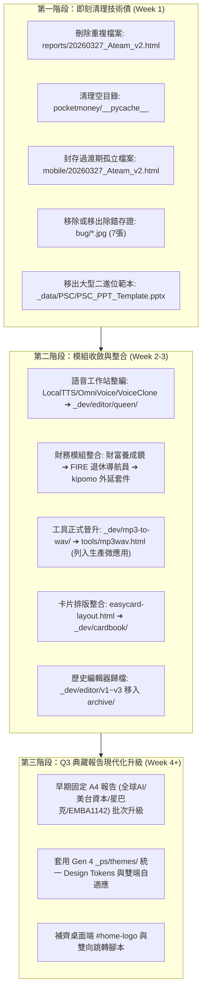

# KLIO 全站資產分類與四象限戰略評估報告 (價值 vs 喜好)

> **評估基準日**：2026-11-05  
> **評估範圍**：全站 163 項實體資產（應用程式類 88 項 + 資訊與文章報告類 75 項）  
> **關聯互動式儀表板**：[`evaluation_quadrant.html`](file:///c:/Dev/wiskinglin.github.io/evaluation_quadrant.html)  
> **全站盤點總綱**：[`wiskingio.md`](file:///c:/Dev/wiskinglin.github.io/wiskingio.md)  

---

## 執行摘要與四象限總覽

本評估依據全站深度盤點報告（`wiskingio.md`），以 **「X 軸：價值 (Value) 1~10 分」** 與 **「Y 軸：喜好 (Preference) 1~10 分」** 為雙核心維度，對全站資產進行全面分類與生命週期去留決策評估：
- **價值 (Value)**：實用性、技術深度、長期生產力、資產複用性、知識長尾與架構嚴謹度。
- **喜好 (Preference)**：個人熱情、互動趣味、審美排版、情感共鳴與極客浪漫感。

### 象限分佈與決策方針統計

| 象限代號 | 象限屬性 | 資產總數 | 佔比 (%) | 應用程式類 | 資訊類 (報告) | 核心去留方針 |
| :--- | :--- | :---: | :---: | :---: | :---: | :--- |
| **Q1** | **高價值・高喜好** | **104 項** | **63.8%** | 59 款 | 45 篇 | **【核心旗艦・主力保留維護】**：全站靈魂，常態置頂展示與持續迭代。 |
| **Q2** | **低價值・高喜好** | **21 項** | **12.9%** | 17 款 | 4 篇 | **【趣味探索・微型展示收藏】**：極客浪漫與童趣解壓，保持免維護靜態展示。 |
| **Q3** | **高價值・低喜好** | **21 項** | **12.9%** | 2 款 | 19 篇 | **【實用基建・自動化/靜態典藏】**：硬核基建與扎實知識，維持索引，排定批次 RWD 升級。 |
| **Q4** | **低價值・低喜好** | **17 項** | **10.4%** | 10 款 | 7 篇 | **【冗餘技術債・批次封存/清理】**：歷史過渡版本、過期爬蟲、重複冗餘檔案，安全封存下線。 |
| **合計** | **全站總評估資產** | **163 項** | **100%** | **88 款** | **75 篇** | **全站保留/維護率達 76.7% (125 項)** |

---

## 第一部分：應用程式類 (Apps / Tools / Games / Prototypes)

全站共收錄 **88 款** 實體 Web 應用與原型，涵蓋生產級微應用、大型獨立子系統、前沿研發實驗室資產與原型池：

### 一、五大分類小組與架構特徵
1. **生產級實用微應用矩陣 (`tools/` 12 款)**：
   - 堅定落實 **Browser-Native / Local-First** 運算哲學，數據不出瀏覽器，支援 PWA 獨立視窗安裝與離線運作。
   - 涵蓋：OrionX 硬體檢測、KIPOMO 現金流、RMBG WebGPU AI 去背、Sakura P2P 聊天室、本地 PDF 編輯器、Sky Fly 飛行遊戲、證件照拍攝器、KLIO COLOR 調色盤、CALCUKLIO 計算機、螢幕檢測儀、行為經濟學閱讀器、Finte 捷徑。
2. **獨立大型 Web 應用 (2 款)**：
   - `summerpark/`（柯基養成公園 PWA）：純原生 ES Modules 無構建架構，單向資料流，Web Audio 程式化合成音效，離線補償，可選 Cloudflare Workers + D1 邊緣雲端存檔。
   - `app/SalaryAnalysis/`（上市櫃薪資數據常態分佈分析）：結合 Python 統計科學流水線（`pandas`, `scipy.stats`）與深色玻璃擬態雙視圖儀表板。
3. **研發實驗室核心資產 (18 款)**：
   - `_dev/cardbook/`：CardGen / CardInspector 核心卡片知識庫與裁切驗證管線。
   - `_dev/editor/`：iTW 獨立文件格式多世代演進鏈（v1~v5 與 Queen 語音編輯器）。
   - `_dev/threejs/`：9 款純原生 Three.js 3D 模擬（馬達能量流、太陽系天體軌道、第一人稱美術館、萬點空間矩陣等）。
   - `_dev/flipclock/` & `_dev/mp3-to-wav/`：擬物翻頁時鐘與純本機音訊轉碼器。
4. **設計系統互動工具 (2 款)**：
   - `_ps/theme-switcher-demo.html`：全站 50 款 CSS Design Tokens 即時動態切換台。
   - `_ps/top50/`：粒子連線圖鑑主頁與 54 款單頁互動原型。
5. **研發實驗室原型池 (`_dev/ideas/app/` 54 款)**：
   - 跨越塔防、賽博競速、量化沙盒、語音克隆、本地瀑布流相簿到垂直檢修工具。

### 二、應用程式類四象限評估明細摘要

#### 1. Q1 核心旗艦 (高價值・高喜好，59 款)
- **旗艦生產代表**：
  - **OrionX 硬體檢測平台** (價值 10.0 / 喜好 9.5) — 全站指標旗艦，整合 8 大硬體測試、PRD 與 Playwright 自動化測試，持續主力維護。
  - **KIPOMO 現金流盤點** (價值 9.5 / 喜好 9.0) — 日常剛需記帳與 30 號扣款防斷鏈系統，LocalStorage 本地化極致流暢，主力日常維護。
  - **RMBG WebGPU 本地 AI 去背** (價值 9.5 / 喜好 9.2) — 端側 AI 推論標竿，零伺服器成本與隱私 100%，旗艦技術展示。
  - **Sakura WebRTC P2P 聊天室** (價值 8.5 / 8.8) — 零伺服器信令 (URL Hash)，櫻花粒子美學與極客端對端加密通訊結合典範。
  - **Summer Park 柯基養成公園** (價值 9.0 / 9.8) — 活頁紙藝美學、純代碼合成音效、實時天氣與邊緣雲同步，全站頂級互動藝術瑰寶。
  - **上市櫃薪資常態分佈儀表板** (價值 9.2 / 8.8) — 跨 7 年完整真實財報數據科學分析，Python 統計分箱與理論曲線，專業權威度極高。
- **研發基建代表**：
  - `_dev/cardbook/` 卡片系統 (9.5 / 9.0)、`_dev/editor/queen/` 語音編輯器 (8.5 / 8.5)、`_dev/editor/v5` 區塊編輯器 (8.5 / 8.0)、`_dev/threejs/` 電動車馬達能量流 (8.5 / 8.8)、第一人稱美術館 (7.8 / 8.6)、萬點柱狀數據矩陣 (8.0 / 7.8)、`_ps/top50/` 風格圖鑑 (9.2 / 9.3)。
- **優秀原型代表**：
  - TurboGrid 試算表 (8.5 / 7.8)、FIRE 退休導航員 (8.2 / 8.2)、QuantPulse 量化沙盒 (8.2 / 8.0)、優勢策略分析器 (7.8 / 7.5)、本地瀑布流相簿 (7.0 / 7.0)、Wan Studio 影片工作站 (7.5 / 7.8)。

#### 2. Q2 趣味探索 (低價值・高喜好，17 款)
- **代表作品**：
  - **Sky Fly 空戰遊戲** (5.0 / 8.5) — 原生 Canvas 60FPS 與 Web Audio 純代碼音效，支援手把，極佳的放鬆娛樂與展示作。
  - **PokeSim 寶可夢抽卡模擬器** (4.5 / 8.5) — PTCG 撕卡包與稀有卡閃爍特效模擬，極高解壓童趣。
  - **Neon 霓虹系列** (Apex 4.8 / 8.5, 塔防 5.0 / 8.8, 競速 4.5 / 8.2) — 復古賽博光影打磨極致。
  - **皮克敏工作小隊** (4.8 / 8.2)、**破壞大師物理版** (4.0 / 7.5)、**江戶前壽司職人風味圖鑑** (4.8 / 8.0)。
- **去留策略**：保持原樣，作為站點放鬆展示專區，不額外投入工程維護。

#### 3. Q3 實用基建 (高價值・低喜好，2 款)
- **全螢幕壞點檢測儀** (6.0 / 5.0) — 單色灰階驗機工具，與 OrionX 螢幕模組部分重疊，保留為單鍵秒開輕量獨立工具。
- **本地 MP3 轉 WAV 音訊工具** (7.5 / 5.0) — Web Audio 原生解碼與封包手寫，高實用純本機轉碼，建議正式納入 `tools/`。

#### 4. Q4 冗餘技術債 (低價值・低喜好，10 款)
- **待封存/清理項目**：
  - **Finte 財務捷徑頁** (3.0 / 4.0) — 僅 1.8KB 的轉跳外殼，為多餘路由層，建議直接引流至 kipomo 並安全清理。
  - **iTW Editor v1~v3** (4.0~5.0 / 4.5~5.0) — 摸索期的過渡產物，已被 v4/v5 完全超越，建議移入歷史封存。
  - **沙盒內已畢業原型**：`Sakura Chat` 原型、`證件照` 原型、`PulseHardware` 原型，建議封存歸檔。
  - **誤置於 app 目錄的 4 份靜態規格文檔**（AI 賦能、內容深度、功能優化、UXUI 範本），非互動程式，移出整理。

---

## 第二部分：資訊類 (文章報告 / 知識庫 / 書籤 / 文檔)

全站共收錄 **75 筆** 資訊與知識資產，包含 56 篇產業深度報告、3 大主題策展書籤、8 篇產品白皮書、7 組知識中樞與 1 案例研究：

### 一、排版設計四大世代演進剖析
全站深度報告展現了嚴謹的工程與設計演進歷程：
1. **Gen 1 (2026/03) A4 橫式簡報型**：固定 `297mm x 210mm`、依賴運行時 CDN Tailwind，手機窄屏產生橫向溢出。
2. **Gen 2 (2026/04) 直式長滾動排版**：突破 A4 限制，改為直式長網頁，導入 Google Fonts，但早期行動版有較多 inline styles。
3. **Gen 3 (2026/06) 暗黑科技與代碼淨化**：轉向 `#05070a` 極致暗黑背景與 Liquid Glass 毛玻璃擬態，行動版 inline styles 驟降至 0。
4. **Gen 4 (2026/07-08) 50 款 Design Tokens 模組化成熟期**：徹底淘汰內嵌樣式，全面引進外部統一靜態核心 `_base.css` 與 50 款專屬主題（如 `10-data-dense.css`, `02-swiss-style.css`, `17-adaptive-dark.css` 等），雙端無縫自動跳轉，達到全站品質巔峰。

### 二、資訊類四象限評估明細摘要

#### 1. Q1 經典長青 (高價值・高喜好，45 篇)
- **AI 與代理巔峰篇章**：
  - **《迴圈工程 (Loop Engineering) 的興起》** (價值 9.5 / 喜好 9.0) — 全站自動化流水線之靈魂思想，宣告提示詞工程退場、自主閉環興起。
  - **《2026 龍蝦、AI 代理與新青安》** (價值 9.2 / 9.2) — 全站思想深度巔峰之作，跨界結合金融、房市與代理人陷阱之批判；翠綠高對比排版。
  - **《Anthropic Fable 5 下架風波與全球主權 AI 變局》** (9.2 / 8.8) — 地緣政治與數位主權戰略研判，行動版 0 inline-style 標竿。
  - **《小國 AI 主權避險策略與微型獨角獸崛起》** (9.1 / 8.6) — 融合陶韻智「路徑依賴避險」之戰略智庫篇章。
  - **《18組AI生圖提示詞收藏！日系海報、拼貼、九宮格》** (8.8 / 9.6) — 18 組實測提示詞圖鑑，一鍵複製與 10-data-dense.css 排版。
- **商業個案與賽局代表**：
  - **《【一人公司的終極型態】深度拆解 Designjoy》** (8.9 / 9.3) — 年收百萬美金一人訂閱制設計公司商業拆解，黑紅白高對比極簡。
  - **《純策略與混合策略推論 | 賽局理論》** (8.5 / 7.8) — 納許均衡嚴謹推導與商業定價應用。
  - **《豐藝電子 (6189) & 勁豐電子 (6577) 雙軌協同深度分析》** (9.2 / 7.8) — 券商機構級基本面報告。
  - **《Cloudflare 邊緣運算與分佈式存儲架構》** (9.0 / 7.2) — 與本站技術棧高度呼應之分散式架構解析。
- **職場心智與人文沉思**：
  - **《AI 時代的領導羅盤：從團隊分工到投資哲學》** (9.5 / 9.6) — 全站 10-data-dense.css 標竿滿分之作。
  - **《中年轉型最難的，是放不下太合身的「舊角色」》** (8.9 / 9.2) — 深刻人文生命反思，深墨綠沉浸色調。
  - **《黃仁勳震撼教育 3 堂課：這樣用 AI「太可惜」》** (8.5 / 9.0) — Editorial 雜誌排版風格。
- **策展書籤與知識庫 SSOT**：
  - **Design First. 頂級數位設計工作室策展庫 (106筆)** (9.0 / 9.8) — 瑞士極簡藝廊風格，審美極致。
  - **Tech ROCKS!!! 旗艦硬體與 AI 武器庫 (76筆)** (9.2 / 9.3) — 太空站 HUD 終端風格。
  - **瀏覽器原生 AI 白皮書 (Klio_02)** (9.8 / 9.0) — 全站技術底層聖經。
  - **個人核心筆記庫 (note.md SSOT)** (9.8 / 8.6) — 123KB 深度筆記庫，發布時嚴格 Git 分支隔離。

#### 2. Q2 個人隨筆 (低價值・高喜好，4 篇)
- **ACG Universe 頂尖動漫遊戲策展庫 (101筆)** (5.8 / 9.5) — 12 欄日漫分鏡網格與速度線，個人熱情巔峰作。
- **動漫角色設定由 AI 生成圖片應用分析** (5.8 / 7.8) — 個人偏好之動漫 Prompt 實戰。
- **2026 信用卡陣容與富士山自駕企劃** (5.8 / 7.0) — 私人自駕旅遊攻略，排版細緻。
- **chats.md 思維火花草稿** (5.5 / 6.5) — 非結構化對話紀錄與靈感片段。

#### 3. Q3 參考典藏 (高價值・低喜好，19 篇)
- **扎實內容但受限於早期固定 A4 排版**：
  - 《全球人工智慧應用擴展：2023-2026》(7.5 / 5.2)、《頂尖產品團隊協作矩陣 Ateam_JD》(8.8 / 5.0)、《星巴克賽局理論》(8.0 / 5.5)、《可口可樂百事博弈》(8.2 / 5.4)、《台美資本市場十年沙盤》(8.6 / 5.5)、《非理性效應：投資行為》(8.2 / 5.5)、《台灣汽車五十年演進》(7.6 / 5.0)、《台科大 EMBA 1142 策略手冊》(8.8 / 5.8)。
- **高價值底層規範與知識庫**：
  - ITW 格式標準 (9.0 / 5.5)、ITW AI 協同引擎 (8.8 / 5.5)、25 大主題結構化書籤庫 `web_collect/` (8.8 / 5.2)、架構分析文件群 `analysis/` (9.0 / 5.5)、台科大 EMBA 決策樹 (8.2 / 5.2)。
- **去留策略**：內容皆為紮實資產，建議保持被動典藏，後續排程透過 `ContentEditor` 與 `reports` skill 批次升級為 Gen 4 響應式主題。

#### 4. Q4 時效清理 (低價值・低喜好，7 篇)
- **待清理/封存項目**：
  - **`reports/20260327_Ateam_v2.html`** (3.5 / 3.0) — 與 `Ateam_JD` 內容 99% 重複之冗餘檔案，建議安全刪除。
  - **`reports/20260326_2026.html`** (6.5 / 4.8) — 早期流量趨勢短篇，時效已過且缺乏導覽。
  - **`_klio_docs/klio_03_April_Summary.md`** (4.5 / 4.2) — 4 月階段手記，已融入版本日誌，可歸檔。
  - **`_klio_docs/bookmark_redesign_proposal.md`** (5.0 / 4.8) — 書籤已 100% 落地，轉歷史備查。
  - **`_data/scrape_contents/`** (3.5 / 2.8) — 2026/04~06 過期爬蟲存檔，建議壓縮冷存檔或清理。
  - **`_data/PSC/PSC_PPT_Template.pptx`** (4.0 / 3.5) — 1.26MB 二進位簡報檔，建議移至外部存檔。
  - **`_cases/Anime.js` 案例快照** (5.2 / 4.0) — 第三方官網離線庫存，全站未引用且已加入 `.gitignore`。

---

## 第三部分：全站四象限戰略行動綱領 (Actionable Roadmap)

---

## 結語與成果交付

本次評估已完成對 KLIO 全站 **163 項資產** 的穿透式分析，並已將全部數據編譯成可直接互動的專屬評估儀表板：
👉 **請在瀏覽器中開啟查看**：[**`evaluation_quadrant.html`**](file:///c:/Dev/wiskinglin.github.io/evaluation_quadrant.html)
- 具備 **Canvas 動態四象限散佈圖**（坐標 1~10 分，滑鼠懸停顯示氣泡卡片，點擊直達明細）。
- 提供 **大類別 Tab 切換**（全部 163 項 / 應用程式 88 款 / 資訊類 75 篇）。
- 支援 **象限 (Q1~Q4) 與去留決策 (保留/合併/精簡/封存) 二級篩選器** 與 **即時全文檢索**。
- 提供完整響應式卡片清單與指標數據即時連動。

