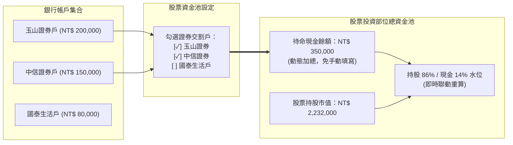
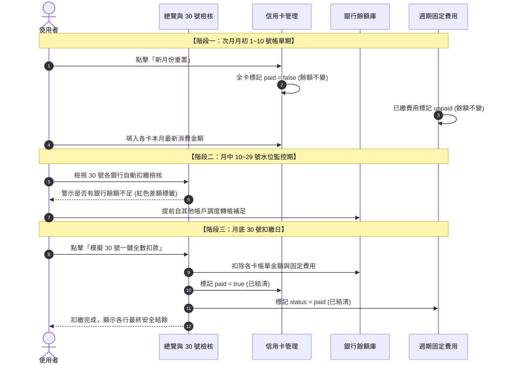

# PocketFlow 後續功能開發計畫與架構設計書 (Development Plan)

---

## 一、文件概述
- **文件版本**：v1.0.0
- **建立日期**：2026-10-27
- **目標系統**：PocketFlow (`tools/finte.html`)
- **相關文件**：[`SDD.md`](file:///c:/Playground26/wiskinglin.github.io/_dev/PocketFlow/SDD.md)、[`README.md`](file:///c:/Playground26/wiskinglin.github.io/_dev/PocketFlow/README.md)
- **狀態**：規劃審查中 (Pending Approval)

---

## 二、需求理解與架構設計方案

### 項目 1：固定費用總計 (Recurring Bills KPI)

#### 1.1 現狀分析與問題痛點
目前在「固定費用 (`tab-bills`)」頁籤中，僅有新增按鈕與個別費用卡片清單（水電、瓦斯、房租、網路等），缺少像分期付款或股票部位那樣的**頂部彙整統計指標 (KPI Cards)**。
這導致使用者在檢視固定開銷時：
- 無法一眼看出**「本月待繳固定費用總計」**是多少（此數值直接影響 30 號銀行扣款水位）。
- 無法評估**「每月維持生活的常態底線開銷」**是多少（例如雙月繳水電與季繳年繳費用，缺乏月度攤提視角）。

#### 1.2 建議設計架構
在 `tab-bills` 頂部新增三大統計指標卡片網格（採用與分期頁面相容之 `grid grid-cols-1 md:grid-cols-3 fluid-gap`）：

1. **指標卡 1：本期待繳固定總額 (當月現金流扣款衝擊)**
   - **計算邏輯**：
     $$UnpaidBillsTotal = \sum_{b \in Bills, b.status = 'unpaid'} b.amount$$
   - **視覺樣式**：深色背景搭配高對比凸顯金額（如 `emerald-500` 或 `indigo-600` 漸層），下方標註「自動計入指定銀行 30 號扣繳檢核」。
2. **指標卡 2：常態每月平均固定開銷 (真實生活成本)**
   - **計算邏輯**：依繳費週期折算每月平均現金流支出：
     $$MonthlyBaseCost = \sum_{b \in Bills} \left( \begin{cases} b.amount & \text{每月固定} \\ b.amount / 2 & \text{雙月帳單} \\ b.amount / 3 & \text{季繳} \\ b.amount / 12 & \text{年繳} \end{cases} \right)$$
   - **功能價值**：即使本月剛好雙月水電免繳 (`skipped`)，也能精準掌握個人每月基本生存開銷。
3. **指標卡 3：項目狀態分佈與批次操作**
   - **呈現資訊**：待繳 $X$ 筆、已繳 $Y$ 筆、免繳 $Z$ 筆。
   - **輔助功能**：提供快捷按鈕「批次切換雙月項目為免繳/待繳」。

---

### 項目 2：投資部位待命現金連結銀行證券戶餘額

#### 2.1 現狀分析與問題痛點
目前在「股票投資部位 (`tab-stocks`)」中，待命現金是由使用者在介面手動輸入一個常數：
`state.settings.stockCashPool = 450000`。
這種設計造成資料割裂：
- 使用者在「銀行與卡費 (`tab-cards`)」中已經維護了各個銀行帳戶（例如：玉山證券、中信證券、富邦證券等）。
- 當證券戶存款增加或買賣交割扣款時，使用者必須手動到股票分頁改寫一次 `stockCashPool`，容易忘記同步，導致持股比例（如 83% 持股 / 17% 現金）失真。

#### 2.2 建議設計架構 (雙向動態關聯)
如同信用卡透過 `bankId` 連結銀行、分期透過 `cardId` 連結信用卡，**投資部位的現金池應直接連結至指定的銀行帳戶**：



- **資料模型變更**：
  在 `state.settings` 中新增：
  `securitiesBankIds: string[]`（預設包含名稱中含「證券」的銀行 ID，例如 `['bank_esun_sec', 'bank_ctbc_sec', 'bank_fubon']`）。
  同時在 `loadState()` 實施相容遷移：若找不到此欄位，自動根據銀行名稱比對預設勾選。
- **計算公式更新 (`computeFinancialMetrics`)**：
  $$StockCashPool = \sum_{b \in Banks, securitiesBankIds.includes(b.id)} b.balance$$
  $$StockTotalPool = StockMarketValue + StockCashPool$$
- **介面調整**：
  「股市待命現金池設定」卡片中，將原本的數字文字輸入框改為**「勾選證券交割帳戶」**多選下拉或 Checkbox 清單，即時呈現勾選後的即時加總金額。
- **效益**：
  使用者在銀行帳戶中修改證券戶餘額時，股票水位百分比**立即自動聯動更新**，完全消除手動維護成本。

---

### 項目 3：備份匯出檔案名稱加入 `YYYYMMDD_HHmmss` 時間戳記

#### 3.1 現狀分析與問題痛點
目前系統匯出檔案僅取日期前 10 碼：
`new Date().toISOString().slice(0, 10)`（僅有 `YYYY-MM-DD`）。
如果使用者在同一天執行多次操作（例如早上調整預算、下午扣款記帳），每次下載的檔名完全一致：
- 瀏覽器會自動重新命名為 `PocketFlow_備份_2026-10-27 (1).json`，導致無法一眼辨認備份先後順序。
- 此外，`toISOString()` 採用 UTC 標準時，在台灣時區（UTC+8）跨午夜時會產生日期落差。

#### 3.2 建議設計架構
建立全域共用的台灣本地時間戳記生成器：

```javascript
function getExportTimestamp() {
  const d = new Date();
  const pad = n => String(n).padStart(2, '0');
  const yyyy = d.getFullYear();
  const mm = pad(d.getMonth() + 1);
  const dd = pad(d.getDate());
  const hh = pad(d.getHours());
  const min = pad(d.getMinutes());
  const ss = pad(d.getSeconds());
  return `${yyyy}${mm}${dd}_${hh}${min}${ss}`;
}
```

- **匯出檔名格式標準化**：
  1. Excel CSV 報表：`PocketFlow_財務報表_20261027_134530.csv`
  2. JSON 資料庫備份：`PocketFlow_備份_20261027_134530.json`
  3. 單機版離線 HTML：`PocketFlow_單機版_20261027_134530.html`

---

### 項目 4：深入說明「新月份重置」與「模擬 30 號一鍵全數扣款」的底層邏輯

這兩個按鈕是 PocketFlow 控制**「月度循環現金流」**的核心開關，使用者常混淆它們對**「銀行真實餘額」**的影響，以下為完整的邏輯解析：

#### 4.1 「模擬 30 號一鍵全數扣款 (`settleAllPendingBills()`)」
- **業務意涵**：
  在每月 30 號（銀行自動扣繳日）當天執行，或在月底前讓使用者進行「扣繳模擬試算」，檢視所有帳單全數扣款完畢後，各銀行究竟還剩下多少可支配餘額。
- **程式底層執行動作**：
  ```javascript
  // 1. 遍歷每家銀行
  state.banks.forEach(bank => {
    // 2. 扣除並結清綁定該銀行的「未繳信用卡」
    state.cards.forEach(c => {
      if (c.bankId === bank.id && !c.paid) {
        bank.balance -= Number(c.statementTotal) || 0;
        c.paid = true; // 狀態轉為已繳清
      }
    });
    // 3. 扣除並結清綁定該銀行的「待繳固定費用 (水電/房租)」
    state.bills.forEach(b => {
      if (b.bankId === bank.id && b.status === 'unpaid') {
        bank.balance -= Number(b.amount) || 0;
        b.status = 'paid'; // 狀態轉為已繳
      }
    });
  });
  ```
- **核心影響**：
  - **銀行餘額會被真實扣除**（`bank.balance` 減少）。
  - 所有信用卡變成「已繳清」、所有費用變成「已繳」。
  - 總覽頁面的「本月待扣款總結」降為 `NT$ 0`，差額警示解除。

---

#### 4.2 「新月份重置 (`resetAllCardsNewMonth()`)」
- **業務意涵**：
  上個月底所有款項都扣繳完成後，進入**次月 1 號 ~ 10 號**（各銀行結帳單陸續寄達）。此時使用者需要開始監控「新月份的新帳單」，必須將所有項目的狀態撥回「待繳」。
- **程式底層執行動作**：
  ```javascript
  // 1. 將所有信用卡設為未繳
  state.cards.forEach(c => { c.paid = false; });
  // 2. 將原本已繳的固定費用設為待繳（原本為免繳 skipped 的保持不變）
  state.bills.forEach(b => { if (b.status === 'paid') b.status = 'unpaid'; });
  ```
- **核心影響**：
  - **重要特性：絕不變動任何銀行的存款餘額！**
  - 它僅僅是將系統從「上月已結清」狀態重置回「新月份待繳檢核」狀態。
  - 重置後，使用者便可在各張信用卡輸入新一期的帳單金額，系統將重新歸戶至指定扣款銀行，展開新一輪的 30 號水位安全檢查。

---

#### 4.3 兩者在月度循環中的完整生命週期



---

## 三、實作階段成果驗收 (Roadmap & Completion)

本規劃所提之所有功能已全數實作完成並通過驗證：

- **Stage 1 [Complete]**：實作共用時間戳記函式 `getExportTimestamp()`，升級 CSV、JSON 與 HTML 打包匯出檔名包含 `YYYYMMDD_HHmmss`，並在 CSV 總表中補齊固定費用明細。
- **Stage 2 [Complete]**：重構股票資金池資料模型，新增 `securitiesBankIds` 關聯機制，提供 UI 勾選銀行戶，讓待命現金與銀行證券戶餘額動態自動加總，即時同步持倉比例。
- **Stage 3 [Complete]**：於固定費用頁籤建構三大 KPI 彙整卡片（當期 30 號待繳總計、常態每月平均平準化支出、費用狀態筆數與雙月帳單一鍵切換免繳/待繳）。
- **Stage 4 [Complete]**：更新 `tools/finte.html`、`_dev/PocketFlow/SDD.md`、`_dev/PocketFlow/README.md`，同步發布日誌與 Git 部署。
