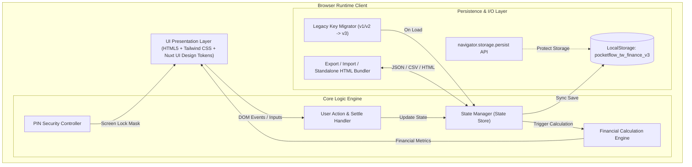
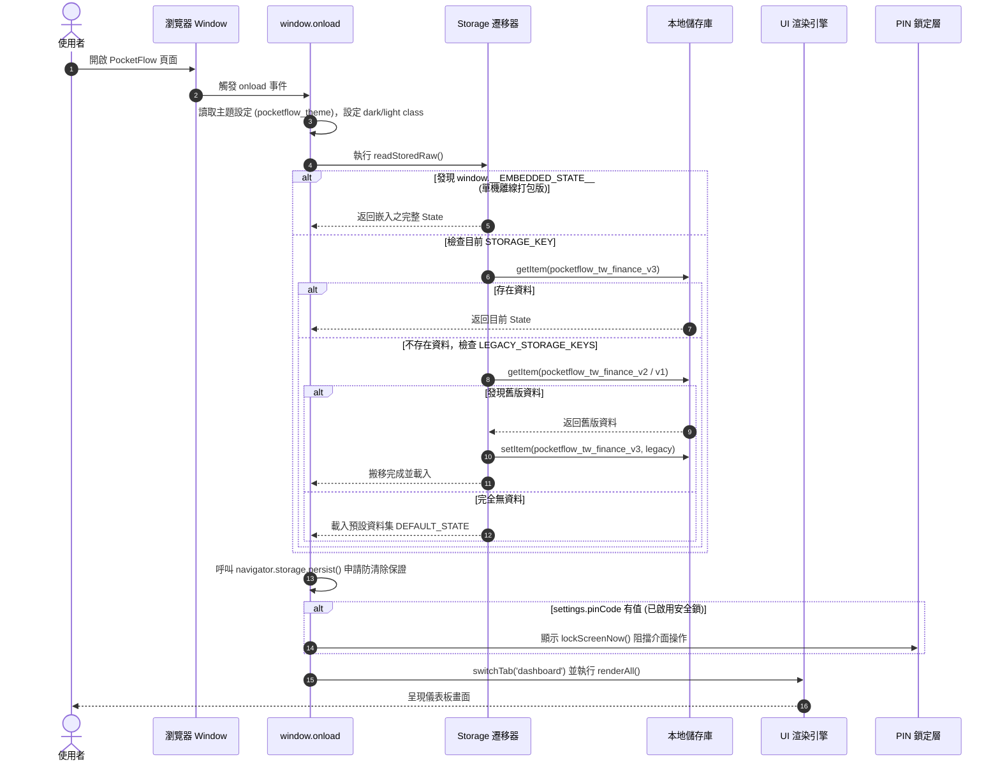
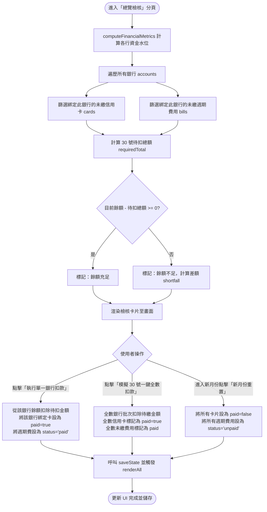
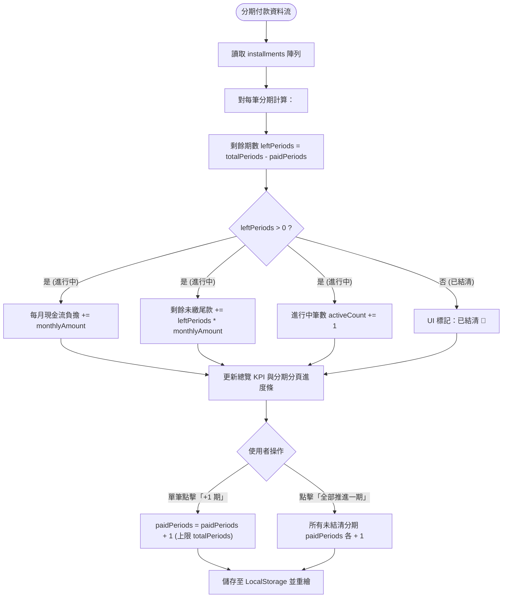
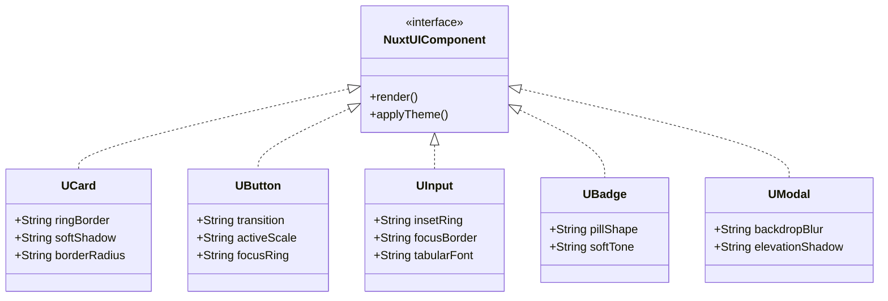
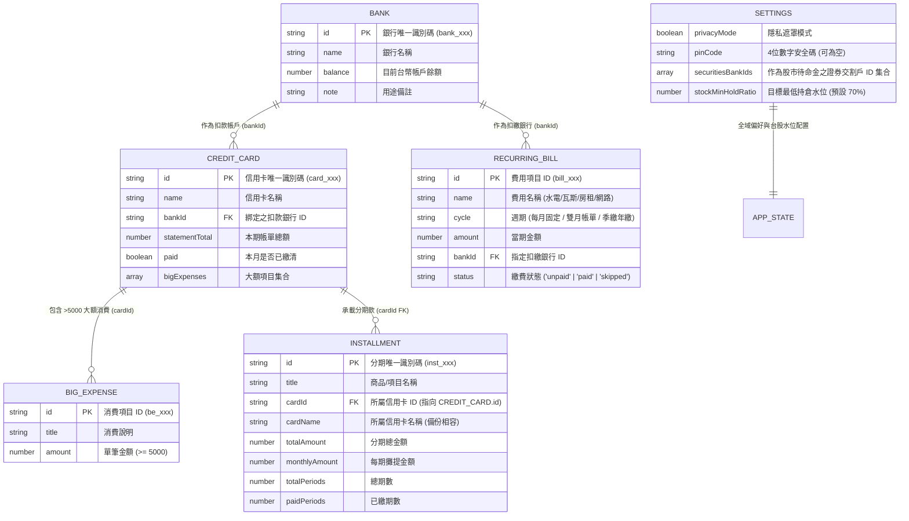

# PocketFlow 系統設計規格書 (Software Design Document, SDD)

---

## 文件資訊
- **軟體名稱**：PocketFlow (個人財務總覽與 30 號扣繳檢核系統)
- **軟體版本**：`0.0.1` (儲存 Schema: `pocketflow_tw_finance_v3`)
- **檔案路徑**：[`tools/finte.html`](file:///c:/Playground26/wiskinglin.github.io/tools/finte.html)
- **文件狀態**：正式版本 (Active)
- **適用對象**：前端工程師、系統架構師、UI/UX 設計師、測試工程師

---

## 1. 系統架構與設計概述 (System Overview & Architecture)

### 1.1 系統定位與核心理念
PocketFlow 是一套專為個人財務設計的**無伺服器單頁應用程式 (Serverless Local-First SPA)**。其核心價值在於解決多帳戶、多信用卡與多筆分期付款時，月底扣繳可能面臨的資金斷鏈風險。
系統奉行三大核心原則：
1. **抓大放小 (Focus on Significant Expenses)**：不浪費精力記錄瑣碎流水帳，專注於各卡本期總額與單筆超過 NT$ 5,000 的大額消費。
2. **月底扣繳水位檢核 (Liquidity Checkup on 30th)**：以每月 10 號收單、30 號銀行自動扣繳為週期基準，自動歸戶並檢核各扣款銀行的資產水位。
3. **本地優先與絕對隱私 (Local-First & Absolute Privacy)**：100% 運行於使用者瀏覽器本地端，無後端伺服器依賴，支援 4 位數 PIN 碼、離線單機版封裝與 CSV/JSON 遷移。

### 1.2 系統架構圖 (Architecture Diagram)



---

## 2. 軟體流程圖 (Software Flowcharts)

### 2.1 系統啟動與初始化流程 (Application Initialization Flow)



### 2.2 每月 30 號自動扣繳檢核與一鍵結清流程 (Billing & Settlement Flow)



### 2.3 分期付款推展與計算邏輯流程 (Installment Progression Flow)



---

## 3. UI 設計規範 (Design Tokens & UI Standards)

PocketFlow 嚴格依循 **Nord 主題配色** 與 **Nuxt UI v3 元件層哲學**，採用純 Vanilla CSS + Tailwind CSS 實作，摒棄重量級前端框架，確保極速載入與流暢動態體驗。

### 3.1 色彩系統 (Color Palette - Nord Theme Inspired)

| 顏色語義 | 變數 / Tailwind 類別 | Hex 色值 | 應用場景 |
| :--- | :--- | :--- | :--- |
| **Primary (主色)** | `indigo-500` / `--ui-primary` | `#81A1C1` (Nord Frost) | 主按鈕、Active 分頁標籤、進度條前景色、聚焦外框 (Focus Ring) |
| **Primary Dark** | `indigo-600` | `#5F83A8` | 按鈕 Hover、漸層起點 |
| **Primary Deep** | `indigo-700` | `#4C6A8C` | 深色按鈕與邊界強調 |
| **Neutral 50** | `slate-50` | `#ECEFF4` (Nord Snow Storm) | 淺色模式背景小區塊 |
| **Neutral 100** | `slate-100` | `#E5E9F0` | 淺色模式主背景、淺色輸入框背景 |
| **Neutral 200** | `slate-200` / `--ui-ring` | `#D8DEE9` | 淺色邊框線、分割線 |
| **Neutral 600** | `slate-600` | `#4C566A` (Nord Polar Night) | 次要文字、邊框輔助色 |
| **Neutral 800** | `slate-800` | `#2E3440` | 深色卡片背景、輸入框背景 |
| **Neutral 900** | `slate-900` | `#262B35` | 深色卡片主底色、導覽列背景 |
| **Neutral 950** | `slate-950` | `#1D2129` | 深色模式全域最底層背景 |
| **Danger / Profit** | `rose-500` | `#BF616A` (Nord Aurora Red) | 欠款警示、台股獲利 (台股慣例紅漲)、不足差額 |
| **Success / Loss** | `emerald-500` | `#8FAE78` (Nord Aurora Green)| 扣款成功、餘額充裕、台股虧損 (台股慣例綠跌) |
| **Warning / Cash** | `amber-500` | `#D4A64A` (Nord Aurora Yellow)| 待命現金警示、大額消費 (>5000) 標籤 |

### 3.2 字型排版與流體比例尺度 (Fluid Typography & Spacing)
系統使用 CSS `clamp()` 函式定義響應式流體比例尺，確保手機直式 (320px) 到 4K 寬螢幕 (3840px) 均呈現完美視覺層級，無需頻繁跳轉媒體查詢斷點。

```css
:root {
  --pad-page: clamp(0.75rem, 3.2vw, 1.75rem);   /* 全頁兩側安全間距 */
  --pad-card: clamp(0.875rem, 3.5vw, 1.35rem);   /* 卡片內邊距 */
  --gap-grid: clamp(0.75rem, 2.8vw, 1.25rem);   /* 網格間隙 */
  --fs-hero: clamp(1.45rem, 5.8vw, 2.1rem);     /* 核心 KPI 數字 */
  --fs-h2: clamp(1.02rem, 3.8vw, 1.25rem);      /* 區塊二級標題 */
  --fs-h3: clamp(0.92rem, 3.4vw, 1.08rem);      /* 卡片標題 */
  --fs-body: clamp(0.78rem, 2.9vw, 0.875rem);   /* 正文 */
  --fs-sub: clamp(0.7rem, 2.5vw, 0.78rem);      /* 附屬資訊、徽章 */
}
```

### 3.3 數值對齊與防折行規範 (Numeric Alignment & Tabular Layout)
- **`num-nowrap` 規範**：所有金額數值、狀態徽章與比例百分比，強制賦予 `white-space: nowrap !important`。
- **等寬數字字型 (`tabular-nums`)**：使用 `font-variant-numeric: tabular-nums`，搭配字元間距微調 `letter-spacing: -0.02em`，確保金融數字在動態遞增時不會產生視覺抖動。
- **手機排版抗擠壓**：卡片資訊一律採用「左標籤、右數值」之單行 Flex 雙端對齊清單結構，禁止在寬度低於 360px 之窄螢幕強行切割為 3 欄而導致數值換行。

### 3.4 Nuxt UI 風格元件層實作規範



#### 元件層樣式細部定義表

| 元件名稱 | CSS 特性與類別 | 設計參數與數值 | 目的與使用者體驗 |
| :--- | :--- | :--- | :--- |
| **`UCard`** | `fluid-card`, `box-shadow` | `0 0 0 1px var(--ui-ring)`, `rounded-xl (0.75rem)` | 摒棄傳統厚重陰影，以 1px 極細邊框創造高級純淨層次感 |
| **`UButton`** | `transition`, `:active` | `transition: 0.15s ease`, `:active { transform: scale(0.98); }` | 按壓回饋微動效，聚焦時提供 2px primary 外框 |
| **`UInput`** | `box-shadow: inset` | `inset 0 0 0 1px var(--ui-ring)`, Focus 時切換為 `--ui-primary` | 去除預設邊框，改用內陰影外框，提升焦點輸入精緻度 |
| **`UBadge`** | `rounded-full`, `px-2 py-0.5` | `font-weight: 600`, 降低飽和度背景配高對比文字 | 柔和狀態識別標籤 (Soft Badge) |
| **`UModal`** | `backdrop-blur-sm`, `shadow-2xl` | `bg-slate-950/75`, `0 20px 40px -12px rgba(46,52,64,0.4)` | 深度毛玻璃背景遮罩與高階浮動陰影 |

---

## 4. 銀行、信用卡、費用與分期的關聯資料模型與業務邏輯

### 4.1 實體關係圖 (Entity-Relationship Diagram)



### 4.2 核心計算邏輯與數學公式 (Financial Computation Formulae)

#### 1. 各銀行 30 號待扣總額與扣後結餘 (Bank Checkup Formula)
對於每一家銀行 $B_i$：
$$CardsSum(B_i) = \sum_{c \in Cards, c.bankId = B_i.id, c.paid = false} c.statementTotal$$
$$BillsSum(B_i) = \sum_{b \in Bills, b.bankId = B_i.id, b.status = 'unpaid'} b.amount$$
$$RequiredTotal(B_i) = CardsSum(B_i) + BillsSum(B_i)$$
$$AfterBalance(B_i) = B_i.balance - RequiredTotal(B_i)$$
$$IsShortfall(B_i) = AfterBalance(B_i) < 0$$

#### 2. 分期付款現金流分析公式 (Installment Formulae)
對於每一筆分期 $I_k$：
$$LeftPeriods(I_k) = \max(0, I_k.totalPeriods - I_k.paidPeriods)$$
$$MonthlyBurn = \sum_{I_k \in Installments, LeftPeriods(I_k) > 0} I_k.monthlyAmount$$
$$RemainingLiability = \sum_{I_k \in Installments} (LeftPeriods(I_k) \times I_k.monthlyAmount)$$

#### 3. 固定費用分析與平準化支出公式 (Recurring Bills Formulae)
對於生活週期固定費用集合 $Bills$：
$$BillsUnpaidTotal = \sum_{b \in Bills, b.status = 'unpaid'} b.amount$$
$$BillsMonthlyBaseCost = \sum_{b \in Bills} \left( \begin{cases} \mathrm{round}(b.amount / 2) & \text{if cycle = '雙月帳單'} \\ \mathrm{round}(b.amount / 3) & \text{if cycle = '季繳/年繳'} \\ b.amount & \text{otherwise} \end{cases} \right)$$

#### 4. 台股波段水位與帳面損益 (Stock Pool & PnL Formulae)
待命現金餘額由勾選之證券帳戶動態加總計算：
$$StockCashPool = \sum_{B_i \in Banks, B_i.id \in Settings.securitiesBankIds} B_i.balance$$

對於持有持股集合 $Stocks$：
$$MarketVal(S_j) = S_j.shares \times S_j.currentPrice$$
$$CostVal(S_j) = S_j.shares \times S_j.avgCost$$
$$StockMarketValue = \sum MarketVal(S_j)$$
$$StockCostValue = \sum CostVal(S_j)$$
$$StockPnL = StockMarketValue - StockCostValue$$
$$StockPnL\% = \begin{cases} \frac{StockPnL}{StockCostValue} \times 100\% & \text{if } StockCostValue > 0 \\ 0 & \text{otherwise} \end{cases}$$
$$StockTotalPool = StockMarketValue + StockCashPool$$
$$StockHoldRatio = \begin{cases} \mathrm{round}\left(\frac{StockMarketValue}{StockTotalPool} \times 100\right) & \text{if } StockTotalPool > 0 \\ 0 & \text{otherwise} \end{cases}$$
$$StockCashRatio = 100 - StockHoldRatio$$

#### 5. 全局淨資產 (Total Net Worth)
$$TotalAssets = \sum B_i.balance + StockTotalPool$$
$$TotalLiabilities = \sum_{c.paid=false} c.statementTotal + \sum_{b.status='unpaid'} b.amount$$
$$NetWorth = TotalAssets - TotalLiabilities$$

### 4.3 狀態轉換邏輯與交互約束 (State Transition & Constraints)

1. **信用卡結清與復原**：
   - 當信用卡由 `paid=false` 切換至 `paid=true` 時，系統自動自對應扣款銀行餘額扣除 `statementTotal`。
   - 當信用卡由 `paid=true` 逆向切換至 `paid=false` 時，系統回補該銀行餘額，以利誤觸復原。
2. **固定費用狀態流轉**：
   - 狀態機包含三態：`unpaid` (待繳)、`paid` (已繳)、`skipped` (本期免繳，如隔月水電費)。
   - 切換至 `paid` 即時自扣款銀行扣款；切換為非 `paid` 狀態自動回補銀行餘額。
3. **大額消費 (>5,000) 聯動約束**：
   - 新增大額消費時，提供勾選框 `mBigAddTotal`。若勾選，自動將該金額累加至所屬卡片之 `statementTotal`；若取消則僅作備忘明細，不影響總額。
4. **信用卡與分期付款的關聯模型與雙向可視設計 (Installment-Card-Bank Association)**：
   - **外鍵連結**：分期項目透過 `cardId`（外鍵）明確綁定至 `state.cards`，表單以下拉選單取代原本的手動字串輸入，並在選項中標明該信用卡所綁定的扣款銀行。
   - **三級連動關係 (分期 → 信用卡 → 扣款銀行)**：在分期付款清單中，系統透過 `cardId` 自動反查所屬信用卡與該卡綁定的扣款帳戶，在頂部以徽章呈現（例如 `玉山 Unicard` + `玉山薪轉`）。
   - **雙向可視性 (信用卡卡片聚合分期資訊)**：在信用卡卡片檢視時，系統自動統計並顯示綁定於該信用卡的進行中分期筆數與每月固定攤提額度（例如 `含 2 筆分期 (NT$ 8,141/月)`），點擊可直接切換至分期管理檢視明細。
   - **刪除保護與解綁**：當使用者欲刪除尚有分期綁定的信用卡時，系統主動跳出確認警示，刪除後分期項目自動解綁並標記為「已刪除卡片」，防止資料孤島或渲染中斷。
   - **向後相容遷移機制**：`loadState()` 內建修復管線，若舊版資料僅含 `cardName` 字串而無 `cardId`，系統在載入時自動依據名稱進行匹配賦值，確保舊版資料平滑升級。

---

## 5. 工程實作與系統特性 (Engineering & System Features)

### 5.1 本地儲存與多版本無縫遷移 (Storage Migration Pipeline)
為保證使用者在系統升級時資料不丟失，系統採用雙層容錯架構：
1. **多鍵容錯讀取**：
   ```javascript
   const STORAGE_KEY = 'pocketflow_tw_finance_v3';
   const LEGACY_STORAGE_KEYS = ['pocketflow_tw_finance_v2', 'pocketflow_tw_finance_v1'];
   ```
   若最新 key 查無資料，依序探查舊版 key，一旦查獲立即遷回最新 key，並輸出 Console 日誌。
2. **持久化儲存保障**：
   呼叫 `navigator.storage.persist()`，要求瀏覽器禁止因磁碟空間不足而自動回收 LocalStorage。
3. **單機離線打包相容**：
   優先偵測 `window.__EMBEDDED_STATE__`。若存在，直接以此內嵌資料為準，實現單檔無網路獨立運行。

### 5.2 安全防護：本地 4 位數 PIN 碼保護機制
- **安全防護範圍**：阻隔未授權人員瀏覽螢幕畫面。
- **純本地無雜湊外傳**：PIN 碼僅存於本機 LocalStorage，不傳送至任何遠端伺服器。
- **虛擬小鍵盤設計**：系統自帶 0~9 觸控與點擊虛擬鍵盤，避免行動裝置彈出原生輸入法遮蔽視覺介面。
- **隱私遮罩 (Privacy Masking)**：支援一鍵將所有金額遮蔽為 `NT$ ••••••`，適合公眾場合或簡報使用。

### 5.3 離線備份與單機打包引擎 (Portability Engine)

所有匯出檔案檔名均透過 `getExportTimestamp()` 自動加上 `YYYYMMDD_HHmmss` 時間戳記，確保同一天內多次備份匯出不會產生同名覆蓋。

| 匯出/匯入格式 | 檔名命名規範 | 實作機制 | 目的與特性 |
| :--- | :--- | :--- | :--- |
| **Excel 財務總表 (.CSV)** | `PocketFlow_財務報表_YYYYMMDD_HHmmss.csv` | `Blob` + `\uFEFF` (UTF-8 BOM Header) | 解決微軟 Excel 開啟 UTF-8 CSV 中文亂碼問題，支援試算表二次分析，內含銀行、信用卡、分期、股票與固定費用 5 大專題表。 |
| **JSON 完整備份 (.json)** | `PocketFlow_備份_YYYYMMDD_HHmmss.json` | `JSON.stringify(state, null, 2)` | 跨瀏覽器、跨裝置完整備份與無損資料還原。 |
| **單機版 HTML 打包 (.html)** | `PocketFlow_單機版_YYYYMMDD_HHmmss.html` | `document.documentElement.cloneNode(true)` + 注入 `<script>window.__EMBEDDED_STATE__ = ...</script>` | 將系統本體與當前所有財務資料封裝為單一 `.html` 檔案，支援點擊直接離線開啟使用。 |

---

## 6. 模組職責與函式清單 (Module Responsibilities & API Inventory)

| 模組分類 | 函式名稱 | 參數 | 責任與行為說明 |
| :--- | :--- | :--- | :--- |
| **狀態核心** | `loadState()` | 無 | 載入並校驗 LocalStorage 或內嵌 State，平滑相容舊版缺漏之 `cardId` 與 `securitiesBankIds`。 |
| **狀態核心** | `saveState()` | 無 | 將當前 `state` 物件序列化寫入 LocalStorage。 |
| **計算引擎** | `computeFinancialMetrics()` | 無 | 計算全站淨資產、銀行檢核、分期負擔、固定費用平準化與證券戶動態待命金。 |
| **視圖控制器** | `renderAll()` | 無 | 協調呼叫各子模組渲染函式，更新全域徽章與倒數資訊。 |
| **視圖控制器** | `switchTab(tabId)` | `tabId: string` | 切換當前頁籤（dashboard, cards, installments, bills, stocks, settings）。 |
| **銀行扣繳** | `settleSingleBankBills(bankId)` | `bankId: string` | 針對指定單一銀行執行扣繳（扣餘額並標記卡費與固定費用已繳）。 |
| **銀行扣繳** | `settleAllPendingBills()` | 無 | 模擬 30 號全數銀行一鍵批次扣款。 |
| **銀行扣繳** | `resetAllCardsNewMonth()` | 無 | 重置所有卡片與固定費用為未繳，進入下一個月檢核週期。 |
| **固定費用** | `toggleAllBimonthlyBillsStatus()` | 無 | 一鍵切換所有雙月帳單狀態（在「本期免繳」與「待繳」間快速翻轉）。 |
| **分期模組** | `stepInstallment(id, delta)` | `id: string, delta: number` | 調整單筆分期已繳期數（+1 或 -1）。 |
| **分期模組** | `advanceAllInstallmentsOnePeriod()`| 無 | 所有進行中分期批次推進 1 期。 |
| **台股模組** | `toggleSecuritiesBank(bankId)` | `bankId: string` | 切換指定銀行是否納入股市待命現金池加總。 |
| **台股模組** | `updateStockMinRatioConfig()` | 無 | 讀取目標最低持倉水位滑桿並更新儲存。 |
| **台股模組** | `updateStockInline(id, field, val)`| `id, field, val` | 即時內聯更新股票股數、市價或成本均價。 |
| **安全控制** | `enterPinDigit(digit)` | `digit: string` | 處理 PIN 碼輸入，比對滿 4 碼時自動驗證。 |
| **打包匯出** | `getExportTimestamp()` | 無 | 產生 `YYYYMMDD_HHmmss` 精確時間戳記字串。 |
| **打包匯出** | `exportToExcelCSV()` | 無 | 產出含 UTF-8 BOM 之 CSV 報表。 |
| **打包匯出** | `downloadStandaloneHTML()` | 無 | DOM 自複製並注入當前狀態，下載單機 HTML。 |

---

## 7. 測試案例與驗證標準 (Testing & Quality Assurance)

| 測試編號 | 測試項目 | 測試情境與輸入 | 預期輸出結果 |
| :--- | :--- | :--- | :--- |
| **TC-01** | 銀行不足額檢核 | 帳戶餘額 NT$ 10,000，綁定卡費 NT$ 12,000 | 顯示「差 NT$ 2,000」，卡片紅框警示，導覽列出現紅底警告徽章。 |
| **TC-02** | 扣款入帳扣除 | 帳戶餘額 NT$ 20,000，扣繳 NT$ 5,000 | 餘額更新為 NT$ 15,000，卡片標記為「已繳清」，待扣總額降為 0。 |
| **TC-03** | 舊版資料無縫升級 | LocalStorage 僅含 `pocketflow_tw_finance_v2` | 自動遷移至 `v3` Key，資料完整載入，Console 輸出遷移日誌。 |
| **TC-04** | Excel CSV 中文編碼 | 匯出 CSV 並以 Windows Excel 開啟 | 中文文字（銀行名稱、消費項目）無亂碼，數字格式正確對齊。 |
| **TC-05** | PIN 碼阻擋驗證 | 設定 PIN 碼 1234，重新整理頁面 | 全螢幕彈出鎖定遮罩，輸入錯誤代碼提示「PIN 碼錯誤」，輸入 1234 順利解除。 |
| **TC-06** | 單機版離線自閉包 | 執行「下載單機版 HTML」，拔除網路開啟 | 介面正常運作，包含當前所有資料，無需任何外部 CDN 亦可讀取 State。 |

---

## 8. 未來架構演進建議 (Future Architectural Recommendations)
1. **型別系統升級**：若未來將系統重構為 Nuxt 3 / TypeScript 架構，可直接沿用本文件第 4 節定義之實體介面（Interfaces）。
2. **Web Worker 試算**：當分期與歷史帳單達到數萬筆規模時，可將 `computeFinancialMetrics` 移至 Web Worker，避免阻礙主執行緒渲染。
3. **PWA (Progressive Web App)**：加入 `manifest.json` 與 Service Worker，支援手機桌面捷徑安裝與完整無網環境離線快取。
