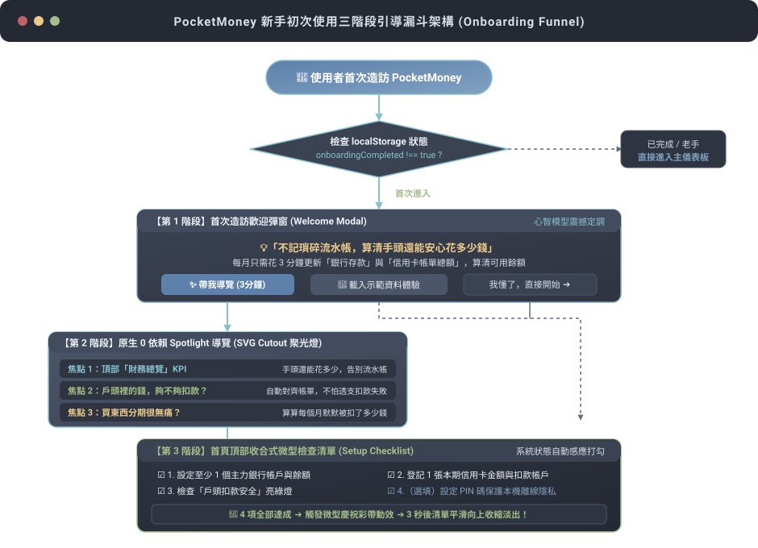
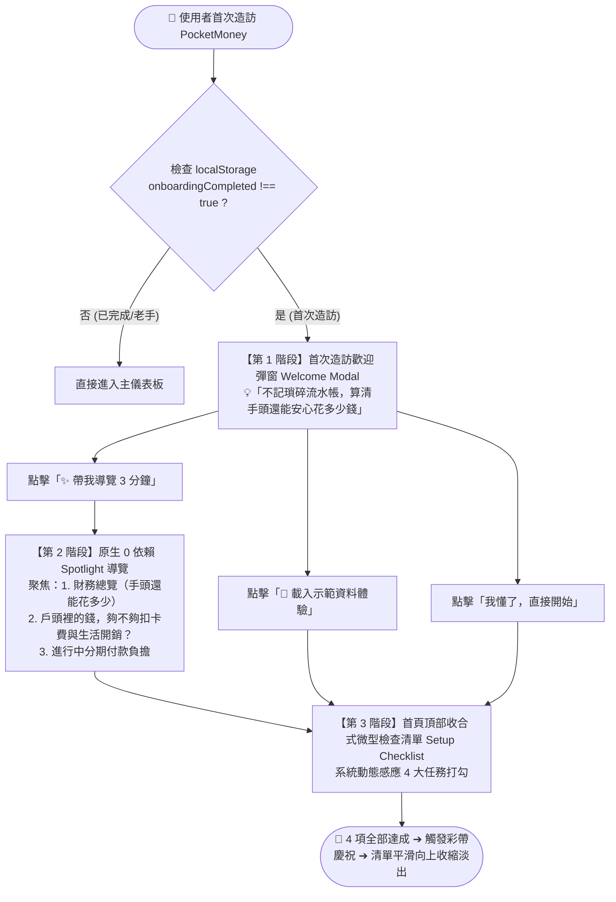
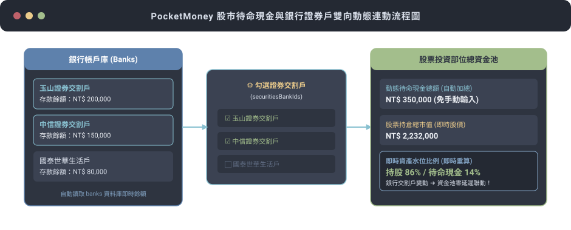
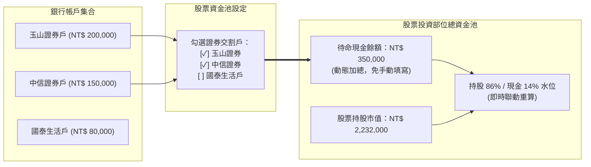
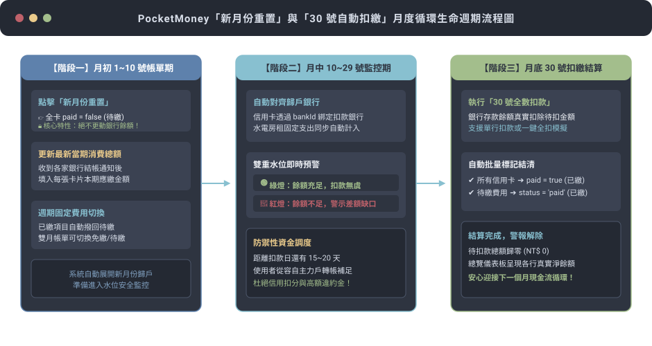
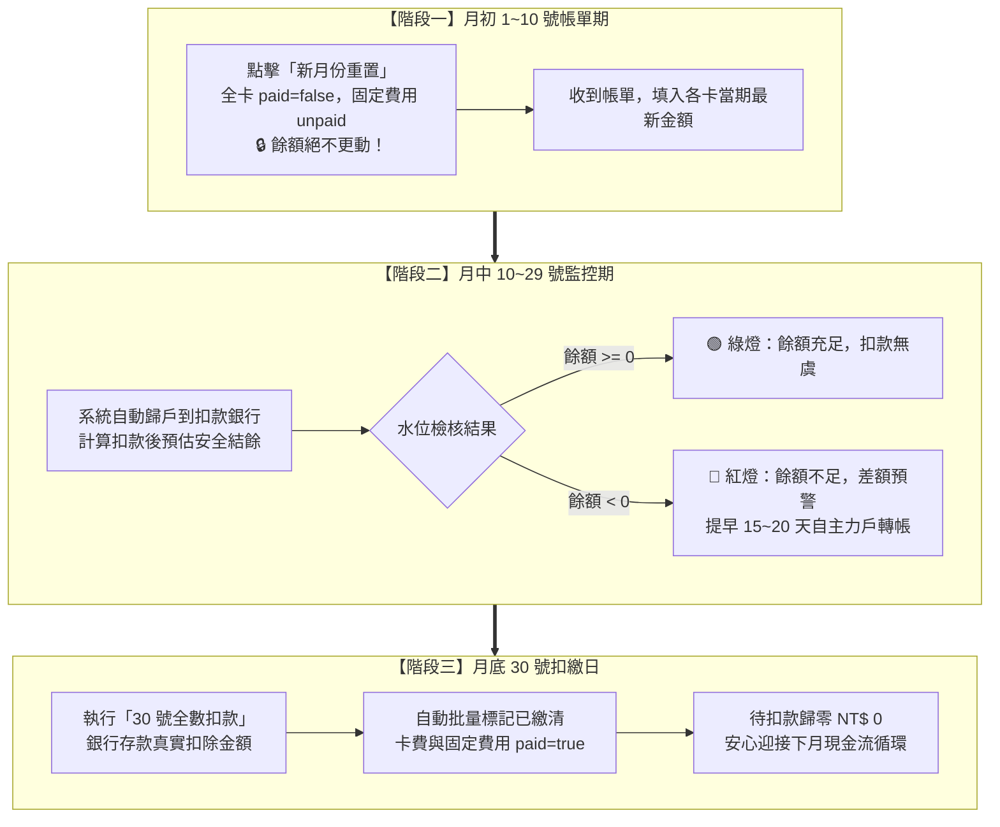

# PocketMoney 後續功能開發計畫與架構設計書 (Development Plan)

---

## 一、文件概述
- **文件版本**：v1.2.0
- **更新日期**：2026-10-27
- **目標系統**：PocketMoney (`tools/pocketmoney.html`)
- **相關文件**：[`SDD.md`](file:///c:/Dev/wiskinglin.github.io/_dev/PocketMoney/SDD.md)、[`README.md`](file:///c:/Dev/wiskinglin.github.io/_dev/PocketMoney/README.md)、[`onboarding_demo.html`](file:///c:/Dev/wiskinglin.github.io/_dev/PocketMoney/onboarding_demo.html)（獨立互動模擬展示頁）
- **最新狀態**：Stage 5 新手引導體驗規劃中 (In Planning)
- **結構導覽**：
  - **[二、最新待開發功能架構規劃（新規劃置頂）](#二最新待開發功能架構規劃current-planning)**：項目 1 新手首次進入導覽與引導體驗設計
  - **[三、已完成功能架構與核心業務邏輯庫](#三已完成功能架構與核心業務邏輯庫completed-features)**：項目 2 固定費用三大 KPI、項目 3 證券戶連動、項目 4 備份時間戳記、項目 5 月度扣款與重置完整邏輯
  - **[四、實作階段推進歷程與狀態 (Roadmap)](#四實作階段推進歷程與狀態-roadmap--status)**：最新 Stage 5 置頂進度看板

---

## 二、最新待開發功能架構規劃 (Current Planning)

### 項目 1：新手首次進入導覽與引導體驗設計 (Onboarding Experience: Welcome Modal + Spotlight Tour + Setup Checklist)

#### 1.1 核心理念與心智模型轉型 (Mindset Shift)
市面常見記帳工具強迫使用者陷入「每筆飲料、每餐便當都必須即時輸入」的流水帳地獄，導致多數人在 3~7 天內因瑣碎疲勞而放棄，且流水帳無法預防「扣款日餘額不足」與「分期付款吃空未來現金流」的根本財務風險。

PocketMoney 定位為**「財務水位防禦與宏觀現金流管控中心」**，新手體驗的核心目標不是教學如何記小帳，而是建立三個強烈的心智震撼：
1. **抓大放小（手頭還能花多少）**：不記瑣碎流水帳，算清手頭還能安心花多少錢；每月只需 3 分鐘更新銀行存款與信用卡帳單總額。
2. **防跳票預警（戶頭夠不夠扣款）**：戶頭裡的錢，夠不夠扣卡費與生活開銷？自動對齊各帳單與扣款銀行，以綠燈（無虞）與紅燈（缺口）徹底杜絕信用扣分與違約金。
3. **分期負擔透明化**：看清被零利率分期蠶食的未來現金流，掌握剩餘總負債。

---

#### 1.2 導覽策略方案評估：Spotlight 導覽 vs. 歡迎彈窗 + 任務檢查清單

| 評估維度 | 方案 A：互動式 Spotlight 導覽 (Driver.js / Shepherd.js) | 方案 B：歡迎彈窗 (Welcome Modal) + 微型任務清單 (Setup Checklist) | 方案 C (推薦採用)：三階段融合漏斗架構 (Hybrid Onboarding) |
| :--- | :--- | :--- | :--- |
| **心智傳達力** | ⭐⭐⭐ 偏向局部操作指示，難以在第一步完整傳達「財務防禦哲學」 | ⭐⭐⭐⭐ 彈窗能完整呈現核心金句，清單能激勵實際動手 | ⭐⭐⭐⭐⭐ **彈窗破題定調 + 輕量 Spotlight 定位 + 清單打勾閉環** |
| **離線與單機相容** | ⭐⭐ 依賴外部第三方 JS 庫，在離線或斷網單機環境容易失效 | ⭐⭐⭐⭐⭐ 純原生 HTML/CSS/JS，100% 離線單機自封裝 | ⭐⭐⭐⭐⭐ **採用微型原生 SVG Mask 聚光燈，0 外部庫依賴，單機即開即用** |
| **使用者干擾度** | ⭐⭐ 強制全螢幕遮罩連鎖點擊，容易讓老手產生焦躁感 | ⭐⭐⭐⭐ 清單可收合、完成後自動消失，完全無打擾 | ⭐⭐⭐⭐⭐ **可隨時跳過彈窗，清單常駐首頁頂部且完成自動隱藏** |
| **動手轉化率** | ⭐⭐ 看完導覽通常只是「被動瀏覽」，未留下真實個人資料 | ⭐⭐⭐⭐⭐ 檢查清單具體明確，每勾一項就完成一次真實設定 | ⭐⭐⭐⭐⭐ **自動感應系統狀態打勾，設定即完成，成就感最高** |

---

#### 1.3 推薦實作架構：三階段引導漏斗 (The Three-Tier Onboarding Funnel)

本系統全面採用高相容性原生架構，流程圖如下：



<details>
<summary><b>點擊展開 Mermaid 流程圖語法原始碼 (Flowchart Source)</b></summary>



</details>


---

#### 1.4 四大視覺焦點與核心文案規格 (UX Copywriting & Visual Focus Specs)

導覽文案遵循 **「痛點共情 ➔ 價值顛覆 ➔ 直覺行動 ➔ 視覺錨定」** 的專業 Fintech 語氣，語調沉穩自信、徹底揚棄生硬金融術語，直擊使用者記帳疲勞與「月底錢夠不夠扣」的真實焦慮。

---

##### 焦點 1：頂部「財務總覽」
- **目標元件錨點**：`#overviewKpiContainer`（總資產、各銀行存款總結餘、當期待扣款總額、當月安全結餘）
- **導覽氣泡標題**：
  > `💡 不記瑣碎流水帳，算清手頭還能安心花多少錢`
- **副標 / 核心價值**：
  > 不用每筆記便當咖啡！每月只需 3 分鐘更新銀行餘額與卡費，自動扣除待繳，算清真正能自由動用的安心資金與總身家。
- **優化文案亮點 (Tooltip Copy)**：
  > 「傳統流水帳消耗意志，卻防不住真正的財務漏洞。  
  > **PocketMoney 帶你實踐『抓大放小』的水位哲學**——每月只需花 3 分鐘更新『各銀行餘額』與『本期信用卡帳單總額』，系統即刻為你扣除所有待繳支出，算清當月真正能安心花費的**安全可用結餘**與**整體資產淨值**。  
  > 不再被零碎便當發票綁架，依然對每一分錢了然於心。」
- **UI 指標解讀指南 (Visual Highlights)**：
  - **總資產**：一覽流動活存與各項資產部位，掌握真實財務底氣。
  - **各銀行存款總結餘**：即時聚合所有開戶銀行的活期現金儲備。
  - **當期待扣款總額**：精準預算本期未繳卡費與週期性固定開銷的扣款衝擊。
  - **當月安全結餘**：存款扣除所有待繳後的「真實防守線」，花錢不再提心吊膽。
- **引導動作 (Action CTA)**：
  - **引導動作**：引導點擊「銀行與信用卡」快速填寫當月最新存款與卡費。
  - **導覽按鈕標籤**：主按鈕 `[ 填寫最新水位 ➔ ]` 或 `[ 下一步：檢查扣款 ➔ ]`，次按鈕 `[ 跳過導覽 ]`。

---

##### 焦點 2：儀表板「戶頭扣款安全檢查（原自動扣繳檢核卡片）」與導航
- **目標元件錨點**：`#autoDebitAuditCard` / 導航按鈕 `tab-cards`
- **導覽氣泡標題**：
  > `🛡️ 戶頭裡的錢，夠不夠扣卡費與生活開銷？`
- **副標 / 核心價值**：
  > 自動把各張卡費與水電房租歸戶到銀行，提早 15~20 天提醒補錢，絕不怕扣款失敗。
- **優化文案亮點 (Tooltip Copy)**：
  > 「再也不用拿計算機手動湊錢、提心吊膽怕跳票！  
  > 系統自動將所有未繳信用卡帳單與週期性固定支出（水電、房租、保險）精準歸戶至指定扣款銀行，在扣款日前持續進行即時壓力測試：  
  > 🟢 **安全綠燈**：戶頭存款很充足，月底自動扣款萬無一失，請安心生活。  
  > 🔴 **警示紅燈**：提早 15~20 天算給你看還差多少錢，提醒你立即由主力戶轉帳調度，再也不怕信用扣分或高額違約金！」
- **實戰防禦情境 (Defensive Logic)**：
  - 當同一家銀行同時綁定 2 張信用卡與房租扣款時，系統自動累積總待扣金額並與帳戶餘額對比，杜絕「扣完第一筆、不夠扣第二筆」的隱形透支陷阱。
- **引導動作 (Action CTA)**：
  - **引導動作**：引導前往「銀行與信用卡」檢視各銀行扣款對齊狀況與是否亮綠燈。
  - **導覽按鈕標籤**：主按鈕 `[ 檢視扣款防線 ➔ ]` 或 `[ 下一步：分期監控 ➔ ]`，次按鈕 `[ 返回上一步 ]`。

---

##### 焦點 3：隱形殺手「進行中分期付款負擔」模組
- **目標元件錨點**：`#installmentModule` / 導航按鈕 `tab-installments`
- **導覽氣泡標題**：
  > `🔍 買東西分期很無痛？算算每個月默默被扣了多少錢`
- **副標 / 核心價值**：
  > 零利率不等於無痛！精算每月固定攤提與剩餘總負債，奪回每個月自由現金的主控權。
- **優化文案亮點 (Tooltip Copy)**：
  > 「『每期只要幾百塊』看似無痛，累積起來卻可能悄悄吸乾每月現金儲備，成為財務隱形殺手！  
  > **PocketMoney 幫你打破分期陷阱**——精確算好每月分期固定攤提總額與剩餘負債總額，搭配視覺化攤提進度條，讓每筆分期透明可控，不再盲目透支未來收入，清楚掌握何時能真正無債一身輕。」
- **關鍵雙指標掌控 (Key Metrics)**：
  - **每月固定攤提**：本月已被鎖定、無法挪用的剛性支出，直接列入月度固定預算。
  - **剩餘負債總額**：透視未來長週期內真實積欠的本金全貌，抑制衝動消費。
- **引導動作 (Action CTA)**：
  - **引導動作**：引導前往「分期付款」模組盤點大額分期計畫。
  - **導覽按鈕標籤**：主按鈕 `[ 掌握分期負擔 ➔ ]` 或 `[ 完成導覽，開始體驗 🎉 ]`，次按鈕 `[ 返回上一步 ]`。

---

##### 焦點 4：首頁頂部收合式「微型檢查清單」（Setup Checklist）
- **UI 呈現位置**：首頁 Dashboard 頂部（位於歡迎橫幅下方、KPI 卡片上方）。
- **視覺規範**：
  - 具備收合/展開箭頭，附帶平滑進度條與完成百分比徽章（例如：`25% (1/4)`）。
  - 深色 Nord 風格卡片，具備完成打勾微動效與任務快速跳轉連結。
- **4 大關鍵任務文案與動態感應邏輯 (Reactive Criteria)**：
  1. `[ ]` **設定至少 1 個主力銀行帳戶與餘額**
     - 引導文案：建立你的第一道活存水位，點擊快速新增銀行。
     - 感應條件：`state.banks.length >= 1 && state.banks.some(b => Number(b.balance) > 0)`
     - 快捷引導：點擊直達新增銀行 Modal。
  2. `[ ]` **登記 1 張本期信用卡結帳金額與扣繳帳戶**
     - 引導文案：輸入本期結帳總額並綁定扣繳戶，啟動自動歸戶防線。
     - 感應條件：`state.cards.length >= 1 && state.cards.some(c => c.bankId && Number(c.statementTotal) > 0)`
     - 快捷引導：點擊直達新增信用卡或帳單編輯區。
  3. `[ ]` **檢查「戶頭裡的錢夠不夠扣款」是否亮綠燈**
     - 引導文案：確認所有帳戶扣完款後都還有餘額，確保月底不跳票。
     - 感應條件：所有已指派之扣款銀行在扣除信用卡及固定費用後之預估結餘均大於等於 0。
     - 快捷引導：平滑滾動至戶頭扣款安全檢查卡片。
  4. `[ ]` **（選填）設定 PIN 碼保護本機資料**
     - 引導文案：為單機本機隱私加把鎖，防止旁人偷窺資產狀況。
     - 感應條件：`Boolean(state.settings.pinCode && state.settings.pinCode.length >= 4)`
     - 快捷引導：點擊開啟安全性 PIN 碼設定視窗。
- **退場機制**：
  - 當 4 項任務（或前 3 項必要任務）全部滿足時，觸發慶祝動畫（Micro Confetti / Pulse Effect），提示「🎉 新手初始設定已全數完成！」，3 秒後平滑向上收縮淡出。
  - 在「偏好設定 (`tab-settings`)」中保留開關「重新顯示新手檢查清單」，方便使用者隨時複查。

---

##### 導覽規格對照總表 (Spotlight Tour Steps Matrix)

| 步驟 (Step) | 聚焦目標元件 (Anchor) | 導覽氣泡標題 (Title) | 核心價值與痛點解方 (Body Snippet) | 主行動按鈕 (Primary CTA) |
| :--- | :--- | :--- | :--- | :--- |
| **Step 1** | `#overviewKpiContainer` | 💡 不記瑣碎流水帳，算清手頭還能安心花多少錢 | 每月花 3 分鐘更新銀行餘額與卡費，自動扣除待繳，算清真正可用餘額。 | `下一步：檢查扣款 ➔` |
| **Step 2** | `#autoDebitAuditCard` / `tab-cards` | 🛡️ 戶頭裡的錢，夠不夠扣卡費與生活開銷？ | 自動對齊各帳單與扣款銀行。🟢 綠燈扣款無虞，🔴 紅燈提早預警差額。 | `下一步：分期監控 ➔` |
| **Step 3** | `#installmentModule` / `tab-installments` | 🔍 買東西分期很無痛？算算每個月默默被扣了多少錢 | 看清每月固定攤提與剩餘總負債，奪回現金主控權，不再盲目透支未來收入。 | `完成導覽，開始體驗 🎉` |

---

#### 1.5 技術規格與無依賴實作方案 (Zero-Dependency Implementation)
為了維持 PocketMoney「單一檔案、零外部構建相依、單機離線打包可用」的最高架構原則：
1. **拒絕外部 CDN 庫**：不引入需連網之肥大庫（如 Driver.js / Shepherd.js），避免斷網或單機 HTML 開啟時失效。
2. **純原生 SVG 聚光燈遮罩 (Native Spotlight Overlay)**：
   - 使用純 HTML5 `<div id="spotlightOverlay">` 配合 CSS `backdrop-filter: blur(4px)` 與全屏 SVG 遮罩。
   - 透過 `element.getBoundingClientRect()` 動態更新 SVG Cutout 剪裁座標，支援「上一步」、「下一步」、「跳過導覽」。
3. **響應式狀態驅動 (State-Driven Checklist)**：
   - 清單狀態不仰賴手動勾選，而是在每次 `renderAll()` 或 `saveState()` 時呼叫 `evaluateOnboardingProgress()` 自動判定條件。
   - 紀錄 `state.settings.onboardingDismissed: boolean` 與 `state.settings.tourCompleted: boolean` 於本地 LocalStorage。

---

## 三、已完成功能架構與核心業務邏輯庫 (Completed Features)

### 項目 2：固定費用總計 (Recurring Bills KPI)

#### 2.1 現狀分析與問題痛點
原本在「固定費用 (`tab-bills`)」中缺乏頂部指標，無法一眼掌握「當月 30 號待繳扣款衝擊」與「每月常態基本開銷（平準化）」。

#### 2.2 設計架構與三大指標
1. **指標卡 1：本期待繳固定總額 (當月現金流扣款衝擊)**
   - 計算公式：$$UnpaidBillsTotal = \sum_{b \in Bills, b.status = 'unpaid'} b.amount$$
2. **指標卡 2：常態每月平均固定開銷 (真實生活成本)**
   - 計算公式（按週期平準化）：
     $$MonthlyBaseCost = \sum_{b \in Bills} \left( \begin{cases} b.amount & \text{每月固定} \\ b.amount / 2 & \text{雙月帳單} \\ b.amount / 3 & \text{季繳} \\ b.amount / 12 & \text{年繳} \end{cases} \right)$$
3. **指標卡 3：項目狀態分佈與雙月批次切換**
   - 呈現待繳、已繳、免繳筆數，支援雙月帳單一鍵切換。

---

### 項目 3：投資部位待命現金連結銀行證券戶餘額

#### 3.1 現狀分析與問題痛點
原本股市待命現金為手動輸入常數，導致證券交割戶餘額變動時無法連動，持倉比例（股/債/現金）容易失真。



<details>
<summary><b>點擊展開 Mermaid 流程圖語法原始碼 (Flowchart Source)</b></summary>



</details>


- **資料模型變更**：`state.settings.securitiesBankIds: string[]`。
- **計算公式**：$$StockCashPool = \sum_{b \in Banks, securitiesBankIds.includes(b.id)} b.balance$$

---

### 項目 4：備份匯出檔案名稱加入 `YYYYMMDD_HHmmss` 時間戳記

#### 4.1 現狀分析與問題痛點
原本僅帶 `YYYY-MM-DD` 且為 UTC 時間，同天多次備份檔名重複覆蓋，且跨午夜有時區落差。

#### 4.2 建議設計架構
全域共用台灣時區時間戳記：
```javascript
function getExportTimestamp() {
  const d = new Date();
  const pad = n => String(n).padStart(2, '0');
  return `${d.getFullYear()}${pad(d.getMonth() + 1)}${pad(d.getDate())}_${pad(d.getHours())}${pad(d.getMinutes())}${pad(d.getSeconds())}`;
}
```
標準化檔名：`PocketMoney_備份_YYYYMMDD_HHmmss.json` / `PocketMoney_單機版_YYYYMMDD_HHmmss.html`。

---

### 項目 5：深入說明「新月份重置」與「模擬 30 號一鍵全數扣款」的底層邏輯

這兩個按鈕是 PocketMoney 控制**「月度循環現金流」**的核心開關，使用者常混淆它們對**「銀行真實餘額」**的影響：

#### 5.1 「模擬 30 號一鍵全數扣款 (`settleAllPendingBills()`)」
- **業務意涵**：月底扣款日或扣繳模擬試算。
- **核心影響**：
  - **銀行餘額會被真實扣除**（`bank.balance` 減少）。
  - 所有信用卡標記為「已繳清」、所有費用標記為「已繳」。
  - 總覽頁面的待扣款降為 `NT$ 0`，差額警示解除。

#### 5.2 「新月份重置 (`resetAllCardsNewMonth()`)」
- **業務意涵**：次月 1~10 號各銀行新帳單寄達時，開啟新一輪監控。
- **核心影響**：
  - **重要特性：絕不變動任何銀行的存款餘額！**
  - 將所有信用卡設為 `paid = false`，已繳固定費用撥回 `unpaid`。
  - 準備填入新一期消費金額，重新啟動 30 號安全水位檢核。

#### 5.3 兩者在月度循環中的完整生命週期



<details>
<summary><b>點擊展開 Mermaid 流程圖語法原始碼 (Flowchart Source)</b></summary>



</details>


---

## 四、實作階段推進歷程與狀態 (Roadmap & Status)

- **Stage 5 [Planning]**：初次使用導覽體驗實作（Welcome Modal 歡迎彈窗、原生零依賴 SVG Spotlight 聚光燈引導、頂部動態感應收合式微型檢查清單 Setup Checklist）。
- **Stage 4 [Complete]**：更新 `tools/pocketmoney.html`、`_dev/PocketMoney/SDD.md`、`_dev/PocketMoney/README.md`，同步發布日誌與 Git 部署。
- **Stage 3 [Complete]**：於固定費用頁籤建構三大 KPI 彙整卡片（當期 30 號待繳總計、常態每月平均平準化支出、費用狀態筆數與雙月帳單一鍵切換免繳/待繳）。
- **Stage 2 [Complete]**：重構股票資金池資料模型，新增 `securitiesBankIds` 關聯機制，提供 UI 勾選銀行戶，讓待命現金與銀行證券戶餘額動態自動加總，即時同步持倉比例。
- **Stage 1 [Complete]**：實作共用時間戳記函式 `getExportTimestamp()`，升級 CSV、JSON 與 HTML 打包匯出檔名包含 `YYYYMMDD_HHmmss`，並在 CSV 總表中補齊固定費用明細。
