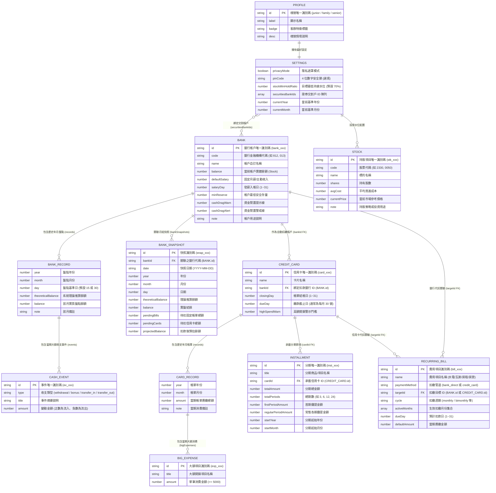
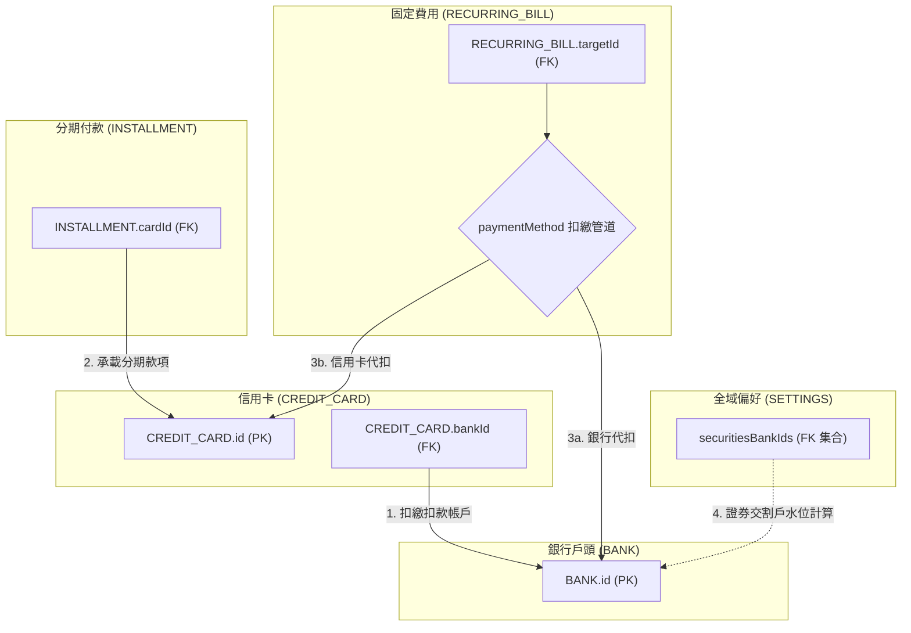

# PocketMoney 資料庫結構規格書 (ERD.md)

- **專案名稱**：PocketMoney (個人資產與 30 號扣繳檢核系統)
- **最新 Schema 版本**：`PocketMoney_tw_finance_v4`
- **最後更新日期**：2026-11-02
- **對應程式與資料庫**：
  - 資料庫檔案：[`_dev/PocketMoney/database/dummy_db_embedded.js`](file:///c:/Playground26/wiskinglin.github.io/_dev/PocketMoney/database/dummy_db_embedded.js)
  - 核心介面原型：[`_dev/PocketMoney/mockup_view.html`](file:///c:/Playground26/wiskinglin.github.io/_dev/PocketMoney/mockup_view.html)
  - 系統架構書：[`_dev/PocketMoney/SDD.md`](file:///c:/Playground26/wiskinglin.github.io/_dev/PocketMoney/SDD.md)

---

## 1. 實體關係圖 (Entity-Relationship Diagram)

---

## 2. 實體詳細欄位規格 (Entity Schema Specifications)

### 2.1 全域設定 (Settings & Profile)

#### `profile` (使用者樣貌設定)
| 欄位名稱 | 型別 | 必填 | 說明 |
| :--- | :--- | :--- | :--- |
| `id` | `string` | 是 | 樣貌代碼（主鍵，如 `junior` / `family` / `senior`） |
| `label` | `string` | 是 | 樣貌顯示名稱（如「三代同堂」） |
| `badge` | `string` | 否 | 標籤徽章（如「雙薪家庭」） |
| `desc` | `string` | 否 | 情境與資產架構簡述 |

#### `settings` (全域偏好與水位配置)
| 欄位名稱 | 型別 | 必填 | 說明 |
| :--- | :--- | :--- | :--- |
| `privacyMode` | `boolean` | 是 | 是否啟用金額模糊化隱私模式 |
| `pinCode` | `string` | 否 | 4 位數保護密碼（空字串為停用） |
| `stockMinHoldRatio` | `number` | 是 | 目標最低股票持倉水位比例（預設 `70` 代表 70%） |
| `securitiesBankIds` | `string[]` | 是 | 作為股市待命交割款之銀行 ID 集合 |
| `currentYear` | `number` | 是 | 當前應用程式運算基準年份（如 `2026`） |
| `currentMonth` | `number` | 是 | 當前應用程式運算基準月份（如 `10`） |

---

### 2.2 銀行存量與時間軸盤點 (Bank & Snapshots)

#### `banks[]` (銀行帳戶主實體)
| 欄位名稱 | 型別 | 必填 | 說明 |
| :--- | :--- | :--- | :--- |
| `id` | `string` | 是 | 銀行唯一識別碼（主鍵，格式：`bank_xxx`） |
| `code` | `string` | 否 | 銀行代碼（如 `812` 台新、`013` 國泰） |
| `name` | `string` | 是 | 銀行/帳戶自訂名稱 |
| `balance` | `number` | 是 | 當前最新帳面結餘（Stock 現值） |
| `defaultSalary` | `number` | 否 | 預設每月薪資/主動收入入帳額（預設 `0`） |
| `salaryDay` | `number` | 否 | 每月固定入帳日（1~31） |
| `minReserve` | `number` | 否 | 最低安全防護金水位（低於此值觸發警戒） |
| `cashDragWarn` | `number` | 否 | 閒置現金注意線（高於此值提示資金閒置） |
| `cashDragAlert` | `number` | 否 | 閒置現金警戒線（高於此值強烈提示配置） |
| `note` | `string` | 否 | 帳戶用途備註（如「日常薪轉・信用卡扣繳」） |
| `records` | `object[]` | 是 | 歷史各月盤點紀錄清單 |

#### `banks[].records[]` (銀行年月盤點紀錄)
| 欄位名稱 | 型別 | 必填 | 說明 |
| :--- | :--- | :--- | :--- |
| `year` | `number` | 是 | 盤點年份 |
| `month` | `number` | 是 | 盤點月份 (1~12) |
| `day` | `number` | 是 | 盤點日（如 15 號日常盤點） |
| `theoreticalBalance` | `number` | 是 | 系統依收支自動推算之理論結餘 |
| `balance` | `number` | 是 | 盤點日使用者回報之實質結餘 |
| `note` | `string` | 否 | 當期差異說明（如「年終入帳」） |
| `events` | `object[]` | 否 | 異常或單筆收支事件陣列 |

#### `banks[].records[].events[]` (大額現金事件)
| 欄位名稱 | 型別 | 必填 | 說明 |
| :--- | :--- | :--- | :--- |
| `id` | `string` | 是 | 事件唯一識別碼（主鍵，格式：`ev_xxx`） |
| `type` | `string` | 是 | 事件類型（`withdrawal` 提領 / `bonus` 獎金 / `transfer_out` 轉出 / `transfer_in` 轉入） |
| `title` | `string` | 是 | 事件說明（如「年終獎金入帳」） |
| `amount` | `number` | 是 | 金額（流入為正數，流出為負數） |

#### `bankSnapshots[]` (月結歷史快照實體)
| 欄位名稱 | 型別 | 必填 | 說明 |
| :--- | :--- | :--- | :--- |
| `id` | `string` | 是 | 快照主鍵代碼 |
| `bankId` | `string` | 是 | 外鍵，關聯至 `BANK.id` |
| `date` | `string` | 是 | 快照日期（格式：`YYYY-MM-DD`） |
| `year` | `number` | 是 | 年份 |
| `month` | `number` | 是 | 月份 |
| `day` | `number` | 是 | 盤點基準日 |
| `theoreticalBalance` | `number` | 是 | 理論結餘 |
| `balance` | `number` | 是 | 實盤結餘 |
| `pendingBills` | `number` | 是 | 當月待扣繳固定費用總額 |
| `pendingCards` | `number` | 是 | 當月待扣繳信用卡總額 |
| `projectedBalance` | `number` | 是 | 扣款後預估餘額（`balance - pendingBills - pendingCards`） |
| `events` | `object[]` | 否 | 當月關聯大額事件 |

---

### 2.3 信用卡與大額開銷 (Credit Card & Big Expenses)

#### `cards[]` (信用卡主實體)
| 欄位名稱 | 型別 | 必填 | 說明 |
| :--- | :--- | :--- | :--- |
| `id` | `string` | 是 | 信用卡唯一識別碼（主鍵，格式：`card_xxx`） |
| `name` | `string` | 是 | 卡片名稱（如「國泰 CUBE 卡」） |
| `bankId` | `string` | 是 | 外鍵，關聯至 `BANK.id`（扣款帳戶） |
| `closingDay` | `number` | 是 | 帳單結帳日（1~31） |
| `dueDay` | `number` | 是 | 應繳款日（預設 30 號） |
| `highSpendWarn` | `number` | 否 | 單月總額示警門檻 |
| `records` | `object[]` | 是 | 各月份帳單與消費紀錄 |

#### `cards[].records[]` (信用卡年月帳單明細)
| 欄位名稱 | 型別 | 必填 | 說明 |
| :--- | :--- | :--- | :--- |
| `year` | `number` | 是 | 帳單年份 |
| `month` | `number` | 是 | 帳單月份 |
| `amount` | `number` | 是 | 當期帳單應繳總額 (Flow) |
| `note` | `string` | 否 | 當月消費總覽備註 |
| `bigExpenses` | `object[]` | 否 | 單筆大額消費清單（>= 5,000 元） |

#### `cards[].records[].bigExpenses[]` (大額消費)
| 欄位名稱 | 型別 | 必填 | 說明 |
| :--- | :--- | :--- | :--- |
| `id` | `string` | 是 | 消費項目唯一識別碼（格式：`exp_xxx`） |
| `title` | `string` | 是 | 消費項目說明（如「雙11箱購尿布與耗材」） |
| `amount` | `number` | 是 | 單筆金額（必須 $\ge 5000$） |

---

### 2.4 分期付款 (Installments)

採用**動態期數推算架構**，無須手動每期維護 `paidPeriods`。

#### `installments[]`
| 欄位名稱 | 型別 | 必填 | 說明 |
| :--- | :--- | :--- | :--- |
| `id` | `string` | 是 | 分期唯一識別碼（主鍵，格式：`inst_xxx`） |
| `title` | `string` | 是 | 分期商品/項目名稱 |
| `cardId` | `string` | 是 | 外鍵，承載分期之信用卡 ID（`CREDIT_CARD.id`） |
| `totalAmount` | `number` | 是 | 分期總金額 |
| `totalPeriods` | `number` | 是 | 總分期期數（如 3、6、12、24） |
| `firstPeriodAmount` | `number` | 是 | 首期攤提金額（處理非整除除數） |
| `regularPeriodAmount` | `number` | 是 | 第 2 期起每期常態攤提金額 |
| `startYear` | `number` | 是 | 分期首期起算年份 |
| `startMonth` | `number` | 是 | 分期首期起算月份 (1~12) |

---

### 2.5 固定費用 (Recurring Bills)

支援**多途徑扣款**與**多樣化扣繳週期**。

#### `recurringBills[]`
| 欄位名稱 | 型別 | 必填 | 說明 |
| :--- | :--- | :--- | :--- |
| `id` | `string` | 是 | 費用項目唯一識別碼（主鍵，格式：`bill_xxx`） |
| `name` | `string` | 是 | 項目名稱（如「管理費」、「首購房貸」） |
| `paymentMethod` | `string` | 是 | 扣款途徑：`'bank_direct'`（銀行直接代扣）或 `'credit_card'`（信用卡扣繳） |
| `targetId` | `string` | 是 | 外鍵，依管道關聯至 `BANK.id` 或 `CREDIT_CARD.id` |
| `cycle` | `string` | 是 | 週期：`'monthly'`（每月）、`'bimonthly'`（雙月）、`'quarterly'`（每季）、`'yearly'`（每年） |
| `activeMonths` | `number[]` | 是 | 扣繳生效月份清單（如雙月繳 `[2, 4, 6, 8, 10, 12]`） |
| `dueDay` | `number` | 是 | 扣繳基準日（1~31） |
| `defaultAmount` | `number` | 是 | 每期預計扣款金額 |

---

### 2.6 台股投資與資產池 (Stocks)

#### `stocks[]`
| 欄位名稱 | 型別 | 必填 | 說明 |
| :--- | :--- | :--- | :--- |
| `id` | `string` | 是 | 持股唯一代碼（主鍵，格式：`stk_xxx`） |
| `code` | `string` | 是 | 股票代碼（如 `2330`, `0050`） |
| `name` | `string` | 是 | 標的名稱 |
| `shares` | `number` | 是 | 持有股數（整股或零股） |
| `avgCost` | `number` | 是 | 平均每股買進成本 |
| `currentPrice` | `number` | 是 | 當前市場參考價格 |
| `note` | `string` | 否 | 持股配置策略備註 |

---

## 3. 外鍵關聯規則與資料完整性約束 (Integrity Constraints)

1. **信用卡扣繳銀行約束**：
   - `CREDIT_CARD.bankId` 必須存在於 `banks[].id` 中。若刪除銀行帳戶，必須提示轉移綁定之信用卡。
2. **分期付款所屬卡片約束**：
   - `INSTALLMENT.cardId` 必須存在於 `cards[].id` 中。
3. **固定帳單扣繳目標約束**：
   - 當 `paymentMethod == 'bank_direct'` 時，`targetId` 必須對應至有效之 `BANK.id`。
   - 當 `paymentMethod == 'credit_card'` 時，`targetId` 必須對應至有效之 `CREDIT_CARD.id`。
4. **交割帳戶資金聯動**：
   - `SETTINGS.securitiesBankIds` 內之所有項目必須為合法之 `BANK.id`。

---

## 4. 關鍵核心業務邏輯運算 (Financial Business Logic)

### 4.1 每月 30 號銀行扣款與缺口檢核 (Checkup Formula)

對於指定月份 $M$，銀行 $B_i$ 之待扣款項為：
$$\mathrm{CardsSum}(B_i) = \sum_{c \in \mathrm{Cards}, c.\mathrm{bankId} = B_i.\mathrm{id}} \mathrm{RecordAmount}(c, M)$$
$$\mathrm{BillsSum}(B_i) = \sum_{b \in \mathrm{Bills}, b.\mathrm{targetId} = B_i.\mathrm{id}, b.\mathrm{paymentMethod} = 'bank\_direct', M \in b.\mathrm{activeMonths}} b.\mathrm{defaultAmount}$$
$$\mathrm{RequiredTotal}(B_i) = \mathrm{CardsSum}(B_i) + \mathrm{BillsSum}(B_i)$$
$$\mathrm{AfterBalance}(B_i) = B_i.\mathrm{balance} - \mathrm{RequiredTotal}(B_i)$$
$$\mathrm{IsShortfall}(B_i) = \mathrm{AfterBalance}(B_i) < 0$$

### 4.2 動態分期各期攤提推算 (Installment Calculation)

對於任意查詢年份 $Y$ 與月份 $M$，計算分期 $I_k$ 之已過期數：
$$\Delta \mathrm{Months} = (Y - I_k.\mathrm{startYear}) \times 12 + (M - I_k.\mathrm{startMonth}) + 1$$

- 若 $\Delta \mathrm{Months} \le 0$：尚未開始，當期金額為 `0`。
- 若 $\Delta \mathrm{Months} = 1$：首期生效，當期金額為 $I_k.\mathrm{firstPeriodAmount}$。
- 若 $1 < \Delta \mathrm{Months} \le I_k.\mathrm{totalPeriods}$：常態生效，當期金額為 $I_k.\mathrm{regularPeriodAmount}$。
- 若 $\Delta \mathrm{Months} > I_k.\mathrm{totalPeriods}$：已結清，當期金額為 `0`。

### 4.3 台股總投資水位與持倉比例 (Stock Holding Ratio)

$$\mathrm{StockCashPool} = \sum_{B_i \in \mathrm{Banks}, B_i.\mathrm{id} \in \mathrm{Settings}.\mathrm{securitiesBankIds}} B_i.\mathrm{balance}$$
$$\mathrm{StockMarketValue} = \sum_{S_j \in \mathrm{Stocks}} (S_j.\mathrm{shares} \times S_j.\mathrm{currentPrice})$$
$$\mathrm{StockCostValue} = \sum_{S_j \in \mathrm{Stocks}} (S_j.\mathrm{shares} \times S_j.\mathrm{avgCost})$$
$$\mathrm{StockTotalPool} = \mathrm{StockMarketValue} + \mathrm{StockCashPool}$$
$$\mathrm{StockHoldRatio} = \begin{cases} \mathrm{round}\left(\frac{\mathrm{StockMarketValue}}{\mathrm{StockTotalPool}} \times 100\right)\% & \text{if } \mathrm{StockTotalPool} > 0 \\ 0\% & \text{otherwise} \end{cases}$$
$$\mathrm{StockUnrealizedPnL} = \mathrm{StockMarketValue} - \mathrm{StockCostValue}$$

---

## 5. 版本歷史 (Changelog)

- **`PocketMoney_tw_finance_v4` (最新現行版)**：
  - 新增歷史年月盤點架構：`banks[].records`（含 `events` 大額現金流）與 `cards[].records`（含 `bigExpenses`）。
  - 新增 `bankSnapshots` 集合，提供 3D 時間軸投影與月結快照。
  - 將固定費用 `recurringBills` 升級為支援信用卡/銀行雙途徑扣款（`paymentMethod`, `targetId`），並新增週期生效月份陣列 `activeMonths`。
  - 將分期付款 `installments` 升級為時間軸動態推算（`startYear`, `startMonth`, `firstPeriodAmount`, `regularPeriodAmount`）。
  - 新增第一級實體 `stocks`，並聯動 `settings.securitiesBankIds` 實作台股持股水位與待命資金池動態計算。
  - 銀行戶頭擴充薪轉配置（`defaultSalary`, `salaryDay`）與流動性資金警示線（`minReserve`, `cashDragWarn`, `cashDragAlert`）。
- **`PocketMoney_tw_finance_v3` (初期設計版)**：
  - 基礎銀行、信用卡、大額消費、單純分期付款與靜態 30 號待扣總額檢核模型。
