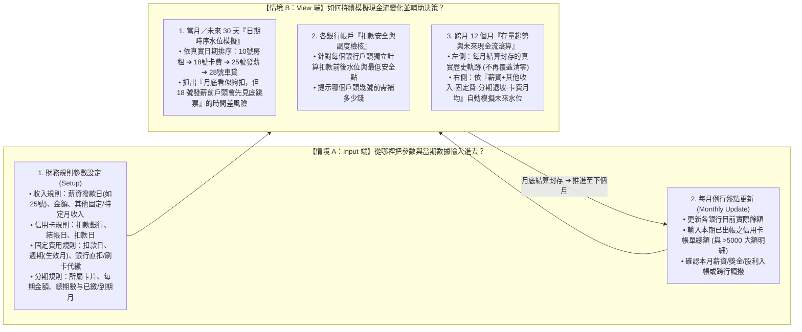

# PocketMoney — 實戰使用者情境：Input（參數與盤點）× View（現金流模擬）(SCENARIOS.md)

> **文件性質**：L1 核心使用者情境與規格缺口定義（已移除無意義的「初級/少子化/高級大人」假 Profile，100% 聚焦**真實個人使用者從 0 設定自身財務參數並持續使用**的完整閉環）。
> **基準檔案**：[`pocketmoney_view.html`](file:///c:/Dev/wiskinglin.github.io/_dev/PocketMoney/pocketmoney_view.html)

---

## 1. 為什麼之前的設計會「輸入完算完就沒用了」？（問題根源診斷）

盤點目前 [`pocketmoney_view.html`](file:///c:/Dev/wiskinglin.github.io/_dev/PocketMoney/pocketmoney_view.html) 的程式碼與舊規格，造成「碎片化、一次性計算機」的三大斷層如下：

| 斷層 | `pocketmoney_view.html` 現況問題 | 導致的後果 |
| :--- | :--- | :--- |
| **斷層 1：把日期寫死在 UI 文字裡，卻沒有地方讓使用者輸入真實日期參數** | • 首頁寫死 `30號扣款`、`30號自動扣繳` • 信用卡標題寫死 `(10號收單 / 20號扣款)`，但 `openCardModal` 只有「名稱、銀行、總額」，**根本沒地方填結帳日與扣款日** • `openBillModal` 只有「名稱、週期、金額、銀行」，**沒地方填幾號扣款、單雙月、或刷卡代繳** | 真實生活中薪水可能 **20～25 號**才撥款、房租 **10 號**扣、卡費 **18 號**扣。沒輸入真實日期，系統就永遠只能算一個假的「月底總和」，無法預測「發薪前會不會先跳票」。 |
| **斷層 2：缺乏完整的「每月薪資 ＋ 其他收入方式」設定入口** | • 雖然在 `openBankModal` 塞了一個 `設為薪資入帳戶` 勾選框，但藏在新增銀行的最底下，且只支援單一固定月薪 • **沒有管理「固定月薪、固定副業/補貼、特定月份獎金（年終/三節/配息）」的統一設定與入帳機制** | 現金流只有「流出（卡費、分期、固定費用）」，沒有完整的「流入（Inflow）規則與時序」，自然無法模擬跨月現金流變化。 |
| **斷層 3：Input（輸入）與 View（檢視模擬）沒有串成持續運轉的循環** | • 輸入完銀行餘額、卡費、分期、固定費用後，只算出當下 `afterBalance = balance - requiredTotal` • 沒有將「規則參數 + 當月數據」轉化為 **「當月時序現金流（幾號進、幾號出）」** 與 **「跨月滾算快照」** | 使用者看一眼「餘額充足」就關掉網頁了，下個月打開又要覆蓋重填，無法持續使用。 |

---

## 2. 重新定義兩大核心使用者情境：Input 情境 vs. View 情境

要讓 `pocketmoney_view.html` 成為**可以每個月持續使用的真實工具**，必須先將使用者情境明確切分為 **「Input（資料與參數怎麼進來）」** 與 **「View（算出什麼有價值的現金流模擬）」**：

---

## 3. Input 端盤點：我們需要補齊哪些「參數輸入入口」？

在不動用任何假 Profile 的前提下，真實使用者自己打開 App，必須能清楚設定以下 5 組參數：

| 模組 | 目前 `pocketmoney_view.html` 已有的輸入欄 | **目前缺失、必須補齊的關鍵參數** | 為什麼這個參數對 View 模擬至關重要？ |
| :--- | :--- | :--- | :--- |
| **① 收入與現金流入 (Inflows)** | 僅在銀行彈窗內嵌 `isSalaryAccount`、`salaryDay`、`salaryAmount` | • **獨立且清楚的收入設定區**（支援多筆收入來源） • **收入類型與週期**：每月固定薪資（如 **20～25 號**撥款）、固定兼職/租金補貼、特定月份收入（如 1 月年終、6/9 月獎金） • **指定入帳銀行 (`targetBankId`)** | 決定現金什麼時候流進哪一個銀行戶頭；若發薪日是 25 號，20 號前的扣款就不能拿當月薪水來抵！ |
| **② 銀行帳戶 (Banks)** | `name`、`balance`、`note` | • **最低安全保留水位 (`minReserve`)**（選填，預設 0） • **餘額最後確認日期 (`updatedAt`)** | 知道目前餘額是幾號盤點的，才能判斷當月哪些扣款已經扣過、哪些還沒扣。 |
| **③ 信用卡 (Cards)** | `name`、`bankId`、`statementTotal`、`bigExpenses` | • **每月結帳日 (`closingDay`，1~31)** • **每月扣款日 (`dueDay`，1~31)** *(移除畫面上寫死的「30號扣款 / 10號收單」假字樣)* | 每張卡扣款日不同（有的 15 號、有的 27 號），必須知道確切幾號從哪家銀行扣款。 |
| **④ 固定費用 (Bills)** | `name`、`cycle`、`amount`、`bankId` | • **每月扣款日 (`dueDay`，1~31)** • **扣款管道 (`paymentMethod`)**：`銀行帳戶直扣` vs `信用卡代繳` • **生效月份 (`activeMonths`)**：雙月帳單是單月還雙月？季繳/年繳是幾月？ | 1. 刷卡代繳的水電費已經包在信用卡帳單裡，不能在銀行再扣一次。 2. 知道幾號扣房租/貸款，才能排出當月現金流時序。 |
| **⑤ 分期付款 (Installments)** | `title`、`cardId`、`totalAmount`、`totalPeriods`、`monthlyAmount`、`paidPeriods` | • **起始年月或自動對應到期年月** • **這筆分期是否已包含在本期 `statementTotal` 內**（防重複計算規則） | 讓未來 12 個月趨勢圖能準確算出「哪一個月分期結束後，每月固定負擔會少掉幾千元」。 |

---

## 4. 階段化探索計畫（從 Input 參數閉環 ➔ View 現金流模擬）

我們接下來的 A/B 原型探索，直接按照你指出的核心脈絡推進：

| 優先順序 | 實驗代號 | 核心命題（解決什麼問題） | A / B 方案比較重點 |
| :---: | :--- | :--- | :--- |
| **Step 1（第一優先）** | **`F01`：Input 參數與收入設定閉環** | **「我要從哪裡把發薪日（如 20~25 號）、其他收入、各卡結帳/扣款日、固定費用扣款日與刷卡代繳設定進去？並拔掉所有寫死的『30號扣款』假設」** | • **方案 A（模組內嵌擴充式）**：在現有「銀行與信用卡 / 固定費用」頁籤內，新增獨立的「每月薪資與其他收入設定卡」，並在銀行/信用卡/固定費用編輯與行內膠囊直接顯示與修改各自的 `入帳日 / 扣款日 / 扣款管道`。 • **方案 B（集中式現金流規則設定抽屜/精靈）**：除各卡片顯示真實日期外，提供一個「現金流日曆規則總表」，在同一畫面集中設定所有「幾號進（薪資/其他收入）、幾號出（卡費/房租/貸款）」。 |
| **Step 2** | **`F02`：View 當月時序與跨月現金流模擬** | **「輸入完這些真實日期與金額後，View 怎麼模擬『發薪前會不會先跳票』以及『跨月持續累積的現金流變化』？」** | • **方案 A（當月日期水位階梯 + 月結封存趨勢）**：首頁檢核卡依真實日期（如 10號 ➔ 18號 ➔ 25號發薪 ➔ 28號）模擬帳戶最低水位點，並在月底結算時封存真實歷史快照。 • **方案 B（未來 30 天逐日事件流 + 12 個月動態滾算沙盒）**：以時間軸列出未來 30 天每一筆流入與流出事件後的帳戶餘額變化，並連動 12 個月預測曲線。 |
| **Step 3** | **`F03`：扣款缺口一鍵跨行調撥** | **「當 View 模擬出某銀行在某號會餘額不足時，如何一鍵從富餘銀行調度資金？」** | 比較卡片內嵌一鍵調撥 vs. 調度建議面板。 |
