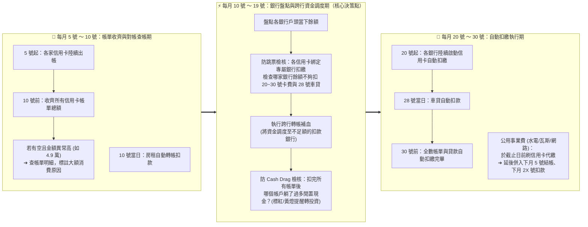
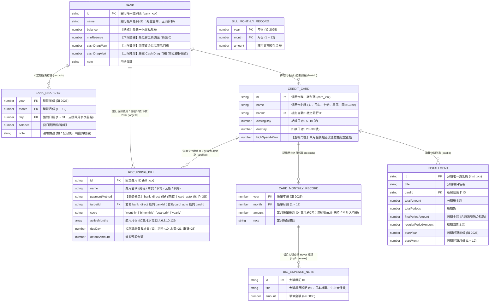
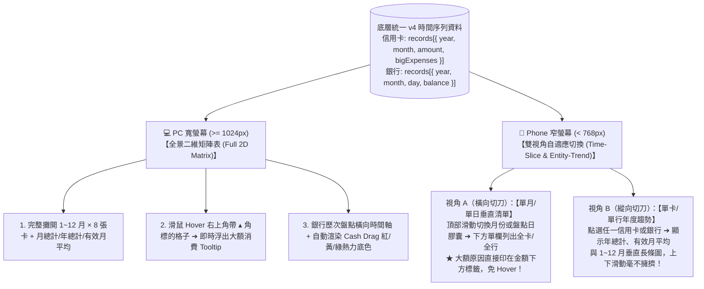
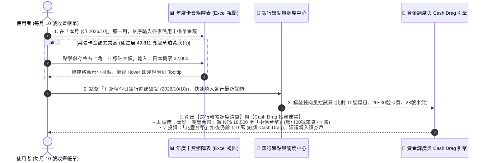

# PocketMoney 產品核心脈絡與 v4 統一架構設計全書 (Unified Product & Architecture Design)

> - **文件定位**：本文件整合了專案演進過程中的多份探索提案（[`PocketMoneyObjects.md`](file:///c:/Playground26/wiskinglin.github.io/_dev/PocketMoney/PocketMoneyObjects.md)、[`SUB_DATABASE_STOCK_FLOW_PROPOSAL.md`](file:///c:/Playground26/wiskinglin.github.io/_dev/PocketMoney/SUB_DATABASE_STOCK_FLOW_PROPOSAL.md)、[`TIMELINE_DATA_PROPOSAL.md`](file:///c:/Playground26/wiskinglin.github.io/_dev/PocketMoney/TIMELINE_DATA_PROPOSAL.md)、[`analysis.md`](file:///c:/Playground26/wiskinglin.github.io/_dev/PocketMoney/analysis.md)）以及與產品擁有者（User）的深度訪談決策。
> - **核心目的**：在不更動現行 v3 正式版規格書 [`SDD.md`](file:///c:/Playground26/wiskinglin.github.io/_dev/PocketMoney/SDD.md) 的前提下，完整記錄**「真實使用情境、為何現有 PoC 仍無法取代 Excel、歷史設計決策的取捨脈絡、以及下一代 v4 的終極資料模型與互動架構」**，作為後續所有 AI Agent 與開發者查閱的單一事實來源（Single Source of Truth）。

---

## 第一章：應用本質與真實使用流程（為什麼做完 PoC 還是回到 Excel？）

### 1.1 真實世界的每月財務作息時間軸 (The Monthly Financial Rhythm)

PocketMoney 不是給「每天記便當錢」的人用的，它的真實使用場景是一套**高度規律、以「月」為循環週期的個人資金調度與資產盤點作業**。使用者每個月的真實金融事件發生順序如下：

1. **每月 5 號 ～ 10 號（帳單收單與異常查帳）**：
   - 5 號開始陸續收到各家銀行的信用卡帳單，通常 **10 號以前**會拿到所有帳單。
   - **大額查帳習慣**：如果看到某張卡當月帳單金額異常高（例如星展衝到 `NT$ 49,811`），有空時會去翻帳單明細，把大筆支出寫在 Excel 儲存格的註解或旁邊，**滑鼠一移過去（Hover）就能一眼回想起「為什麼那個月 49,000 這麼高」**。
2. **固定費用的兩種截然不同支付路徑（時間遞延效應）**：
   - **路徑 A：透過信用卡代繳（水電、瓦斯、網路）**：
     - 例如 10/21 付款截止日，透過信用卡刷卡繳納後，這筆費用會進入信用卡 11/5 的結帳週期，**實際從銀行扣款的時間被延後到 11/2X**，且金額**已經包含在信用卡的帳單總額內**。
   - **路徑 B：透過銀行帳戶直接扣款（房租、車貸）**：
     - **房租**：固定每月 **10 號** 從指定銀行自動轉帳。
     - **車貸**：固定每月 **28 號** 從指定銀行自動扣款。
3. **每月 10 號前後（核心痛點：跨行資金調度與 Cash Drag 檢查）**：
   - 台灣的銀行信用卡自動扣繳通常**強制綁定本行帳戶**（玉山卡只能扣玉山戶、國泰卡只能扣國泰戶、台新卡只能扣台新戶）。
   - 當 10 號收齊所有卡費金額、房租扣款、且已知 28 號要扣車貸時，使用者必須去確認各個銀行戶頭的餘額，回答兩個問題：
     1. **【下限防禦：防跳票調度】** 哪個銀行戶頭在 20～30 號扣款時會不夠錢？現在需要從主力戶轉多少錢過去？
     2. **【上限防禦：防 Cash Drag（現金拖累）】** 哪些銀行戶頭躺了太多閒置資金（例如兆豐台幣放了 111 萬標紅底、證券戶累積超過 50 萬標黃底），應該趕快找地方投資？

---

### 1.2 為什麼目前的 PoC (`v3`) 做完，使用者還是回到 Excel？

這是一個最關鍵的產品反思。對比使用者真實維護的兩張 Excel 大表（**「年度信用卡月份 × 銀行交叉表」** 與 **「銀行餘額不定期盤點時間軸表」**），現行 [`SDD.md`](file:///c:/Playground26/wiskinglin.github.io/_dev/PocketMoney/SDD.md)（`tools/pocketmoney.html` v3）存在 **5 個致命斷層**，導致它不如 Excel 好用：

| 斷層項目 | Excel 目前做得到的事（吸引用戶留下的原因） | 現有 PoC (`v3`) 的缺陷（推開用戶的原因） |
| :--- | :--- | :--- |
| **1. 時間記憶與全局視野** | **二維矩陣一眼看穿全年**：Excel 打開就是 `2025/1 ~ 2025/12` × `8 張信用卡` 的完整矩陣，同時看到月總計、年總計、月平均，還能橫向看銀行在 `5/21, 6/5, 6/19, 6/30` 的水位變化。 | **單月失憶症**：只有「當期 (`statementTotal`)」一個欄位。按「新月份重置」就把上個月抹掉了，完全無法累積年份與月份的長期資產與消費軌跡。 |
| **2. 輸入與操作的摩擦成本** | **直接在格子打字、不廢話**：收到帳單，在對應年月的格子打上數字就結束。帳單本來就一定會自動扣繳，根本不需要每個月去點 8 次「標記已繳」。 | **多餘的 `paid` 狀態儀式**：強迫使用者每個月去做「待繳 ➔ 點擊扣款入帳 (`paid=true`) ➔ 新月份重置 (`paid=false`)」的繁瑣狀態切換，違反直覺。 |
| **3. 固定費用的重複扣款陷阱** | 在腦中或 Excel 分開處理：清楚知道水電瓦斯已經刷卡（算在卡費裡），只有房租（10號）與車貸（28號）會直接扣銀行。 | **模型混為一談**：把水電瓦斯跟房租全部當成「綁定銀行扣款 (`bankId`)」，若誠實輸入水電費與信用卡總額，銀行預估餘額就會被**重複扣兩次**！ |
| **4. 顏色標註的風控語義** | **雙向視覺警示**：Excel 裡用紅/黃/綠底色標記「銀行餘額過高（Cash Drag 閒置資金需投資）」以及「某月卡費異常暴增（需查帳）」，並用儲存格註解記錄大額明細。 | **只看不足額、不管閒置資金**：只有餘額 `< 0` 才會亮紅燈，對於「兆豐躺了 120 萬沒拿去投資（Cash Drag）」完全無感；大額消費也沒有跟歷史年月綁定。 |
| **5. 真實月平均的分母智慧** | **自動排除未持卡月份**：例如兆豐卡只有 1~4 月有帳單（共 `27,972`）、5~12 月灰底空白，Excel 月平均除以 **4 個月** (`6,993`)；富邦數位 1~2 月填 `NT$0`，月平均除以 **12 個月** (`6,202`)。 | 無歷史資料結構，更沒有區分「刷 `0` 元（有持卡）」與「`null` 空白（未開卡/停卡）」。 |

---

## 第二章：這套系統到底解決了什麼核心問題？

綜合上述分析，PocketMoney 的終極定位是 **「零流水帳負擔的個人財務指揮中心（Personal Liquidity, Cash-Drag & Statement Matrix Engine）」**，專門解決以下四大核心問題：

1. **解決「多卡多帳戶的月底跳票焦慮」與「跨行轉帳調度計算」**：
   - 在每月 10 號收齊帳單時，自動將「20~30 號待扣卡費」、「10 號房租」、「28 號車貸」精準歸戶到各自的扣款銀行，直接算出**哪幾家銀行有缺口、該從哪個充裕帳戶轉多少錢過去**。
2. **解決「Cash Drag（閒置現金拖累報酬率）」的視覺盲區**：
   - 除了守住下限（不透支），更主動監控上限。當銀行活存或證券交割戶扣完當月應付帳款後，餘額仍超過設定閾值時，自動以**黃燈／紅燈**標記，提醒將閒置資金投入股市或高利標的。
3. **解決「為什麼那個月花這麼多？」的事後查帳需求（抓大放小）**：
   - 徹底放棄每日流水帳。全年只記 `12 個月 × N 張卡` 的帳單總額；當某月帳單異常飆高時，提供儲存格等級的 **大額消費註解 (`> 5,000` Hover Tooltip)**，滑鼠移過去立刻看到「當月大筆支出原因」。
4. **解決「長期年度消費結構與資產走勢」的留存分析**：
   - 自動彙算每張卡與整體的「月總計」、「年總計」、「有效月平均（自動識別 `0` 與 `null`）」，並留存銀行不定期盤點的水位軌跡。

---

## 第三章：業界與開源財務軟體是怎麼設計的？（Best Practices 借鏡）

在檢視台灣主流 App（詳見 [`analysis.md`](file:///c:/Playground26/wiskinglin.github.io/_dev/PocketMoney/analysis.md)）與全球知名開源個人財務系統後，我們可以歸納出業界的三大設計流派與我們應汲取的 Best Practice：

### 3.1 台灣主流記帳 App 的局限
- **CWMoney / Ahorro / Moze**：以「發票掃描、每日餐飲分類流水帳」為核心。痛點是**高度消耗意志力**，且專注於「過去花了什麼」，對「月底某銀行夠不夠扣款、多少現金在閒置」毫無幫助。
- **MoneyBook 麻布記帳**：雖能自動同步多家銀行與信用卡，但**必須交出各家網銀帳號密碼**，存在極高資安與合規疑慮（違反本專案 Local-First 絕對隱私原則）。

### 3.2 全球開源個人財務軟體的三大黃金實踐 (Open-Source Best Practices)

| 開源專案 | 核心架構模式 | 值得 PocketMoney 吸收的設計精髓 |
| :--- | :--- | :--- |
| **1. Beancount** *(Plain Text Accounting)* | **存量斷言 (`balance` directive) + 差額自動填補 (`pad`)** | **【對應：銀行餘額盤點】** Beancount 允許使用者不記日常小帳，只需不定期宣告某天的真實餘額（如 `2025-06-19 balance Bank:ESun 185373 TWD`），系統自動算出兩次盤點間的隱含淨流量（Implied Flow）。這證明**銀行餘額本質上就是「不定期的日期存量斷言（Date-Point Balance Assertions）」**。 |
| **2. Actual Budget** *(Local-First Envelope)* | **2D 預算矩陣 + 信用卡負債路由 (Payment Routing)** | **【對應：信用卡代繳固定費用】** 當水電費使用信用卡支付時，資金流向是 `Expense:Utility ➔ Liability:CreditCard`，**銀行活存完全不動**；直到卡費扣款日，才發生 `Asset:Bank ➔ Liability:CreditCard`。這完美解決了固定費用刷卡代繳的重複扣款問題。 |
| **3. Firefly III / Maybe** | **靜態帳戶設定 (Master) + 時序快照/帳單實例 (Time Series)** | **【對應：主檔與時間子物件分離】** 帳戶本身只存「規則、綁定關係、安全水位門檻」；所有的金額都存放在以「數值化時間 (`year, month, day`)」索引的子序列中，確保跨年比較（YoY）、季度統計、月均值計算具備最高查詢效能。 |

---

## 第四章：既有三份設計提案的演進脈絡與取捨（給未來 Agent 的歷史紀錄）

在專案探索階段，曾先後產出三份架構提案文件。以下記錄各文件的核心貢獻，以及**經過實際情境驗證後決定保留與捨棄的項目**：

1. **[`PocketMoneyObjects.md`](file:///c:/Playground26/wiskinglin.github.io/_dev/PocketMoney/PocketMoneyObjects.md)（領域物件與時序投影模型）**：
   - ✅ **保留精髓**：
     - 區分「名目結帳日 (`closingDay`，如 5~10 號)」與「扣款日 (`dueDay`，如 20~30 號)」。
     - 分期付款的「首期含餘數 (`firstPeriodAmount`) vs 續期常態金額 (`regularPeriodAmount`)」零頭平攤演算法。
     - 銀行帳戶的水位警戒概念（並由單一下限擴充為「下限防透支 + 上限防 Cash Drag」）。
   - ❌ **修正與捨棄**：
     - 原先將所有時間推進都轉化為逐日 `CashflowEvent` 雖在理論上完美，但對「每月 10 號看一次、不定期盤點銀行」的使用者而言過於繁重；應簡化為「月度帳單矩陣」與「不定期銀行盤點快照」。

2. **[`SUB_DATABASE_STOCK_FLOW_PROPOSAL.md`](file:///c:/Playground26/wiskinglin.github.io/_dev/PocketMoney/SUB_DATABASE_STOCK_FLOW_PROPOSAL.md)（子資料庫與存量 × 流量提案）**：
   - ✅ **保留精髓**：
     - **最重要的架構突破**：確立了**「銀行餘額是存量（Stock，按年月日 `YYYY-MM-DD` 記錄）」**與**「信用卡帳單是流量（Flow，按年月 `YYYY-MM` 記錄）」**的時間粒度分離原則！
     - 每個主實體向下掛載專屬歷史紀錄子集的概念，能 100% 向下相容現有 [`SDD.md`](file:///c:/Playground26/wiskinglin.github.io/_dev/PocketMoney/SDD.md)。
   - ❌ **修正與捨棄**：
     - **捨棄歷史紀錄中的 `paid: boolean` 與繁瑣的雙向交易外鍵 (`bankLedgerEntryId`)**：因為在真實情境中，帳單不可能不付，20~30 號銀行會自動扣走；使用者要的是在 10 號做完資金調度，並留存各月帳單數字供長期分析，不需要每個月手動為每張卡點擊結清來寫入銀行流水。

3. **[`TIMELINE_DATA_PROPOSAL.md`](file:///c:/Playground26/wiskinglin.github.io/_dev/PocketMoney/TIMELINE_DATA_PROPOSAL.md)（3D 時間軸與過去/現在/未來投影提案）**：
   - ✅ **保留精髓**：
     - 「過去是封存的實際數據、現在是當期工作區、未來是由分期與固定規則自動推算的預估（`isProjected`）」三段式時間觀。
     - 分期付款加入 `startYear / startMonth`，讓系統能根據當前月份自動推算已繳期數與未來各月分期負擔，免去手動按 `+1 期` 的麻煩。
   - ❌ **修正與捨棄**：
     - **將時間索引由單純 `"YYYY-MM"` 字串升級為結構化數值 (`year: number, month: number, day?: number`)**：方便未來直接進行跨年度聚合、季度切片、同期比較（YoY）與排序分析。
     - 視覺化優先做好**超越 Excel 的高密度 2D 交叉矩陣表（Matrix Table）**，而非先做华而不實的 3D 走道。

---

## 第五章：設計層面需考量的核心領域元素（v4 統一資料模型）

為了讓系統同時具備 **Excel 的二維矩陣直覺** 與 **軟體的自動化風控分析能力**，我們將五大核心元素重新定義如下：

### 5.1 元素總覽與實體關係圖 (v4 Unified ER Diagram)

---

### 5.2 各領域元素的設計細節與數學邏輯

#### 元素一：信用卡帳單 (`CreditCard` & `CardMonthlyRecord`)
1. **移除無意義的歷史 `paid` 狀態**：
   - 歷史與當期帳單子物件只存純粹的事實數據：`{ year: number, month: number, amount: number | null, bigExpenses?: [], note?: string }`。
2. **數值化時間 (`year`, `month`) 支援高階數據分析**：
   - 不用字串 `"2025-01"`，直接存整數 `year: 2025`, `month: 1`。
   - **年度總計 ($AnnualTotal$)**：
     $$AnnualTotal(c, Y) = \sum_{r \in c.records, r.year = Y, r.amount \neq null} r.amount$$
   - **有效月平均 ($MonthlyAvg$ — 完美還原 Excel 邏輯)**：
     - 區分 **`amount === 0`（有持卡但當月刷 0 元，如富邦數位 1~2 月）** 與 **`amount === null` 或無該月紀錄（未開卡或已停卡，如兆豐 5~12 月灰底空白）**：
     $$ActiveMonths(c, Y) = \text{count}(r \in c.records \mid r.year = Y \land r.amount \neq null)$$
     $$MonthlyAvg(c, Y) = \begin{cases} \mathrm{round}\left(\frac{AnnualTotal(c, Y)}{ActiveMonths(c, Y)}\right) & \text{if } ActiveMonths > 0 \\ 0 & \text{otherwise} \end{cases}$$
3. **大額消費 (`bigExpenses`) 轉型為「月度儲存格的 Hover 查帳註解」**：
   - 當某張卡某月的 `amount` 大於該卡設定的 `highSpendWarn`（或大於該卡月平均的 $1.5$ 倍）時，表格儲存格自動呈現**琥珀黃／玫瑰紅警示底色**。
   - 使用者點擊該格即可補充 `bigExpenses`（例如：`[{ title: '長榮機票', amount: 32000 }, { title: '好市多採買', amount: 8500 }]`）。
   - 平常在年度大表上，只要**滑鼠 Hover 到該月份的金額上，就會浮出精美 Tooltip 顯示當時為什麼刷這麼多**！

---

#### 元素二：銀行餘額與不定期盤點 (`Bank` & `BankSnapshot`)
1. **支援同月多次不定期盤點 (`year`, `month`, `day`)**：
   - 對應使用者的 Excel 習慣（例如 `2025/5/21`、`2025/6/5`、`2025/6/19`、`2025/6/24`、`2025/6/30`），每次盤點的時間座標為 `(year, month, day)`，排序鍵值為 $DateKey = year \times 10000 + month \times 100 + day$。
   - 每個銀行帳戶的當前餘額 `bank.balance`，永遠自動同步為 `records` 中 $DateKey$ 最大（最新）那一筆的 `balance`。
2. **雙邊界風控燈號（防跳票下限 + 防 Cash Drag 上限）**：
   - 系統針對每個銀行帳戶在任意盤點時間點提供三色語義（完美對應 Excel 的紅/黃/綠底色）：
     - 🔴 **透支危險（Shortfall）**：當「最新餘額 $-$ 本月待扣卡費 $-$ 本月待扣直扣固定費用 $< minReserve$」時，亮紅框警示需立刻轉入資金。
     - 🔴 / 🟡 **Cash Drag 閒置資金警示（Excess Cash）**：當扣除本月所有應付帳單後的淨結餘 $> cashDragAlert$（紅底）或 $> cashDragWarn$（黃底）時，提示**「閒置現金過高，造成 Cash Drag，建議轉入證券戶或投資標的」**。
     - 🟢 **水位健康（Optimal Liquidity）**：介於安全預備金與 Cash Drag 警戒線之間。

---

#### 元素三：固定費用的「雙軌分流」(`RecurringBill`)
為了徹底解決「水電瓦斯刷信用卡」造成的重複扣款與時間遞延問題，固定費用強制分為兩類：

| 類型 | `paymentMethod` | 代表項目 | 扣款/截止日 (`dueDay`) | 對「銀行待扣檢核」的影響 | 對「信用卡帳單」的影響 |
| :--- | :--- | :--- | :--- | :--- | :--- |
| **銀行直扣型** | `'bank_direct'` | **房租** (10號轉帳) **車貸** (28號扣款) | `10`、`28` | **直接納入**該銀行當月待扣總額（若盤點日 $< dueDay$，代表尚未扣除，需預留資金） | 無影響 |
| **刷卡代繳型** | `'card_auto'` | **水電、瓦斯、網路** | `21` (刷卡日) | **不直接扣減銀行餘額**（避免與信用卡帳單總額 Double Counting！） | 作為所屬信用卡帳單的「固定底層組成提示」，並記錄水電各月歷史金額供生活成本分析 |

> 💡 **智慧時間感知（Date-Aware Deduction）**：
> 因為房租是 **10 號**扣款、車貸是 **28 號**扣款、卡費是 **20~30 號**扣款：
> - 如果使用者在 **10 月 8 號** 盤點銀行餘額：系統知道 10 號的房租**還沒扣**，所以該銀行的「待扣總額」會包含「10 號房租 + 20~30 號卡費 + 28 號車貸」。
> - 如果使用者在 **10 月 12 號** 盤點銀行餘額：系統知道 10 號的房租**已經扣過了**（盤點餘額已是扣完房租後的數字），因此剩下的「待扣總額」就只會算「20~30 號卡費 + 28 號車貸」（當然也支援手動勾選微調）！這才是真正懂使用者作息的智慧檢核。

---

#### 元素四：分期付款的自動時間推演 (`Installment`)
1. **告別手動按 `+1 期`**：
   - 每筆分期記錄 `startYear` 與 `startMonth`（例如 `2025 年 6 月` 開始分 12 期）。
   - 當檢視任意目標年月 $(Y, M)$ 時，系統自動計算該月是第幾期：
     $$PeriodIndex(Y, M) = (Y - startYear) \times 12 + (M - startMonth) + 1$$
   - 若 $1 \le PeriodIndex \le totalPeriods$，則該分期在該月份自動生效（第 1 期帶入 `firstPeriodAmount`，第 2 期以後帶入 `regularPeriodAmount`）。
2. **未來現金流自由日預告**：
   - 自動在年度矩陣表的未來月份（如 `2026/11`、`2026/12`）填入已確定的分期底部金額，一眼看出哪一個月分期結束、現金流大解放。

---

## 第六章：如何透過軟體設計與 UX 流程完美整合（PC × Phone 雙棲超越 Excel 的關鍵設計）

### 6.0 核心痛點突破：為什麼 Excel 在電腦上是神器，在手機上卻是災難？

使用者一針見血地指出：**「雖然需要矩陣表格來看全局，但 Excel 在手機上看與操作非常痛苦！」**
原因在於：
1. **視覺維度衝突（看）**：「10 欄（8 張卡 + 月份 + 總計）× 14 列」的二維表格是為橫向寬螢幕設計的。在手機直式窄螢幕（`360px ~ 430px`）上，使用者被迫同時「上下滑動 + 左右滑動」，滑到右邊忘了左邊是幾月，字體還小如螞蟻。
2. **觸控與鍵盤衝突（輸入）**：在手機 Excel 點擊微小儲存格時，虛擬鍵盤跳出直接遮蔽半個螢幕；要切換儲存格或輸入「大額消費註解（Comment）」時更是寸步難行。

> **核心設計哲學：「底層同一套時間矩陣資料，頂層依『輸入 vs 瀏覽』與『PC vs Phone』自適應投影（Adaptive Projection）」**。

---

### 6.1 深度拆解：【輸入使用 (Input Mode)】—— PC 與手機怎麼輸入最無痛？

觀察真實生活，除了初次匯入全年舊帳外，**日常 95% 的輸入行為都只發生在「單一時間切片（本月帳單 或 今日銀行盤點）」**：
- 每月 10 號收齊帳單：只需要把 8 張信用卡在「**這個月（如 `2026/10`）**」的數字填進去。
- 打開網銀盤點：只需要把 8 家銀行在「**今天（如 `2026/10/10`）**」的餘額填進去。

因此，我們針對 PC 與 Phone 提供兩種截然不同但共享資料的輸入體驗：

| 裝置環境 | 最佳輸入模式 | 互動細節與人體工學設計 |
| :--- | :--- | :--- |
| **📱 手機端 (Phone)** | **「單一時間切片・垂直快打抽屜」** *(Single-Slice Vertical Batch Input)* | 1. **拒絕在手機戳二維小格子**：點擊「⚡ 登記本月卡費」或「⚡ 新增今日盤點」，彈出專注於該月份／該日期的**單欄垂直清單**。 2. **純數字大鍵盤連續跳格**：每個輸入框綁定 `inputmode="numeric"`，打完第一張卡按鍵盤右下角 `Enter / 下一張`，焦點自動跳至下一張卡，**單手拇指 30 秒填完 8 張卡**。 3. **異常高額原地展開標註**：當輸入金額超過該卡警戒線（如星展輸入 `49,811`），該列下方自動浮現 `[+ 標註大額原因]`，點一下原地展開輸入 `日本機票 32000`，免跳轉視窗。 |
| **💻 電腦端 (PC)** | **「全景二維矩陣直打 + 鍵盤導航」** *(2D Matrix Inline Edit)* | 1. **Excel 級原位編輯**：在 `1~12 月 × 各信用卡` 矩陣中直接點擊任一儲存格輸入數字。 2. **鍵盤快捷鍵流**：按 `Enter` 自動跳至「同卡下一個月」、按 `Tab` 自動跳至「同月下一張卡」。 3. **歷史帳單快速補登**：在大螢幕上可隨時回填或修正過去任一年月的金額與大額註解。 |

---

### 6.2 深度拆解：【瀏覽與分析 (Browse & Audit Mode)】—— PC 與手機怎麼看最清楚？

當使用者在「看」資料時，本質上是在問兩類問題：
- **橫向問題（同月跨卡／同日跨行）**：「10 月總共刷多少？哪家銀行不夠扣要轉帳？哪家銀行 Cash Drag 亮紅燈？」
- **縱向問題（同卡／同行跨時間）**：「為什麼 9 月花這麼多？國泰 Cube 今年年總計與月平均多少？兆豐台幣的 120 萬什麼時候轉走的？」

1. **💻 電腦端瀏覽（PC Browse）：「全景二維矩陣 + 滑鼠 Hover 氣泡」**
   - 直接呈現完整的二維交叉表（如同 Excel，但自動算好排除空白月的有效月平均，並自動渲染 Cash Drag 與異常高消費底色）。
   - **滑鼠 Hover 查帳**：儲存格右上角若有琥珀色標記 `▴`，滑鼠移過去直接浮出大額消費明細氣泡，不需點開彈窗。
2. **📱 手機端瀏覽（Phone Browse）：徹底消滅「左右 + 上下同時滑動」的痛苦**
   - **手機視角 A（預設：時間切片視角）**：
     - 頂部提供可左右撥動的**時間膠囊列（Time Scrubber）**，例如：`[ 8月 ]` `[ 9月 ]` **`[ ● 10月 ($97,056) ]`** `[ 11月 ]`。
     - 下方以**單欄垂直卡片列**呈現該月各張信用卡金額（左卡名、右金額）。
     - **免 Hover 直顯大額標籤**：因為手機沒有滑鼠游標，凡是該月有標記大額消費的卡片，**直接在金額正下方顯示一行琥珀色標籤（如 `🏷️ 長榮機票 $32,000 · 保養 $12,000`）**，滑手機時一眼看穿為什麼那個月特別高！
   - **手機視角 B（單卡／單銀行縱向趨勢視角）**：
     - 點擊任一張信用卡（如 `國泰Cube`），切換（或展開）該卡的年度縱向視圖：頂部呈現 **`年總計 NT$272,463`** 與 **`月平均 NT$22,705`**，下方垂直列出 `1月 ~ 12月` 的金額長條圖與大額紀錄，完全符合手機上下滑動的直覺。
   - **桌機／手機視角自由切換開關**：在介面上方提供 `[🖥️ 全景矩陣]`、`[📱 月份切片]`、`[📊 單卡趨勢]` 切換器，在電腦上也能看單卡趨勢，在手機橫放時也能看全景矩陣！

---

### 6.3 核心操作流程整合：每月 10 號的「3 分鐘黃金工作流」

---

### 6.2 四大殺手級 UI 視圖設計（結合 Excel 的快 + App 的聰明）

#### 視圖 1：信用卡「年度月份 × 銀行」全視角矩陣表 (The Statement Matrix)
- **完全復刻並升級您的圖 2 Excel 表**：
  - **列（Rows）**：`1月` ～ `12月` + 底部固定兩列 **`年總計`**、**`月平均`**（自動排除空白未持卡月份）。
  - **欄（Columns）**：`玉山`、`台新`、`富邦數位`、`富邦好市多`、`兆豐`、`星展`、`中信`、`國泰Cube` + 右側固定欄 **`月總計`**。
- **超越 Excel 的三大互動**：
  1. **直接點擊格子內聯輸入 (Inline Edit)**：支援鍵盤 `Tab` / `Enter` 像 Excel 一樣橫向或縱向連續輸入數字。
  2. **智慧底色與 Hover 查帳氣泡**：
     - 當某格金額超過該卡月均 $1.5$ 倍（或自訂門檻），自動加上柔和琥珀色底。
     - 有標記 `bigExpenses` 的格子右上角會出現一個精緻的琥珀色小角標 `▴`，**滑鼠一移過去（Hover），不用點開彈窗，立刻浮出大額消費清單（如：`長榮機票 NT$32,000`）與該卡當月包含的分期項目**！
  3. **一鍵切換視角**：可切換顯示「總帳單金額」、「僅看扣除分期後的純新增消費」、「未來 6 個月已背負分期預測」。

#### 視圖 2：銀行餘額「時間軸盤點矩陣」與 Cash Drag 熱力圖 (The Liquidity & Cash Drag Matrix)
- **完全復刻並升級您的圖 3 Excel 表**：
  - **列（Rows）**：各銀行帳戶（`兆豐台幣`、`玉山證券`、`玉山薪轉`...）+ 底部 **`當日總資金`**。
  - **欄（Columns）**：歷次盤點日期（`2025/5/21`、`2025/6/5`、`2025/6/19`、`2025/6/30`...），最右側（或最左側）為**「➕ 新增今日盤點」**與**「月底扣款後預估結餘」**。
- **超越 Excel 的自動色階（免手動塗顏色）**：
  - 系統根據每個帳戶設定的 `minReserve`（下限）與 `cashDragWarn / cashDragAlert`（上限），**自動為每個日期的餘額格子渲染紅／黃／綠底色**！
  - 當您把兆豐台幣的 100 萬轉走買股票，下一欄盤點輸入 `164,736` 時，格子**自動從紅底變成清爽的綠底**，視覺回饋感極強。

#### 視圖 3：10 號專屬「跨行轉帳調度小幫手」(Cross-Bank Dispatch Advisor)
- 在 Excel 裡，您看到 A 銀行不夠錢、B 銀行錢太多，還得自己心算要轉多少錢。
- 在 PocketMoney 首頁，系統直接根據當月待扣卡費與直扣費用（房租 10 號、車貸 28 號），幫您列出**具體的行動指令卡片**：
  - **指令 1（防跳票必做）**：`[玉山薪轉]` 本月待扣卡費 `NT$ 26,225`，目前餘額 `NT$ 20,000` ➔ **請轉入 `NT$ 6,225`**。
  - **指令 2（Cash Drag 提醒）**：`[兆豐台幣]` 扣完所有費用後仍閒置 `NT$ 1,118,806`（超過上限 50 萬）➔ **建議調度 `NT$ 600,000` 至證券交割戶**。

#### 視圖 4：固定費用「支付路徑分流看板」(Dual-Track Recurring Bills)
- 將固定費用介面清晰拆為上下兩區：
  1. **🏦 銀行帳戶直接扣款區（影響銀行水位）**：如「房租（每月 10 號・國泰）」、「車貸（每月 28 號・中信）」，標明扣款日，並與銀行檢核直接連動。
  2. **💳 信用卡自動代繳區（不重複扣銀行，追蹤生活剛性成本）**：如「台電電費（雙月 21 號・刷台新卡）」、「天然氣」、「光纖網路」，可同樣展開 1~12 月矩陣記錄各期水電金額，觀察夏季/冬季電費變化，但絕不會干擾銀行餘額試算。

---

## 第七章：總結——從 v3 到 v4 的核心設計準則

1. **讓矩陣表格成為一級公民（Matrix-First UI）**：保留現有精美的 KPI 總覽卡片，但在「信用卡」與「銀行餘額」分頁導入高密度的 **Excel 式二維時間矩陣表**，解決「見樹不見林」的痛點。
2. **消滅多餘的手動狀態切換（Zero-Ceremony Workflow）**：移除歷史紀錄的 `paid` 欄位，以「盤點日期 (`year, month, day`)」與「帳單年月 (`year, month`)」的自然推進取代手動重置。
3. **精確反映真實金融物理規則（Accurate Financial Physics）**：
   - 嚴格區分固定費用的「銀行直扣（10號房租/28號車貸）」與「信用卡代繳（水電網路延後出帳）」。
   - 嚴格區分月平均計算中的「`0` 元帳單（分母 $+1$）」與「`null` 未持卡（分母不計）」。
   - 同時守住「透支下限（防跳票）」與「閒置上限（防 Cash Drag）」。
4. **大額消費即註解（Big Expenses as Hover Annotations）**：將 `> 5,000` 大額消費直接內嵌於各卡各月的帳單紀錄中，實現「看到異常高金額 ➔ 滑鼠 Hover 秒看原因」的無縫查帳體驗。

