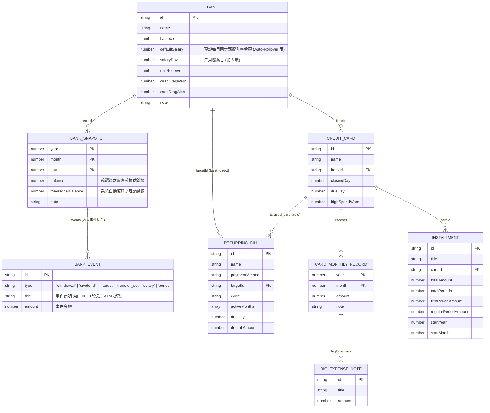

# PocketMoney 使用者體驗與介面設計規格書 (User Experience & UI Design, UXD)

## Revision (版本修訂紀錄)

| 版本 | 日期 | 修訂摘要 |
| :--- | :--- | :--- |
| **Rev 0.1** | 2026-10-29 | 初版建立：整合早期探索提案，制定「零 AI Slop」介面鐵律，定案「信用卡帳單輪播輸入」、「大額費用二階段翻面綁定」與「銀行餘額理論推算＋收支事件歸戶」流程。 |

---

> - **文件定位**：整合專案演進過程中的探索提案（[`PocketMoneyObjects.md`](file:///c:/Playground26/wiskinglin.github.io/_dev/PocketMoney/achieved/PocketMoneyObjects.md)、[`SUB_DATABASE_STOCK_FLOW_PROPOSAL.md`](file:///c:/Playground26/wiskinglin.github.io/_dev/PocketMoney/achieved/SUB_DATABASE_STOCK_FLOW_PROPOSAL.md)、[`TIMELINE_DATA_PROPOSAL.md`](file:///c:/Playground26/wiskinglin.github.io/_dev/PocketMoney/achieved/TIMELINE_DATA_PROPOSAL.md)、[`analysis.md`](file:///c:/Playground26/wiskinglin.github.io/_dev/PocketMoney/achieved/analysis.md)）與產品訪談決策。
> - **核心目的**：在不更動現行規格書 [`SDD.md`](file:///c:/Playground26/wiskinglin.github.io/_dev/PocketMoney/SDD.md) 的前提下，透過逐一流程與 UI 深度訪談，定義新一代的**核心業務流程、UI 視圖規格與資料模型（Schema）**，作為開發與設計的單一事實來源（Single Source of Truth）。

---

## 第零章：文件與 UI 實作鐵律（Zero-Slop UI & Documentation Rules）

為防止文件中的架構解釋或開發備註滲透至最終產品介面，所有 AI Agent 與開發者在撰寫規格、製作 Mockup 或實作 HTML 時，必須嚴格遵守以下規範：

### 0.1 強制區分 `【設計邏輯】` 與 `【UI 實際文字】`
- **`【設計邏輯 (Design Logic)】`**：僅供開發者理解業務規則、計算公式與狀態條件，**嚴禁渲染至 HTML DOM 中**。
- **`【UI 實際文字 (Exact UI Copy)】`**：明確列於規格書「B. 介面文字清單」內的字串。**只有被定義為 `UI 實際文字` 的字串才允許出現在畫面上**。

### 0.2 三條「零 AI Slop」介面鐵律
1. **禁用版本與開發標籤**：
   - 畫面上禁止出現 `✨ NEW v4`、`PC 版 UI Mockup`、`PoC`、`Beta`、`v4 新介面` 等開發過程標籤。
2. **禁用架構術語作為介面標題**：
   - 禁止在畫面上使用 `跨日快照矩陣`、`信用卡年度帳單矩陣 (5~10號收單...)`、`存量斷言`、`雙軌分流` 等內部設計詞彙。
   - 真實產品標題僅使用簡潔名詞：**`銀行餘額`**、**`信用卡費`**、**`固定費用`**、**`分期付款`**、**`台股部位`**。
3. **禁止整排教學式副標題**：
   - 禁止在頁面或表格上方印出操作說明書（例如：`點擊任一金額可直接原地修改；滑鼠移過右上角...`）。
   - 介面互動應透過游標狀態（`cursor: pointer` / `text`）、Hover 高亮、Focus 邊框與直覺按鈕傳達，不依賴文字解釋。

---

## 第一章：真實使用情境與純動作流程 (User Action Flows)

### 1.1 每月財務週期事件表

系統針對以「月」為週期的個人資金盤點與扣繳檢核設計，每月的實際金融事件時序如下：

| 時間區間 | 事件類型 | 實際發生內容 | 資金扣款路徑 |
| :--- | :--- | :--- | :--- |
| **每月 5 號 ～ 10 號** | 信用卡出帳 | 各家銀行陸續寄發信用卡帳單，10 號前收齊當月應繳總額。 | 將於 20～30 號從各卡綁定的同名銀行帳戶自動扣款。 |
| **每月 10 號** | 房租扣款 | 固定於 10 號當日由指定銀行帳戶自動轉帳。 | 銀行帳戶直接扣款 (`bank_direct`)。 |
| **每月 10 號 ～ 19 號** | 餘額盤點與資金調度 | 盤點各銀行帳戶餘額，檢核是否足以支付 20～30 號卡費與 28 號車貸；若有不足則跨行轉帳補足，若有過多閒置資金則評估轉投資。 | 跨銀行帳戶轉帳。 |
| **每月 20 號 ～ 30 號** | 信用卡自動扣繳 | 各家信用卡依扣款日（20～30 號）從綁定銀行帳戶扣款。 | 銀行帳戶自動扣繳。 |
| **帳單截止日前 (如 21 號)** | 公用事業費代繳 | 水電、瓦斯、網路費透過信用卡刷卡代繳。 | 併入信用卡下期（次月 5 號）帳單，不直接扣減當月銀行餘額 (`card_auto`)。 |
| **每月 28 號** | 車貸扣款 | 固定於 28 號當日由指定銀行帳戶自動扣款。 | 銀行帳戶直接扣款 (`bank_direct`)。 |

---

### 1.2 核心使用者動作流程 (Action Flows)

> **一致性原則**：本節僅記錄已透過訪談定案之動作流程，並與第三章 UI 規格完全同步；尚未訪談定案之步驟標註為 `[待訪談定案]`，不預先填入舊版假設。

#### 流程一：每月收齊信用卡帳單並輸入（輸入與瀏覽分離）
| 步驟 | 觸發時機 (Trigger) | 使用者動作 (User Action) | 系統計算邏輯 (System Logic) | 畫面變化 (UI State Change) |
| :--- | :--- | :--- | :--- | :--- |
| **1. 第一階段：輪播輸入每月卡費總額** | 每月 5～10 號收到帳單，進入「卡片輪播輸入模式」 | 針對畫面中央聚焦顯示之「本月尚未輸入」信用卡，輸入當月帳單總額並按 `Enter` | 將金額寫入該卡當月紀錄 `records[{year, month, amount}]`，並將該卡標記為本月已輸入，篩選下一張未輸入卡片 | 當前信用卡面滑入歸檔，自動滑出下一張尚未輸入的信用卡面（不中斷輸入總額節奏） |
| **2. 第二階段：逐張翻面確認並綁定大額費用** | 第一階段全數卡片總額輸入完畢後，自動進入第二階段 | 針對翻面聚焦之卡片（系統優先排列本月金額較高之卡片），輸入大額消費項目名稱與金額（或略過無大額之卡片） | 將大額明細直接寫入該卡當月之 `bigExpenses` 陣列完成綁定（僅作結構拆解註解，不重複累加帳單總額） | 卡片翻轉至背面大額輸入區，確認後滑入歸檔並切換至下一張待確認卡片，全部確認完畢後播放完成動畫 |

#### 流程二：瀏覽信用卡費與大額明細
- `[待訪談定案]`

#### 流程三：盤點銀行餘額與歸戶收支事件（輸入與瀏覽分離）
| 步驟 | 觸發時機 (Trigger) | 使用者動作 (User Action) | 系統計算邏輯 (System Logic) | 畫面變化 (UI State Change) |
| :--- | :--- | :--- | :--- | :--- |
| **0. 月度自動滾算 (Auto-Rollover)** | 每月初或開啟盤點時自動觸發 | 無需手動操作（系統自動預先試算） | 依各銀行上次餘額，自動加計設定之「固定薪資入帳」，並扣除已發生之「上月綁定卡費」與「固定房租/車貸」，算出今日理論餘額 | 各銀行卡片預先帶入系統算出的「今日推估餘額」與計算公式明細 |
| **1. 第一階段：輪播確認 / 輸入銀行餘額** | 點擊「新增銀行盤點」進入銀行輪播模式 | 逐一檢視各家銀行卡面：若為無日常進出的純扣款戶，直接點 `[推估無誤]`（或按 `Enter`）；若有日常領錢/買賣股票，則輸入網銀實際餘額 | 將確認後之餘額寫入該銀行當日快照 `records[{year, month, day, balance}]`，並更新 `bank.balance` | 當前銀行卡面滑入歸檔，自動滑出下一家銀行卡面 |
| **2. 第二階段：銀行收支事件歸戶** | 完成銀行餘額輪播確認後（或餘額與推估值有差額時） | 比照信用卡大額費用模式，逐張或針對有變動的銀行輸入重大收支事件（類型：`提款`、`股利收入`、`利息收入`、`轉帳支出`、`薪資收入`、`獎金收入`）與金額 | 將收支事件寫入該銀行當期快照之 `events` 陣列，直接歸戶綁定至該銀行 | 事件標籤掛載至對應銀行紀錄下，完成盤點動畫 |

#### 流程四：瀏覽銀行餘額與扣款水位檢核
- `[待訪談定案]`

---

### 1.3 v3 升級至 v4 的核心功能差異

| 項目 | v3 現況 | v4 規格調整 |
| :--- | :--- | :--- |
| **輸入與瀏覽分離** | 瀏覽資訊與輸入框混在同一個畫面，視覺與操作互相干擾。 | 將「輸入流程（卡片輪播輸入）」與「瀏覽分析視圖」徹底切開。 |
| **銀行餘額智慧推算與收支事件** | 每次盤點需手動重填所有銀行餘額，且無法記錄餘額增減原因。 | 內建「月度自動滾算（＋薪資－卡費－固定貸款）」，盤點時可一鍵確認推估餘額；並支援將「提款、股利、利息、轉帳、薪資、獎金」等收支事件歸戶至對應銀行。 |
| **時間維度** | 僅儲存單一當期數值 (`statementTotal` / `balance`)，換月重置會覆蓋舊資料。 | 信用卡以 `(year, month)` 儲存歷年各月帳單；銀行以 `(year, month, day)` 儲存不定期盤點快照。 |
| **繳費狀態管理** | 需手動點擊「標記已繳 (`paid=true`)」與「新月份重置 (`paid=false`)」。 | 移除手動繳費狀態切換。帳單與固定費用依日期（10 號房租、20~30 號卡費、28 號車貸）自動判定當月待扣金額。 |
| **固定費用扣款路徑** | 所有固定費用皆綁定銀行扣款，導致刷卡代繳的水電費與信用卡帳單重複扣減銀行餘額。 | 區分為 `bank_direct`（房租、車貸，計入銀行待扣）與 `card_auto`（水電、瓦斯、網路，刷卡代繳不重複扣減銀行餘額）。 |
| **銀行水位檢核** | 僅檢核餘額不足（`< 0`）。 | 雙向檢核：下限檢核「餘額不足（防跳票）」，上限檢核「閒置資金過高（Cash Drag 提醒轉投資）」。 |
| **有效月平均計算** | 無歷史月份統計。 | 區分 `0`（有持卡刷 0 元，計入分母）與 `null`（未持卡/已停卡，不計入分母）。 |

---

## 第二章：參考架構與歷史提案取捨紀錄 (Architecture Decisions)

### 2.1 開源財務系統設計借鏡
1. **Beancount（存量斷言 `balance` directive）**：銀行餘額採用「不定期日期存量快照（Date-Point Snapshot）」，不強制記錄每日收支流水。
2. **Actual Budget（支付路由 Payment Routing）**：公用事業費刷信用卡時，負債歸入信用卡帳單，不直接扣減銀行活存。
3. **Firefly III / Maybe（主檔與時序分離）**：銀行與信用卡主檔僅存名稱、綁定關係與風控門檻；金額數據存放於以數值時間 `(year, month, day)` 索引的子陣列中。

### 2.2 內部探索提案取捨總結
1. **[`PocketMoneyObjects.md`](file:///c:/Playground26/wiskinglin.github.io/_dev/PocketMoney/PocketMoneyObjects.md)**：
   - **保留**：信用卡 `closingDay`（結帳日）與 `dueDay`（扣款日）；分期付款首期含餘數 (`firstPeriodAmount`) 與續期金額 (`regularPeriodAmount`)；銀行水位門檻。
   - **捨棄**：逐日 `CashflowEvent` 事件流引擎（改以月度帳單與不定期銀行快照取代）。
2. **[`SUB_DATABASE_STOCK_FLOW_PROPOSAL.md`](file:///c:/Playground26/wiskinglin.github.io/_dev/PocketMoney/SUB_DATABASE_STOCK_FLOW_PROPOSAL.md)**：
   - **保留**：銀行餘額為存量（Stock，`YYYY-MM-DD`）、信用卡帳單為流量（Flow，`YYYY-MM`）的粒度分離架構。
   - **捨棄**：歷史紀錄中的 `paid: boolean` 與雙向交易外鍵 `bankLedgerEntryId`。
3. **[`TIMELINE_DATA_PROPOSAL.md`](file:///c:/Playground26/wiskinglin.github.io/_dev/PocketMoney/TIMELINE_DATA_PROPOSAL.md)**：
   - **保留**：分期付款記錄 `startYear / startMonth` 以自動推算各月期數與未來月份負擔。
   - **修正**：時間索引改為結構化數值 (`year: number, month: number, day?: number`)。

---

## 第三章：UI 視圖標準規格 (UI View Specifications)

> **說明**：本章節依「輸入」與「瀏覽」模組逐一透過深度訪談定案。尚未訪談的區塊保持留白，確保文件前後完全一致。

---

### 3.1 信用卡每月帳單輸入 UI (Credit Card Monthly Input) — 【已訪談定案】

#### 正式採納方案
- **方案 1：【卡片輪播焦點模式 (Cover Flow / Netflix 式)】**
  畫面中央只聚焦放大「本月尚未輸入」的實體信用卡面，打完金額按 `Enter` 卡面自動滑入歸檔並滑出下一張未填卡，8 張卡填完即播放完成動畫。

#### 未來備案（完整保留供後續演進參考）
- **備案 2：【待辦收件匣清零模式 (Inbox Zero 待處理佇列)】**
  系統依每張卡的結帳日自動產生「本月待輸入帳單（如：剩 3 張未填）」清單，每輸入完一張該卡就打勾消失，專注把當月未填卡片清零。
- **備案 3：【單月對帳單面板 (Monthly Focus Sheet)】**
  點擊「登記本月帳單」後開啟獨立滿版面板，畫面只顯示「當月」的所有信用卡與上月金額對照（不顯示全年矩陣），支援單頁從上到下快速填完。
- **備案 4：【PDF 帳單拖曳匯入 + 卡片確認流 (Dropzone & Review Cards)】**
  畫面提供帳單拖曳區（支援未來將各家 PDF/截圖一次丟入自動解析），解析後以一張張信用卡確認卡呈現金額與大額項目，使用者只需按空白鍵逐張確認。

---

### 3.2 大額費用輸入與綁定 UI (Big Expenses Input & Card Binding) — 【已訪談定案】

#### 正式採納方案
- **方案 1：【兩階段輪播：先全數輸完總額 ➔ 第二階段逐張確認大額】**
  第一輪專心把 8 張卡的帳單總額快速打完（不中斷節奏）；全數輸完後自動進入第二階段，畫面將剛才輸入的卡片（優先排高金額卡）逐張翻面，讓你填入大額費用並直接綁定該卡。

#### 未來備案（完整保留供後續演進參考）
- **備案 2：【獨立「大額費用」管理清單（比照固定費用模式）】**
  將大額費用獨立成一個專屬管理區（與卡費輸入完全脫鉤），新增大額項目時直接點選下方「當月已輸入之信用卡」標籤即可完成綁定，並可隨時檢視全年所有大額支出。
- **備案 3：【總額輸完後的「全卡對帳桌面」(Post-Input Card Board)】**
  當 8 張卡總額輪播輸入完畢後，畫面一次攤開本月所有已填金額的卡片，你可以一眼挑出金額偏高的幾張卡，直接點卡片下方的 `[+ 新增本卡大額]` 逐張掛載明細。

---

### 3.3 信用卡費瀏覽 UI (Credit Card Browse View) — 【待訪談】

- `[待訪談定案]`

---

### 3.4 銀行餘額輸入與收支事件歸戶 UI (Bank Balances Input & Cashflow Events) — 【已訪談定案】

#### 正式採納方案（組合設計）
1. **基底互動 — 【全數銀行輪播模式（比照信用卡輪播）】**
   比照信用卡輪播模式，將各家銀行卡面逐一翻出進行餘額確認與輸入，完成後進入第二階段歸戶收支事件。
2. **智慧推算機制 A — 【薪資與固定收支「月度自動滾算引擎」(Auto-Rollover)】**
   設定薪轉戶每月固定入帳金額後，系統每月初自動替所有銀行結算「`+ 薪資` `- 上月卡費` `- 固定房租車貸`」，產生全自動的最新基準水位，只需在買賣股票或大筆提領時手動校正。
3. **智慧推算機制 B — 【系統自動推算「理論餘額」➔ 一鍵確認 / 僅改差額】**
   系統自動用「上次餘額 ＋ 固定薪資 － 已扣卡費 － 已扣房租車貸」算出每家銀行的**今日推估餘額**；無需登入那些純扣款網銀，直接點 `[推估無誤]` 即可過關，只需針對有日常領錢的主力戶輸入真實餘額。
4. **收支事件歸戶 — 【銀行收支事件綁定（比照信用卡大額費用模式）】**
   當發生特定資金變動事件（包含：**`提款`**、**`股利收入`**、**`利息收入`**、**`轉帳支出`**、**`薪資收入`**、**`獎金收入`**）時，於銀行餘額輪播確認後（第二階段）或事件輸入區填入事件類別、說明與金額，直接歸戶綁定至該銀行帳戶。

---

### 3.5 銀行餘額瀏覽與水位檢核 UI (Bank Balances Browse View) — 【待訪談】

- `[待訪談定案]`

---

## 第四章：資料模型與計算邏輯 (Data Schema & Computation Rules)

> **注意**：本章節依第三章已定案之 UI 需求同步更新，並於所有視圖訪談完成後進行最終校準。

### 4.1 實體關係圖 (ER Diagram)

### 4.2 核心計算公式

1. **信用卡年度總計與有效月平均**：
   - 年度總計：
     $$AnnualTotal(c, Y) = \sum_{r \in c.records, r.year = Y, r.amount \neq null} r.amount$$
   - 有效持卡月數（`amount === 0` 計入分母，`amount === null` 或無紀錄不計入分母）：
     $$ActiveMonths(c, Y) = \text{count}(r \in c.records \mid r.year = Y \land r.amount \neq null)$$
   - 有效月平均：
     $$MonthlyAvg(c, Y) = \begin{cases} \mathrm{round}\left(\frac{AnnualTotal(c, Y)}{ActiveMonths(c, Y)}\right) & \text{if } ActiveMonths > 0 \\ 0 & \text{otherwise} \end{cases}$$

2. **銀行待扣總額與扣後預估結餘（依盤點日 `snapDay` 動態判斷）**：
   - 設該銀行於當月最新盤點日為 $D_{snap}$：
   - 尚未扣款之銀行直扣固定費用：
     $$PendingBills(B_i) = \sum_{b \in Bills, b.paymentMethod = 'bank\_direct', b.targetId = B_i.id, b.dueDay > D_{snap}} b.amount$$
   - 尚未扣款之綁定信用卡費：
     $$PendingCards(B_i) = \sum_{c \in Cards, c.bankId = B_i.id, c.dueDay > D_{snap}} c.currentMonthAmount$$
   - 扣後預估結餘：
     $$ProjectedBalance(B_i) = B_i.balance - (PendingBills(B_i) + PendingCards(B_i))$$

3. **分期付款當月期數自動推算**：
   - 對於目標年月 $(Y, M)$：
     $$PeriodIndex(Y, M) = (Y - startYear) \times 12 + (M - startMonth) + 1$$
   - 若 $1 \le PeriodIndex \le totalPeriods$，則該分期於 $(Y, M)$ 生效（第 1 期金額為 `firstPeriodAmount`，第 2 期起為 `regularPeriodAmount`）。
