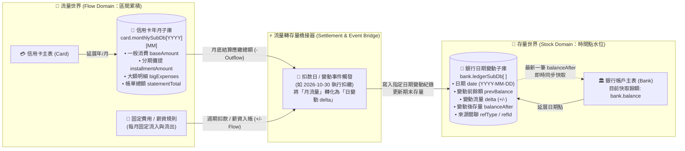
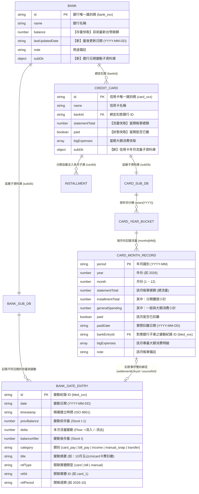
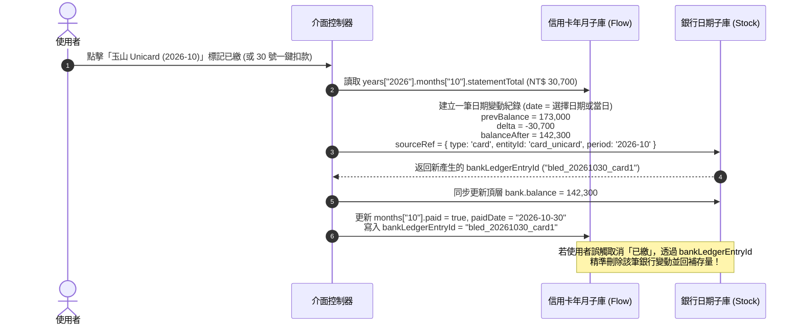

# PocketMoney 子資料庫與「存量 × 流量」架構設計提案

> - **文件狀態**：架構提案 (Proposal)
> - **基準規格**：[`_dev/PocketMoney/SDD.md`](file:///c:/Playground26/wiskinglin.github.io/_dev/PocketMoney/SDD.md)
> - **實作目標**：[`tools/pocketmoney.html`](file:///c:/Playground26/wiskinglin.github.io/tools/pocketmoney.html)
> - **核心命題**：由「主實體」向下延展專屬「子資料庫（Sub-Database）」——信用卡以**「年／月」**展開流量帳單子庫，銀行以**「日期變動」**展開存量與異動子庫，建立完整的**存量（Stock）與流量（Flow）雙向觀測模型**。

---

## 1. 為什麼採用「主從式子資料庫」設計？

在現有 `SDD.md`（`v3`）中，`Bank.balance` 與 `Card.statementTotal` 皆為**單一純量（Scalar）**，新月份重置或修改餘額時會直接覆寫舊值，導致兩個問題：
1. **時間粒度不同步**：
   - **信用卡**本質上是**「月週期流量（Monthly Flow）」**——每月結帳一次、扣款一次，使用者關心的是「2025 年、2026 年各月份刷了多少、分期佔多少」。
   - **銀行帳戶**本質上是**「日粒度存量（Date-Point Stock）」**——薪水在 5 號入帳、房租在 10 號轉出、卡費在 30 號扣繳、偶爾手動盤點餘額，同一個月內會有多次不同日期的水位變化。
2. **存量與流量脫鉤**：
   - 只看信用卡，只知道「花了多少錢（流量）」，看不出對資產水位的衝擊；
   - 只看銀行餘額，只知道「現在剩多少錢（存量）」，卻不知道餘額是怎麼從上個月底走到今天的。

因此，本提案不採用強制拉平為同一時間格的單一大表，而是讓**每個實體各自長出符合其業務本質的「子資料庫（Sub-Database）」**，再透過「扣繳／入帳事件外鍵」將兩者縫合。

---

## 2. 核心觀念：存量（Stock）與流量（Flow）的關係模型

### 2.1 經濟與財務定義對映

| 維度 | 財務概念 | 對應子資料庫 | 時間粒度 | 視覺化幾何意義 |
| :--- | :--- | :--- | :--- | :--- |
| **存量 (Stock)** | 在**某一個時間點**累積的資金水位 | **銀行日期變動子庫** (`bank.historySubDb`) | `YYYY-MM-DD` (日期點 / 事件點) | **水位高度 / 階梯折線**（在某一天切一刀看到的帳戶餘額） |
| **流量 (Flow)** | 在**某一段時間內**發生的資金流入或流出 | **信用卡年月子庫** (`card.monthlySubDb`)<br>**固定費用與薪資事件** | `YYYY` → `MM` (月區間) | **管線流速 / 柱狀落差**（推動存量水位上升或下降的力量） |

### 2.2 存量—流量恆等式 (Stock-Flow Identity)

對於任意一家銀行帳戶 $B_i$，在任意兩個日期點 $t_1$ 與 $t_2$（$t_1 < t_2$）之間，必然滿足以下恆等關係：

$$\underbrace{Balance(B_i, t_2)}_{\text{期末存量 (Stock)}} = \underbrace{Balance(B_i, t_1)}_{\text{期初存量 (Stock)}} + \underbrace{\sum_{\tau \in (t_1, t_2]} Inflow(B_i, \tau)}_{\text{期間流入 (薪資/轉入)}} - \underbrace{\sum_{\tau \in (t_1, t_2]} Outflow_{\text{Card}}(B_i, \tau)}_{\text{信用卡扣繳流量}} - \underbrace{\sum_{\tau \in (t_1, t_2]} Outflow_{\text{Bill}}(B_i, \tau)}_{\text{固定費用流量}} + \underbrace{\Delta_{\text{Unexplained}}(B_i, t_1, t_2)}_{\text{未列舉日常收支 (隱含流量)}}$$

### 2.3 存量與流量互動架構圖 (Stock-Flow Architecture)



---

## 3. 子資料庫結構設計 (Schema v4 Specification)

為了維持現行 [`SDD.md`](file:///c:/Playground26/wiskinglin.github.io/_dev/PocketMoney/SDD.md) 的「抓大放小」與「30 號扣繳檢核」100% 向下相容，**主表（`Bank`、`Card`）原本的頂層欄位完全保留作為「當前最新狀態（HEAD）」**，並在每個實體內部掛載專屬的 `subDb` 子資料庫。

### 3.1 實體關係圖 (ER Diagram - 主庫與子資料庫階層)



---

### 3.2 TypeScript 資料介面定義

#### A. 銀行主表與「日期變動子資料庫」(`Bank` & `BankSubDatabase`)

銀行子資料庫採用**「依日期排序的事件存摺（Date-Indexed Stock-Flow Ledger）」**設計。使用者不論是「手動改餘額（紀錄存量快照）」或「按下 30 號扣款（觸發流量扣除）」，都會在 `entries` 長出一筆帶有日期的紀錄：

```ts
export interface Bank {
  id: string;                    // e.g., "bank_esun"
  name: string;                  // e.g., "玉山銀行 (薪轉/扣繳)"
  balance: number;               // 當前最新餘額 (永遠等於 subDb 最新一筆的 balanceAfter)
  lastUpdatedDate: string;       // e.g., "2026-10-28"
  note: string;
  subDb: BankSubDatabase;        // ★ 銀行專屬子資料庫
}

export interface BankSubDatabase {
  initialBalance: number;        // 帳戶建檔期初存量
  initialDate: string;           // 建檔基準日 "YYYY-MM-DD"
  /**
   * 依日期由舊到新（或新到舊）排列的變動紀錄陣列
   * 同時記錄「流量 (delta)」與「存量 (balanceAfter)」
   */
  entries: BankLedgerEntry[];
  /**
   * 日期快速索引快取 (Date -> 當日最終存量)，供圖表秒級查詢
   * e.g., { "2026-10-01": 120000, "2026-10-05": 185000, "2026-10-30": 142300 }
   */
  dailyClosingStock: Record<string, number>;
}

export type FlowCategory =
  | 'opening'          // 期初建檔
  | 'salary_income'    // 薪資/固定入帳 (+Inflow)
  | 'card_settlement'  // 信用卡帳單扣繳 (-Outflow)
  | 'bill_settlement'  // 水電房貸等固定費用扣繳 (-Outflow)
  | 'manual_adjust'    // 手動盤點存量校正 (自動推算隱含流量 delta)
  | 'transfer';        // 跨行調度轉帳 (+/-Flow)

export interface BankLedgerEntry {
  id: string;                    // "bled_20261030_01"
  date: string;                  // ★ 發生日期 "YYYY-MM-DD"
  createdAt: string;             // ISO 時間戳記
  prevBalance: number;           // 變動前存量 (Stock before)
  delta: number;                 // ★ 本次流量變動 (Flow: 正數為流入，負數為流出)
  balanceAfter: number;          // ★ 變動後存量 (Stock after = prevBalance + delta)
  category: FlowCategory;
  title: string;                 // e.g., "扣繳：玉山 Unicard (2026-10 帳單)"
  sourceRef?: {                  // 跨子庫溯源外鍵（連接流量與存量的橋樑）
    type: 'card' | 'bill' | 'transfer' | 'manual';
    entityId?: string;           // e.g., "card_unicard"
    period?: string;             // e.g., "2026-10"
  };
  note?: string;
}
```

#### B. 信用卡主表與「每年每月流量子資料庫」(`Card` & `CardSubDatabase`)

信用卡子資料庫採用**「年 (`YYYY`) ➔ 月 (`MM`) 雙層樹狀結構」**，天然契合年度消費回顧、各月卡費比較、以及分期款自動攤入各月：

```ts
export interface Card {
  id: string;                    // e.g., "card_unicard"
  name: string;                  // e.g., "玉山 Unicard"
  bankId: string;                // FK -> Bank.id (扣款銀行)
  statementDay?: number;         // 結帳日 (如每月 15 號)
  dueDay?: number;               // 扣款日 (預設每月 30 號)

  // --- 以下為「當前工作月份 (Active Period)」快取，100% 相容 v3 UI ---
  statementTotal: number;
  paid: boolean;
  bigExpenses: BigExpenseItem[];

  // ★ 信用卡專屬「年/月」子資料庫
  subDb: CardSubDatabase;
}

export interface CardSubDatabase {
  activePeriod: string;          // 目前綁定在頂層顯示的年月，如 "2026-10"
  /**
   * 第一層 Key 為年份 "YYYY" (如 "2025", "2026")
   * 第二層 Key 為雙位數月份 "MM" (如 "01" ~ "12")
   */
  years: Record<string, CardYearBucket>;
}

export interface CardYearBucket {
  year: number;                  // 2026
  annualTotal: number;           // 該年度累計刷卡總流量 (自動加總 01~12 月)
  annualInstallment: number;     // 該年度分期攤提總額
  months: Record<string, CardMonthRecord>; // Key: "01" | "02" | ... | "12"
}

export interface CardMonthRecord {
  period: string;                // "2026-10"
  year: number;                  // 2026
  month: number;                 // 10
  statementTotal: number;        // ★ 該月應繳帳單總額 (月流量 Outflow)
  installmentAmount: number;     // 其中：由 Installments 自動算出的當月分期額
  bigExpenseAmount: number;      // 其中：大額消費 (>5000) 加總
  generalAmount: number;         // 其中：一般日常刷卡 (= statementTotal - installment - bigExpense)
  paid: boolean;                 // 是否已從銀行扣繳
  paidDate?: string;             // 實際扣繳日期 "YYYY-MM-DD" (如 "2026-10-30")
  bankLedgerEntryId?: string;    // ★ 外鍵：指向銀行子庫 BankLedgerEntry.id，實現存量與流量雙向對帳
  bigExpenses: BigExpenseItem[]; // 該月專屬的大額消費清單
  isProjected?: boolean;         // 若為未來月份，標記為由分期推算之預估值
  note?: string;
}
```

---

### 3.3 具體 JSON 資料範例（一眼看懂兩個子資料庫如何連動）

以下展示「玉山銀行」與「玉山 Unicard」在 `2026-10` 的子資料庫實例：

```json
{
  "banks": [
    {
      "id": "bank_esun",
      "name": "玉山薪轉戶",
      "balance": 142300,
      "lastUpdatedDate": "2026-10-30",
      "note": "主力薪轉與卡費扣繳",
      "subDb": {
        "initialBalance": 120000,
        "initialDate": "2026-10-01",
        "dailyClosingStock": {
          "2026-10-01": 120000,
          "2026-10-05": 185000,
          "2026-10-15": 173000,
          "2026-10-30": 142300
        },
        "entries": [
          {
            "id": "bled_20261001_init",
            "date": "2026-10-01",
            "createdAt": "2026-10-01T09:00:00+08:00",
            "prevBalance": 0,
            "delta": 120000,
            "balanceAfter": 120000,
            "category": "opening",
            "title": "10 月初帳戶期初餘額"
          },
          {
            "id": "bled_20261005_sal",
            "date": "2026-10-05",
            "createdAt": "2026-10-05T10:30:00+08:00",
            "prevBalance": 120000,
            "delta": 65000,
            "balanceAfter": 185000,
            "category": "salary_income",
            "title": "10 月份薪資入帳"
          },
          {
            "id": "bled_20261015_snap",
            "date": "2026-10-15",
            "createdAt": "2026-10-15T21:00:00+08:00",
            "prevBalance": 185000,
            "delta": -12000,
            "balanceAfter": 173000,
            "category": "manual_adjust",
            "title": "手動更新餘額 (隱含日常提領/轉出 -12,000)"
          },
          {
            "id": "bled_20261030_card1",
            "date": "2026-10-30",
            "createdAt": "2026-10-30T09:15:00+08:00",
            "prevBalance": 173000,
            "delta": -30700,
            "balanceAfter": 142300,
            "category": "card_settlement",
            "title": "信用卡扣繳：玉山 Unicard (2026年10月帳單)",
            "sourceRef": {
              "type": "card",
              "entityId": "card_unicard",
              "period": "2026-10"
            }
          }
        ]
      }
    }
  ],
  "cards": [
    {
      "id": "card_unicard",
      "name": "玉山 Unicard",
      "bankId": "bank_esun",
      "statementTotal": 30700,
      "paid": true,
      "bigExpenses": [
        { "id": "be_1", "title": "日本機票", "amount": 16500 }
      ],
      "subDb": {
        "activePeriod": "2026-10",
        "years": {
          "2026": {
            "year": 2026,
            "annualTotal": 58900,
            "annualInstallment": 8400,
            "months": {
              "09": {
                "period": "2026-09",
                "year": 2026,
                "month": 9,
                "statementTotal": 28200,
                "installmentAmount": 4200,
                "bigExpenseAmount": 12000,
                "generalAmount": 12000,
                "paid": true,
                "paidDate": "2026-09-30",
                "bankLedgerEntryId": "bled_20260930_card1",
                "bigExpenses": [
                  { "id": "be_09_1", "title": "週年慶家電", "amount": 12000 }
                ]
              },
              "10": {
                "period": "2026-10",
                "year": 2026,
                "month": 10,
                "statementTotal": 30700,
                "installmentAmount": 4200,
                "bigExpenseAmount": 16500,
                "generalAmount": 10000,
                "paid": true,
                "paidDate": "2026-10-30",
                "bankLedgerEntryId": "bled_20261030_card1",
                "bigExpenses": [
                  { "id": "be_1", "title": "日本機票", "amount": 16500 }
                ]
              }
            }
          }
        }
      }
    }
  ]
}
```

---

## 4. 關鍵業務機制：如何讓使用者看清「存量 vs 流量」？

### 4.1 機制一：不記流水帳也能算流量——「存量差額反推隱含流量」

PocketMoney 的第一原則是**「抓大放小（不記瑣碎便當帳）」**。當使用者在 `10/05` 領完薪水餘額是 `185,000`，到了 `10/15` 打開網銀發現餘額變成 `173,000`，使用者只需在銀行卡片輸入：
- **日期**：`2026-10-15`
- **目前餘額**：`173,000`

系統會自動在該銀行的 `subDb.entries` 產生一筆紀錄，並算出：
$$\Delta \text{Implied Flow} = 173,000 - 185,000 = -12,000$$

這代表在 `10/05 ~ 10/15` 這 10 天內，除了已登記的固定帳單外，有 **`NT$ 12,000` 的未列舉日常現金流出**。使用者完全不必逐筆記帳，就能同時掌握**「存量精確水位」**與**「區間隱含流量」**！

### 4.2 機制二：30 號扣繳的「跨子庫原子交易（Atomic Cross-SubDB Settlement）」

當使用者點擊「執行單一銀行扣款」或將某張信用卡標記為 `paid = true` 時，系統執行以下跨子庫連動（支援復原回滾）：



### 4.3 機制三：信用卡「年／月矩陣」與分期款自動投影

在每張信用卡的子資料庫中，當使用者新增一筆分期（例如 `startMonth: "2026-08"`, `totalPeriods: 12`, `monthlyAmount: 4200`）：
1. 系統自動走訪該卡 `subDb.years["2026"].months["08".."12"]` 與 `years["2027"].months["01".."07"]`。
2. 自動在對應年月的 `installmentAmount` 注入 `4200`，讓使用者點開任何一張信用卡的「年度／月度子庫抽屜」時，不僅能看到過去每個月實際刷了多少，還能看到**未來幾個月已經背負的固定分期流量底部**。

---

## 5. UI 視覺化設計：存量與流量同框對照視圖 (Stock-Flow Dual Chart)

遵循 [`SDD.md` 第 3 節](file:///c:/Playground26/wiskinglin.github.io/_dev/PocketMoney/SDD.md#L164-L256) 的 **Nord 主題調色盤** 與 **Nuxt UI 極細邊框卡片 (`UCard`)** 規範，我們可以在兩個層級呈現子資料庫：

### 5.1 單一實體下鑽抽屜 (Entity Sub-DB Drawer / Modal)

1. **點擊任一「銀行卡片」➔ 開啟【銀行存量與變動子庫視圖】**：
   - **上方：存量階梯面積圖 (Stock Step-Line Chart)**：X 軸為日期 (`YYYY-MM-DD`)，Y 軸為當時餘額（Nord Frost `#81A1C1` 漸層面積），標示出每一次薪資入帳的「跳升」與 30 號扣繳後的「階梯下降」。
   - **下方：日期變動時間軸清單 (Date Ledger Table)**：
     - 支援「➕ 新增某日餘額盤點 / 收支變動」。
     - 每筆顯示：`日期` | `事件摘要 (附信用卡/費用標籤)` | `流量變動 (+綠 / -紅 tabular-nums)` | `當日結餘存量 (Stock)`。
2. **點擊任一「信用卡卡片」➔ 開啟【信用卡年度／月度流量子庫視圖】**：
   - **年份切換器**：`[ 2025 年 ]` `[ 2026 年 ● ]` `[ 2027 年 (預估) ]`，右側顯示該年累計總刷卡額與月均刷卡額。
   - **12 個月流量矩陣 / 堆疊長條圖 (12-Month Stacked Bar)**：
     - 1 月～12 月並排，每根柱子拆分為三層顏色：
       - 底層（深藍 `#4C6A8C`）：固定分期攤提（剛性流量）
       - 中層（琥珀黃 `#D4A64A`）：`> 5,000` 大額消費（可檢討流量）
       - 頂層（冰河藍 `#81A1C1`）：一般日常刷卡
     - 點擊任一月份即可切換編輯該月的帳單明細，或查看該月是從哪個銀行、在哪一天完成扣繳。

### 5.2 全局「存量 × 流量」水庫總覽圖 (Global Stock-Flow Reservoir View)

在首頁總覽提供「水庫對照視圖（Stock-Flow Combo Chart）」：

```
金額 (NT$)
250k ┤          ╭──────╮ (10/05 薪資流入 +65k)
200k ┤          │      ╰────────╮ (10/15 日常流出 -12k)
150k ┤ ╭────────╯               ╰───────────────● 142.3k (10/30 扣繳後存量線)
100k ┤ │  [存量折線：銀行總餘額 (依日期點)]
 50k ┤ │
   0 ┼─┴────────┬───────────────┬───────────────┬──────────► 時間軸
     │         10/05           10/15           10/30 (月底結算)
  -50k ┤        ▲               ▼               ██ -30.7k (玉山卡費月流量)
                +65k            -12k            ▒▒ -15.0k (固定費用月流量)
```

- **上半部（正軸，折線面積）**：代表**銀行存量水位（Stock）**隨不同日期的真實起伏。
- **下半部（負軸或疊加柱狀）**：代表**信用卡各月帳單與固定費用（Flow）**在月底扣繳日對水庫造成的洩洪量。
- **危險預警**：當某個月底的「預估流出柱狀總和」大於當下「銀行存量水位線」時，折線將跌破 `0` 軸並渲染為 **Nord Aurora Red (`#BF616A`)**，直觀看出「哪一個月的流量會擊穿存量水庫」。

---

## 6. 模組 API 擴充清單与儲存遷移策略

### 6.1 新增子資料庫管理函式 (Sub-DB Controller APIs)

| 模組分類 | 函式名稱 | 參數 | 責任與行為說明 |
| :--- | :--- | :--- | :--- |
| **銀行子庫** | `recordBankStockSnapshot()` | `(bankId, date, newBalance, title?)` | 記錄某日最新銀行餘額（存量），自動與前一筆比較算出隱含流量 `delta`，並重算後續結餘。 |
| **銀行子庫** | `appendBankFlowEntry()` | `(bankId, date, delta, category, title, sourceRef?)` | 直接記錄一筆已知金額的流入或流出（流量），自動累加推算 `balanceAfter` 並同步至 `bank.balance`。 |
| **銀行子庫** | `removeBankLedgerEntry()` | `(bankId, entryId)` | 刪除指定日期變動紀錄，若關聯至信用卡扣繳則同步解鎖該月信用卡 `paid` 狀態。 |
| **信用卡子庫** | `upsertCardMonthRecord()` | `(cardId, year, month, payload)` | 新增或更新指定信用卡在特定年、月的帳單金額與大額消費，若為 `activePeriod` 則同步更新頂層快取。 |
| **信用卡子庫** | `switchCardActivePeriod()` | `( year, month )` | 全站或單卡切換目前檢視的年月（如回顧 `2026-09` 或預覽 `2026-11`），將該月子庫資料投影至頂層卡片。 |
| **存量流量橋接** | `settleCardMonthToBank()` | `(cardId, period, settleDate)` | **核心橋接函式**：將信用卡某月流量結清，寫入綁定銀行該日期的負向變動紀錄，建立雙向 ID 綁定。 |
| **存量流量分析** | `computeStockFlowReconciliation()` | `(bankId, startDate, endDate)` | 計算指定銀行在兩日期之間的「期初存量、已知卡費流出、已知帳單流出、期末存量、隱含未列舉流量」。 |

### 6.2 無縫升級與儲存空間評估 (Migration & Storage)

1. **v3 ➔ v4 自動初始化子庫 (`migrateV3ToSubDbV4`)**：
   - 載入既有 `PocketMoney_tw_finance_v3` 時，若發現 `bank.subDb` 不存在：
     - 自動以今日日期 `YYYY-MM-DD` 與目前 `bank.balance` 建立第一筆 `category: 'opening'` 的銀行子庫期初存量紀錄。
   - 若發現 `card.subDb` 不存在：
     - 自動以當前年月 `YYYY-MM`（例如 `2026-10`）建立 `card.subDb.years["2026"].months["10"]`，將現有 `statementTotal`、`paid`、`bigExpenses` 完整放入。
2. **LocalStorage 容量安全性**：
   - 1 張信用卡 1 年 12 個月的 JSON 紀錄約 `1.8 KB`；5 張卡記錄 5 年僅約 `45 KB`。
   - 1 個銀行帳戶每年記錄 50 筆日期變動約 `7.5 KB`；5 個帳戶記錄 5 年僅約 `187 KB`。
   - 總體積遠低於瀏覽器 LocalStorage `5,000 KB (5 MB)` 上限的 **5%**，即使打包為單機離線 HTML 也毫無負擔。
3. **CSV 多工作表匯出擴充**：
   - `exportToExcelCSV()` 新增匯出「各卡歷年各月帳單矩陣表」與「各銀行日期變動存摺明細表」，方便使用者在 Excel 進行樞紐分析。

---

## 7. 建議分階段實作藍圖 (Implementation Roadmap)

| 階段 | 階段名稱 | 交付項目與驗證標準 |
| :--- | :--- | :--- |
| **Stage 1** | **子資料庫核心與無損遷移** | 完成 `bank.subDb` 與 `card.subDb` 初始化、v3 自動升級遷移、頂層快取同步函式；確保現有介面 100% 正常運作。 |
| **Stage 2** | **信用卡「年／月」子庫抽屜與月份切換** | 在每張信用卡加入「📅 歷年各月帳單」按鈕與彈窗，支援年份切換、1～12 月流量柱狀圖、各月帳單獨立編輯與分期自動攤入。 |
| **Stage 3** | **銀行「日期變動」子庫與存量盤點** | 在每個銀行帳戶加入「📈 餘額變動存摺」按鈕與彈窗，支援依日期新增餘額快照（自動算隱含流量 delta）與扣繳流水對帳。 |
| **Stage 4** | **存量 × 流量橋接與綜合視覺化** | 串聯 30 號扣款自動寫入銀行日期子庫（含取消回滾），並在總覽頁新增「存量水位線 × 月底流量柱」對照圖表與匯出報表。 |

