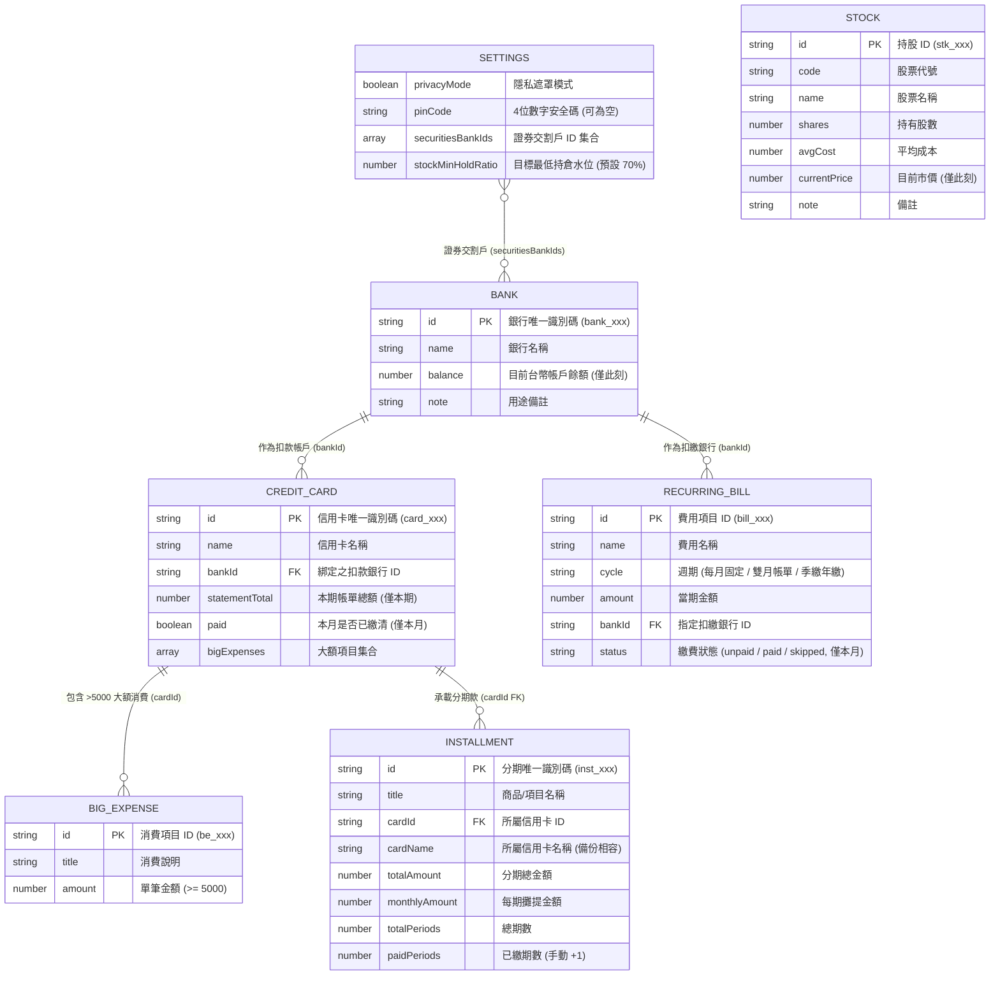
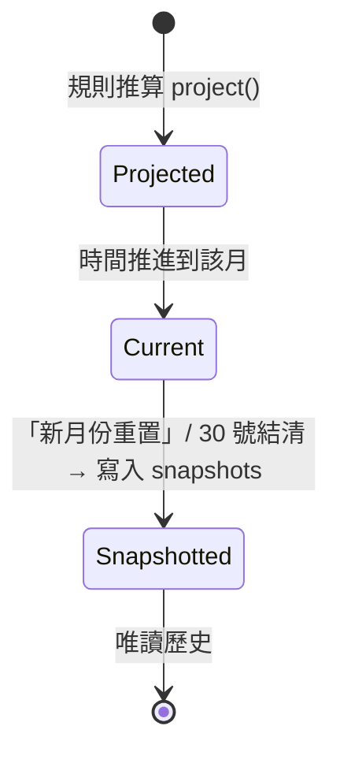

# PocketMoney 時間軸資料結構提案

> 狀態：**提案（尚未實作）**
> 現況對應檔案：[`tools/pocketmoney.html`](file:///c:/Playground26/wiskinglin.github.io/tools/pocketmoney.html)（儲存 key：`PocketMoney_tw_finance_v3`）
> 目標 Schema：`PocketMoney_tw_finance_v4`

---

## 0. 兩個階段的定位

| 階段 | 名稱 | 核心概念 | 時間觀 |
| :--- | :--- | :--- | :--- |
| **Phase 1（現在）** | **Right at the Moment** | 只看「此刻」的財務快照，30 號扣繳是否足額 | 單點（now） |
| **Phase 2（下一步）** | **3D Time World** | 以時間為 X 軸的 3D 世界，往左是過去，往右是未來 | 連續軸（past ← now → future） |

```
        過去 (實際)              現在              未來 (預測)
   ◄──────────────────────────  ●  ──────────────────────────►
   1月  2月  3月 ...  9月      10月     11月  12月 ...
   快照 快照 快照      快照     即時 state    推算 推算
   (實線、實心)          (強調光環)     (虛線、半透明)
```

**核心設計原則：一個 state 只描述「現在」；過去是「封存的快照」；未來是「算出來的，不存檔」。**

---

## 1. 現況資料結構（Phase 1：Right at the Moment）

> 取自 `pocketmoney.html` 的 `PRESET_SCENARIOS` 與 `loadState()`，以實際程式碼為準。

### 1.1 根物件 `state`

```ts
interface StateV3 {
  settings:     Settings;
  banks:        Bank[];
  cards:        Card[];
  installments: Installment[];
  bills:        Bill[];
  stocks:       Stock[];
}
```

### 1.2 各實體

```ts
interface Settings {
  privacyMode: boolean;
  pinCode: string;               // '' 代表未啟用
  stockMinHoldRatio: number;     // 預設 70
  securitiesBankIds: string[];   // 視為證券待命現金的銀行
}

interface Bank {
  id: string;                    // bank_xxx
  name: string;
  balance: number;               // ★ 只有「此刻」的餘額
  note: string;
}

interface Card {
  id: string;                    // card_xxx
  name: string;
  bankId: string;                // FK → Bank
  statementTotal: number;        // ★ 只有「本期」帳單
  paid: boolean;                 // ★ 只有「本月」是否已繳
  bigExpenses: { id: string; title: string; amount: number }[];
}

interface Installment {
  id: string;
  title: string;
  cardId: string;                // FK → Card
  cardName: string;              // 舊版相容備份
  totalAmount: number;
  monthlyAmount: number;
  totalPeriods: number;
  paidPeriods: number;           // ★ 手動 +1 推進，與月份沒有連動
}

interface Bill {
  id: string;
  name: string;
  cycle: '每月固定' | '雙月帳單' | '季繳/年繳';
  amount: number;
  bankId: string;                // FK → Bank
  status: 'unpaid' | 'paid' | 'skipped';   // ★ 只有「本月」狀態
}

interface Stock {
  id: string;
  code: string;
  name: string;
  shares: number;
  avgCost: number;
  currentPrice: number;
  note: string;
}
```

### 1.3 實體關係圖（現況，格式同 SDD §4.1）

> 每個欄位都只有「單一值」＝只活在「此刻」，這是 Phase 1 的本質。



### 1.4 現況的結構性限制

| # | 限制 | 後果 |
| :--- | :--- | :--- |
| L1 | 數值欄位（`balance`、`statementTotal`、`paid`、`status`）都是**單值** | 無法回答「3 月我有多少錢」 |
| L2 | 「新月份重置」直接覆寫 `paid` / `status` | **歷史被抹除**，不可回溯 |
| L3 | 分期的 `paidPeriods` 靠手動 +1 | 與「現在是幾月」**沒有任何連動**，容易漏按 |
| L4 | `Bill.cycle` 只有文字，沒有「哪個月會繳」 | 雙月、季繳**無法推算到未來月份** |
| L5 | `Bank` 沒有收入欄位 | 推算未來只會單向下降，沒有意義 |
| L6 | `Card.statementTotal` 把分期攤提與一般消費混在一起 | 無法預測「分期結束後帳單會掉多少」 |
| L7 | `Stock.currentPrice` 只有當下價 | 無法呈現資產走勢 |

---

## 2. 新功能資料結構（Phase 2：3D Time World）

### 2.1 設計決策

| 決策 | 內容 | 理由 |
| :--- | :--- | :--- |
| D1 | **保留** 現有 `banks / cards / installments / bills / stocks` 結構 | 向下相容，Phase 1 畫面不需重寫 |
| D2 | 新增 `timeline.snapshots`，以 `"YYYY-MM"` 為 key | 儲存**過去**，append-only，不被重置覆寫 |
| D3 | **未來不存檔**，由 `project()` 純函式即時推算 | 避免資料不一致；規則改了，未來自動跟著變 |
| D4 | 在實體上補**規則欄位**（收入、到期月、預估消費、起始月） | 這些是推算未來的「原料」 |
| D5 | 月份一律用 `"YYYY-MM"` 字串，另提供 `monthIndex` 供 3D 座標使用 | 字串可排序、可讀；整數利於 3D 位置計算 |

### 2.2 新根物件 `state`（v4）

```ts
interface StateV4 extends StateV3 {
  schemaVersion: 4;
  timeline: Timeline;          // ★ 新增
}

interface Timeline {
  currentMonth: string;        // "2026-10"，目前「此刻」所在月份
  snapshots: Record<string, MonthSnapshot>;   // 過去月份，key = "YYYY-MM"
  view: ViewState;             // 3D 世界的相機/游標狀態
}
```

### 2.3 月份快照 `MonthSnapshot`（過去，實際值）

```ts
interface MonthSnapshot {
  month: string;               // "2026-09"
  closedAt: string;            // ISO 時間，結帳封存時間
  source: 'auto' | 'manual';   // auto=月底重置時自動封存；manual=手動補登

  banks:  Record<string, { balance: number }>;                 // bankId → 該月底餘額
  cards:  Record<string, { statementTotal: number;             // cardId → 該月帳單
                           installmentPart: number;            //   其中分期攤提
                           paid: boolean }>;
  bills:  Record<string, { amount: number;                     // billId → 該月實繳
                           status: 'paid' | 'skipped' | 'unpaid' }>;
  stocks: Record<string, { price: number; shares: number }>;   // stockId → 月底收盤與持股

  totals: {                    // 預先彙總，3D 渲染與圖表直接取用
    bankTotal: number;
    cardTotal: number;
    billTotal: number;
    stockValue: number;
    netWorth: number;
  };
}
```

> **為何用 `Record<id, …>` 而非陣列？** 實體之後可能被刪除或改名；以 id 為 key 的快照不依賴陣列順序，已刪除的實體在歷史中仍可呈現（顯示為灰色「已刪除」）。

### 2.4 實體新增的「規則欄位」（供推算未來）

```ts
interface Bank {
  // ...既有欄位
  monthlyIncome?: number;      // ★ 每月預估入帳（薪轉、租金收入）
  incomeDay?: number;          // ★ 入帳日（1–31），判斷 30 號扣款前是否已入帳
  openedMonth?: string;        // ★ 帳戶啟用月份，早於此月在 3D 世界不顯示
}

interface Card {
  // ...既有欄位
  baseSpending?: number;       // ★ 每月預估「一般消費」（不含分期）
  statementDay?: number;       // 結帳日，預設 10
  payDay?: number;             // 扣款日，預設 30
}

interface Installment {
  // ...既有欄位
  startMonth: string;          // ★ 首期月份 "YYYY-MM"，取代手動 +1 的 paidPeriods
  // paidPeriods 改為「由 currentMonth 與 startMonth 推導」；
  // 欄位保留作為舊資料遷移與手動校正（paidOffset）
  paidOffset?: number;
}

interface Bill {
  // ...既有欄位
  months?: number[];           // ★ 會出現的月份，如雙月 [1,3,5,7,9,11]、年繳 [6]
  startMonth?: string;
  endMonth?: string;           // 例如房貸到期月，之後不再推算
}

interface Stock {
  // ...既有欄位
  expectedMonthlyReturn?: number;   // 選填；預設 0（不預測股價，避免誤導）
}
```

### 2.5 未來投影（不存檔，純函式輸出）

```ts
// 純函式：不修改 state，輸入規則 + 起點，輸出該月推算結果
function project(state: StateV4, month: string): MonthProjection;

interface MonthProjection extends Omit<MonthSnapshot, 'closedAt' | 'source'> {
  isProjection: true;          // ★ 渲染層用來套用「虛線、半透明」
  shortfalls: { bankId: string; shortBy: number }[];   // 該月 30 號扣款後不足額
}
```

**推算規則**（沿用現行 SDD §4.2 公式，補上時間維度）：

```
對月份 m（m > currentMonth），逐月迭代：

  installmentPart(card, m) = Σ monthlyAmount
                              ，若 startMonth ≤ m < startMonth + totalPeriods
  cardBill(card, m)        = installmentPart(card, m) + card.baseSpending
  billAmount(bill, m)      = bill.amount ，若 m 的月份 ∈ bill.months（缺省=每月）且在 start/end 區間內
  bankBalance(bank, m)     = bankBalance(bank, m-1)
                              + bank.monthlyIncome
                              − Σ cardBill(綁定此行的卡, m)
                              − Σ billAmount(綁定此行的費用, m)
  shortfall(bank, m)       = bankBalance(bank, m) < 0
```

### 2.6 視圖狀態 `ViewState`（3D 世界）

```ts
interface ViewState {
  cursorMonth: string;         // 相機目前看向哪個月 "YYYY-MM"
  range: { past: number; future: number };   // 可視範圍（月數），預設 6 / 12
  layout: 'lanes' | 'stack';   // lanes：每個實體一條走道；stack：堆疊長條
  metric: 'balance' | 'cardBill' | 'netWorth';
}
```

### 2.7 實體關係圖（v4 時間軸，格式同 SDD §4.1）

圖例：**【新】** = v4 新增實體或欄位；其餘為 v3 既有。

```mermaid
erDiagram
    APP_STATE ||--|| TIMELINE : "時間軸 (timeline)"
    TIMELINE ||--o{ MONTH_SNAPSHOT : "過去 snapshots[YYYY-MM]"
    TIMELINE ||--|| VIEW_STATE : "3D 視角 (view)"

    MONTH_SNAPSHOT ||--o{ SNAP_BANK : "當月各銀行餘額"
    MONTH_SNAPSHOT ||--o{ SNAP_CARD : "當月各卡帳單"
    MONTH_SNAPSHOT ||--o{ SNAP_BILL : "當月各費用實繳"
    MONTH_SNAPSHOT ||--o{ SNAP_STOCK : "當月各持股收盤"
    MONTH_SNAPSHOT ||--|| SNAP_TOTALS : "預先彙總"

    BANK ||--o{ SNAP_BANK : "歷史 (bankId)"
    CREDIT_CARD ||--o{ SNAP_CARD : "歷史 (cardId)"
    RECURRING_BILL ||--o{ SNAP_BILL : "歷史 (billId)"
    STOCK ||--o{ SNAP_STOCK : "歷史 (stockId)"

    BANK ||--o{ CREDIT_CARD : "作為扣款帳戶 (bankId)"
    BANK ||--o{ RECURRING_BILL : "作為扣繳銀行 (bankId)"
    CREDIT_CARD ||--o{ INSTALLMENT : "承載分期款 (cardId FK)"

    TIMELINE {
        string currentMonth "【新】此刻所在月份 (YYYY-MM)"
        object snapshots "【新】過去月份快照集合 (key = YYYY-MM)"
        object view "【新】3D 視角狀態"
    }

    MONTH_SNAPSHOT {
        string month PK "【新】月份 (YYYY-MM)"
        string closedAt "【新】封存時間 (ISO)"
        string source "【新】auto 自動封存 / manual 手動補登"
    }

    SNAP_BANK {
        string month PK "所屬月份"
        string bankId PK "銀行 ID (歷史中可指向已刪除實體)"
        number balance "【新】該月底餘額"
    }

    SNAP_CARD {
        string month PK "所屬月份"
        string cardId PK "信用卡 ID"
        number statementTotal "【新】該月帳單總額"
        number installmentPart "【新】其中分期攤提"
        boolean paid "【新】該月是否已繳"
    }

    SNAP_BILL {
        string month PK "所屬月份"
        string billId PK "費用 ID"
        number amount "【新】該月實繳金額"
        string status "【新】paid / skipped / unpaid"
    }

    SNAP_STOCK {
        string month PK "所屬月份"
        string stockId PK "持股 ID"
        number price "【新】月底收盤價"
        number shares "【新】月底持股數"
    }

    SNAP_TOTALS {
        string month PK "所屬月份"
        number bankTotal "【新】銀行總餘額"
        number cardTotal "【新】信用卡總帳單"
        number billTotal "【新】固定費用總額"
        number stockValue "【新】股票市值"
        number netWorth "【新】淨資產"
    }

    VIEW_STATE {
        string cursorMonth "【新】相機看向的月份"
        object range "【新】可視範圍 (past / future 月數)"
        string layout "【新】lanes 走道 / stack 堆疊"
        string metric "【新】balance / cardBill / netWorth"
    }

    BANK {
        string id PK "銀行唯一識別碼 (bank_xxx)"
        string name "銀行名稱"
        number balance "目前台幣帳戶餘額 (此刻)"
        string note "用途備註"
        number monthlyIncome "【新】每月預估入帳"
        number incomeDay "【新】入帳日 (1-31)"
        string openedMonth "【新】帳戶啟用月份"
    }

    CREDIT_CARD {
        string id PK "信用卡唯一識別碼 (card_xxx)"
        string name "信用卡名稱"
        string bankId FK "綁定之扣款銀行 ID"
        number statementTotal "本期帳單總額 (此刻)"
        boolean paid "本月是否已繳清 (此刻)"
        array bigExpenses "大額項目集合"
        number baseSpending "【新】每月預估一般消費 (不含分期)"
        number statementDay "【新】結帳日 (預設 10)"
        number payDay "【新】扣款日 (預設 30)"
    }

    RECURRING_BILL {
        string id PK "費用項目 ID (bill_xxx)"
        string name "費用名稱"
        string cycle "週期"
        number amount "當期金額"
        string bankId FK "指定扣繳銀行 ID"
        string status "繳費狀態 (此刻)"
        array months "【新】會出現的月份 (如雙月 1,3,5...)"
        string startMonth "【新】起始月份"
        string endMonth "【新】結束月份 (如房貸到期)"
    }

    INSTALLMENT {
        string id PK "分期唯一識別碼 (inst_xxx)"
        string title "商品/項目名稱"
        string cardId FK "所屬信用卡 ID"
        number totalAmount "分期總金額"
        number monthlyAmount "每期攤提金額"
        number totalPeriods "總期數"
        number paidPeriods "已繳期數 (改由 startMonth 推導)"
        string startMonth "【新】首期月份 (YYYY-MM)"
        number paidOffset "【新】人工校正期數"
    }

    STOCK {
        string id PK "持股 ID (stk_xxx)"
        string code "股票代號"
        number shares "持有股數"
        number avgCost "平均成本"
        number currentPrice "目前市價 (此刻)"
        number expectedMonthlyReturn "【新】預期月報酬 (預設 0)"
    }

    APP_STATE {
        number schemaVersion "【新】Schema 版本 (4)"
        object settings "全域偏好"
    }
```



**v4 新增實體一覽**

| 實體 | 角色 | 存不存檔 | 說明 |
| :--- | :--- | :--- | :--- |
| `TIMELINE` | 時間軸容器 | 存 | 掛在 `state.timeline`，統管「此刻」與「過去」 |
| `MONTH_SNAPSHOT` | 過去的某一個月 | 存 (append-only) | 以 `YYYY-MM` 為 key，月底封存後唯讀 |
| `SNAP_BANK / SNAP_CARD / SNAP_BILL / SNAP_STOCK` | 快照內的明細 | 存 | 複合主鍵 (`month` + 實體 id)；以 id 對應避免實體刪除後歷史斷裂 |
| `SNAP_TOTALS` | 月度彙總 | 存 | 預先加總，3D 與圖表免重算 |
| `VIEW_STATE` | 3D 視角 | 存 | 相機位置、顯示指標；屬使用者偏好 |
| `MONTH_PROJECTION` (未畫入) | 未來的某一個月 | **不存** | 由 `project()` 即時產生，結構同 `MONTH_SNAPSHOT`，多 `isProjection` 與 `shortfalls` |

> 注意：SNAP_* 對 BANK / CREDIT_CARD 等的連線是「邏輯參照」，**不是**強外鍵。實體被刪除後，歷史快照仍保留該 id 的數值，畫面顯示為「已刪除」。

---

## 3. 3D 世界的座標映射

| 3D 軸 | 對應資料 | 方向 / 規則 |
| :--- | :--- | :--- |
| **X 軸（左右）** | 時間 `monthIndex` | **向左 = 過去**，向右 = 未來，原點 = `currentMonth` |
| **Y 軸（高度）** | 金額（依 `view.metric`） | 柱高 ∝ 金額；負值（不足額）往下延伸並標紅 |
| **Z 軸（縱深）** | 實體走道（銀行 / 信用卡 / 固定費用） | 每個實體一條 lane，依 `bankId` 分群，卡片排在其扣款銀行旁 |

```
monthIndex(m) = (年 − 現在年) × 12 + (月 − 現在月)      // 現在 = 0，過去為負，未來為正
position.x    = monthIndex × MONTH_WIDTH
position.y    = amount × HEIGHT_SCALE
position.z    = laneIndex(entity) × LANE_GAP
```

**視覺語義**

| 時間區 | 資料來源 | 材質 |
| :--- | :--- | :--- |
| 過去（x < 0） | `snapshots` | 實心、完整不透明度 |
| 現在（x = 0） | 即時 `state` | 發光環強調（Right at the Moment 的延伸） |
| 未來（x > 0） | `project()` | 線框 / 半透明，越遠越淡 |
| 不足額月份 | `shortfalls` | 紅色警示柱與地面光暈 |

**互動**：左右拖曳或方向鍵＝推移 `cursorMonth`；點擊任一柱子＝彈出該實體該月明細（沿用現有 Modal）。

> **離線約束**：現行 SDD 要求單檔、無 CDN 仍可運作（TC-06）。3D 引擎需內嵌，或先以 CSS 3D transform / Canvas 偽 3D 做第一版，再評估是否內嵌 Three.js（專案已有 [`_dev/threejs`](file:///c:/Playground26/wiskinglin.github.io/_dev/threejs) 可參考）。

---

## 4. 生命週期：資料如何從「未來」變成「過去」



1. **現在 → 過去**：觸發「新月份重置」時，先把當下 `state` 寫入 `timeline.snapshots[currentMonth]`，**再**重置 `paid / status`，最後 `currentMonth` 進一月。
2. **未來 → 現在**：不需要搬資料；月份推進後，原本推算的月份自然變成「現在」，由即時 `state` 取代。
3. **分期自動推進**：`paidPeriods` 由 `currentMonth − startMonth` 推導，移除「全部推進一期」的手動步驟（保留 `paidOffset` 作人工校正）。

---

## 5. 遷移策略（v3 → v4）

| 步驟 | 動作 |
| :--- | :--- |
| 1 | 沿用現有 `readStoredRaw()` 的 `LEGACY_STORAGE_KEYS` 機制，將 `PocketMoney_tw_finance_v3` 加入 legacy 清單，新 key 為 `…_v4` |
| 2 | `timeline = { currentMonth: 今天所在月, snapshots: {}, view: 預設值 }` |
| 3 | 為每筆 `Installment` 回推 `startMonth = currentMonth − paidPeriods` |
| 4 | 新增規則欄位全部為**選填**，缺省值使推算退化為「沿用現況」（收入 0、一般消費 = 最近帳單 − 分期） |
| 5 | **不**偽造過去快照；過去月份留空，3D 世界左側顯示「尚無歷史」，並提供手動補登入口 |
| 6 | 匯出 / 單機版 HTML 的 `__EMBEDDED_STATE__` 同步含 `timeline`；舊版備份匯入時自動走同一遷移管線 |

---

## 6. 實作階段規劃

| Stage | 目標 | 成功標準 |
| :--- | :--- | :--- |
| **1. 資料層** | v4 schema、遷移、快照寫入 | v3 資料載入後零遺失；重置月份後 `snapshots` 多一筆 |
| **2. 推算引擎** | `project(state, month)` 純函式 | 單元測試：分期結束後帳單下降、雙月帳單只在指定月出現、收入進帳後不足額消失 |
| **3. 2D 時間軸** | 月份切換器 + 12 個月矩陣表 | 可左右切換，過去/未來樣式正確區分 |
| **4. 3D 世界** | X/Y/Z 映射、相機推移、不足額警示 | 可往左看歷史、往右看預測，效能在手機維持流暢 |
| **5. 整合** | 匯出入、預設情境補規則欄位、更新 SDD | CSV/JSON 含月度資料；三組情境皆有可展示的 12 個月曲線 |

---

## 7. 待決議事項

1. **歷史來源**：只從現在開始累積（A），或開放手動補登過去月份（B）？（本文件預設支援 B 的 `source: 'manual'` 欄位）
2. **一般消費預測**：沿用最近一期、使用者手動設定，或兩者並存？
3. **股價是否預測**：預設不預測（僅沿用現價），避免產生誤導性數字。
4. **3D 技術選型**：第一版用 CSS 3D / Canvas，或直接內嵌 Three.js（影響單檔體積與離線限制）。
5. **未來範圍上限**：預設 12 個月，是否允許擴到 36 個月（房貸、長期分期情境）。
