# PocketMoney 功能盤點與 UI 視覺指南 (Feature Overview)

本文件透過瀏覽器實際預覽與 UI 互動盤點 **PocketMoney** 目前所具備的各項功能與介面設計，涵蓋正式操作版（`tools/kipomo.html`）與視覺趨勢預覽版（`_dev/PocketMoney/mockup_view.html`）。

---

## 目錄

1. [系統架構與介面概述](#1-系統架構與介面概述)
2. [正式版核心功能盤點（kipomo.html）](#2-正式版核心功能盤點kipomohtml)
   - 2.1 [隱私保護與安全鎖定（PIN 碼）](#21-隱私保護與安全鎖定pin-碼)
   - 2.2 [新手導覽與初始任務引導](#22-新手導覽與初始任務引導)
   - 2.3 [財務總覽與扣款安全檢查（核心儀表板）](#23-財務總覽與扣款安全檢查核心儀表板)
   - 2.4 [銀行餘額與信用卡費管理（抓大放小）](#24-銀行餘額與信用卡費管理抓大放小)
   - 2.5 [信用卡分期付款與現金流負擔](#25-信用卡分期付款與現金流負擔)
   - 2.6 [定期性固定生活費用管理](#26-定期性固定生活費用管理)
   - 2.7 [股票資產與資金比例監控](#27-股票資產與資金比例監控)
   - 2.8 [數據備份、Excel 匯出與單機離線打包](#28-數據備份excel-匯出與單機離線打包)
3. [趨勢版視覺功能盤點（mockup_view.html）](#3-趨勢版視覺功能盤點mockup_viewhtml)
   - 3.1 [信用卡消費趨勢與大額排除平均](#31-信用卡消費趨勢與大額排除平均)
   - 3.2 [銀行餘額走勢與閒置資金/安全水位警示](#32-銀行餘額走勢與閒置資金安全水位警示)
   - 3.3 [固定支出扣款管道走勢分析](#33-固定支出扣款管道走勢分析)
   - 3.4 [分期付款累積攤提曲線](#34-分期付款累積攤提曲線)
   - 3.5 [三大財務畫像情境切換（初級大人 / 少子化勇者 / 高級大人）](#35-三大財務畫像情境切換初級大人--少子化勇者--高級大人)
4. [功能總結矩陣表](#4-功能總結矩陣表)

---

## 1. 系統架構與介面概述

PocketMoney 主打**「抓大放小、著重金流安全防禦」**的極簡理財哲學，不強求使用者記錄每一筆零星流水帳，而是聚焦在：
- **避免信用卡/房貸戶頭存款不足導致扣款失敗或信用受損**。
- **掌握大額消費（> NT$ 5,000）對月開銷的衝擊**。
- **即時掌握信用卡分期所吃掉的未來月現金流**。
- **本機無伺服器儲存，高度確保財務隱私安全**。

---

## 2. 正式版核心功能盤點（kipomo.html）

### 2.1 隱私保護與安全鎖定（PIN 碼）

- **4 位數 PIN 碼防護**：啟動頁面時預設提供九宮格數字鍵盤輸入，防止在公共場合或他人借閱螢幕時窺見真實資產。
- **一鍵隱藏/顯示金額**：右上角提供「顯示金額 / 隱藏金額」切換眼睛圖示，隨時保護敏感數字。
- **免登入本機儲存**：PIN 碼及所有設定均加密保存在使用者瀏覽器 LocalStorage，無需連線後端。

---

### 2.2 新手導覽與初始任務引導

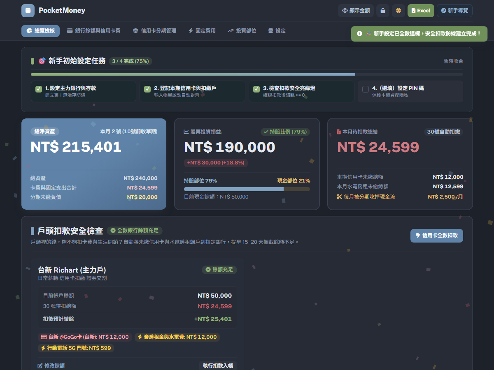

- **新手引導任務列（Checklist）**：
  1. 設定主力銀行與存款（建立第 1 道活存防線）
  2. 登記本期信用卡與扣繳戶（自動對齊對扣）
  3. 檢查扣款安全亮綠燈（確認扣後結餘 $\ge 0$）
  4. （選填）設定 PIN 碼保護本機隱私
- **快速示範資料載入**：提供「✨ 帶我導覽 3 分鐘」與「🚀 載入示範資料」按鈕，讓新使用者立刻理解產品概念與資料呈現方式。

---

### 2.3 財務總覽與扣款安全檢查（核心儀表板）

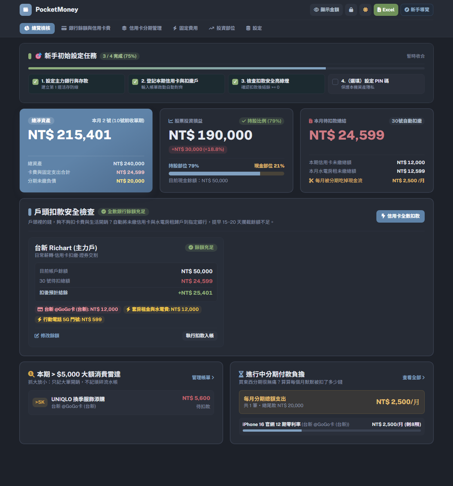

- **三大頂部指標卡**：
  - **總淨資產**：顯示淨資產總計（含總資產、卡費與固定支出、分期未繳負債結算）。
  - **股票投資損益**：即時換算持股總市值、波段未實現損益與現股配置比例（例如 79% 持股 vs 21% 現金）。
  - **本月待扣款總結**：精確統計本月信用卡待繳、固定水電房租待繳，以及每月被分期吃掉的固定現金流。
- **戶頭扣款安全檢查（紅綠燈預警系統）**：
  - 清楚列出主力扣繳戶餘額與待扣款項對齊結果。
  - **扣後預計結餘**：提早 15~20 天攔截餘額不足風險，確保全數帳戶顯示「餘額充足」綠燈。
  - **一鍵信用卡全數扣款 / 執行扣款入帳**：繳費完成後一鍵結清。
- **本期 > $5,000 大額消費雷達**：
  - 自動列出當月超過門檻的重大開銷（例如換季服飾添購 NT$ 5,600），專注控制大額突波。
- **進行中分期付款負擔摘要**：
  - 呈現每月分期總額與剩餘期數總覽（例如 iPhone 12 期零利率剩餘 8 期）。

---

### 2.4 銀行餘額與信用卡費管理（抓大放小）

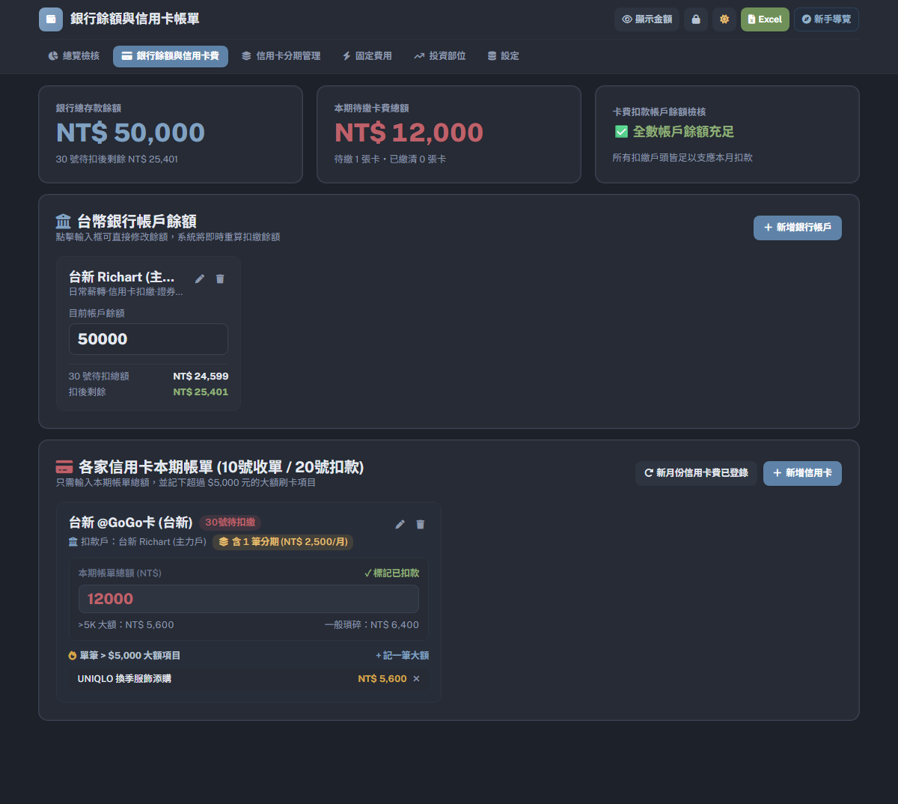

- **銀行帳戶管理**：
  - 支援多銀行帳戶新增、編輯與刪除。
  - 點擊輸入框可直接修改現有存款餘額，系統即時連動計算扣後結餘。
- **信用卡本期帳單**：
  - 支援設定扣款銀行帳戶與約定扣款日。
  - 只需登錄「本期帳單總額」與「大額消費項目（> NT$ 5,000）」，系統自動計算出一般瑣碎花費，省去流水日記帳的繁瑣。
  - 支援標記已扣款、單筆大額新增/移除、新月份信用卡費一鍵登錄。

---

### 2.5 信用卡分期付款與現金流負擔

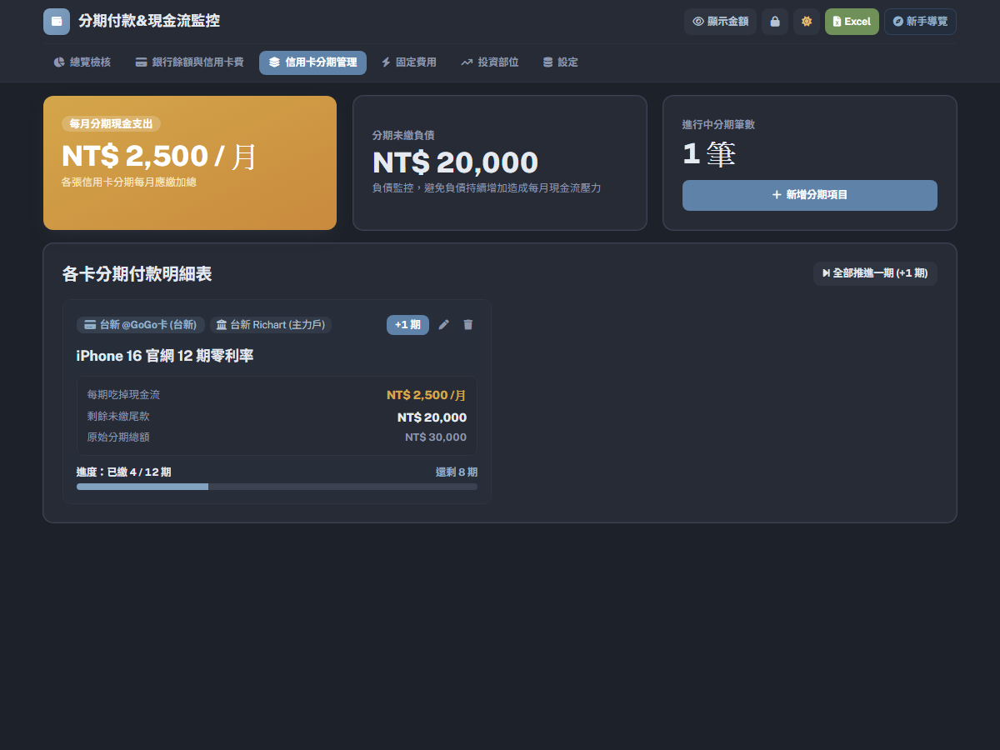

- **現金流防護監控**：
  - 統計「每月分期現金支出」（各卡每月應繳加總）。
  - 監控「分期未繳負債」（總未繳尾款），避免零利率分期累積過多導致未來現金流枯竭。
- **分期明細與進度追蹤**：
  - 條列各筆分期項目、綁定信用卡與扣繳帳戶。
  - 視覺化進度條（如 4/12 期，還剩 8 期）。
  - **全部推進一期 (+1 期)**：月換季時一鍵自動結算推進所有期數，亦支援單筆個別 +1 期。

---

### 2.6 定期性固定生活費用管理

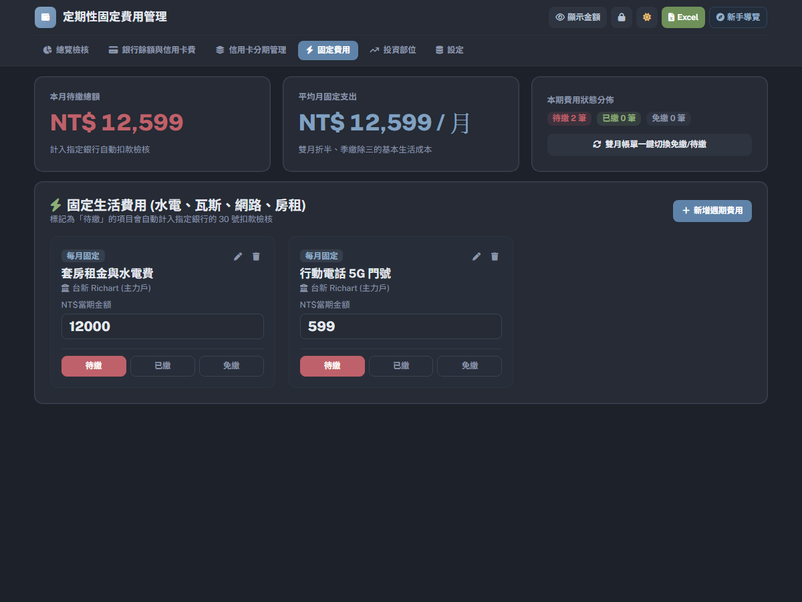

- **固定生活費集中控管**：
  - 彙整房租、水電費、電信 5G、瓦斯與家用網路等週期性固定開支。
  - 支援設定扣繳銀行戶，自動併入扣款安全檢核。
- **三態繳費狀態切換**：
  - 提供 `待繳`、`已繳`、`免繳` 快速切換按鈕。
- **雙月帳單一鍵切換**：
  - 針對台灣台電電費、水費雙月開單特性，支援「雙月帳單一鍵切換免繳/待繳」。

---

### 2.7 股票資產與資金比例監控

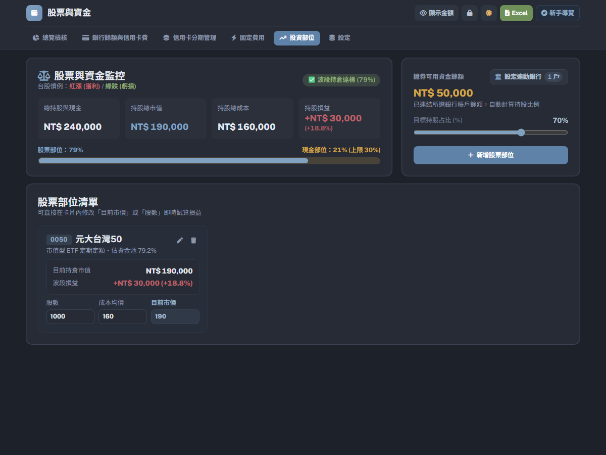

- **持股與現金部位調配**：
  - 設定連動交割銀行，自動計算「持股部位」與「現金部位」比例。
  - 具備現金部位水位上限警戒（例如現金比例低於 30% 警示）。
- **股票部位損益試算**：
  - 支援登錄股票代號、名稱、股數、成本均價與目前市價。
  - 自動換算持股市值與未實現損益率（符合台股慣例：紅漲綠跌）。

---

### 2.8 數據備份、Excel 匯出與單機離線打包

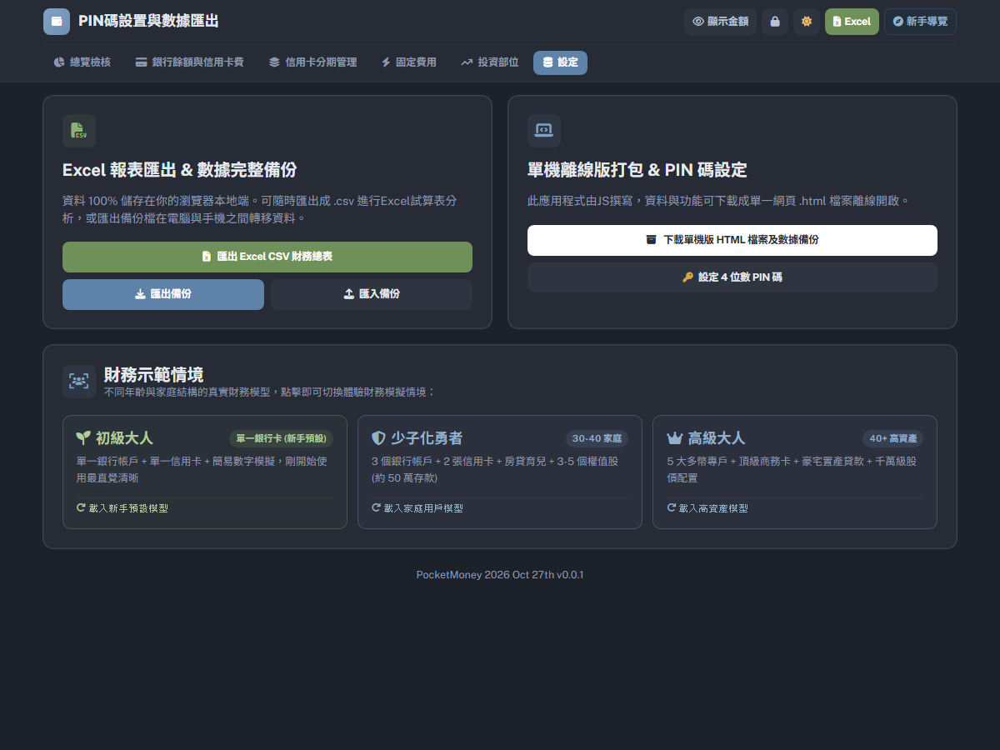

- **Excel CSV 財務總表匯出**：可直接將所有資產、帳單、分期、投資資料匯出為 CSV 試算表。
- **完整數據備份與匯入**：支援一鍵匯出與匯入 JSON 備份檔，便於在跨裝置（手機與電腦）間無縫同步。
- **單機離線版 HTML 打包下載**：點擊「下載單機版 HTML 檔案及數據備份」，可產生完整獨立運作的 HTML 檔案，無需網路亦可長久使用。
- **PIN 碼設定/變更**：提供個人專屬 4 位數 PIN 碼設定介面。
- **三種典型範本模型切換**：可一鍵切換「初級大人」、「少子化勇者」、「高級大人」之範例資料以供體驗。

---

## 3. 趨勢版視覺功能盤點（mockup_view.html）

`mockup_view.html` 著重於**中長期財務趨勢洞察**、**多維度統計圖表**與**典型客群情境分析**：

### 3.1 信用卡消費趨勢與大額排除平均

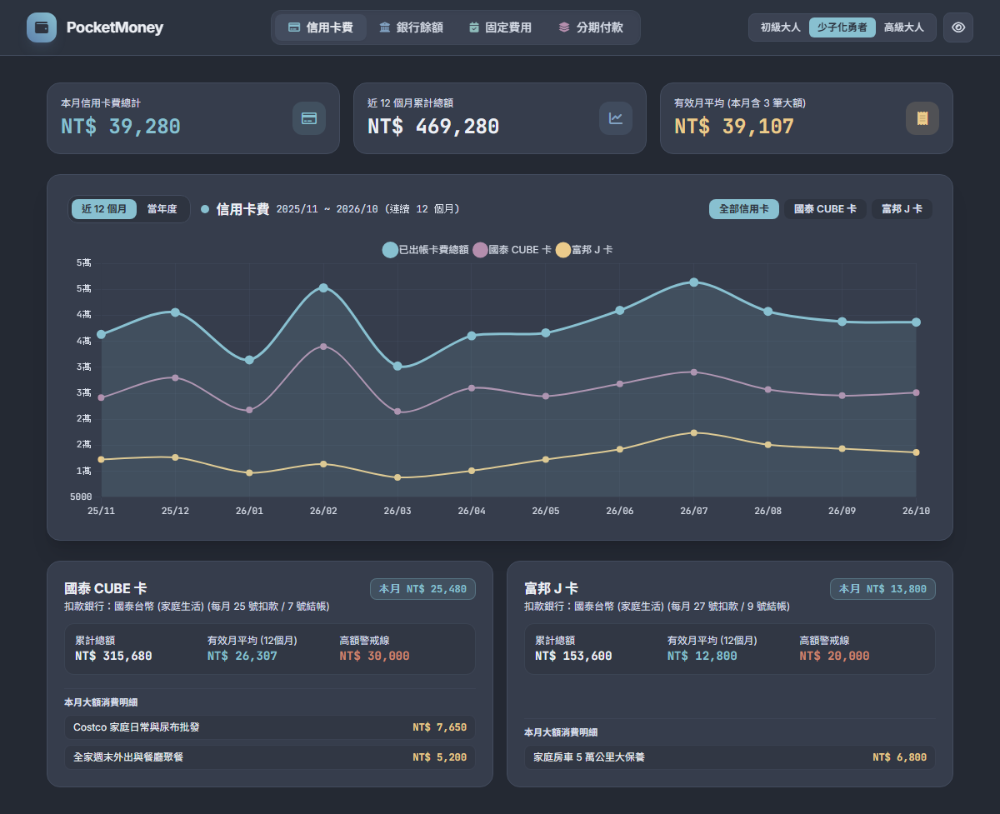

- **近 12 個月 / 當年度趨勢圖**：
  - 平滑折線圖展示各張信用卡（如國泰 CUBE 卡、富邦 J 卡）與出帳總額的 12 個月變化曲線。
- **有效月平均（去除大額突波）**：
  - 指標卡除了「本月總計」與「近 12 個月累計」外，特別計算**有效月平均**（扣除單次極端大額花費後的真實生活開銷基準線）。
- **單卡卡片與高額警戒線**：
  - 卡片呈現各自的月累計、有效月平均與自訂高額警戒線（如 NT$ 30,000 / NT$ 20,000）。
  - 下方拆解本月大額消費明細（如 Costco 採買 NT$ 7,650、大保養 NT$ 6,800）。

---

### 3.2 銀行餘額走勢與閒置資金/安全水位警示

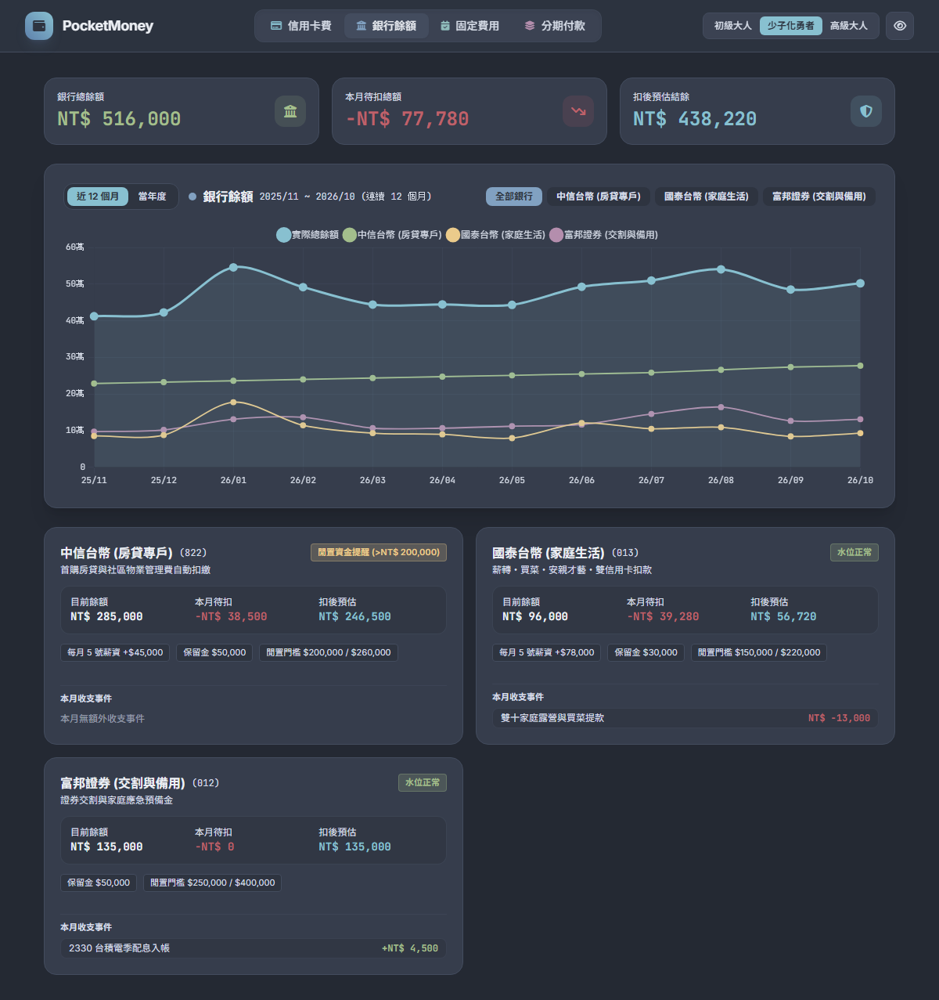

- **多帳戶資金走勢圖**：
  - 追蹤房貸專戶、生活專戶與證券交割專戶各自之月度結餘水位。
- **閒置資金與安全防線標籤**：
  - 智慧識別帳戶閒置金額（例如房貸專戶偵測到閒置資金 > NT$ 200,000 提醒轉投資或還本）。
  - 帳戶標註保留金門檻（如保留金 NT$ 50,000）、閒置門檻，並顯示「水位正常」或警告標籤。
- **本月收支重大事件**：
  - 標記單月非經常性收支（如雙十家庭露營 NT$ -13,000、台積電季配息 NT$ +4,500）。

---

### 3.3 固定支出扣款管道走勢分析

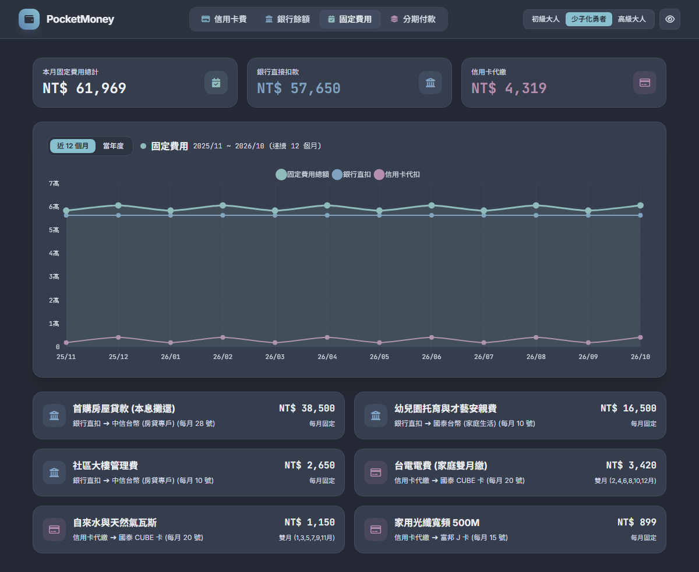

- **扣款管道結構拆解**：
  - 頂部直接區分「銀行直接扣款（如房貸、安親托育、管理費）」與「信用卡代繳（如水電瓦斯、寬頻通訊）」。
  - 12 個月折線圖清楚呈現兩大管道的每月穩定支出基期。
- **週期頻率標註**：
  - 清楚區分「每月固定」與「雙月繳（如電費雙月 2,4,6,8,10,12 月開單）」，防止隔月多扣造成資金誤判。

---

### 3.4 分期付款累積攤提曲線

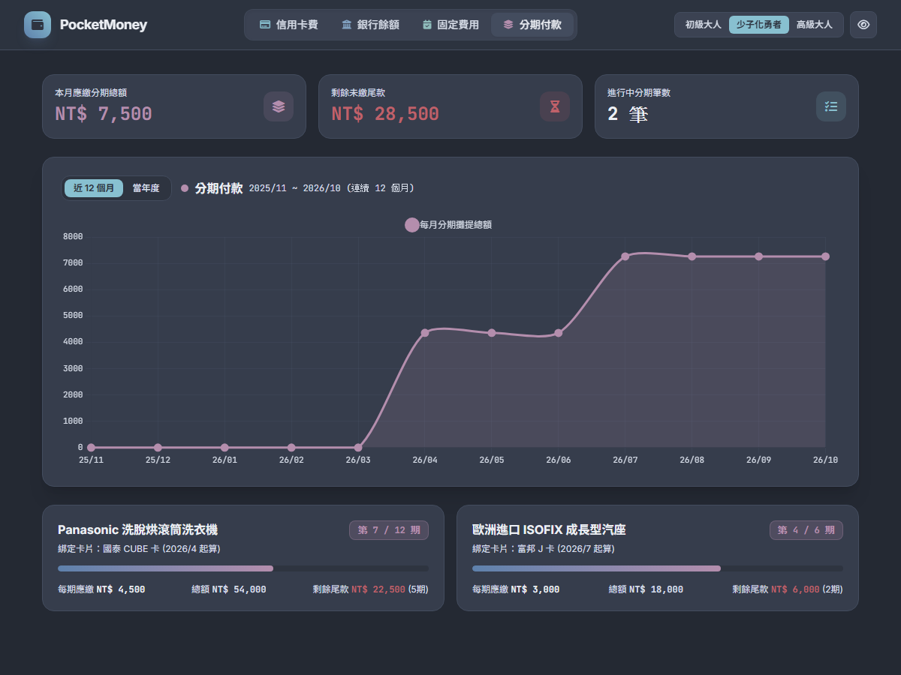

- **月攤提負擔爬升曲線**：
  - 視覺化展示隨新商品分期購買（如滾筒洗衣機、成長型汽座），每月應繳金額的爬升與未來遞減期程。
- **期數進度條與總額試算**：
  - 卡片標示第幾期/總期數（例如第 7 / 12 期）、綁定卡別與起算月份。
  - 呈現每期應繳、總額及剩餘尾款金額。

---

### 3.5 三大財務畫像情境切換（初級大人 / 少子化勇者 / 高級大人）

| 角色情境 | 截圖預覽 | 財務結構特色 |
| :--- | :--- | :--- |
| **初級大人** (剛入職場/單身) | 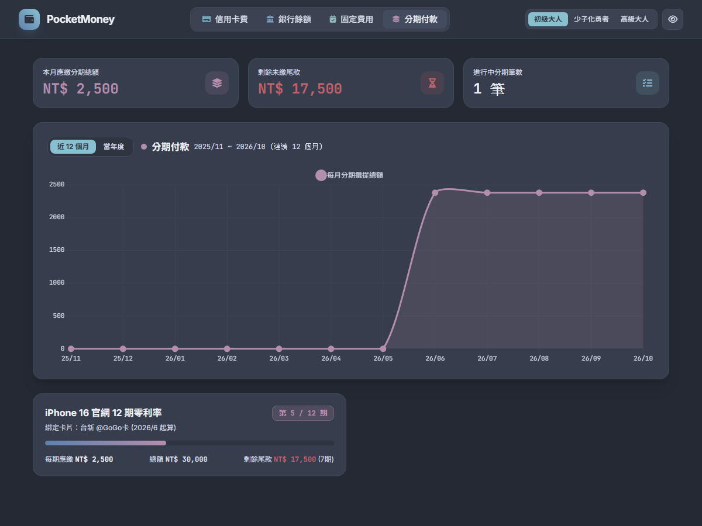 | 單一薪轉銀行 + 單一信用卡，聚焦小資生活費、套房租金與手機通訊費防守。 |
| **少子化勇者** (30-40 夾心世代) |  | 3 家銀行專戶 + 多張信用卡，承擔房貸、幼兒托育、多筆大型家電分期及台股 ETF。 |
| **高級大人** (40+ 高資產/熟齡) | 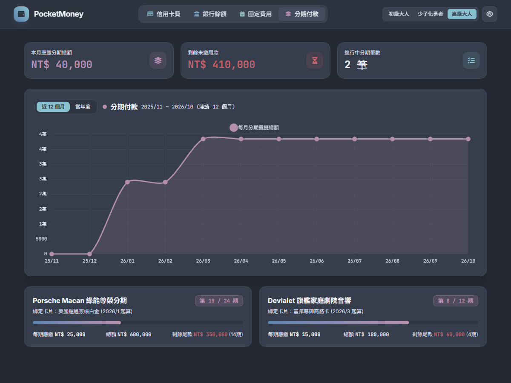 | 5 大多幣別與私人銀行專戶、頂級商務卡、豪宅置產貸款與千萬級股債部位。 |

---

## 4. 功能總結矩陣表

| 功能分類 | 子功能項目 | 正式版 (`kipomo.html`) | 趨勢版 (`mockup_view.html`) | 說明 |
| :--- | :--- | :---: | :---: | :--- |
| **隱私與安全** | PIN 碼鎖定 | ✅ | ❌ | 4 位數 PIN 碼遮罩保護 |
| | 金額切換遮罩 | ✅ | ✅ | 一鍵隱藏資產敏感數字 |
| **銀行管理** | 多帳戶餘額管理 | ✅ | ✅ | 支援直接編輯餘額與指定用途 |
| | 扣款安全紅綠燈檢查 | ✅ | ✅ | 提早計算扣後預計結餘防止透支 |
| | 閒置資金與水位提醒 | ❌ | ✅ | 設定安全防線與閒置資金警報 |
| **信用卡管理** | 帳單登錄 | ✅ | ✅ | 記錄當期應繳總金額 |
| | 抓大放小大額雷達 | ✅ | ✅ | 獨立標註 >$5,000 項目，其餘自動歸納 |
| | 12 個月開銷趨勢線 | ❌ | ✅ | 歷史走勢與單卡折線對比 |
| | 有效月平均計算 | ❌ | ✅ | 自動去除大額突波算出真實開銷基準 |
| **分期管理** | 分期項目追蹤 | ✅ | ✅ | 記錄期數、每期金額與未繳尾款 |
| | +1 期快速推進 | ✅ | ❌ | 月換季一鍵推進全部或單筆分期 |
| | 分期累積負擔走勢 | ❌ | ✅ | 呈現多筆分期累積造成的現金流壓迫線 |
| **固定費用** | 週期水電房租管理 | ✅ | ✅ | 分類管理常態生活固定開銷 |
| | 三態狀態切換 | ✅ | ❌ | 支援「待繳 / 已繳 / 免繳」 |
| | 雙月帳單一鍵切換 | ✅ | ❌ | 適應台水台電雙月繳款機制 |
| | 扣款管道拆解 | ❌ | ✅ | 視覺化分流銀行直扣 vs 信用卡代繳 |
| **投資理財** | 股票市值損益追蹤 | ✅ | ❌ | 台股個股/ETF 成本均價與損益試算 |
| | 現金/股票配置比例滑桿 | ✅ | ❌ | 監控現金防禦水位與持股警戒線 |
| **數據與匯出** | Excel CSV 匯出 | ✅ | ❌ | 一鍵匯出財務總表 |
| | JSON 備份 / 匯入 | ✅ | ❌ | 本機無伺服器跨裝置轉移 |
| | 單機版 HTML 離線打包 | ✅ | ❌ | 下載完全離線執行的本機單一檔案 |
| **客群適應** | 範本情境切換 | ✅ | ✅ | 初級大人、少子化勇者、高級大人 |

