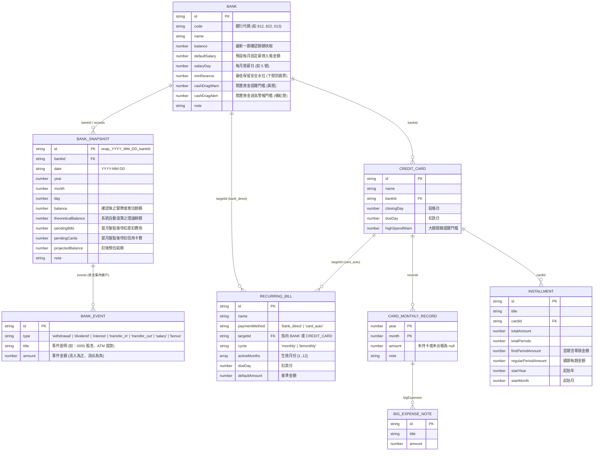

# PocketMoney 資料庫結構與計算公式規格書 (SCHEMA.md)

> **文件性質**：L1 唯一資料結構與計算公式真實來源（Single Source of Truth）。
> **涵蓋範圍**：
> 1. **Main 現行結構（v3.5）**：[`pocketmoney_view.html`](file:///c:/Dev/wiskinglin.github.io/_dev/PocketMoney/pocketmoney_view.html) 實際運行的 `state` 結構與計算公式。
> 2. **v4 時序快照結構**：[`database/dummy_db_*.json`](file:///c:/Dev/wiskinglin.github.io/_dev/PocketMoney/database/) 與 [`mockup_view.html`](file:///c:/Dev/wiskinglin.github.io/_dev/PocketMoney/mockup_view.html) 使用的 12 個月時序擴充結構。
> 3. **演進對照與待決議項目**：連向 [`DECISIONS.md`](file:///c:/Dev/wiskinglin.github.io/_dev/PocketMoney/DECISIONS.md)。

---

## 1. 儲存鍵值與版本規範 (Storage Keys & Isolation)

| 環境 / 用途 | `STORAGE_KEY` | 說明與紅線 |
| :--- | :--- | :--- |
| **正式版 (`tools/kipomo.html`)** | `PocketMoney_tw_finance_v3` | 使用者真實本機資料 |
| **Main 雛型 (`pocketmoney_view.html`)** | `PocketMoney_tw_finance_v3` | 與正式版共用，已向後相容新增薪資戶、股利與趨勢圖欄位 |
| **功能實驗 (`prototypes/Fxx-*/A.html`, `B.html`)** | `PocketMoney_exp_Fxx_A` / `B` | **強制隔離**，嚴禁在 A/B 實驗中直接覆寫 `PocketMoney_tw_finance_v3` |
| **三人物測試集 (`database/dummy_db_*.json`)** | `schemaVersion: "PocketMoney_tw_finance_v4"` | 包含 `junior`、`family`、`senior` 完整 12 個月（`2025-11`～`2026-10`）時序資料 |

---

## 2. Main 雛型現行資料模型（v3.5 — `pocketmoney_view.html`）

目前 `pocketmoney_view.html` 運作的根物件 `state` 結構如下：

```ts
interface PocketMoneyStateV35 {
  settings: {
    privacyMode: boolean;         // 金額隱私遮罩 (NT$ ••••••)
    pinCode: string;              // 4 位數本地安全鎖 (空字串為停用)
    stockMinHoldRatio: number;    // 股票目標最低持股水位百分比 (預設 70)
    securitiesBankIds: string[];  // 綁定作為證券交割現金池的 BANK.id 清單
  };
  banks: BankV35[];
  cards: CreditCardV35[];
  installments: InstallmentV35[];
  bills: RecurringBillV35[];
  stocks: StockPositionV35[];
}

interface BankV35 {
  id: string;                     // e.g. "bank_1730..."
  name: string;                   // 銀行名稱 (如 "永豐大戶")
  balance: number;                // 目前台幣餘額 (NT$)
  note?: string;                  // 用途備註
  isSalaryAccount?: boolean;      // 【v3.5 新增】是否為薪資入帳戶
  salaryDay?: number;             // 【v3.5 新增】每月發薪日 (1~31，預設 5)
  salaryAmount?: number;          // 【v3.5 新增】預估每月固定薪資 (NT$)
}

interface CreditCardV35 {
  id: string;                     // e.g. "card_1730..."
  name: string;                   // 信用卡名稱
  bankId: string;                 // FK -> BankV35.id (指定扣繳銀行)
  statementTotal: number;         // 本期帳單應繳總額 (NT$)
  paid: boolean;                  // 本期是否已扣繳結清
  bigExpenses?: {                 // 本期 > $5,000 大額消費註記 (不重複累加至 statementTotal)
    id: string;
    title: string;
    amount: number;
  }[];
}

interface InstallmentV35 {
  id: string;                     // e.g. "inst_1730..."
  title: string;                  // 分期項目名稱
  cardId: string;                 // FK -> CreditCardV35.id
  cardName?: string;              // 冗餘名稱備份 (向後相容)
  totalAmount: number;            // 分期總金額
  totalPeriods: number;           // 總期數
  monthlyAmount: number;          // 每期應繳金額
  paidPeriods: number;            // 已繳期數 (0 ~ totalPeriods)
}

interface RecurringBillV35 {
  id: string;                     // e.g. "bill_1730..."
  name: string;                   // 費用名稱 (房租、台電電費、網路費)
  cycle: '每月固定' | '雙月帳單' | '季繳/年繳';
  amount: number;                 // 當期金額
  bankId: string;                 // FK -> BankV35.id (指定扣款銀行)
  status: 'unpaid' | 'paid' | 'skipped'; // 待繳 | 已繳 | 本期免繳
}

interface StockPositionV35 {
  id: string;                     // e.g. "stk_1730..."
  code: string;                   // 台股代號 (如 "2330", "0050")
  name: string;                   // 股票名稱
  shares: number;                 // 持有股數 (1 張 = 1000 股)
  avgCost: number;                // 買入成本均價
  currentPrice: number;           // 目前市價
  note?: string;                  // 波段操作備註
}
```

---

## 3. v4 時序與雙軌快照擴充模型（`database/dummy_db_*.json`）

為解決「換月重置覆蓋歷史資料」並支援真實 12 個月趨勢分析，v4 引入了**時序子陣列 (`records`)** 與**跨行快照表 (`bankSnapshots`)**。逐步往 Main 合併時以此為標準：



### 3.1 Main (v3.5) 與 v4 欄位對照表（開發轉接必讀）

| 概念 | Main (`pocketmoney_view.html` v3.5) | v4 (`dummy_db_*.json`) | 轉接規則 |
| :--- | :--- | :--- | :--- |
| **固定費用集合名稱** | `state.bills` | `state.recurringBills` | 讀取時支援 `state.bills \|\| state.recurringBills` |
| **銀行預設月薪** | `bank.salaryAmount` + `bank.isSalaryAccount` | `bank.defaultSalary` | `const salary = bank.salaryAmount ?? bank.defaultSalary ?? 0` |
| **固定費用扣款對象** | `bill.bankId`（僅支援銀行） | `bill.paymentMethod` (`bank_direct` \| `card_auto`) + `bill.targetId` | 若 `paymentMethod === 'card_auto'`，不計入銀行直扣，避免與卡費重複扣款 |
| **分期剩餘期數** | 手動維護 `inst.paidPeriods` | 由 `(year, month)` 與 `startYear, startMonth` 自動推算 | 見 `DECISIONS.md` ADR-001 |

---

## 4. 核心計算公式 (Computation Rules)

### 4.1 總資產與總淨資產（防重複計算鐵律）
- **全部銀行總餘額**：
  $$\text{TotalBankBalance} = \sum_{b \in \text{Banks}} b.\text{balance}$$
- **股票持倉總市值與波段損益**：
  $$\text{StockMarketValue} = \sum_{s \in \text{Stocks}} s.\text{shares} \times s.\text{currentPrice}, \quad \text{StockCostValue} = \sum_{s \in \text{Stocks}} s.\text{shares} \times s.\text{avgCost}$$
- **證券交割待命現金池**（僅供計算股票部位配置比例，**不得再次加進總資產**）：
  $$\text{StockCashPool} = \sum_{b \in \text{Banks},\, b.\text{id} \in \text{securitiesBankIds}} b.\text{balance}$$
  $$\text{StockHoldRatio} = \mathrm{round}\left(\frac{\text{StockMarketValue}}{\text{StockMarketValue} + \text{StockCashPool}} \times 100\right)\%$$
- **總資產與總淨資產**：
  $$\text{TotalAssets} = \text{TotalBankBalance} + \text{StockMarketValue}$$
  $$\text{TotalUnpaidLiabilities} = \sum_{c \in \text{Cards},\, \neg c.\text{paid}} c.\text{statementTotal} + \sum_{b \in \text{Bills},\, b.\text{status}='unpaid'} b.\text{amount}$$
  $$\text{NetWorth} = \text{TotalAssets} - \text{TotalUnpaidLiabilities}$$

### 4.2 指定銀行扣款安全檢核（防跳票核心）
針對每一家銀行 $B_i$ 分別獨立計算，**嚴禁以全體銀行總餘額掩蓋單一銀行缺口**：
- **待扣信用卡費**：
  $$\text{CardsSum}(B_i) = \sum_{c \in \text{Cards},\, c.\text{bankId} = B_i.\text{id},\, \neg c.\text{paid}} c.\text{statementTotal}$$
- **待扣直扣固定費用**：
  $$\text{BillsSum}(B_i) = \sum_{b \in \text{Bills},\, b.\text{bankId} = B_i.\text{id},\, b.\text{status} = 'unpaid'} b.\text{amount}$$
- **扣後預估結餘與四段水位燈號**：
  $$\text{ProjectedBalance}(B_i) = B_i.\text{balance} - \big(\text{CardsSum}(B_i) + \text{BillsSum}(B_i)\big)$$
  $$\text{Status}(B_i) = \begin{cases} \text{SHORTFALL / LOW\_RESERVE (紅燈)} & \text{if } \text{ProjectedBalance}(B_i) < (B_i.\text{minReserve} \lor 0) \\ \text{CASH\_DRAG\_ALERT (橘紅燈)} & \text{if } B_i.\text{cashDragAlert} > 0 \land \text{ProjectedBalance}(B_i) \ge B_i.\text{cashDragAlert} \\ \text{CASH\_DRAG\_WARN (黃燈)} & \text{if } B_i.\text{cashDragWarn} > 0 \land \text{ProjectedBalance}(B_i) \ge B_i.\text{cashDragWarn} \\ \text{SAFE (綠燈)} & \text{otherwise} \end{cases}$$

### 4.3 常態每月固定開銷平準化
$$\text{BillsMonthlyBaseCost} = \sum_{b \in \text{Bills}} \begin{cases} b.\text{amount} & \text{每月固定} \\ \mathrm{round}(b.\text{amount} / 2) & \text{雙月帳單} \\ \mathrm{round}(b.\text{amount} / 3) & \text{季繳} \end{cases}$$

### 4.4 未發生月份（$m > M_{\text{current}}$）之銀行餘額自動滾算推估
在 12 個月趨勢圖的 `[當年度]` 模式下，對尚未發生的月份 $m$ 以當前確認餘額遞推：
$$\widehat{\text{Balance}}(B_i, m) = \widehat{\text{Balance}}(B_i, m-1) + \text{Salary}(B_i) - \text{DirectBills}(B_i, m) - \sum_{c.\text{bankId}=B_i.\text{id}} \text{MonthlyAvg}(c)$$

### 4.5 信用卡有效月平均（v4 時序紀錄）
- 區間總計：$\text{PeriodTotal}(c, S) = \sum_{r \in c.\text{records},\, r.\text{amount} \neq \text{null}} r.\text{amount}$
- 有效持卡月數（`amount === 0` 計入分母，`amount === null` 未持卡或未出帳**不計入分母**）：
  $$\text{ActiveMonths}(c, S) = \text{count}(r \in c.\text{records} \mid r.\text{amount} \neq \text{null})$$
- 有效月平均：$\text{MonthlyAvg}(c, S) = \text{ActiveMonths} > 0 \ ? \ \mathrm{round}(\text{PeriodTotal} / \text{ActiveMonths}) : 0$

### 4.6 分期付款目標年月期數推算
- 對目標年月 $(Y, M)$：$\text{PeriodIndex}(Y, M) = (Y - \text{startYear}) \times 12 + (M - \text{startMonth}) + 1$
- 若 $1 \le \text{PeriodIndex} \le \text{totalPeriods}$，第 1 期金額為 `firstPeriodAmount`，第 2 期起為 `regularPeriodAmount`。

