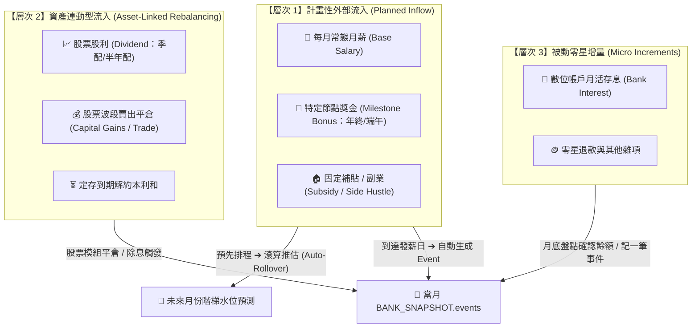
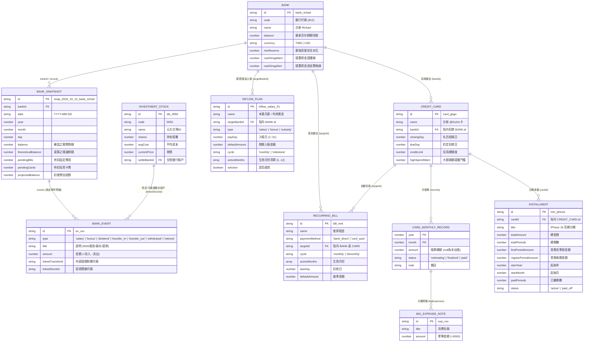

# PocketMoney 資料庫規劃現況分析與後續演進待辦清單 (TODO.md)

- **建立/更新日期**：2026-11-02
- **文件狀態**：規劃中 (Planning)
- **基準規格**：[`_dev/PocketMoney/UXD.md`](file:///c:/Dev/wiskinglin.github.io/_dev/PocketMoney/UXD.md)（第四章 4.1 實體關係圖與雙軌快照結構）與 [`_dev/PocketMoney/SDD.md`](file:///c:/Dev/wiskinglin.github.io/_dev/PocketMoney/SDD.md)
- **目標用途**：以 `UXD.md` 的「主實體聚合 + 雙軌快照（Event / Snapshot）」為基線，深入探討現金流入、跨戶調撥、投資連動等模組之自然擴充架構，作為後續重構之規格依據。

---

## 目錄

1. [現行架構基線：UXD 4.1 核心模組體系](#1-現行架構基線uxd-41-核心模組體系)
2. [深入探討：現金流入（Inflow）模組的本質與分層架構](#2-深入探討現金流入inflow模組的本質與分層架構)
   - 2.1 [為什麼不能把所有流入硬套成「Recurring Income」？](#21-為什麼不能把所有流入硬套成recurring-income)
   - 2.2 [流入的三大本質層次分類](#22-流入的三大本質層次分類)
   - 2.3 [建議實體設計：`INFLOW_PLAN`（計畫性流入）與 `BANK_EVENT` 的閉環](#23-建議實體設計inflow_plan計畫性流入與bank_event的閉環)
3. [其他模組之落差分析與自然擴充方案](#3-其他模組之落差分析與自然擴充方案)
   - 3.1 [帳戶內部調撥（Internal Transfer）與 `BANK_EVENT` 對齊](#31-帳戶內部調撥internal-transfer與bank_event對齊)
   - 3.2 [信用卡結帳日與扣款日的跨月時差問題](#32-信用卡結帳日與扣款日的跨月時差問題)
   - 3.3 [固定費用（`RECURRING_BILL`）之主規則與當期實例覆寫](#33-固定費用recurring_bill之主規則與當期實例覆寫)
   - 3.4 [分期付款（`INSTALLMENT`）提前結清與信用額度佔用](#34-分期付款installment提前結清與信用額度佔用)
   - 3.5 [多幣別支援與儲存持久化限制](#35-多幣別支援與儲存持久化限制)
4. [對齊 UXD 4.1 之擴充實體關係圖 (Extended ER Diagram)](#4-對齊-uxd-41-之擴充實體關係圖-extended-er-diagram)
5. [後續逐步導入之待辦清單 (Implementation Checklist)](#5-後續逐步導入之待辦清單-implementation-checklist)

---

## 1. 現行架構基線：UXD 4.1 核心模組體系

在 [`UXD.md`](file:///c:/Dev/wiskinglin.github.io/_dev/PocketMoney/UXD.md) 4.1 中，系統架構由四大主模組構成：
1. **`BANK` (銀行帳戶)**：
   - 屬性包含 `balance`、`defaultSalary`、`salaryDay`、`minReserve`、`cashDragWarn`、`cashDragAlert`。
   - 子實體：**`BANK_SNAPSHOT`**（月度/盤點日存量快照）與 **`BANK_EVENT`**（收支異動明細事件，流入為正、流出為負）。
2. **`CREDIT_CARD` (信用卡)**：
   - 屬性包含 `closingDay`、`dueDay`、`highSpendWarn`。
   - 子實體：**`CARD_MONTHLY_RECORD`**（月帳單金額）、**`BIG_EXPENSE_NOTE`**（大額消費）、**`INSTALLMENT`**（分期付款）。
3. **`RECURRING_BILL` (週期固定費用)**：
   - 雙向綁定扣款管道（`paymentMethod: 'bank_direct' | 'card_auto'`），包含 `activeMonths`、`dueDay`、`defaultAmount`。
4. **`INVESTMENT / STOCK` (股票投資)**：
   - 持股總覽與波段損益，並透過交割戶之 `BANK_EVENT (type: 'dividend' | 'transfer_out')` 與銀行連動。

---

## 2. 深入探討：現金流入（Inflow）模組的本質與分層架構

### 2.1 為什麼不能把所有流入硬套成「Recurring Income」？

市面上常見記帳軟體常將所有收入簡化為「固定週期收入（Recurring Income）」，但在實際生活與投資中，不同現金流入的**「頻率、確定性、驅動機制」**完全不同：

| 流入項目 | 現實發生特徵 | 能否預先排程？ | 本質驅動來源 |
| :--- | :--- | :---: | :--- |
| **每月薪資 (Salary)** | 每月固定日期（如 5 號）、金額穩定 | **可以** (高度確定) | 外部本業工資 |
| **獎金 (Bonus)** | 每年 1~2 次（如 1 月年終、6 月端午）、金額浮動 | **可以** (指定月份) | 外部激勵收入 |
| **股票股利 (Dividend)** | 季配或半年配、金額隨持股張數波動 | **視持股而定** | **投資部位衍生** (不應兩套帳重複記) |
| **股票資本利得 (Capital Gains)** | 不定期、波段買賣平倉、買進扣款/賣出回款 | **完全無法預期** | **「資產形態轉換 (股 ➔ 現)」** |
| **銀行高利活存息 (Interest)** | 每月入帳、金額微小且隨每日餘額波動 | **無法精算** | 存量孳息 (盤點事件) |

若強行把「股票買賣獲利」或「股利」寫入 Recurring Income，會造成無法排程預測、本金回收與獲利混淆、以及股票與收入重複記帳的大忌。

---

### 2.2 流入的三大本質層次分類

為了維持 PocketMoney「抓大放小、流動性防守」的哲學，現金流入應拆解為三個層次：



1. **層次 1：計畫性外部流入（Planned Inflow）——防守預測層**
   - **目標**：專門解決「月底 30 號防跳票檢核」與「未來月份階梯水位推估（Auto-Rollover）」。
   - **範疇**：每月本業薪資、兼職收入、1 年 1~2 次的固定節點獎金。
2. **層次 2：資產連動型流入（Asset-Linked Events）——資產再平衡層**
   - **目標**：記錄真實發生的投資回款，不走預算排程。
   - **範疇**：
     - **股票配息**：除息日入帳，直接在指定證券交割戶產生 `BANK_EVENT (type: 'dividend')`。
     - **股票賣出回款**：股票持股扣減，並在交割戶產生 `BANK_EVENT (type: 'transfer_in', title: '賣出台積電1張')`。
3. **層次 3：被動零星增量（Micro Increments）——盤點吸收層**
   - **目標**：抓大放小，不消耗使用者意志力。
   - **範疇**：活存利息、發票中獎，在月度盤點實際餘額時自動吸收，或選填單筆 `BANK_EVENT (type: 'interest')`。

---

### 2.3 建議實體設計：`INFLOW_PLAN`（計畫性流入）與 `BANK_EVENT` 的閉環

延續 `UXD.md` 4.1 的精神，在保留現行 `BANK.defaultSalary` 向下相容的前提下，將收入排程抽換/擴充為乾淨的 `INFLOW_PLAN`：

```ts
interface INFLOW_PLAN {
  id: string;                 // e.g. "inflow_salary_taishin", "inflow_bonus_cny"
  name: string;               // "本業薪資"、"年終獎金"、"租金補貼"
  targetBankId: string;       // FK -> BANK.id (匯入指定銀行)
  type: 'salary' | 'bonus' | 'subsidy' | 'other';
  payDay: number;             // 入帳日 (1~31)
  defaultAmount: number;      // 預期金額
  cycle: 'monthly' | 'milestone'; // monthly: 每月固定; milestone: 特定月份
  activeMonths: number[];     // monthly 為 [1..12]; 年終獎金可能為 [1]; 端午為 [6]
  isActive: boolean;
}
```

#### 與 `BANK_SNAPSHOT` 及 `BANK_EVENT` 的互動機制：
1. **未來推估（Future Projection）**：
   在計算未來未發生月份（$m > M_{\text{current}}$）的推估水位時，系統自動將該月份命中 `activeMonths` 的所有 `INFLOW_PLAN.defaultAmount` 納入當月資金流入滾算。
2. **當期落地（Current Settlement）**：
   當進入當月且系統日期或盤點日期 $\ge payDay$ 時，系統可提示使用者「一鍵確認薪資/獎金入帳」，自動在當月的 `BANK_SNAPSHOT` 內注入一筆 `BANK_EVENT`：
   ```json
   {
     "id": "ev_auto_salary_202610",
     "type": "salary",
     "title": "本業薪資入帳",
     "amount": 42000
   }
   ```

---

## 3. 其他模組之落差分析與自然擴充方案

### 3.1 帳戶內部調撥（Internal Transfer）與 `BANK_EVENT` 對齊
- **痛點**：使用者常由薪轉戶（台新）轉帳至房貸扣繳戶（中信）。
- **自然擴充設計**：
  不額外開一張複雜的跨庫大表，而是利用 `BANK_EVENT` 進行**配對關聯**：
  - 在轉出銀行 Snapshot 新增事件：`{ type: 'transfer_out', title: '轉出至中信房貸戶', amount: -30000, linkedTransferId: 'xfer_001' }`
  - 在轉入銀行 Snapshot 新增事件：`{ type: 'transfer_in', title: '台新薪轉戶轉入', amount: 30000, linkedTransferId: 'xfer_001' }`
  - 當儀表板檢核到中信餘額不足時，系統可直接提供按鈕：「💡 從台新 Richart 調度轉帳 NT$ 30,000」，點擊即可一鍵在兩邊寫入成對的 Events。

---

### 3.2 信用卡結帳日與扣款日的跨月時差問題
- **痛點**：`UXD.md` 中已定義 `closingDay`（結帳日）與 `dueDay`（扣款日），但 `CARD_MONTHLY_RECORD` 的 `month` 容易混淆是「消費期」還是「扣款期」。
- **自然擴充設計**：
  - 明確定義 `CARD_MONTHLY_RECORD` 中的 `year/month` 代表**「帳單出帳期（Billing Cycle）」**。
  - 扣繳銀行進行 30 號待扣檢核時，檢核公式對齊其 `dueDay` 所在的實際日曆月份，杜絕跨月錯位。

---

### 3.3 固定費用（`RECURRING_BILL`）之主規則與當期實例覆寫
- **痛點**：夏季電費暴增（如 4,500 元，冬月 1,500 元），若修改 `defaultAmount` 會破壞全年預算基線。
- **自然擴充設計**：
  - `RECURRING_BILL` 維持作為「主規則定義」。
  - 允許在特定月份的 `BANK_SNAPSHOT.events` 或當月對帳單中，以 `overrideAmount` 進行單期覆寫，未覆寫者自動採用 `defaultAmount`。

---

### 3.4 分期付款（`INSTALLMENT`）提前結清與信用額度佔用
- **痛點**：缺少提早全額結清機制，且未監控信用額度上限。
- **自然擴充設計**：
  - `CREDIT_CARD` 增加 `creditLimit: number`（總信用額度）。
  - 可用額度計算：$\text{AvailableLimit} = \text{CreditLimit} - \text{CurrentStatement} - \sum \text{RemainingInstallmentAmount}$。
  - 分期支援 `status: 'active' | 'paid_off'`，提早結清時將所有剩餘尾款一次性灌入當月帳單。

---

### 3.5 多幣別支援與儲存持久化限制
- **外幣資產**：`BANK` 增加 `currency: 'TWD' | 'USD' | 'JPY'`，系統全域設定匯率對照，淨資產一律折合為台幣展示。
- **儲存引擎**：LocalStorage 維持存放當前 HEAD 狀態，歷年 Snapshot 與 Events 逐步支援 IndexedDB 非同步載入，徹底解決 5MB 天花板。

---

## 4. 對齊 UXD 4.1 之擴充實體關係圖 (Extended ER Diagram)



---

## 5. 後續逐步導入之待辦清單 (Implementation Checklist)

### 階段零：解決單月拋棄式痛點 —— 跨月數據沉澱與長期價值 (P0)
- [ ] **T00. 歷史月度資料沉澱與儲蓄率追蹤（避免換月數據被覆蓋）**
  - [ ] 支援封存每月歷史快照（總資產、總負債、淨現金流、真實儲蓄率），不覆蓋前月數據。
  - [ ] 提供連續 6~12 個月資產淨值成長折線圖與月度儲蓄率趨勢。
  - [ ] 次月 30 天動態現金流預測（Safe-to-Spend）：每月盤點完成後，自動依發薪日與扣款日推算下月可安心自由花費額度。
  - [ ] 分期退坡時間軸：視覺化未來各月隨分期到期後的固定負擔下降趨勢。

### 階段一：現金流入模組與銀行薪資戶 (P0)
- [ ] **T01. 銀行薪資戶與固定流入設定**
  - [ ] 銀行卡片與設定支援「設為薪資戶」，設定每月入帳日（如 5 號）與固定薪資金額。
  - [ ] 提供「薪資入帳」快捷按鈕：點擊後一鍵將薪資注入該銀行帳戶餘額。
  - [ ] 健全理論餘額自動滾算公式：`理論餘額 = 上期餘額 + 薪資流入 - 固定費用 - 信用卡費`。
- [ ] **T02. 新手引導三步閉環 (Onboarding)**
  - [ ] 第一步：建立主力薪資戶與發薪日（設定資金起點）。
  - [ ] 第二步：建立常用信用卡與扣款戶（設定主要消費流出）。
  - [ ] 第三步：建立固定房租或貸款（設定底層開銷）。
  - [ ] 完成後立即產生首份可用現金流概況。

### 階段二：投資模組現金連動（股利與資本損益） (P1)
- [ ] **T03. 股票股利入帳至交割戶**
  - [ ] 股票部位支援「股利入帳」動作：輸入除息金額與入帳日，現金直接注入綁定的證券交割戶。
- [ ] **T04. 股票平倉結算與資本損益計算**
  - [ ] 股票賣出平倉彈窗：輸入賣出股數、買進成本均價、賣出成交價。
  - [ ] 自動計算資本損益（賣出金額 - 買入成本 = 資本利得 / 資本損失）。
  - [ ] 賣出交割款直接注入選定的證券交割銀行餘額，並扣減持股部位股數。

### 階段三：內部調撥與時序校準 (P1)
- [ ] **T05. 帳戶內部調撥閉環 (`Internal Transfer`)**
  - [ ] 支援跨行調撥動作，成對產生調出與調入紀錄。
  - [ ] 總覽檢核不足額時，主動提示「從富餘帳戶調度資金」。
- [ ] **T06. 信用卡結帳日與扣款日跨月週期校正**
  - [ ] 明確劃分帳單月份與扣款月份，消除跨月計算誤差。
  - [ ] 信用卡額度監控與分期佔用率警示。
- [ ] **T07. 固定費用單期金額覆寫**
  - [ ] 支援特定月份突發費用覆寫（如夏季電費突波），不影響常態基準。

### 階段四：多幣別與儲存持久化 (P2)
- [ ] **T08. 多幣別帳戶支援**
  - [ ] 支援常用外幣帳戶與折合台幣總值計算。
- [ ] **T09. 儲存架構升級**
  - [ ] 本地 IndexedDB 儲存封裝，確保長期歷史月份資料無損讀取與匯出備份。
