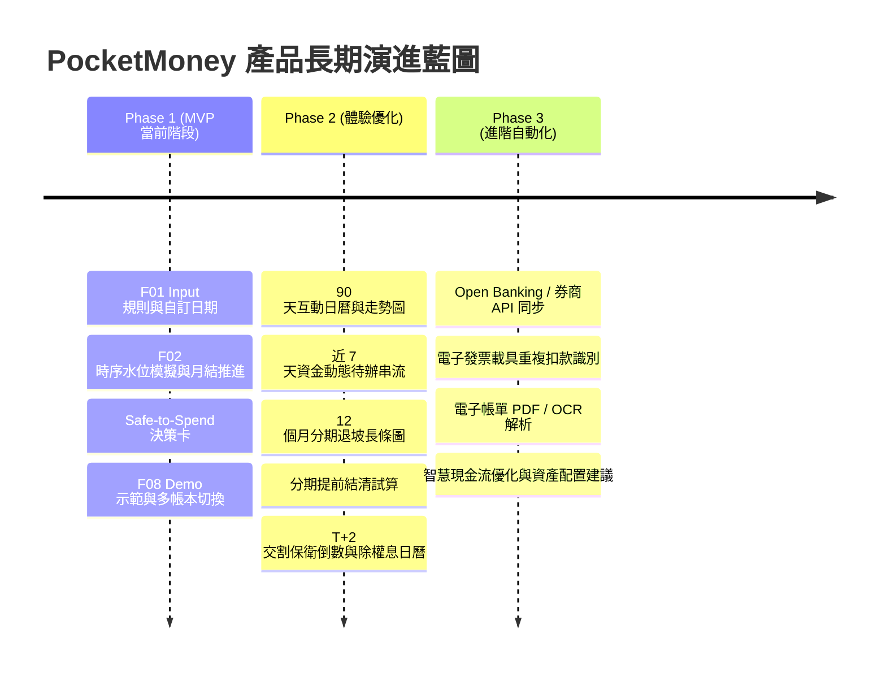

# PocketMoney 開發進度看板與統一待辦清單 (BACKLOG.md)

> **文件性質**：L2 唯一進度儀表板。
> **核心目標**：將主力雛型 [`pocketmoney.html`](file:///c:/Playground26/wiskinglin.github.io/pocketmoney/pocketmoney.html) 從「碎片化、寫死日期假設的一次性計算機」改造成**「具備完整 Input 參數設定 ＋ View 持續現金流模擬 ＋ Multi-Profile 切換」的可持續使用系統**。

---

## 📋 功能編號登記總表 (Feature Registry)
> **發號原則**：每個功能編號皆為全域唯一、只增不改、不重複使用。原型直接放於 `prototypes/Fxx-<slug>/`，不加 `r1/` 等巢狀層級。

| 編號 | 功能名稱 | 狀態 | 原型/模組路徑 | 關聯決策 |
| :--- | :--- | :---: | :--- | :--- |
| **F01** | Input 參數與收支規則中心 | 🟢 已合併 | prototypes/F01-input-params/ | ADR-009 |
| **F02** | 跨月時序現金流模擬與自動扣款 | 🟡 開發中 | prototypes/F02-view-cashflow/ | ADR-001, ADR-005 |
| **F03** | 扣款缺口跨行調撥與單期覆寫 | ❌ 不實施 | - | ADR-014 |
| **F04** | 多帳戶與多信用卡自適應版面 | 🟢 已合併 | prototypes/F04-multi-card-account-layout/ | ADR-012 |
| **F05** | 日期控制與輸入瀏覽分離 | 🟢 已合併 | prototypes/F05-date-controller-flow/ | ADR-012 |
| **F06** | 外部對帳單與明細分析器 | 🟢 已完成 (Viewer進行中) | analyzer/ | ADR-013 |
| **F07** | 漸進式功能解鎖 (Progressive Disclosure) | ⏳ 規劃定案 | prototypes/F07-progressive-disclosure/ | ADR-011 |
| **F08** | Profile 雙軌切換架構 (Demo與多帳本) | 🟢 已整合 | prototypes/F08-profile-switch/ | SCENARIOS |
| **F09** | 初次使用與重設資料全面歸零 | 🟢 已合併 | prototypes/F09-zero-state-reset/ | ADR-015 |
| **F10** | 證券戶與持股資料模型正規化 | ⏳ 待辦探索 | prototypes/F10-securities-account-model/ | ADR-004、ERD |
| **F11** | 總覽收支餘裕與防入不敷出決策卡 | 🟢 已整合 (F15) | prototypes/F11-cashflow-margin-card/ | ADR-016 |
| **F12** | 總覽時序長條軸去重視覺瘦身 | 🟢 已整合 (F15) | prototypes/F12-dashboard-timeline-cleanup/ | - |
| **F13** | 單月現金流趨勢圖與資產圖遷移 | 🟢 已整合 (F15) | prototypes/F13-monthly-cashflow-trend/ | ADR-016 |
| **F14** | 三段式時間切換引擎 (存量/防禦/流量) | 🟢 已整合 (F15) | prototypes/F14-three-tier-time-engine/ | ADR-016 |
| **F15** | 總覽重構與三段式時間切換整合原型 | 🟢 已整合 | prototypes/F15-integrated-dashboard/ | ADR-016 |

---

## 📊 STATUS 儀表板（最後更新：2026-11-05）

### 🟢 已完成並合併／已整合（Completed, Merged & Integrated）
- **`F15` — 總覽重構與三段式時間切換整合正式版 [INTEGRATED]**
  - **交付成果**：正式整合至 [`pocketmoney.html`](file:///c:/Playground26/wiskinglin.github.io/pocketmoney/pocketmoney.html)。八大分頁（總覽、銀行、卡片、固定費用、台股部位、分期付款、收支規則、系統設定）100% 唯讀資料洞察視圖，兩階段每月盤點輸入抽屜（階段一資產盤點、階段二帳單扣款指定與預覽），三段式時序狀態機（過去存量回溯、當月日進度防禦、未來流量推演），全站手機版 RWD（零橫向溢出、觸控友善底部/抽屜控制）。
- **`F08` — Profile 雙軌切換架構（Demo與多帳本切換器）[INTEGRATED]**
  - **交付成果**：多帳本切換器（個人、家庭、工作室）、示範資料載入沙盒、獨立 localStorage 隔離命名空間 (`PocketMoney_profiles_meta_v1` 與 `PocketMoney_tw_finance_v3`)，無縫向下相容正式版儲存架構。
- **F09 — 初次使用與重設資料全面歸零（Zero Initial State & Reset）**
  - **交付成果**：移除 DEFAULT_STATE 中的預設寫死示範數據（台新、中信、永豐、CUBE卡等），所有帳戶、信用卡、收支規則、分期與持股預設皆清空歸零（空陣列）。修復設定頁「完全清空重設」功能，執行時確實清除 localStorage 與記憶體狀態並重新渲染，徹底解決初次開啟與點選重設無法歸零的問題。
- **`F06-Viewer` — 帳單比對檢驗器（Split-Pane Bill & PDF Verification Viewer）**
  - **交付成果**：獨立單檔工具 [`viewer.html`](file:///c:/Playground26/wiskinglin.github.io/pocketmoney/analyzer/viewer.html)，支援左右雙欄對照（左欄原生 PDF 預覽、右欄四大標準化模組：帳單摘要與平帳檢核、約定扣繳檢核卡、長週期分期進度條、消費明細標準表格）。支援拖曳載入 PDF/JSON，通過零 AI Slop 規範驗收。
- **`F06` — 外部對帳單與明細分析器（External Statement & Bill Analyzer）[第一階段]**
  - **架構紀錄**：見 ADR-013（機敏隔離、`analyzer/` 模組化設計、可擴充證券與銀行、`result/pocketmoney_db.json` 累加合併與主程式匯入）。
  - **交付成果**：國泰、富邦、玉山信用卡帳單自動辨識剖析器、PocketMoney 相容 DB 增量合併引擎與 CLI 批次執行工具。各家帳單與分期解析驗證測試 100% 通過。
- **原型 `F04` — 多帳戶與多信用卡自適應版面（方案 B）**
  - **定案紀錄**：Manager 已審閱核可 `prototypes/F04-multi-card-account-layout/r1/B.html`，見 ADR-012。
  - **交付歷史**：已登錄至 [`CHANGELOG.md`](file:///c:/Playground26/wiskinglin.github.io/pocketmoney/CHANGELOG.md) [v0.1.0]。
  - **交付成果**：首頁例外優先檢核、銀行表格/網格切換、無消費信用卡收納、依扣款銀行歸戶、趨勢圖前 3 名焦點。
- **原型 `F05` — 日期控制與輸入瀏覽分離**
  - **定案紀錄**：Manager 已審閱核可 `prototypes/F05-date-controller-flow/r1/index.html`（該資料夾無 A/B，視為核可版本），見 ADR-012。
  - **交付歷史**：已登錄至 `CHANGELOG.md` [v0.1.0]。
  - **交付成果**：前月/指定日期/次月/回到今天、帳單登記抽屜、分期依起算年月自動推進。
  - **尚未導入**：信用卡逐月 `records`、依日期自動判定已扣款（待 ADR-001 拍板，併入下方 `F02`）。
  - **編號說明**：原先 Roadmap 暫稱之 Step 4 與 Step 5 已正式定編為 `F07`（漸進式解鎖）與 `F08`（Profile 切換），原型路徑分別對應 `prototypes/F07-progressive-disclosure/` 與 `prototypes/F08-profile-switch/`，與已合併之 `F04`（多卡版面）、`F05`（日期控制）明確分立。

- **`F01` — Input 參數與收支規則中心（拔除寫死日期假設）**
  - **定案紀錄**：已拍板採用方案 B（ADR-009），成功合併至主力雛型 [`pocketmoney.html`](file:///c:/Playground26/wiskinglin.github.io/pocketmoney/pocketmoney.html)。
  - **交付歷史**：已登錄至 [`CHANGELOG.md`](file:///c:/Playground26/wiskinglin.github.io/pocketmoney/CHANGELOG.md) [v0.0.1 / v0.0.2]。
  - **交付成果**：收支規則中心分頁、各卡扣款日自訂、固定費用直扣 vs 代繳分流、首頁 1~31 號收支時序預覽條、銀行餘額與信用卡費獨立為一級模組。

---

### 🎯 近期核心改造路線（Roadmap）

| 階段 | 代號 | 核心命題 | 解決的具體斷層 | 狀態 |
| :---: | :--- | :--- | :--- | :---: |
| **Step 1** | **`F01`** | **Input 端：補齊所有「真實日期與收入規則」輸入入口，拔除寫死的假設** | 1. **每月薪資與其他收入設定**：可設定實際撥薪日（如 20～25 號）、月薪金額，以及新增其他固定/特定月份收入（獎金、副業、配息、補貼）。 2. **信用卡結帳日與扣款日**：在新增/編輯信用卡與卡片列表上，支援設定每張卡各自的 `結帳日` 與 `扣款日`（拔掉寫死的「30號扣款 / 10號收單」）。 3. **固定費用扣款日與扣款管道**：支援設定 `每月幾號扣款`、`雙月/季繳生效月份`，以及區分 `銀行帳戶直扣` vs `信用卡代繳`（不再重複扣減銀行餘額）。 | 🟢 **已合併至 Main [v0.0.2]** |
| **Step 2** | **`F02`** | **View 端：依使用者設定的真實日期，模擬「當月時序水位」與「跨月持續累積」** | 1. **當月時序現金流模擬（抓出發薪前跳票）**：依真實日期排序（如 10 號扣房租 ➔ 18 號扣卡費 ➔ 25 號發薪），算清每一筆扣款當下戶頭夠不夠錢。 2. **月底結算封存與跨月推進**：結算完當月後，將真實期末餘額與帳單封存進歷史月份 `records`，推進至下個月，讓 12 個月趨勢圖左邊呈現真實歷史、右邊呈現根據你自身規則算出的未來現金流。 | ⏳ **規格已備，待啟動探索** |
| **Step 3** | **`F03`** | **Action 端：扣款缺口一鍵跨行調撥與單期金額覆寫** | 1. 當 View 模擬出某銀行在某號會出現缺口時，一鍵從富餘銀行調度轉帳。 2. 夏季電費或單月突發調整時，可覆寫當期金額而不破壞全年常態基準。 | ⏳ **規格已備，待啟動探索** |
| **Step 4** | **`F07`** | **漸進式功能解鎖（Progressive Disclosure：從單月防禦到成熟期趨勢）** | 1. **單筆資料狀態（Zero/Low History State）**：當尚無歷史封存快照時，隱藏失真的 12 個月趨勢圖與失真月均，改以「當期存量防禦卡」與「首月結算指引」為核心。 2. **累積 2~3 個月後**：隨使用者每月執行「月底結算封存」，自動展開真實成長走勢圖。 3. **累積 6~12 個月後**：自動解鎖信用卡真實月均日常消費水準與分期退坡深度分析。 | ⏳ **規劃已定案 (ADR-011)** |
| **Step 5** | **`F08`** | **Profile 雙軌切換架構（教學示範沙盒 ＋ 多身分 Multi-Profile 切換）** | 1. **教學示範 Profile (Demo Showcase)**：內建小資多卡分期與家庭房貸時差示範資料，開箱即看圖表，並支援一鍵重置沙盒，不污染真實資料。 2. **多身分 Multi-Profile 帳本切換**：單一 User 免登出秒級切換「個人生活帳」、「家庭公用帳」、「副業/工作室帳」，各自獨立儲存空間。 | ⏳ **規格已備 (SCENARIOS & UXD)** |
| **Step 6** | **`F06`** | **外部對帳單與明細分析器（External Statement & Bill Analyzer）** | 1. **信用卡/證券/銀行對帳單自動分析**：針對數位原生 PDF 萃取應繳總額、扣款日、單筆消費與長週期分期資訊（見 ADR-013）。 2. **機敏個資隔離與結果累積匯入**：原始帳單與分析 DB 完全隔離於 Git 之外；分析結果累積輸出至 `result/pocketmoney_db.json`，支援主程式一鍵匯入。 3. **雙欄比對檢視器 (`viewer.html`)**：提供雙向平帳稽核與明細標準化核對。 | 🟢 **已完成 (含 F06-Viewer)** |
| **Step 7** | **`F10`** | **Data 端：證券戶與持股資料模型正規化（移除 SETTINGS 中介依賴）** | 1. **建立 `SECURITIES_ACCOUNT` 實體**：引入證券戶（如「國泰證券」、「元大證券」），建立 `BANK ||--o{ SECURITIES_ACCOUNT ||--o{ STOCK` 正規化階層。 2. **解除 SETTINGS 轉介耦合**：移除由全域偏好設定轉介交割帳戶的非正規化設計，讓持股、T+2 交割與除權息直接歸屬證券戶與綁定銀行。 3. **多券商水位獨立管理**：支援不同券商獨立計算待命現金池與持股防禦水位。 | ⏳ **待辦探索 (待啟動)** |

---

## 🗺️ User Story Mapping 全景演進地圖 (對齊最新規格書)

