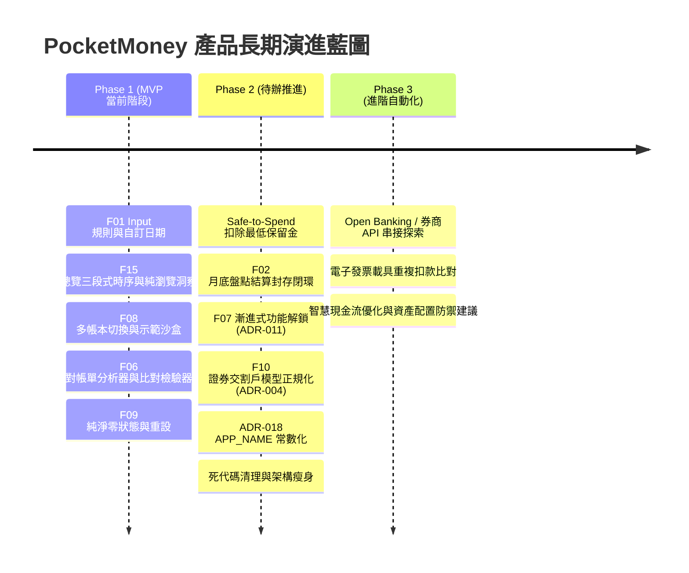

# PocketMoney 開發進度看板與統一待辦清單 (BACKLOG.md)

> **文件性質**：L2 唯一進度儀表板。
> **核心目標**：將主力程式 [`pocketmoney.html`](pocketmoney.html) 從「碎片化、寫死日期假設的一次性計算機」改造成**「具備完整 Input 參數設定 ＋ View 持續現金流模擬 ＋ Multi-Profile 切換」的可持續使用系統**。

---

## 📋 功能編號登記總表 (Feature Registry)
> **發號原則**：每個功能編號皆為全域唯一、只增不改、不重複使用。歷史原型存放於 `prototypes/`（歷史快照標籤見 Git `v0.3.0`），後續開發以主力程式為主。

| 編號 | 功能名稱 | 狀態 | 原型/模組路徑 | 關聯決策 |
| :--- | :--- | :---: | :--- | :--- |
| **F01** | Input 參數與收支規則中心 | 🟢 已整合 | `prototypes/F01-input-params/` | ADR-009 |
| **F02** | 跨月時序現金流模擬與月底結算封存 | 🟡 待辦推進 | `prototypes/F02-view-cashflow/` | ADR-001, ADR-005, ADR-017 |
| **F03** | 扣款缺口跨行調撥與單期覆寫 | ❌ 不實施 | `prototypes/F03-action-transfer/` | ADR-014 |
| **F04** | 多帳戶與多信用卡自適應版面 | 🟢 已整合 | `prototypes/F04-multi-card-account-layout/` | ADR-012 |
| **F05** | 日期控制與輸入瀏覽分離 | 🟢 已整合 | `prototypes/F05-date-controller-flow/` | ADR-012, ADR-017 |
| **F06** | 外部對帳單與明細分析器 | 🟢 已整合 (含 Viewer) | `analyzer/` | ADR-013 |
| **F07** | 漸進式功能解鎖 (Progressive Disclosure) | ⏳ 規劃定案待實作 | `prototypes/F07-progressive-disclosure/` | ADR-011 |
| **F08** | Profile 雙軌切換架構 (Demo與多帳本) | 🟢 已整合 | `prototypes/F08-multi-profile-switcher/` | SCENARIOS, ADR-017 |
| **F09** | 初次使用與重設資料全面歸零 | 🟢 已整合 | `prototypes/F09-zero-initial-reset/` | ADR-015 |
| **F10** | 證券戶與持股資料模型正規化 | ⏳ 待辦探索 | `prototypes/F10-securities-account-model/` | ADR-004, ERD |
| **F11** | 總覽收支餘裕與防入不敷出決策卡 | 🟢 已整合 | `prototypes/F11-cashflow-margin-card/` | ADR-016, ADR-017 |
| **F12** | 總覽時序長條軸去重視覺瘦身 | 🟢 已整合 | `prototypes/F12-dashboard-timeline-cleanup/` | ADR-016 |
| **F13** | 單月現金流趨勢圖與資產圖遷移 | 🟢 已整合 | `prototypes/F13-monthly-cashflow-trend/` | ADR-016, ADR-017 |
| **F14** | 三段式時間切換引擎 (存量/防禦/流量) | 🟢 已整合 | `prototypes/F14-three-tier-time-engine/` | ADR-016, ADR-017 |
| **F15** | 總覽重構與三段式時間切換整合原型 | 🟢 已整合 | `prototypes/F15-integrated-dashboard/` | ADR-016, ADR-017 |

---

## 📊 STATUS 儀表板（最後更新：2026-11-05）

### 🟢 已完成並整合至主程式（Completed & Integrated）
- **`F15` — 總覽重構與三段式時間切換整合正式版 [INTEGRATED]**
  - **交付成果**：正式整合至 [`pocketmoney.html`](pocketmoney.html)。八大分頁（總覽、銀行、卡片、固定費用、台股部位、分期付款、收支規則、系統設定）100% 唯讀資料洞察視圖，兩階段每月盤點輸入抽屜（階段一信用卡帳單與大額消費、階段二銀行餘額盤點與收支事件），三段式時序狀態機（過去存量回溯、當月日進度防禦、未來流量推演），全站手機版 RWD（零橫向溢出、觸控友善底部/抽屜控制）。
- **`F08` — Profile 雙軌切換架構（Demo與多帳本切換器）[INTEGRATED]**
  - **交付成果**：多帳本切換器（個人、家庭、工作室）、示範資料載入沙盒、獨立 localStorage 隔離命名空間 (`PocketMoney_profiles_meta_v1` 與 `PocketMoney_tw_finance_v3`)，無縫向下相容正式版儲存架構。
- **`F09` — 初次使用與重設資料全面歸零（Zero Initial State & Reset）[INTEGRATED]**
  - **交付成果**：移除 DEFAULT_STATE 中的預設寫死示範數據，所有帳戶、信用卡、收支規則、分期與持股預設皆清空歸零（空陣列）。修復設定頁「完全清空重設」功能，執行時確實清除 localStorage 與記憶體狀態並重新渲染，徹底解決初次開啟與點選重設無法歸零的問題。
- **`F06-Viewer` — 帳單比對檢驗器（Split-Pane Bill & PDF Verification Viewer）[INTEGRATED]**
  - **交付成果**：獨立單檔工具 [`analyzer/viewer.html`](analyzer/viewer.html)，支援左右雙欄對照（左欄原生 PDF 預覽、右欄四大標準化模組：帳單摘要與平帳檢核、約定扣繳檢核卡、長週期分期進度條、消費明細標準表格）。支援拖曳載入 PDF/JSON，通過零 AI Slop 規範驗收。
- **`F06` — 外部對帳單與明細分析器（External Statement & Bill Analyzer）[INTEGRATED]**
  - **架構紀錄**：見 ADR-013（機敏隔離、`analyzer/` 模組化設計、可擴充證券與銀行、`result/pocketmoney_db.json` 累加合併與主程式匯入）。
  - **交付成果**：國泰、富邦、玉山信用卡帳單自動辨識剖析器、PocketMoney 相容 DB 增量合併引擎與 CLI 批次執行工具。各家帳單與分期解析驗證測試 100% 通過。
- **`F04` — 多帳戶與多信用卡自適應版面 [INTEGRATED]**
  - **交付成果**：見 ADR-012。首頁例外優先檢核、銀行表格/卡片切換、無消費信用卡收納、依扣款銀行歸戶。
- **`F05` — 日期控制與輸入瀏覽分離 [INTEGRATED]**
  - **交付成果**：見 ADR-012、ADR-017。總覽單月控制、頂部每月盤點抽屜專用輸入流、分期合約依起算年月自動推進期數。
- **`F01` — Input 參數與收支規則中心 [INTEGRATED]**
  - **交付成果**：見 ADR-009。收支規則中心分頁、各卡扣款日自訂、固定費用直扣 vs 代繳分流、首頁 1~31 號收支時序預覽條、銀行餘額與信用卡費獨立為一級模組。

---

## 🎯 尚未實作之重點待辦清單 (Key Pending Action Items)

以下為近期排定之核心待辦事項，依優先級推進：

1. **Safe-to-Spend 扣除最低保留金**：
   - **問題描述**：現行 Safe-to-Spend（安全可支配餘裕）計算公式中，尚未完全扣除各銀行設定的「安全保留金 (`minReserve`)」。
   - **目標成果**：在總覽頁核心 KPI、餘裕決策卡與扣款防禦檢核中，全面扣減活存帳戶最低防禦保留金，確保使用者視覺看到的「安全可花金額」絕對不侵蝕底線安全水庫。
2. **F07 漸進式功能解鎖 (Progressive Disclosure - ADR-011)**：
   - **問題描述**：新使用者剛建立帳本時歷史資料為 0，若顯示全年 12 個月趨勢圖與平均線易產生失真與空洞感。
   - **目標成果**：
     - **0 個月（新手開箱）**：隱藏趨勢折線圖，聚焦於「當月存量防禦」與「首月盤點指引」。
     - **2~3 個月**：隨使用者每月盤點歷史累積，自動展開真實成長趨勢圖。
     - **6~12 個月**：完整解鎖有效月平均常態支出基準線、分期退坡解放分析與季節性波動洞察。
3. **F02 月底結算封存閉環 (Month-End Archival Loop - ADR-001/ADR-017)**：
   - **問題描述**：需要標準化之換月/月底盤點結算機制，將當月真實發生的銀行結餘與卡費記錄增量寫入 `records`。
   - **目標成果**：使用者確認本月盤點完成後，系統安全封存當期快照，時間指針步進至次月，嚴禁回溯改動歷史數據，維持歷史不可變性。
4. **F10 證券交割戶模型正規化 (Securities Account Normalization - ADR-004)**：
   - **問題描述**：目前證券持股透過 `settings.securitiesBankIds` 全域偏好中介轉接交割帳戶，非完全正規化實體。
   - **目標成果**：引入 `SECURITIES_ACCOUNT` 實體，建立 `BANK ||--o{ SECURITIES_ACCOUNT ||--o{ STOCK` 正規化層級，支援多券商獨立現金池計算與交割款防禦。
5. **ADR-018 APP_NAME 常數化與對外名稱收斂**：
   - **問題描述**：對外產品名稱待定（內部代號維持 `pocketmoney`）。
   - **目標成果**：於前端 JavaScript 宣告 `APP_NAME` 單一常數，所有頁面標題、`<title>`、匯出檔名皆引用該常數，待對外名稱確認後即可一鍵精準收斂，不改動 localStorage key 與資料夾架構。
6. **死代碼清理與代碼整潔度優化**：
   - **目標成果**：盤點並移除整合 F15/F08/F09 過程中所遺留的無用舊函式（如舊版手動平帳、手動扣款、換月重置按鈕等殘留腳本與無用 CSS 樣式），提升單檔主程式執行效能與維護性。

---

## 🗺️ 核心改造路線對齊表 (Roadmap)

| 階段 | 代號 | 核心命題 | 狀態 | 說明 |
| :---: | :--- | :--- | :---: | :--- |
| **Step 1** | **`F01`** | **Input 規則中心與自訂日期** | 🟢 **已整合** | 薪資規則、各卡扣款日、直扣代繳分流 |
| **Step 2** | **`F02`** | **月底結算封存與跨月推進** | 🟡 **待辦推進** | 月底盤點封存閉環、跨月自動推進 (ADR-017) |
| **Step 3** | **`F03`** | **扣款缺口跨行調撥與單期覆寫** | ❌ **不實施** | 使用者決策判定無效益，正式取消 (ADR-014) |
| **Step 4** | **`F07`** | **漸進式功能解鎖** | ⏳ **規劃定案** | 依資料月份跨度漸進解鎖趨勢圖 (ADR-011) |
| **Step 5** | **`F08`** | **Profile 雙軌切換架構** | 🟢 **已整合** | 多帳本切換器與示範沙盒隔離 |
| **Step 6** | **`F06`** | **外部對帳單分析器與 Viewer** | 🟢 **已整合** | PDF 帳單剖析、CLI 與雙欄對照 Viewer |
| **Step 7** | **`F10`** | **證券交割戶模型正規化** | ⏳ **待辦探索** | 建立證券戶實體，解除 SETTINGS 轉接依賴 |

---

## 🗺️ User Story Mapping 全景演進地圖

