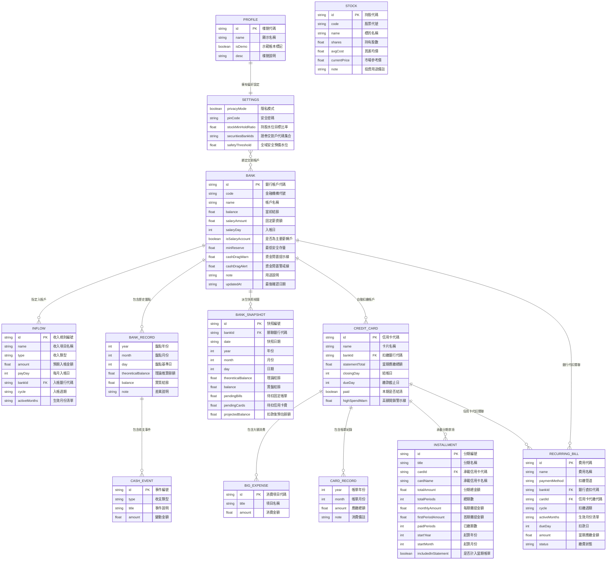
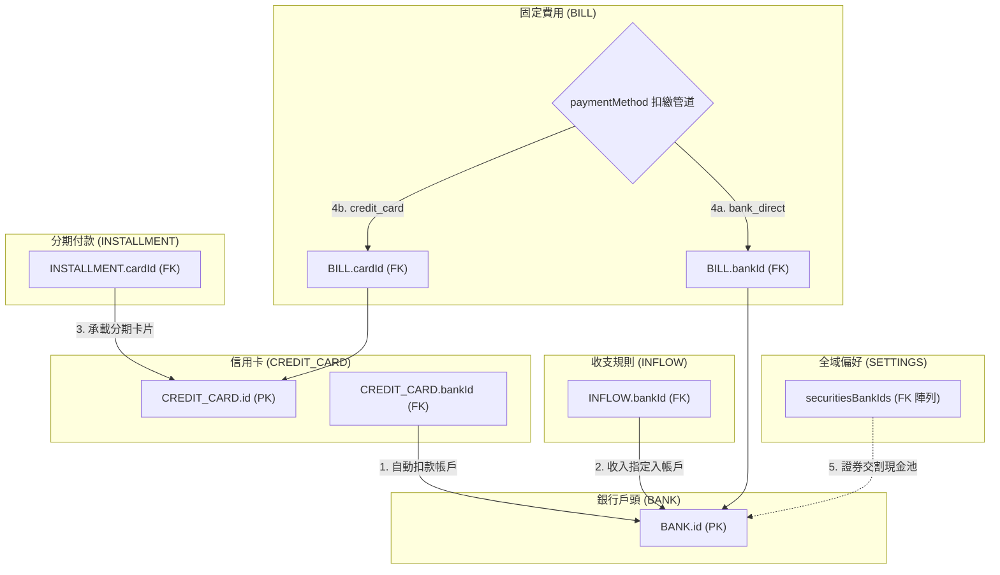

# PocketMoney 資料庫結構規格書 (ERD.md)

- **專案名稱**：PocketMoney (個人資產與扣款時序防禦系統)
- **最新 Schema 版本**：`PocketMoney_tw_finance_v4.1`
- **最後更新日期**：2026-11-03
- **對應程式與資料庫**：
  - 核心主程式：[`pocketmoney/pocketmoney.html`](file:///c:/Dev/wiskinglin.github.io/pocketmoney/pocketmoney.html)
  - 資料庫與公式真值來源：[`pocketmoney/schema/SCHEMA.md`](file:///c:/Dev/wiskinglin.github.io/pocketmoney/schema/SCHEMA.md)
  - 架構決策紀錄：[`pocketmoney/DECISIONS.md`](file:///c:/Dev/wiskinglin.github.io/pocketmoney/DECISIONS.md)
  - 示範與嵌入式資料庫：[`pocketmoney/database/dummy_db_embedded.js`](file:///c:/Dev/wiskinglin.github.io/pocketmoney/database/dummy_db_embedded.js)
  - 外部對帳單分析模組：[`pocketmoney/analyzer/`](file:///c:/Dev/wiskinglin.github.io/pocketmoney/analyzer/)

---

## 1. 實體關係圖 (Entity-Relationship Diagram)

---

## 2. 實體詳細欄位規格 (Entity Schema Specifications)

### 2.1 全域偏好與帳本設定 (Settings & Multi-Profile)

#### `profile` (帳本樣貌資訊)
對應 Multi-Profile 註冊表中的各帳本元資料（`PocketMoney_profiles_meta`）：
| 欄位名稱 | 型別 | 必填 | 說明 |
| :--- | :--- | :--- | :--- |
| `id` | `string` | 是 | 樣貌代碼（主鍵，如 `junior`、`family`、`senior` 或 `prof_xxx`） |
| `name` | `string` | 是 | 樣貌或帳本名稱（如「個人日常帳」、「初級大人」） |
| `isDemo` | `boolean` | 是 | 是否為教學示範帳本（示範帳本支援一鍵重置） |
| `desc` | `string` | 否 | 情境與資產架構簡述 |
| `colorTheme` | `string` | 否 | 帳本標籤色彩 |

#### `settings` (全域偏好與水位配置)
在主程式 `pocketmoney.html` 中以 `state.settings` 持久化儲存於 `localStorage`：
| 欄位名稱 | 型別 | 必填 | 說明 |
| :--- | :--- | :--- | :--- |
| `privacyMode` | `boolean` | 是 | 是否啟用金額模糊化隱私模式（`NT$ ••••••`） |
| `pinCode` | `string` | 否 | 4 位數保護密碼（空字串為停用） |
| `stockMinHoldRatio` | `number` | 是 | 目標最低股票持倉水位比例（預設 `70` 代表 70%） |
| `securitiesBankIds` | `string[]` | 是 | 作為股市待命交割現金池之銀行 ID 集合（外鍵：`BANK.id`） |
| `safetyThreshold` | `number` | 否 | 全域防禦最低預備水位（預設 `20000` 或 6 個月緊急備用金） |

> **注意**：原 v4 草案中的 `currentYear` 與 `currentMonth` 在主程式實作中已改由執行期 `AppClock` 控管，不寫入持久化儲存，以支援暫時性預覽而不污染儲存資料（詳見 ADR-012）。

---

### 2.2 收支規則與收入項目 (Inflows)

依據 ADR-009 方案 B，將主動收入與定期現金流入升格為頂層第一級實體 `state.inflows`，於主程式獨立「收支規則」分頁進行集中管理。

#### `inflows[]`
| 欄位名稱 | 型別 | 必填 | 說明 |
| :--- | :--- | :--- | :--- |
| `id` | `string` | 是 | 收入規則識別碼（主鍵，格式：`inf_xxx`） |
| `name` | `string` | 是 | 收入項目名稱（如「每月正職薪資」、「年中績效獎金」） |
| `type` | `string` | 是 | 收入類型：`'salary'`（薪資）、`'bonus'`（獎金）、`'dividend'`（股利）、`'side_income'`（副業） |
| `amount` | `number` | 是 | 預期入帳金額 |
| `payDay` | `number` | 是 | 每月預計入帳日（1~31） |
| `bankId` | `string` | 是 | 外鍵，指定入帳之銀行 ID（`BANK.id`） |
| `cycle` | `string` | 是 | 入帳週期：`'每月固定'`（常態）或 `'特定月份'` |
| `activeMonths` | `number[]` | 否 | 特定月份生效清單（如年中獎金 `[1, 7]`），省略則代表每月生效 |
| `holidayAdjustment` | `string` | 否 | 假日順延調整：`'before_friday'`（提前週五）、`'after_monday'`（順延週一）、`'none'` |

---

### 2.3 銀行存量與時間軸盤點 (Bank & Snapshots)

#### `banks[]` (銀行帳戶主實體)
主程式運行的存量實體，支援日常防禦與漸進式歷史累積（ADR-010、ADR-011）：
| 欄位名稱 | 型別 | 必填 | 說明 |
| :--- | :--- | :--- | :--- |
| `id` | `string` | 是 | 銀行唯一識別碼（主鍵，格式：`bank_xxx`） |
| `code` | `string` | 否 | 銀行代碼（如 `812` 台新、`013` 國泰） |
| `name` | `string` | 是 | 銀行/帳戶名稱 |
| `balance` | `number` | 是 | 當前最新帳面結餘（Stock 現值） |
| `isSalaryAccount` | `boolean` | 否 | 是否標記為主要薪轉帳戶 |
| `salaryDay` | `number` | 否 | 每月固定薪資入帳日（1~31） |
| `salaryAmount` | `number` | 否 | 預設每月薪資/主動收入入帳額（可與 `inflows` 雙軌支援） |
| `minReserve` | `number` | 否 | 最低安全防護金水位（低於此值觸發警戒） |
| `cashDragWarn` | `number` | 否 | 閒置現金注意線（高於此值提示資金閒置） |
| `cashDragAlert` | `number` | 否 | 閒置現金警戒線（高於此值強烈提示配置） |
| `note` | `string` | 否 | 帳戶用途備註（如「日常薪轉・信用卡扣繳」） |
| `updatedAt` | `string` | 否 | 餘額最後確認日期（格式：`YYYY-MM-DD`） |
| `records` | `object[]` | 否 | 歷史各月盤點紀錄清單（ADR-002 唯一寫入源） |

#### `banks[].records[]` (銀行年月盤點明細)
| 欄位名稱 | 型別 | 必填 | 說明 |
| :--- | :--- | :--- | :--- |
| `year` | `number` | 是 | 盤點年份 |
| `month` | `number` | 是 | 盤點月份 (1~12) |
| `day` | `number` | 是 | 盤點日（如 15 號或月底基準日） |
| `theoreticalBalance` | `number` | 是 | 系統依收支自動推算之理論結餘 |
| `balance` | `number` | 是 | 盤點日實質結餘 |
| `note` | `string` | 否 | 當期差異備註 |
| `events` | `object[]` | 否 | 當期收支事件集合 |

#### `banks[].records[].events[]` (銀行收支事件)
依據 ADR-006 定案列舉為 7 種類型：
| 欄位名稱 | 型別 | 必填 | 說明 |
| :--- | :--- | :--- | :--- |
| `id` | `string` | 是 | 事件唯一識別碼（主鍵，格式：`ev_xxx`） |
| `type` | `string` | 是 | 類型：`'salary'`、`'bonus'`、`'dividend'`、`'interest'`、`'transfer_in'`、`'transfer_out'`、`'withdrawal'` |
| `title` | `string` | 是 | 事件說明（如「年終獎金入帳」、「ATM 提領新鈔」） |
| `amount` | `number` | 是 | 金額（流入為正數，流出為負數） |

#### `bankSnapshots[]` (月結歷史快照衍生視圖)
> **架構原則 (ADR-002)**：`bankSnapshots[]` 為「供跨行圖表快速讀取的衍生快取視圖（Derived View）」，由 `bank.records[]` 在結算封存時自動派生生成，不作為雙邊維護的寫入來源。
| 欄位名稱 | 型別 | 必填 | 說明 |
| :--- | :--- | :--- | :--- |
| `id` | `string` | 是 | 快照主鍵代碼 |
| `bankId` | `string` | 是 | 外鍵，關聯至 `BANK.id` |
| `date` | `string` | 是 | 快照日期（格式：`YYYY-MM-DD`） |
| `year` | `number` | 是 | 年份 |
| `month` | `number` | 是 | 月份 |
| `day` | `number` | 是 | 盤點基準日 |
| `theoreticalBalance` | `number` | 是 | 理論結餘 |
| `balance` | `number` | 是 | 實盤結餘 |
| `pendingBills` | `number` | 是 | 當月待扣繳固定費用總額 |
| `pendingCards` | `number` | 是 | 當月待扣繳信用卡總額 |
| `projectedBalance` | `number` | 是 | 扣款後預估餘額（`balance - pendingBills - pendingCards`） |

---

### 2.4 信用卡與大額開銷 (Credit Card & Big Expenses)

#### `cards[]` (信用卡主實體)
主程式 `state.cards` 直接維護當期帳單核心防禦數據，同時相容歷史對帳單與大額開銷（ADR-001、ADR-012）：
| 欄位名稱 | 型別 | 必填 | 說明 |
| :--- | :--- | :--- | :--- |
| `id` | `string` | 是 | 信用卡唯一識別碼（主鍵，格式：`card_xxx`） |
| `name` | `string` | 是 | 卡片名稱（如「國泰 CUBE 卡」） |
| `bankId` | `string` | 是 | 外鍵，關聯至 `BANK.id`（扣繳帳戶） |
| `statementTotal` | `number` | 是 | 當期帳單應繳總額 (Flow) |
| `closingDay` | `number` | 是 | 帳單結帳日（1~31） |
| `dueDay` | `number` | 是 | 應扣繳截止日（1~31） |
| `paid` | `boolean` | 是 | 當期是否已扣款結清 |
| `highSpendWarn` | `number` | 否 | 單月總額示警門檻 |
| `bigExpenses` | `object[]` | 否 | 當期單筆大額消費清單 |
| `records` | `object[]` | 否 | 歷史月份帳單明細紀錄 |

#### `cards[].bigExpenses[]` (大額消費)
| 欄位名稱 | 型別 | 必填 | 說明 |
| :--- | :--- | :--- | :--- |
| `id` | `string` | 是 | 消費項目唯一識別碼（格式：`exp_xxx`） |
| `title` | `string` | 是 | 消費項目說明（如「百貨週年慶家電採購」） |
| `amount` | `number` | 是 | 單筆金額 |

#### `cards[].records[]` (信用卡歷史帳單明細)
依據 ADR-005，月份定義為「當月應扣繳帳單期（對齊當月 `dueDay`）」：
| 欄位名稱 | 型別 | 必填 | 說明 |
| :--- | :--- | :--- | :--- |
| `year` | `number` | 是 | 扣繳年份 |
| `month` | `number` | 是 | 扣繳月份 (1~12) |
| `amount` | `number` | 是 | 該期帳單扣繳總額 |
| `note` | `string` | 否 | 當月消費總覽備註 |
| `bigExpenses` | `object[]` | 否 | 該期關聯之大額消費清單 |

---

### 2.5 分期付款 (Installments)

支援**動態期數自動推算**與**手動記錄雙軌並行**（ADR-001 方案 A），並具備除不盡尾差自動歸併機制。

#### `installments[]`
| 欄位名稱 | 型別 | 必填 | 說明 |
| :--- | :--- | :--- | :--- |
| `id` | `string` | 是 | 分期唯一識別碼（主鍵，格式：`inst_xxx`） |
| `title` | `string` | 是 | 分期商品/項目名稱（如「iPhone 16 Pro 24期」） |
| `cardId` | `string` | 是 | 外鍵，承載分期之信用卡 ID（`CREDIT_CARD.id`） |
| `cardName` | `string` | 否 | 承載信用卡名稱（向後相容與防呆冗餘） |
| `totalAmount` | `number` | 是 | 分期總金額 |
| `totalPeriods` | `number` | 是 | 總分期期數（如 3、6、12、24） |
| `monthlyAmount` | `number` | 是 | 後續每期常態攤提金額（或 `regularPeriodAmount`） |
| `firstPeriodAmount` | `number` | 否 | 首期攤提金額（處理除不盡之尾差） |
| `paidPeriods` | `number` | 是 | 已繳期數（若未設 `startYear/Month` 則依手動值為準） |
| `startYear` | `number` | 否 | 分期首期起算年份 |
| `startMonth` | `number` | 否 | 分期首期起算月份 (1~12) |
| `includedInStatement` | `boolean` | 否 | 是否已包含在信用卡當期 `statementTotal` 內（防重複計算） |

---

### 2.6 固定費用 (Recurring Bills / `state.bills`)

支援**銀行直扣**與**信用卡代扣**雙途徑，並具備完整繳款狀態標記。

#### `bills[]` (主程式實體屬性：`state.bills`)
| 欄位名稱 | 型別 | 必填 | 說明 |
| :--- | :--- | :--- | :--- |
| `id` | `string` | 是 | 費用項目唯一識別碼（主鍵，格式：`bill_xxx`） |
| `name` | `string` | 是 | 項目名稱（如「套房租金」、「台電電費」） |
| `paymentMethod` | `string` | 是 | 扣款途徑：`'bank_direct'`（銀行直接代扣）或 `'credit_card'`（信用卡代繳） |
| `bankId` | `string` | 否 | 外鍵，當管道為 `bank_direct` 時關聯之 `BANK.id` |
| `cardId` | `string` | 否 | 外鍵，當管道為 `credit_card` 時關聯之 `CREDIT_CARD.id` |
| `cycle` | `string` | 是 | 週期：`'每月固定'`、`'雙月帳單'`、`'季繳/年繳'`（亦相容 `'monthly'`, `'bimonthly'`） |
| `activeMonths` | `number[]` | 是 | 扣繳生效月份清單（如雙月繳 `[2, 4, 6, 8, 10, 12]`） |
| `dueDay` | `number` | 是 | 扣繳基準日（1~31） |
| `amount` | `number` | 是 | 當期應繳金額（或 `defaultAmount`） |
| `status` | `string` | 是 | 當前繳費狀態：`'unpaid'`（未繳）、`'paid'`（已繳）、`'skipped'`（跳過） |

---

### 2.7 投資部位與證券交割池 (Stocks)

> **架構備註 (待辦 F10)**：現行版本中，投資水位是透過 `settings.securitiesBankIds` 篩選交割銀行，再與頂層 `stocks[]` 聚合成現金池計算水位。未來將於 **F10** 導入獨立的 `SECURITIES_ACCOUNT`（證券商帳戶）實體，正規化為 `BANK ||--o{ SECURITIES_ACCOUNT ||--o{ STOCK`，解除對 `SETTINGS` 的間接中介耦合。

#### `stocks[]`
| 欄位名稱 | 型別 | 必填 | 說明 |
| :--- | :--- | :--- | :--- |
| `id` | `string` | 是 | 持股唯一代碼（主鍵，格式：`stk_xxx`） |
| `code` | `string` | 是 | 股票代碼（如 `2330`, `0050`） |
| `name` | `string` | 是 | 標的名稱 |
| `shares` | `number` | 是 | 持有股數（整股或零股） |
| `avgCost` | `number` | 是 | 平均每股買進成本 |
| `currentPrice` | `number` | 是 | 當前市場參考價格 |
| `note` | `string` | 否 | 持股策略或投資用途備註 |

---

## 3. 外鍵關聯規則與資料完整性約束 (Integrity Constraints)

1. **信用卡扣款銀行約束**：
   - `CREDIT_CARD.bankId` 必須存在於 `banks[].id`。若刪除銀行帳戶，主程式將提示或自動將關聯卡片解綁/移轉至其他帳戶。
2. **收支規則指定入帳銀行約束**：
   - `INFLOW.bankId` 必須為有效之 `BANK.id`。
3. **分期付款承載卡片約束**：
   - `INSTALLMENT.cardId` 必須存在於 `cards[].id`。若卡片遺失，保留 `cardName` 進行自動容錯配對。
4. **固定帳單多途徑扣繳約束**：
   - 當 `paymentMethod == 'bank_direct'` 時，`bankId` 必須對應至有效之 `BANK.id`。
   - 當 `paymentMethod == 'credit_card'` 時，`cardId` 必須對應至有效之 `CREDIT_CARD.id`，且扣款金額計入該卡待繳統計，**嚴禁雙重扣款**。
5. **證券交割帳戶聯動約束**：
   - `SETTINGS.securitiesBankIds` 內之所有項目必須為合法之 `BANK.id`，系統以這些銀行之總結餘作為待命投資交割現金池。

---

## 4. 關鍵核心業務邏輯運算 (Financial Business Logic)

### 4.1 可自由支配金額 (Safe-to-Spend, STS)
$$\mathrm{SafeToSpend} = \mathrm{CurrentBankCash} + \mathrm{ExpectedInflows} - \mathrm{DirectBills} - \mathrm{CreditCardPayables} - \mathrm{SafetyReserve}$$
* **$\mathrm{CurrentBankCash}$**：截至當日活存可用結餘總額。
* **$\mathrm{ExpectedInflows}$**：指定評估區間內經順延規則判定確定入帳之 `inflows` 總額。
* **$\mathrm{DirectBills}$**：區間內僅限 `bank_direct` 銀行直扣且狀態為 `unpaid` 之固定費用加總。
* **$\mathrm{CreditCardPayables}$**：所有綁定各行且未結清之當期卡費（含分期）。
* **$\mathrm{SafetyReserve}$**：全域安全存量（`settings.safetyThreshold`）或各帳戶 `minReserve` 總和。

### 4.2 銀行扣款時序與缺口檢核 (Cashflow & Shortfall Checkup)
對於指定月份 $M$ 與銀行 $B_i$：
$$\mathrm{CardsSum}(B_i) = \sum_{c.\mathrm{bankId} = B_i.\mathrm{id}, \neg c.\mathrm{paid}} c.\mathrm{statementTotal}$$
$$\mathrm{BillsSum}(B_i) = \sum_{b.\mathrm{bankId} = B_i.\mathrm{id}, b.\mathrm{paymentMethod} = 'bank\_direct', M \in b.\mathrm{activeMonths}, b.\mathrm{status} = 'unpaid'} b.\mathrm{amount}$$
$$\mathrm{InflowSum}(B_i) = \sum_{inf.\mathrm{bankId} = B_i.\mathrm{id}, M \in inf.\mathrm{activeMonths}} inf.\mathrm{amount}$$
$$\mathrm{ProjectedBalance}(B_i) = B_i.\mathrm{balance} + \mathrm{InflowSum}(B_i) - \mathrm{CardsSum}(B_i) - \mathrm{BillsSum}(B_i)$$
$$\mathrm{IsShortfall}(B_i) = \mathrm{ProjectedBalance}(B_i) < 0$$

### 4.3 分期期數動態推算與除不盡尾差邏輯 (Installments)
1. **動態期數推算（ADR-001 方案 A）**：
   若設定 `startYear` 與 `startMonth`，針對當前檢視日期 $Y$ 與 $M$：
   $$\Delta \mathrm{Months} = (Y - I_k.\mathrm{startYear}) \times 12 + (M - I_k.\mathrm{startMonth}) + 1$$
   - 若 $\Delta \mathrm{Months} \le 0$：尚未開始，當期攤提為 $0$。
   - 若 $\Delta \mathrm{Months} = 1$：首期生效，金額為 $I_k.\mathrm{firstPeriodAmount}$。
   - 若 $1 < \Delta \mathrm{Months} \le I_k.\mathrm{totalPeriods}$：常態生效，金額為 $I_k.\mathrm{monthlyAmount}$。
   - 若 $\Delta \mathrm{Months} > I_k.\mathrm{totalPeriods}$：已結清，當期金額為 $0$。
   若無設定起算年月，則依手動維護之 $I_k.\mathrm{paidPeriods}$ 計算剩餘期數。

2. **除不盡尾差歸併**：
   $$\mathrm{RegularPeriodAmount} = \lfloor \mathrm{TotalAmount} / \mathrm{TotalPeriods} \rfloor$$
   $$\mathrm{FirstPeriodAmount} = \mathrm{RegularPeriodAmount} + \Big(\mathrm{TotalAmount} - (\mathrm{RegularPeriodAmount} \times \mathrm{TotalPeriods})\Big)$$

### 4.4 股票投資水位與持倉比例 (Stock Holding Ratio)
$$\mathrm{StockCashPool} = \sum_{B_i \in \mathrm{Banks}, B_i.\mathrm{id} \in \mathrm{Settings}.\mathrm{securitiesBankIds}} B_i.\mathrm{balance}$$
$$\mathrm{StockMarketValue} = \sum_{S_j \in \mathrm{Stocks}} (S_j.\mathrm{shares} \times S_j.\mathrm{currentPrice})$$
$$\mathrm{StockCostValue} = \sum_{S_j \in \mathrm{Stocks}} (S_j.\mathrm{shares} \times S_j.\mathrm{avgCost})$$
$$\mathrm{StockTotalPool} = \mathrm{StockMarketValue} + \mathrm{StockCashPool}$$
$$\mathrm{StockHoldRatio} = \begin{cases} \mathrm{round}\left(\frac{\mathrm{StockMarketValue}}{\mathrm{StockTotalPool}} \times 100\right)\% & \text{if } \mathrm{StockTotalPool} > 0 \\ 0\% & \text{otherwise} \end{cases}$$
$$\mathrm{StockUnrealizedPnL} = \mathrm{StockMarketValue} - \mathrm{StockCostValue}$$

---

## 5. 版本歷史與修訂紀錄 (Revision History)

| 修訂版本 | 修訂日期 | 修訂人員 | 變更類型 | 變更內容摘要 | 對應決策與依據 |
| :--- | :--- | :--- | :--- | :--- | :--- |
| **`PocketMoney_tw_finance_v4.1`** | 2026-11-03 | Antigravity | **重大同步進版** | 1. **新增 `INFLOW` 實體**：升格收支規則為頂層第一級實體，支援薪資、獎金、股利排程。 2. **對齊主程式實作**：將 `BILL` 實體外鍵由單一 `targetId` 拆分為 `bankId` 與 `cardId`，金額欄位對齊為 `amount`，加入繳費狀態 `status`。 3. **信用卡當期直覺化**：`CREDIT_CARD` 加入當期 `statementTotal`、`paid` 與直屬 `bigExpenses[]`。 4. **分期付款雙軌推算**：`INSTALLMENT` 補齊 `monthlyAmount`、`cardName`、`paidPeriods`、`includedInStatement`。 5. **移除執行期設定持久化**：`SETTINGS` 移除 `currentYear`/`currentMonth`（改為 Runtime `AppClock` 控管），加入 `safetyThreshold`。 6. **明確架構從屬**：標明 `bankSnapshots` 為衍生讀取視圖，`bank.records` 為唯一寫入來源。 7. **修正所有舊路徑**：全面更正為 `pocketmoney/` 目錄結構。 | ADR-001、ADR-002、ADR-003、ADR-005、ADR-006、ADR-009、ADR-010、ADR-012、ADR-015、`SCHEMA.md` |
| **`PocketMoney_tw_finance_v4`** | 2026-11-02 | Gemini Agent | 架構擴充版 | 1. 導入年月盤點架構：`banks[].records`（含 `events`）與 `cards[].records`。 2. 新增 `bankSnapshots` 集合支援 3D 時間軸。 3. 固定費用支援雙途徑扣款，分期付款改採起算年月動態推算。 4. 新增 `stocks` 實體並與證券交割戶水位聯動。 | UXD.md 規劃案 |
| **`PocketMoney_tw_finance_v3`** | 2026-11-01 | Initial Team | 初始版 | 基礎銀行、信用卡、固定開銷、手動分期付款與靜態 30 號待扣總額檢核模型。 | 初始 baseline |
