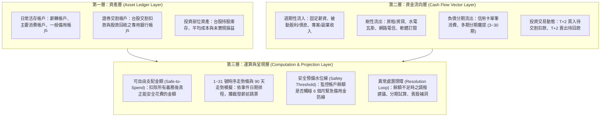

# PocketMoney 產品定位、架構與核心邊界 (PRODUCT.md)

> **文件性質**：L1 唯一產品定位與邊界依據。
> **核心承諾**：秉持「先清楚知道自己有多少錢，以及每個月要付多少錢」的理念，以真實收支時間規則為核心，守護現金流扣款安全與財務自由安全邊際。

---

## 1. 產品定位與核心願景

- **產品定位**：**前瞻型現金流防禦與決策引擎（Forward-looking Cash Flow Defense & Decision Engine）**，並進一步擴展為**全方位個人與家庭資產管理系統**。
- **核心目標**：
  整合日常活存、信用卡週期（含長週期多筆分期帳單）、固定收支與台股證券交割/除權息，動態預測未來 30 至 90 天每日真實帳戶現金流，提供**零時差透支與交割違約預警**。
- **核心理念**：
  > 「不記瑣碎流水帳，而是把發薪日、信用卡扣款日、固定費用與分期規則設定好。建立個人與家庭維度的全貌資產視角，建立 6 個月緊急備用金安全邊際，引導走向財務自由。」

---

## 2. 系統三層式架構 (Three-Layer System Architecture)

本產品採用清晰的三層式資料與運算結構設計，確保資料邊界分明、算式精確：

---

## 3. Profile 雙重應用架構 (Demo Showcase vs Multi-Profile)

為兼顧「新手開箱體驗」與「一人多帳本管理」，系統支援兩大 Profile 機制：

1. **教學示範式 Profile (Demo Showcase Mode)**：
   * 預載「小資多卡分期」與「家庭房貸時差」完整擬真資料。
   * 新使用者打開即可體驗圖表、分期退坡與時序預覽條，快速理解產品價值。
   * 具備「沙盒隔離」，支援隨意操作與一鍵重置，絕不污染真實帳本。
2. **多帳本/身分切換 Profile (Multi-Profile Switcher)**：
   * 類似 Google / Instagram 帳號快速切換機制，單一使用者可建立多本獨立帳本：
     * `個人生活帳本`（個人薪資、個人信用卡與娛樂）
     * `家庭公用帳本`（共有存款、房貸水電、育兒專款）
     * `工作室/副業帳本`（專案請款、外包成本、設備支出）
   * 免登入/登出，單鍵切換，本地獨立存量。

---

## 4. 核心成功指標 (Success Metrics)

1. **零假設真實日期模擬**：所有發薪日、卡片結帳/扣款日、固定費用扣款日皆由使用者自行指定，徹底消除寫死假日期之盲區。
2. **時序跳票精準攔截**：發薪日前（如 10 號扣房貸、18 號扣卡費）若有餘額不足，精確發出破底警示，預防違約。
3. **Safe-to-Spend 可信賴度**：計算結果確實排除已承諾分期與最低防禦金，作為消費決策依據。
4. **跨月累積與持續可用性**：月底結算封存為歷史快照點，次月自動推進，走勢圖隨使用時間越長越具參考價值。

---

## 5. 產品護欄：我們「刻意不做」的事 (Anti-Goals)

1. ❌ **不做每日瑣碎流水帳**：不記飲料、便當等細項，堅持「抓大放小（餘額盤點、帳單總額、固定收支規則與 `>$5,000` 大額消費）」。
2. ❌ **不強迫綁定外部伺服器與網銀帳密**：100% 瀏覽器本地運算與本地儲存，保障極致隱私，支援 JSON / 單機 HTML 備份匯出。
3. ❌ **不做未經解耦的假資料污染**：Demo 示範 Profile 必須具備明確沙盒隔離與重置能力。
4. ❌ **畫面上不堆砌工程術語與版本號**：嚴格遵守 `specs/UXD.md` 第零章「零 AI Slop 鐵律」。
