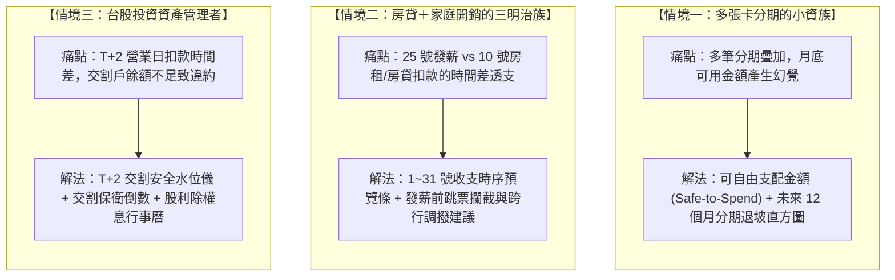
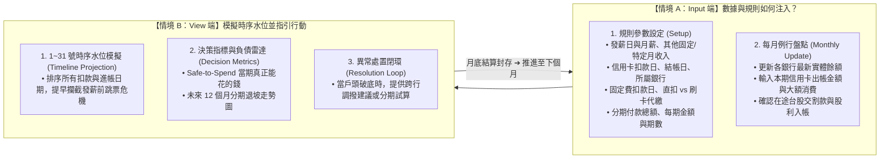

# PocketMoney — 核心使用者情境、Profile 架構與 User Story Mapping (SCENARIOS.md)

> **文件性質**：L1 核心使用者情境與規格定義。
> **核心定位**：融合真實生活痛點場景（小資族分期、三明治族房貸時間差、台股投資 T+2 交割）、Demo 示範與多帳號切換 (Multi-Profile) 架構、以及完整 User Story Mapping 藍圖。
> **基準檔案**：[`pocketmoney.html`](pocketmoney.html)

---

## 1. 痛點根源：為什麼單純記帳或一次性計算機無法持續使用？

在傳統個人記帳或一次性財務試算中，使用者最常遇到的三大斷層如下：

| 斷層類型 | 現實痛點與誤區 | 導致的嚴重後果 |
| :--- | :--- | :--- |
| **斷層 1：日期寫死或忽略時間差** | 傳統工具只算月底「總收入減總支出」，但現實中發薪日可能是 **20～25 號**、房租 **10 號**扣、信用卡 **18 號**扣。 | 雖然月底結算有餘額，但在 25 號薪水進來前，18 號扣卡費時戶頭已經先見底跳票。 |
| **斷層 2：分期付款的流動性幻覺** | 購買大額商品（如手機、筆電、家電）辦理 12~30 期分期，只看每月幾千元看似負擔低。 | 多筆分期疊加後，佔據了未來數個月大部分的可支配額度，使人誤以為戶頭還有錢而過度消費。 |
| **斷層 3：多帳戶與證券交割孤島** | 日常活存、高利活存、薪轉戶、台股交割戶各自獨立，台股買進需在 T+2 日扣款。 | 股票下單後忘記交割戶餘額不足，在 T+2 營業日扣款時面臨違約交割危機。 |

---

## 2. 三大真實生活實戰情境 (Real-life Scenarios)

> 本系統**不塞入無法修改的僵化假 Profile**，而是針對以下三種真實生活樣態提供專屬防禦機制與解決方案：



### 情境一：多張卡分期的小資族（化解分期幻覺，看清何時解脫）
* **人物畫像與生活樣貌**：
  * 月薪約 35,000 ~ 55,000 元，擁有 2~4 張常用信用卡（如台新 @GoGo、國泰 CUBE、富邦 J 卡）。
  * 過去一年內陸續買了新手機（12 期）、筆電（24 期）、換季冷氣（12 期），每月零星分期攤提加總達 12,000 元。
* **核心痛點**：
  * 每次刷卡分期時都覺得「一個月才攤 1,500 元很輕鬆」，但 4~5 筆分期疊加後，每個月一開局就有上萬元固定被鎖死。
  * 看到銀行戶頭還有 30,000 元，誤以為可以隨意消費，月底收到帳單才驚覺破底。
* **系統解決方式與回饋**：
  1. **可自由支配金額 (Safe-to-Spend)**：即時扣除「當期信用卡應繳 ＋ 所有分期攤提 ＋ 最低安全防禦水位」，清楚告訴他「今天真正能安全花費的額度」。
  2. **未來 12 個月分期退坡直方圖**：堆疊柱狀圖直觀呈現分期何時遞減（例如：「4 個月後手機繳清，每月現金流釋放 3,000 元」），給予財務減壓預期。
  3. **分期提前結清試算**：模擬如果將某一筆分期一次清償，未來 3 個月的月負擔能減輕多少。

### 情境二：房貸＋家庭開銷的三明治族（跨越時序時間差，避免扣款跳票）
* **人物畫像與生活樣貌**：
  * 雙薪家庭或背負房貸/租金、水電瓦斯、育兒學費與孝親費，每月固定必要開銷高達 40,000 ~ 80,000 元。
  * 每月 **25 號**領薪水，但房貸/房租固定 **10 號**直接由銀行帳戶扣款，水電與保費透過信用卡代繳於 **18 號**扣款。
* **核心痛點**：
  * **時差透支陷阱**：在 10 號與 18 號扣款時，這個月的薪水（25 號）根本還沒入帳！如果只看整月總收入大於總支出，就會在發薪前幾天因餘額不足遭到銀行跳票扣款失敗，影響信用評分。
  * **多管道重複扣款疑慮**：不清楚水電瓦斯是信用卡代繳還是銀行直扣，導致資金預估混亂。
* **系統解決方式與回饋**：
  1. **1～31 號收支時序預覽條**：清楚標記 10 號房貸、18 號卡費、25 號發薪，明確指出「扣款發生在發薪前」。
  2. **當期時序最低水位防禦**：依真實日期逐日扣算，若 18 號卡費扣款後餘額會小於安全防線，主動發出「發薪前透支警示」。
  3. **固定費用扣款管道隔離**：清楚區分「銀行帳戶直扣」與「信用卡代繳 (`card_auto`)」，代繳費用自動併入信用卡帳單預估，絕不從銀行重複扣款。

### 情境三：台股投資資產管理者（守護 T+2 交割安全，資產收益全盤掌握）
* **人物畫像與生活樣貌**：
  * 有定期定額存股（如 ETF 0050、00878）或波段操作台股個股，資金分別配置於「高利活存帳戶」與「證券交割專用帳戶」。
  * 每季或每年有現金股利入帳，且常常在交易日買賣股票。
* **核心痛點**：
  * **T+2 違約交割風險**：為了賺取數位帳戶高利活存，平常不把大額現金放在幾乎沒有利息的證券交割戶。週一盤中買進股票後，常在忙碌中忘記在「週三早上 10:00 前」將交割款調撥進交割戶，造成違約交割危機。
  * **除權息與成本失真**：收到股票股利（配股）後，每股損益平衡成本改變，手動計算極為繁瑣。
* **系統解決方式與回饋**：
  1. **T+2 交割安全水位儀與倒數計時**：在買入成交後，精準對齊台灣證交所行事曆，即時對比交割戶可用餘額與 T+2 應扣款，不足時高亮顯示缺額並提示跨行調撥。
  2. **除權息日曆與淨利入帳**：自動扣除二代健保補充保費與匯費，準確推估入帳日與資金流入。
  3. **除權後持股成本自動重算**：原持股成本隨配股自動攤平，即時呈現正確未實現損益。

---

## 3. Profile 雙重應用架構：教學示範 vs 多帳號切換

為滿足「新手免門檻體驗」與「一人多帳本彈性管理」，系統提供兩種 Profile 應用形態：

```
┌─────────────────────────────────────────────────────────────┐
│                    Profile 雙軌切換架構                     │
├──────────────────────────────┬──────────────────────────────┤
│  應用 A：教學示範展示 Profile  │  應用 B：多帳戶/身分切換 Profile │
│       (Demo Showcase)        │    (Multi-Profile Switcher)  │
├──────────────────────────────┼──────────────────────────────┤
│ • 目的：功能展示、新手觀摩   │ • 目的：多帳本獨立管理       │
│ • 特色：預載真實場景數據     │ • 特色：免登出、一鍵切換     │
│ • 範例：小資族 / 三明治家庭  │ • 範例：個人日常生活帳       │
│ • 唯讀或沙盒重置 (不污染真實)│        家庭共同開銷帳       │
│                              │        副業/自由接案帳       │
└──────────────────────────────┴──────────────────────────────┘
```

### 應用 A：教學示範式 Profile (Demo / Tutorial Mode)
* **設計目的**：解決初次造訪的使用者面對完全空白的畫面「不知道能做什麼、看不出圖表威力」的痛點。
* **具體運作**：
  * 在導航列或歡迎視窗提供「示範情境（Demo Profiles）」：
    1. **【示範】小資多卡分期情境**：載入 3 張信用卡、4 筆分期、完整 12 個月退坡直方圖與 Safe-to-Spend 指標。
    2. **【示範】家庭三明治開銷情境**：載入房貸、薪資時序差、雙月水電與信用卡代繳設定。
  * **沙盒安全機制**：示範模式具備明顯提示標籤（例如 `[示範資料 - 僅供觀摩]`），使用者可隨意嘗試點擊與計算，並支援「一鍵重置」或「一鍵切換回我的真實帳本」，絕不污染使用者的真實個人資料。

### 應用 B：單一使用者之多帳本/身分切換 (Multi-Profile Switcher)
* **設計目的**：如同 Google / Instagram 帳號快速切換，單一使用者通常具備多個平行的財務角色。
* **具體運作**：
  * 使用者可在同一個瀏覽器環境內建立多個獨立資料空間（Profiles）：
    * 帳本 1：`個人日常收支帳`（自身薪水、個人信用卡、娛樂與分期）
    * 帳本 2：`家庭公費帳`（夫妻共有帳戶、水電房貸、育兒共同基金）
    * 帳本 3：`副業 / 工作室帳`（專案請款、勞報所得、外包設備支出）
  * **切換體驗**：點擊右上角頭像或帳本選單，免登入/登出，0.1 秒秒級切換，各帳本的銀行、信用卡、固定收支、報表完全獨立隔离。

---

## 4. User Story Mapping 表格 (5 大活動模組 × 3 階段演進)

依據系統藍圖，將所有功能模組與使用者目標拆解為清晰的 3 階段演進地圖：

| 活動模組 (Activity) | 使用者目標 (User Goal) | MVP 必備功能 (Phase 1) | Phase 2 優化體驗 | Phase 3 進階自動化 |
| :--- | :--- | :--- | :--- | :--- |
| **1. 帳戶與資產管理** | 清楚掌握多帳戶現有資金、淨資產與防禦底線 | • 新手引導 (Onboarding) 資產快速盤點<br>• 建立活存與證券交割帳戶<br>• 手動更新餘額<br>• 設定最低安全預備水位線 | • 多帳戶自訂標籤分類<br>• 帳戶間跨行資金調撥模擬<br>• 擴充不動產（房貸/淨值）介面 | • Open Banking 帳戶餘額自動同步<br>• 家庭維度資產全貌整合視角<br>• 多 Profile (個人/家庭) 雲端安全備份 |
| **2. 固定收支規劃** | 精準預測週期性資金流動，避免遺漏日常支出 | • 設定固定收支頻率與金額<br>• 指定每筆費用扣款日與扣款銀行<br>• 遇假日自動順延計算<br>• 區分銀行直扣 vs 信用卡代繳 | • 依月份彈性微調非固定金額（如水電夏月波動）<br>• 特定月份獎金/配息流入排程 | • 串接電子發票載具，自動識別週期性重複扣款項目 |
| **3. 信用卡與負債管理** | 資產與負債明確拆分，化解分期付款錯覺，掌控未來負債 | • 設定各卡自訂結帳日與扣款日<br>• 手動建立分期並展開排程<br>• 資產與卡費負債拆開呈現<br>• 支援每期攤提與尾差計算 | • 12 個月分期負擔堆疊直方圖<br>• 分期提前結清試算模擬<br>• 專屬分期與負債管理獨立分頁 | • 匯入電子帳單 PDF / 拍照發票，透過 OCR 與 AI 自動解析當期應繳與分期 |
| **4. 證券與投資組合** | 預防交割戶餘額不足，掌控整體投資組合分布與被動收益 | • T+2 交割扣款排程連動<br>• 手動輸入待交割款與持股明細<br>• 股票賣出平倉交割款自動回補 | • 除權息日曆整合與股利淨額計算<br>• T+2 交割缺額保衛倒數與警示<br>• 自動計算投資組合比例與資產權重 | • 券商 Open API 串接或對帳單自動匯入成交明細 |
| **5. 儀表板與決策預警** | 一覽未來現金健康度與淨資產，引導財務安全決策 | • 瀏覽與輸入解耦 Dashboard<br>• 總流動現金與本月待繳總額卡<br>• Safe-to-Spend 可自由支配金額試算<br>• 1~31 號收支時序預覽條 | • 90 天互動日曆與走勢折線圖<br>• 近 7 天資金動態待辦串流<br>• 缺口跨行一鍵調撥排程建議<br>• Demo 示範 Profile 一鍵觀摩切換 | • 智慧財務路徑優化建議（閒置資金高利活存分配、定期定額平滑化） |

---

## 5. Input 端與 View 端之核心閉環機制


