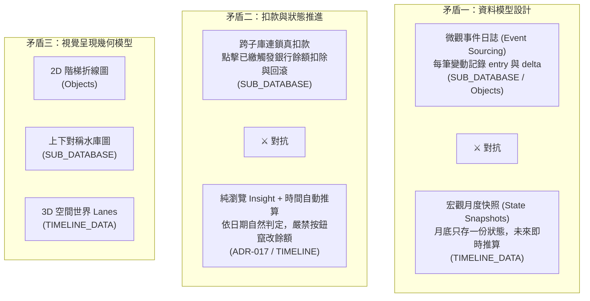

# PocketMoney 早期設計構想與收斂彙整報告

> **文件性質**：專案發散期歷史資產整合報告（Historical Design Synthesis）  
> **整理目的**：在專案進入架構收斂期時，完整保留使用者於發散期所提出的各項核心構想、論點細節、財務數學模型與視覺化靈感，避免原始構想遺失，並梳理與現行規範（`DECISIONS.md`、`schema/SCHEMA.md`）之對照關係。  
> **來源文件**：
> 1. `pocketmoney/archive/PocketMoneyObjects.md`
> 2. `pocketmoney/archive/SUB_DATABASE_STOCK_FLOW_PROPOSAL.md`
> 3. `pocketmoney/archive/TIMELINE_DATA_PROPOSAL.md`
> 4. `pocketmoney/archive/analysis.md`

---

## 1. 來源文件之核心構想與關鍵論點

### 1.1 `PocketMoneyObjects.md`：現金流與流動性風控引擎

本文件為系統最早期的領域物件導向（Domain-Driven）架構規格，定義了個人金融的核心哲學、實體模型、時序展開機制與風控數學公式。

#### A. 設計哲學與架構原則
1. **抓大放小（Focus on the Vital Few）**：
   - 傳統流水帳（如便當、咖啡）耗費龐大意志力，且多為事後記錄，無法預防未來的透支風險。
   - 系統定位為「個人短期現金流與流動性風控引擎（Liquidity & Cash Flow Engine）」，僅監控核心資金池（銀行活存）、單筆大額消費（> 5,000 元）與跨期負債（分期付款）。
2. **防線檢核（Safety Barrier Check）**：
   - 將待扣款項精確歸戶至指定銀行帳戶，在 20 號、30 號等扣款日前提早 15～30 天攔截餘額不足風險。
3. **時序投影（Temporal Projection）**：
   - 將靜態帳務轉換為未來時間軸上的階梯水位預測，以動態方式檢視帳戶是否跌破安全線。
4. **客戶端純本機架構（Client-Side Serverless / PWA）**：
   - 100% 離線本地運作，資料存於 localStorage 或 IndexedDB。
   - 規劃 4 位數 PIN 碼，透過 PBKDF2 衍生密鑰結合 AES-GCM 進行本機資料加解密。
   - 具備 JSON 快照匯出入、CSV 扁平化報表，以及單檔 `.html` 離線打包能力。

#### B. 領域物件模型（Domain Objects）
- **`BankAccount`**：包含 `id`, `name`, `balance`, `isPrimary`, `emergencyReserve`（最低安全預備金底線，預設 0）。
- **`ExpectedIncome`**：預期現金流入物件，包含 `id`, `sourceName`, `amount`, `targetBankId`, `schedule: RecurrenceRule`, `isReceived`。負責定期注水，避免風控引擎產生透支誤報。
- **`CreditCard` 與 `CreditCardStatement`**：
  - 採「靜態卡片設定 + 動態當期帳單實例」雙層架構。
  - 區分「名目結帳日（`nominalClosingDay`）/ 名目扣款日（`nominalDueDay`）」與「預計出帳日（`scheduledClosingDate`）/ 實際出帳日（`actualClosingDate`）」，因應銀行請款時差與假日遞延。
  - 帳單狀態生命週期：`estimating`（預估中）➔ `finalized`（帳單確認）➔ `paid`（已扣繳）。
- **`Installment`（分期付款負債）**：
  - 記錄 `totalAmount`, `totalPeriods`, `currentPeriod`, `remainingPeriods`。
  - **首期與續期金額拆分演算法**：金融實務上無法整除之零頭餘數必須納入第 1 期。
    $$\text{BaseAmount} = \lfloor \text{TotalAmount} \div \text{TotalPeriods} \rfloor$$
    $$\text{Remainder} = \text{TotalAmount} \pmod{\text{TotalPeriods}}$$
    $$\text{FirstPeriodAmount} = \text{BaseAmount} + \text{Remainder},\quad \text{RegularPeriodAmount} = \text{BaseAmount}$$
- **`FixedExpense`**：剛性週期支出（水電、房租、網路），含 `schedule: RecurrenceRule`, `deductBankId`, `autoDebit`, `status ('pending' | 'paid' | 'skipped')`。
- **`LargeExpense`**：單筆金額 > 5,000 元之大額消費，支援標記是否已轉分期（`isInstallment`, `installmentId`）。

#### C. 時間與排程模型（三層架構）
1. **`RecurrenceRule`（通用排程規則）**：定義頻率（daily / weekly / monthly / yearly）、間隔（interval）、適用月份（`byMonth`，如雙月 [2,4,6,8,10,12]）、指定日期（`byMonthDay`）或星期（`byWeekday`）。
2. **`CashflowEvent`（時序資金事件）**：由排程引擎在特定預警窗（如未來 30 天）內展開為具體的日期事件（含金額、方向 inflow/outflow、指定銀行、關聯來源）。
3. **`DailyBalanceSnapshot`（逐日水位快照）**：逐日遞推狀態，供圖表渲染階梯點集。

#### D. 風控數學與視覺化
- **銀行帳戶時序動態方程式**：
  $$Balance_b(t) = Balance_b(t-1) + Income_b(t) - FixedExp_b(t) - \sum_{c \in Cards(b)} CardPayment_c(t)$$
- **扣款安全防線檢核式（Safety Barrier Engine）**：
  針對未來預警窗 $[t_0, t_0 + \Delta t]$ 找出最低波谷水位：
  $$\text{MinBalance}_b = \min_{t \in [t_0, t_0 + \Delta t]} \Big( \text{ProjectedBalance}_b(t) \Big)$$
  - **綠燈（安全無虞）**：$\text{MinBalance}_b \ge \text{Reserve}_b$
  - **黃燈（水位緊繃）**：$0 \le \text{MinBalance}_b < \text{Reserve}_b$
  - **紅燈（透支風險）**：$\text{MinBalance}_b < 0$
- **階梯時序雷達圖（Stepped Cashflow Radar）**：
  - 拒絕平滑插值曲線，採用階梯折線圖（Step line），真實呈現發薪日垂直補血與扣款日垂直跳水之物理本質。
  - 配置橘色虛線（安全預備金線）與紅色實線（$0 元透支線），標註黃色警戒區與紅色危險區。

---

### 1.2 `SUB_DATABASE_STOCK_FLOW_PROPOSAL.md`：子資料庫與「存量 × 流量」雙向觀測

本文件為架構提案，探討如何從主實體延伸出符合業務本質的「子資料庫（Sub-Database）」，解決純量覆寫與時間粒度不同步問題。

#### A. 核心痛點與理論模型
1. **純量覆寫的兩大痛點**：
   - 舊版 `Bank.balance` 與 `Card.statementTotal` 為單一純量，新月份重置時會覆寫舊值，導致歷史抹除。
   - **時間粒度不對等**：信用卡本質是「月週期流量（Monthly Flow，以年月展開）」；銀行帳戶本質是「日粒度存量（Date-Point Stock，以具體日期變動展開）」。
   - 單看信用卡看不出對水位的衝擊，單看銀行餘額不知道餘額如何演變。
2. **存量—流量恆等式（Stock-Flow Identity）**：
   $$Balance(B_i, t_2) = Balance(B_i, t_1) + \sum Inflow - \sum Outflow_{Card} - \sum Outflow_{Bill} + \Delta_{Unexplained}(B_i, t_1, t_2)$$

#### B. 專屬子資料庫結構設計
- **銀行主表與日期變動子資料庫（`bank.subDb`）**：
  - 記錄 `initialBalance`, `initialDate`, `dailyClosingStock`（日期快取索引）。
  - `entries: BankLedgerEntry[]`：包含 `date`, `prevBalance`, `delta`（流量變動）, `balanceAfter`（變動後存量）, `category`（opening / salary_income / card_settlement / bill_settlement / manual_adjust / transfer）, `sourceRef`。
- **信用卡主表與年月流量子資料庫（`card.subDb`）**：
  - 採 `years[YYYY].months[MM]` 雙層樹狀結構。
  - `CardMonthRecord`：包含 `statementTotal`, `installmentAmount`, `bigExpenseAmount`, `generalAmount`, `paid`, `paidDate`, `bankLedgerEntryId`（雙向外鍵）, `bigExpenses`, `isProjected`。

#### C. 三大關鍵業務機制
1. **存量差額反推隱含流量（不用記流水帳也能算日常消費）**：
   - 當使用者在 10/05 發薪後餘額為 185,000，10/15 盤點餘額變為 173,000，只需輸入新餘額，系統自動推算：
     $$\Delta \text{Implied Flow} = 173,000 - 185,000 = -12,000$$
   - 代表這 10 天內有 12,000 元的「未列舉日常隱含流出」。不記便當帳也能精確掌握區間總流速。
2. **30 號扣繳之跨子庫原子交易（Atomic Settlement）**：
   - 標記信用卡已繳時，自動在對應銀行的日期子庫新增負向變動紀錄，並回填 `bankLedgerEntryId` 建立雙向綁定；若誤按取消，可精準刪除銀行紀錄並回補存量。
3. **信用卡年月矩陣與分期自動投影**：
   - 新增分期時，自動巡訪未來月份並注入 `installmentAmount`，形成剛性流量底部。

#### D. 視覺化設計：存量 × 流量水庫對照視圖
- **單一實體抽屜**：
  - 銀行：存量階梯面積圖（Nord Frost `#81A1C1`）+ 日期變動時間軸清單。
  - 信用卡：12 個月堆疊長條圖（底層深藍分期攤提、中層琥珀黃大額消費、頂層冰河藍日常刷卡）。
- **全局水庫總覽圖（Stock-Flow Combo Reservoir View）**：
  - 上半部（正軸折線面積）：銀行依日期點累積之真實存量水位（Stock）。
  - 下半部（負軸柱狀）：信用卡與固定費用在月底扣款造成的洩洪量（Flow）。
  - 當流出柱大於存量水位時，折線跌破 0 軸並亮起 Nord Aurora Red (`#BF616A`)。

---

### 1.3 `TIMELINE_DATA_PROPOSAL.md`：時間軸資料結構與 3D 世界

本文件為 Phase 2 演進提案，確立了時間軸的哲學模型與空間映射規格。

#### A. 時間維度定位與核心哲學
- **階段定位**：
  - Phase 1（Right at the Moment）：單點（now），聚焦此刻快照與 30 號扣款防禦。
  - Phase 2（3D Time World）：連續軸（past $\leftarrow$ now $\rightarrow$ future）。
- **核心設計原則**：
  > **「一個 state 只描述『現在』；過去是『封存的快照』；未來是『算出來的，不存檔』。」**

#### B. 現況結構性限制（L1～L7）
- L1：數值欄位為單值，無法回溯歷史。
- L2：新月份重置會抹除歷史。
- L3：分期 `paidPeriods` 靠手動 +1，與月份脫鉤且易漏按。
- L4：費用週期只有文字，無法推算未來月份。
- L5：銀行無收入欄位，未來推算只會單向遞減至透支。
- L6：帳單總額未拆分分期與一般消費，無法預測分期結束後的減輕幅度。
- L7：股票只有當下現價，無資產走勢。

#### C. 設計決策與 v4 資料結構
- **`Timeline` 根物件**：
  - `currentMonth`（如 "2026-10"）。
  - `snapshots: Record<string, MonthSnapshot>`：以 `"YYYY-MM"` 為 key，append-only，不可覆寫。快照內部以實體 id 為 key（`banks[bankId]`, `cards[cardId]`），即使實體被刪除，歷史仍能保留。
  - `view: ViewState`（3D 視角與相機狀態）。
- **實體補充「規則欄位」（作為推算未來的原料）**：
  - `Bank`：補 `monthlyIncome`, `incomeDay`, `openedMonth`。
  - `Card`：補 `baseSpending`, `statementDay`, `payDay`。
  - `Installment`：補 `startMonth`（取代手動 +1 的 `paidPeriods`，執行期動態推導），保留 `paidOffset` 作人工校正。
  - `Bill`：補 `months: number[]`（生效月份）、`startMonth`, `endMonth`。
  - `Stock`：補 `expectedMonthlyReturn`（預設 0，不盲目預測股價）。
- **未來投影純函式 `project(state, month): MonthProjection`**：
  - 不修改 state，輸入規則 + 起點，即時計算未來月份。
  - 包含 `isProjection: true`（供渲染半透明）與 `shortfalls`（不足額警示）。

#### D. 3D Time World 空間座標映射
- **座標軸映射**：
  - **X 軸（左右，時間）**：$\text{monthIndex} = (\text{年} - \text{現在年}) \times 12 + (\text{月} - \text{現在月})$。左為負（過去），原點為現在，右為正（未來）。
  - **Y 軸（高度，金額）**：柱高正比於金額；透支負值向下延伸並標紅。
  - **Z 軸（縱深，實體走道 Lanes）**：每個實體一條走道，依 `bankId` 分群，信用卡排在其扣款銀行旁。
- **視覺材質語義**：
  - 過去（$x < 0$）：實心、完整不透明度。
  - 現在（$x = 0$）：發光環強調。
  - 未來（$x > 0$）：線框 / 半透明，隨時間遞遠而淡化。
  - 不足額月份：紅色警示柱與地面光暈。

---

### 1.4 `analysis.md`：市面 App 競品分析與優劣對照

本文件從台灣個人記帳軟體市場（CWMoney、麻布記帳 MoneyBook、Ahorro、Moze、AndroMoney）出發，界定 PocketMoney 的市場利基、痛點與改進路線。

#### A. 產品核心利基（優點）
1. **精準解決「月底夠不夠扣款」**：將未繳卡費與水電房租精確歸戶到指定銀行，直擊透支痛點，一般記帳 App 鮮少提供此風控視角。
2. **信用卡分期專項管理**：清晰呈現「每月被分期吃掉的現金流」與「分期未繳總負債」。
3. **高度契合台灣在地習慣**：10 號結帳、20 號扣款、台股紅漲綠跌、雙月與季繳帳單拆算。
4. **極致隱私保護**：純本機儲存、無伺服器、免註冊，無需交出網銀帳號密碼（完全避開 MoneyBook 最大的資安隱憂）。
5. **記帳門檻極低**：「抓大放小」，只記總額與 >5,000 大額，省去逐筆記錄生活瑣碎帳的心理負擔。
6. **免費、離線可用、Excel 可匯出**：無訂閱制綁定，資料自主權高。
7. **內建情境模型**：提供小資族、家庭、高資產等示範情境。

#### B. 固有缺點與局限性
1. **全手動輸入**：缺乏網銀同步與載具發票串接，餘額與帳單皆須自行更新，怠惰即失準。
2. **缺乏日常微觀流水帳**：看不出錢花在哪裡，只能看出餘額夠不夠扣款。
3. **資料遺失風險極高**：資料僅存於瀏覽器 localStorage，快取清除或換裝置即可能遺失，高度依賴手動匯出備份。
4. **PIN 碼防護有限**：僅為前端畫面鎖定，防君子不防小人，並非底層加密。
5. **無雲端與多裝置同步**：無法夫妻或家庭共同管理。
6. **投資功能單一**：僅台股且需手動輸入市價，無即時報價、配息紀錄、美股與外幣。
7. **無主動推播提醒**：離線網頁無法在扣款日前發出系統推播。
8. **非原生 App**：缺乏桌面 Widget 與生物辨識。

#### C. 定位策略與優先改善建議
- **市場定位總結**：不必嘗試取代 CWMoney 或發票記帳軟體，而是扮演**「日常記帳 App + PocketMoney 月底檢核」**的互補共存角色。
- **五大優先改進路線**：
  1. 提醒備份機制或自動定時匯出。
  2. 轉為 PWA（支援手機桌面安裝與離線快取）。
  3. 台股報價自動更新。
  4. 扣款日前主動提醒通知。
  5. 本地資料實施真加密（非僅前端 PIN 鎖）。

---

## 2. 各構想目前狀態對照表

本章節將上述四份文件提出的各項構想，比對現行架構決策紀錄（`pocketmoney/DECISIONS.md`）與資料規格書（`pocketmoney/schema/SCHEMA.md`），分類為**「已採納」**、**「已被取代／轉化」**與**「仍未實作」**。

| 構想名稱 | 原始來源文件 | 目前狀態 | 對應 ADR / Schema 規格說明 |
| :--- | :--- | :---: | :--- |
| **抓大放小與 > 5,000 大額消費** | `PocketMoneyObjects.md` `analysis.md` | 🟢 已採納 | 納入核心規範。`SCHEMA.md` §2 `CreditCardRuleItem.bigExpenses`、`CardMonthlyRecord.bigExpenses`。 |
| **三段式消費拆解（分期 + 大額 + 日常一般刷卡）** | `PocketMoneyObjects.md` `SUB_DATABASE_STOCK_FLOW_PROPOSAL.md` | 🟢 已採納 | ADR-017 §2 定案；`SCHEMA.md` §3.1 公式定義 $\text{DiscretionaryCard}$。 |
| **分期付款除不盡尾差計入首期演算法** | `PocketMoneyObjects.md` | 🟢 已採納 | `SCHEMA.md` §3.2 完整採納公式：$\text{RegularPeriodAmount} = \lfloor \text{Total} / \text{Periods} \rfloor$、首期補齊餘數。 |
| **分期依起算年月（startYear/Month）自動推進期數** | `TIMELINE_DATA_PROPOSAL.md` `SUB_DATABASE_STOCK_FLOW_PROPOSAL.md` | 🟢 已採納 | ADR-001、ADR-012、ADR-017 定案；徹底廢除手動「+1 期」按鈕；`SCHEMA.md` §2 `InstallmentItem`。 |
| **雙月與非單月帳單生效月份與平準化折算** | `PocketMoneyObjects.md` `TIMELINE_DATA_PROPOSAL.md` | 🟢 已採納 | ADR-009、ADR-017 定案；`SCHEMA.md` §2 `RecurringBillItem.activeMonths` 及 §3.4 平準化公式。 |
| **月度歷史快照增量封存（不覆寫歷史）** | `TIMELINE_DATA_PROPOSAL.md` `SUB_DATABASE_STOCK_FLOW_PROPOSAL.md` | 🟢 已採納 | ADR-002、ADR-011、ADR-017 定案；`SCHEMA.md` 第三層 `bank.records` 與 `card.records` 按 YYYY-MM 增量歸檔。 |
| **三段式時間視圖（過去存量 / 當月日進度 / 未來流量）** | `TIMELINE_DATA_PROPOSAL.md` `SUB_DATABASE_STOCK_FLOW_PROPOSAL.md` | 🟢 已採納 | ADR-016 正式拍板定案，區分過去結算快照、當月盤中防禦與未來現金流量推演。 |
| **漸進式功能解鎖（無歷史時不假造圖表）** | `TIMELINE_DATA_PROPOSAL.md` `PocketMoneyObjects.md` | 🟢 已採納 | ADR-011 定案；初期聚焦當月防禦，隨月度結算累積後解鎖 12 個月走勢圖，嚴禁以假公式偽造歷史。 |
| **集中式收支規則中心（Inflow/Rules 獨立管理）** | `PocketMoneyObjects.md` `TIMELINE_DATA_PROPOSAL.md` | 🟢 已採納 | ADR-009（方案 B）、ADR-017 定案；獨立 `inflows: InflowItem[]`，廢除雙重設定；`SCHEMA.md` §2。 |
| **外部對帳單分析器（解決全手動輸入痛點）** | `analysis.md` | 🟢 已採納 | ADR-013 定案；建立 `pocketmoney/analyzer/` 模組，解析信用卡/證券/銀行帳單並增量輸出相容 JSON。 |
| **Multi-Profile 多帳本與示範沙盒隔離** | `analysis.md` | 🟢 已採納 | ADR-017、`SCHEMA.md` §4 定案；支援自建帳本與小資、房貸示範帳本秒級切換且隔離儲存。 |
| **樹狀 Sub-Database 物件結構（`years[YYYY].months[MM]`）** | `SUB_DATABASE_STOCK_FLOW_PROPOSAL.md` | 🔄 已被取代 | 被 ADR-017「扁平化三層架構（Three-Tier Lifecycle）」取代，歷史改以扁平陣列 `records: { year, month, ... }[]` 存放，降低巢狀複雜度。 |
| **扣款日「跨子庫原子交易」真扣款與回滾按鈕** | `SUB_DATABASE_STOCK_FLOW_PROPOSAL.md` | 🔄 已被取代 | 被 ADR-017「瀏覽純 Insight 與輸入流程徹底分離」取代；拔除所有破壞餘額的手動扣款/平帳按鈕，狀態由日期自動判定，輸入收斂至每月盤點流。 |
| **扣款缺口跨行自動調撥與單期覆寫 (F03)** | 早期發散構想 | ❌ 已取消 | ADR-014 使用者評估無實用效益，正式決策廢棄不實施；維持由使用者於銀行端自行調撥。 |
| **偽券商股票賣出平倉功能與交易下單** | 早期原型設計 | 🔄 已被取代 | ADR-017 拔除偽券商平倉交易功能，股票部位純粹作為資產配置、市值損益與交割現金池 Insight。 |
| **3D Time World 空間視覺映射（X/Y/Z 空間走道與材質）** | `TIMELINE_DATA_PROPOSAL.md` | ⏸️ 仍未實作 | 時間觀念（過去快照/未來推算）已採納，但 3D 空間視角（Three.js / CSS 3D 走道與半透明材質）目前仍維持 2D 圖表，尚未實作 3D。 |
| **存量差額反推隱含流量公式（$\Delta_{Unexplained}$）** | `SUB_DATABASE_STOCK_FLOW_PROPOSAL.md` | ⏸️ 仍未實作 | `SCHEMA.md` §3.3 建立了理論餘額 vs 實盤餘額偏離，但 UI 尚未建立「輸入兩次盤點餘額自動推算日常現金流出」之獨立分析模組。 |
| **PBKDF2 + AES-GCM 本機資料真正加密** | `PocketMoneyObjects.md` `analysis.md` | ⏸️ 仍未實作 | 現行 `SCHEMA.md` 與程式仍為前端 PIN 碼遮罩，尚未實作 Web Crypto 密鑰衍生與儲存資料 AES-GCM 實體加密。 |
| **PWA（Progressive Web App）可安裝離線應用** | `PocketMoneyObjects.md` `analysis.md` | ⏸️ 仍未實作 | 目前專案仍為單檔 HTML 模式，尚未配置 `manifest.json` 與 Service Worker 離線安裝快取。 |
| **台股即時報價自動更新** | `analysis.md` | ⏸️ 仍未實作 | 目前仍需手動輸入 `currentPrice`。 |
| **扣款日前主動推播或日曆連動** | `analysis.md` | ⏸️ 仍未實作 | 網頁端受限於無推播環境，尚未實作本機通知或 `.ics` 扣款排程日曆匯出。 |
| **定期提醒手動備份機制** | `analysis.md` | ⏸️ 仍未實作 | 尚未建立「距離上次備份已過 N 天」之主動防護引導。 |

---

## 3. 四份文件之間的重疊、互補與矛盾

### 3.1 核心重疊（四份文件的共識）
1. **堅持「流動性風控」為第一要務**：
   四份文件均深刻指出，傳統記帳「逐筆記流水帳」耗費心力且無法解決「月底扣款會不會跳票」的真實痛點。系統必須專注於銀行存款水位、信用卡應繳金額、分期負擔與剛性水電房租。
2. **「抓大放小」的記帳心法**：
   共同確立忽略細碎日常消費，僅掌握單筆大額（> 5,000 元）與各卡帳單總額，降低維持記帳的門檻。
3. **分期付款對現金流的長期壓制**：
   均高度重視分期付款的跨月累積效應，明確指出分期未繳總額與每月攤提是侵蝕每月可支配所得的關鍵因素。
4. **本機隱私優先，抗拒雲端資安風險**：
   一致堅持資料 100% 留存在使用者端，不採中心化伺服器，不強迫要求使用者提供銀行網路銀行帳號密碼。

### 3.2 視角互補（各文件所補足的維度）
- **物件與數學底層**（`PocketMoneyObjects.md`）：補足了嚴謹的金融數學公式（分期零頭演算法、階梯投影公式、風控紅黃綠燈判斷式）。
- **存量與流量的宏微觀橋接**（`SUB_DATABASE_STOCK_FLOW_PROPOSAL.md`）：補足了「銀行存量（日）」與「信用卡流量（月）」時間粒度不一致的哲學解法，發明了不記流水帳也能反推日常消費的數學機制。
- **時間維度與生命週期**（`TIMELINE_DATA_PROPOSAL.md`）：確立了「過去＝封存快照」、「現在＝單一真實 state」、「未來＝純函式推算不存檔」的關鍵生命週期原則，為資料庫結構奠定防破壞基石。
- **市場定位與外部現實**（`analysis.md`）：跳出開發者視角，指出 PocketMoney 與市面主流 App（CWMoney、麻布記帳）的競爭優勢與互補定位，並客觀指明手動輸入與資料遺失的高風險。

### 3.3 關鍵矛盾與設計衝突

#### 矛盾一：微觀事件日誌（Event Sourcing）vs. 宏觀月度快照（Monthly Snapshots）
- **衝突論點**：
  - `SUB_DATABASE_STOCK_FLOW_PROPOSAL.md` 傾向「事件存摺模型」：每一次餘額更新或扣款，都在 `bank.subDb.entries` 寫入一筆具備 `delta`、`balanceAfter` 與 `sourceRef` 的變動事件。
  - `TIMELINE_DATA_PROPOSAL.md` 則主張「月度快照模型」：不記錄細微的日常事件流水，每個月底只封存一份 `MonthSnapshot`，未來全部交由規則純函式 `project()` 推算。
- **專案收斂解法**：
  現行架構（ADR-017 與 `SCHEMA.md`）採納了**以月度快照為主體，內嵌重大歸戶事件**的混合設計：以 `bank.records[{ year, month, balance, events }]` 兼顧月度趨勢與重大收支溯源，避免了過度沉重的逐日記帳負擔。

#### 矛盾二：扣款操作的行為本質——「跨子庫原子真扣款」vs.「日期自然判定」vs.「純瀏覽洞察」
- **衝突論點**：
  - `SUB_DATABASE_STOCK_FLOW_PROPOSAL.md` 設計了複雜的跨庫交易（Atomic Settlement）：使用者點擊「信用卡標記已繳」，系統自動扣除銀行活存，並以 `bankLedgerEntryId` 支援撤回回滾。
  - `TIMELINE_DATA_PROPOSAL.md` 主張時間自然推進，未來自然變成現在，反對過多手動資料搬動。
  - 這導致早期原型中出現「手動點已繳真的扣了銀行錢，但下個月又被時鐘推算重複扣款」的嚴重資料破碎。
- **專案收斂解法**：
  ADR-017 正式定案**「瀏覽（純 Insight）與輸入（專用流程）徹底分離」**：拔除卡片上的手動扣款與一鍵平帳按鈕，日常畫面純粹依日期自動呈現到期狀態；銀行餘額的真實變更一律收斂至獨立的「[+ 每月盤點輸入]」流程，避免跨庫非同步操作破壞資料完整性。

#### 矛盾三：日常消費掌握度——「徹底不管日常」vs.「存量差額反推隱含流量」
- **衝突論點**：
  - `PocketMoneyObjects.md` 與 `analysis.md` 認為日常記帳太累，直接放棄，只看大額。
  - `SUB_DATABASE_STOCK_FLOW_PROPOSAL.md` 認為如果完全忽略日常花費，銀行水位會在不知不覺中縮水，因而提出「利用兩次盤點餘額之差額，扣除已知卡費帳單，反推隱含日常消費 $\Delta$」。
- **專案收斂解法**：
  目前在 `SCHEMA.md` §3.3 轉化為「理論滾算餘額 vs 實盤確認餘額偏離洞察」，當實盤餘額低於理論餘額時，差額即代表該月未列舉之生活提款與雜支。

---

## 4. 仍有價值、值得未來實作之構想清單

本章節特別提煉出四份文件中**極具價值、目前尚未實作或未完全體現於現行系統**的靈感與設計，作為後續迭代的優先參考資產：

### 4.1 核心演算法與分析模型類
1. **存量差額反推日常隱含流量引擎（Implied Cashflow Tracker）**：
   - **來源**：`SUB_DATABASE_STOCK_FLOW_PROPOSAL.md` §4.1
   - **價值**：真正實踐「免記流水帳也能掌握生活花費」。在每月盤點輸入餘額時，自動帶出：
     $$\text{未列舉日常支出} = \text{期初餘額} + \text{排程收入} - \text{卡費與固定扣款} - \text{期末實盤餘額}$$
     在首頁以單一數據卡直接呈現「本月非列舉生活花費：NT$ 12,450」，讓使用者在零記帳負擔下洞察真實生活流速。
2. **多卡分期到期解放現金流退坡預測（Installment Roll-off Relief Curve）**：
   - **來源**：`TIMELINE_DATA_PROPOSAL.md` §1.4 (L6)、`SUB_DATABASE_STOCK_FLOW_PROPOSAL.md` §4.3
   - **價值**：在信用卡與分期分頁中，精準繪製未來 3～12 個月「分期固定負擔隨各合約到期逐步下降」的階梯圖，直觀告訴使用者：「再過 3 個月，每月將多出 8,200 元可用現金流」，提供強烈的正向財務心理回饋。
3. **安全防線前置預警窗與波谷演算法（30-Day Safety Valley Forecast）**：
   - **來源**：`PocketMoneyObjects.md` §4.3
   - **價值**：以 30 天為滑動視窗，尋找當月預測最低點 $\text{MinBalance}_b$。即使月底發薪後餘額足夠，但若在 18 號扣卡費時餘額會短暫跌至零軸以下，系統能提早 15 天亮起黃燈預警，精準捕捉發薪前夕的流動性真空。

### 4.2 視覺化與互動創新類
4. **存量 × 流量水庫上下對稱圖（Stock-Flow Combo Chart）**：
   - **來源**：`SUB_DATABASE_STOCK_FLOW_PROPOSAL.md` §5.2
   - **價值**：正軸為銀行存款水位面積折線，負軸為月底信用卡與費用洩洪柱。視覺上能一眼看出「哪一個月的負軸柱會擊穿正軸水庫」，比起單純的單一折線更具物理衝擊力。
5. **單卡 12 個月三層堆疊長條圖（3-Tier Stacked Bar）**：
   - **來源**：`SUB_DATABASE_STOCK_FLOW_PROPOSAL.md` §5.1
   - **價值**：每根月份柱狀圖嚴格切分為「底層分期（剛性）、中層大額（檢討）、頂層日常（彈性）」。一眼診斷該月份卡費暴增究竟是因為出國買機票（大額），還是日常無感刷卡累積（日常）。
6. **偽 3D / 空間走道視角（3D Timeline View）**：
   - **來源**：`TIMELINE_DATA_PROPOSAL.md` §3
   - **價值**：以時間為橫軸、銀行/卡片為縱深走道，結合過去（實心）、現在（光環）、未來（半透明線框）之材質語義。可作為專案未來的特色視覺模式（如運用 Canvas / Three.js 實驗展示）。

### 4.3 安全防護與可靠度類
7. **本機 Web Crypto 實體金鑰加密（PBKDF2 + AES-GCM）**：
   - **來源**：`PocketMoneyObjects.md` §1.2、`analysis.md` §改善建議 5
   - **價值**：擺脫純前端畫面遮罩的偽安全。使用者輸入 4 位數或自訂密碼後，由 PBKDF2 衍生密鑰，將 localStorage 內容以 AES-GCM 密文存儲，即便裝置外借或遭有心人士檢視原始碼也無法直接獲取財務明細。
8. **定期備份提醒與自動匯出防護機制**：
   - **來源**：`analysis.md` §缺點 3、§改善建議 1
   - **價值**：解決純瀏覽器儲存最致命的「無預警清快取遺失」風險。當偵測到超過 30 天未匯出備份，或累積結算達新季度時，於設定頁或頂部溫和提示「您已累積 3 個月財務資料，建議點此下載備份存檔」。
9. **PWA 支援（Manifest + Service Worker）**：
   - **來源**：`analysis.md` §改善建議 2、`PocketMoneyObjects.md` §1.2
   - **價值**：讓網頁能直接安裝至手機桌面（無網址列），支援離線存取，兼具原生 App 的沉浸感與純本機應用的隱私優勢。

---

## 5. 僅存在於此四份文件中的獨特構想判讀

經深入比對目前最新版之 `DECISIONS.md`、`schema/SCHEMA.md`、`specs/` 與程式碼主體，以下構想**只存在於這四份歷史文件中**，尚未被任何現行架構文件收錄或落地：

1. **PBKDF2 密鑰衍生結合 AES-GCM 本機資料實體加密設計**：
   現行系統僅具備全域 `pinCode: string` 前端遮罩鎖，真正的 Web Crypto 密文存儲架構僅見於 `PocketMoneyObjects.md` 與 `analysis.md`。
2. **存量差額反推日常隱含流量公式（$\Delta_{Unexplained}$ 計算引擎）**：
   現行系統僅有「實盤 vs 理論偏離」，但利用盤點差額直接算出「未記帳日常消費總額」的自動運算邏輯僅存在於 `SUB_DATABASE_STOCK_FLOW_PROPOSAL.md`。
3. **3D Time World 空間座標映射模型（X 時間 / Y 金額 / Z 走道 + 實心/光環/半透明材質語義）**：
   完整的 3D 空間幾何座標與走道分群映射，僅存在於 `TIMELINE_DATA_PROPOSAL.md`。
4. **存量 × 流量水庫上下對稱對照圖（正軸存量水位面積 × 負軸負載洩洪柱）**：
   此種以上下正負對稱呈現「水庫蓄水 vs 月底洩洪」的直觀幾何圖表，僅見於 `SUB_DATABASE_STOCK_FLOW_PROPOSAL.md`。
5. **信用卡 12 個月三層堆疊長條圖（分期攤提 + 大額消費 + 一般日常三色堆疊）**：
   將年度 12 個月的每根柱狀拆為三層剛性/彈性色塊的呈現規格，僅詳述於 `SUB_DATABASE_STOCK_FLOW_PROPOSAL.md`。
6. **動態帳單實例模型與銀行請款時差定義（`CreditCardStatement` 區分名目日與實際出帳日）**：
   因應銀行請款時差與假日遞延之雙層動態帳單實例設計，僅見於 `PocketMoneyObjects.md`。
7. **通用時間排程三層架構（`RecurrenceRule` ➔ `CashflowEvent` ➔ `DailyBalanceSnapshot`）**：
   完整的 RFC 風格週期規則展開為具體日事件的排程引擎架構，僅見於 `PocketMoneyObjects.md`。
8. **「日常記帳 App + PocketMoney 月底檢核」的互補共存產品戰略定位**：
   針對台灣記帳軟體生態的競品生態位分析與「不求取代、專注互補」之戰略總結，僅存在於 `analysis.md`。
