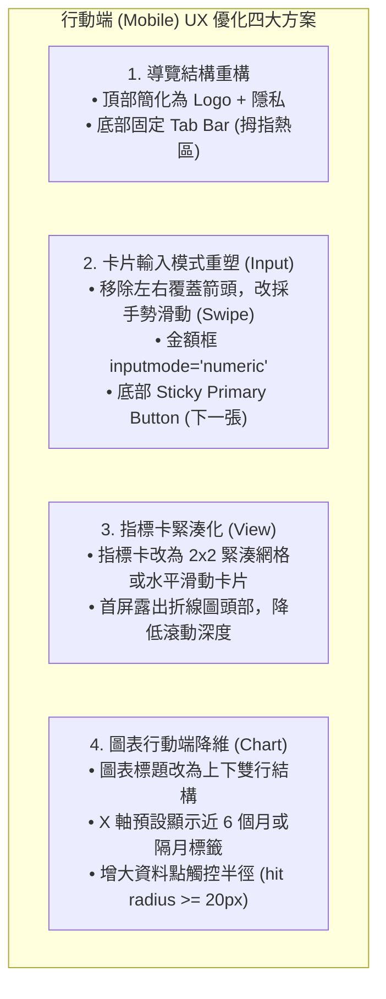
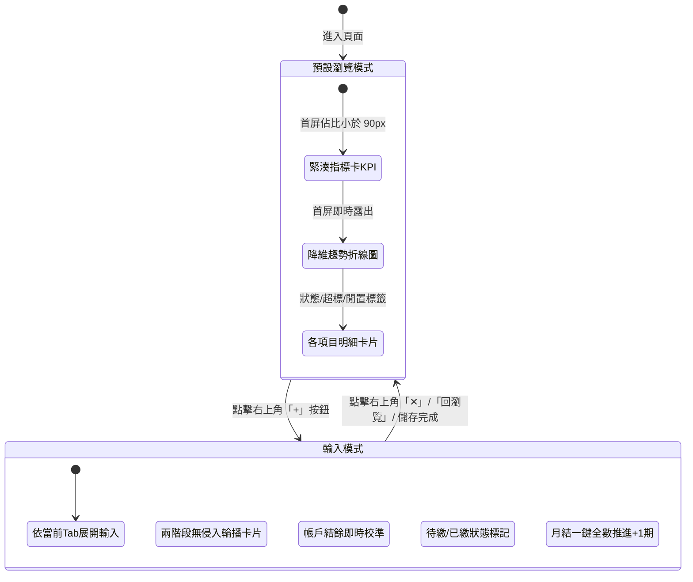

# PocketMoney 功能盤點與 UI 視覺指南 (Feature Overview)

本文件透過瀏覽器實際預覽與 UI 互動盤點 **PocketMoney** 目前所具備的各項功能與介面設計，涵蓋正式操作版（`tools/kipomo.html`）與視覺趨勢預覽版（`pocketmoney/mockup_view.html`）。

---

## 目錄

1. [系統架構與介面概述](#1-系統架構與介面概述)
2. [正式版核心功能盤點（kipomo.html）](#2-正式版核心功能盤點kipomohtml)
   - 2.1 [隱私保護與安全鎖定（PIN 碼）](#21-隱私保護與安全鎖定pin-碼)
   - 2.2 [新手導覽與初始任務引導](#22-新手導覽與初始任務引導)
   - 2.3 [財務總覽與扣款安全檢查（核心儀表板）](#23-財務總覽與扣款安全檢查核心儀表板)
   - 2.4 [銀行餘額與信用卡費管理（抓大放小）](#24-銀行餘額與信用卡費管理抓大放小)
   - 2.5 [信用卡分期付款與現金流負擔](#25-信用卡分期付款與現金流負擔)
   - 2.6 [定期性固定生活費用管理](#26-定期性固定生活費用管理)
   - 2.7 [股票資產與資金比例監控](#27-股票資產與資金比例監控)
   - 2.8 [數據備份、Excel 匯出與單機離線打包](#28-數據備份excel-匯出與單機離線打包)
3. [趨勢版視覺功能盤點（mockup_view.html）](#3-趨勢版視覺功能盤點mockup_viewhtml)
   - 3.1 [信用卡消費趨勢與大額排除平均](#31-信用卡消費趨勢與大額排除平均)
   - 3.2 [銀行餘額走勢與閒置資金/安全水位警示](#32-銀行餘額走勢與閒置資金安全水位警示)
   - 3.3 [固定支出扣款管道走勢分析](#33-固定支出扣款管道走勢分析)
   - 3.4 [分期付款累積攤提曲線](#34-分期付款累積攤提曲線)
   - 3.5 [三大財務畫像情境切換（初級大人 / 少子化勇者 / 高級大人）](#35-三大財務畫像情境切換初級大人--少子化勇者--高級大人)
4. [功能總結矩陣表](#4-功能總結矩陣表)
5. [行動端（Mobile）UI 檢查、UX 關鍵因素分析與優化建議](#5-行動端mobileui-檢查ux-關鍵因素分析與優化建議)
   - 5.1 [mockup_input 行動端畫面檢查與 UX 痛點](#51-mockup_input-行動端畫面檢查與-ux-痛點)
   - 5.2 [mockup_view 行動端畫面檢查與 UX 痛點](#52-mockup_view-行動端畫面檢查與-ux-痛點)
   - 5.3 [影響行動端 UX 的關鍵因素剖析](#53-影響行動端-ux-的關鍵因素剖析)
   - 5.4 [具體優化建議與落地改善方案](#54-具體優化建議與落地改善方案)
   - 5.5 [整合版行動端成果落地（mockup_mobile.html）：單頁雙模式流暢切換](#55-整合版行動端成果落地mockup_mobilehtml單頁雙模式流暢切換)

---

## 1. 系統架構與介面概述

PocketMoney 主打**「抓大放小、著重金流安全防禦」**的極簡理財哲學，不強求使用者記錄每一筆零星流水帳，而是聚焦在：
- **避免信用卡/房貸戶頭存款不足導致扣款失敗或信用受損**。
- **掌握大額消費（> NT$ 5,000）對月開銷的衝擊**。
- **即時掌握信用卡分期所吃掉的未來月現金流**。
- **本機無伺服器儲存，高度確保財務隱私安全**。

---

## 2. 正式版核心功能盤點（kipomo.html）

### 2.1 隱私保護與安全鎖定（PIN 碼）

- **4 位數 PIN 碼防護**：啟動頁面時預設提供九宮格數字鍵盤輸入，防止在公共場合或他人借閱螢幕時窺見真實資產。
- **一鍵隱藏/顯示金額**：右上角提供「顯示金額 / 隱藏金額」切換眼睛圖示，隨時保護敏感數字。
- **免登入本機儲存**：PIN 碼及所有設定均加密保存在使用者瀏覽器 LocalStorage，無需連線後端。

---

### 2.2 新手導覽與初始任務引導

- **新手引導任務列（Checklist）**：
  1. 設定主力銀行與存款（建立第 1 道活存防線）
  2. 登記本期信用卡與扣繳戶（自動對齊對扣）
  3. 檢查扣款安全亮綠燈（確認扣後結餘 $\ge 0$）
  4. （選填）設定 PIN 碼保護本機隱私
- **快速示範資料載入**：提供「✨ 帶我導覽 3 分鐘」與「🚀 載入示範資料」按鈕，讓新使用者立刻理解產品概念與資料呈現方式。

---

### 2.3 財務總覽與扣款安全檢查（核心儀表板）

- **三大頂部指標卡**：
  - **總淨資產**：顯示淨資產總計（含總資產、卡費與固定支出、分期未繳負債結算）。
  - **股票投資損益**：即時換算持股總市值、波段未實現損益與現股配置比例（例如 79% 持股 vs 21% 現金）。
  - **本月待扣款總結**：精確統計本月信用卡待繳、固定水電房租待繳，以及每月被分期吃掉的固定現金流。
- **戶頭扣款安全檢查（紅綠燈預警系統）**：
  - 清楚列出主力扣繳戶餘額與待扣款項對齊結果。
  - **扣後預計結餘**：提早 15~20 天攔截餘額不足風險，確保全數帳戶顯示「餘額充足」綠燈。
  - **一鍵信用卡全數扣款 / 執行扣款入帳**：繳費完成後一鍵結清。
- **本期 > $5,000 大額消費雷達**：
  - 自動列出當月超過門檻的重大開銷（例如換季服飾添購 NT$ 5,600），專注控制大額突波。
- **進行中分期付款負擔摘要**：
  - 呈現每月分期總額與剩餘期數總覽（例如 iPhone 12 期零利率剩餘 8 期）。

---

### 2.4 銀行餘額與信用卡費管理（抓大放小）

- **銀行帳戶管理**：
  - 支援多銀行帳戶新增、編輯與刪除。
  - 點擊輸入框可直接修改現有存款餘額，系統即時連動計算扣後結餘。
- **信用卡本期帳單**：
  - 支援設定扣款銀行帳戶與約定扣款日。
  - 只需登錄「本期帳單總額」與「大額消費項目（> NT$ 5,000）」，系統自動計算出一般瑣碎花費，省去流水日記帳的繁瑣。
  - 支援標記已扣款、單筆大額新增/移除、新月份信用卡費一鍵登錄。

---

### 2.5 信用卡分期付款與現金流負擔

- **現金流防護監控**：
  - 統計「每月分期現金支出」（各卡每月應繳加總）。
  - 監控「分期未繳負債」（總未繳尾款），避免零利率分期累積過多導致未來現金流枯竭。
- **分期明細與進度追蹤**：
  - 條列各筆分期項目、綁定信用卡與扣繳帳戶。
  - 視覺化進度條（如 4/12 期，還剩 8 期）。
  - **全部推進一期 (+1 期)**：月換季時一鍵自動結算推進所有期數，亦支援單筆個別 +1 期。

---

### 2.6 定期性固定生活費用管理

- **固定生活費集中控管**：
  - 彙整房租、水電費、電信 5G、瓦斯與家用網路等週期性固定開支。
  - 支援設定扣繳銀行戶，自動併入扣款安全檢核。
- **三態繳費狀態切換**：
  - 提供 `待繳`、`已繳`、`免繳` 快速切換按鈕。
- **雙月帳單一鍵切換**：
  - 針對台灣台電電費、水費雙月開單特性，支援「雙月帳單一鍵切換免繳/待繳」。

---

### 2.7 股票資產與資金比例監控

- **持股與現金部位調配**：
  - 設定連動交割銀行，自動計算「持股部位」與「現金部位」比例。
  - 具備現金部位水位上限警戒（例如現金比例低於 30% 警示）。
- **股票部位損益試算**：
  - 支援登錄股票代號、名稱、股數、成本均價與目前市價。
  - 自動換算持股市值與未實現損益率（符合台股慣例：紅漲綠跌）。

---

### 2.8 數據備份、Excel 匯出與單機離線打包

- **Excel CSV 財務總表匯出**：可直接將所有資產、帳單、分期、投資資料匯出為 CSV 試算表。
- **完整數據備份與匯入**：支援一鍵匯出與匯入 JSON 備份檔，便於在跨裝置（手機與電腦）間無縫同步。
- **單機離線版 HTML 打包下載**：點擊「下載單機版 HTML 檔案及數據備份」，可產生完整獨立運作的 HTML 檔案，無需網路亦可長久使用。
- **PIN 碼設定/變更**：提供個人專屬 4 位數 PIN 碼設定介面。
- **三種典型範本模型切換**：可一鍵切換「初級大人」、「少子化勇者」、「高級大人」之範例資料以供體驗。

---

## 3. 趨勢版視覺功能盤點（mockup_view.html）

`mockup_view.html` 著重於**中長期財務趨勢洞察**、**多維度統計圖表**與**典型客群情境分析**：

### 3.1 信用卡消費趨勢與大額排除平均

- **近 12 個月 / 當年度趨勢圖**：
  - 平滑折線圖展示各張信用卡（如國泰 CUBE 卡、富邦 J 卡）與出帳總額的 12 個月變化曲線。
- **有效月平均（去除大額突波）**：
  - 指標卡除了「本月總計」與「近 12 個月累計」外，特別計算**有效月平均**（扣除單次極端大額花費後的真實生活開銷基準線）。
- **單卡卡片與高額警戒線**：
  - 卡片呈現各自的月累計、有效月平均與自訂高額警戒線（如 NT$ 30,000 / NT$ 20,000）。
  - 下方拆解本月大額消費明細（如 Costco 採買 NT$ 7,650、大保養 NT$ 6,800）。

---

### 3.2 銀行餘額走勢與閒置資金/安全水位警示

- **多帳戶資金走勢圖**：
  - 追蹤房貸專戶、生活專戶與證券交割專戶各自之月度結餘水位。
- **閒置資金與安全防線標籤**：
  - 智慧識別帳戶閒置金額（例如房貸專戶偵測到閒置資金 > NT$ 200,000 提醒轉投資或還本）。
  - 帳戶標註保留金門檻（如保留金 NT$ 50,000）、閒置門檻，並顯示「水位正常」或警告標籤。
- **本月收支重大事件**：
  - 標記單月非經常性收支（如雙十家庭露營 NT$ -13,000、台積電季配息 NT$ +4,500）。

---

### 3.3 固定支出扣款管道走勢分析

- **扣款管道結構拆解**：
  - 頂部直接區分「銀行直接扣款（如房貸、安親托育、管理費）」與「信用卡代繳（如水電瓦斯、寬頻通訊）」。
  - 12 個月折線圖清楚呈現兩大管道的每月穩定支出基期。
- **週期頻率標註**：
  - 清楚區分「每月固定」與「雙月繳（如電費雙月 2,4,6,8,10,12 月開單）」，防止隔月多扣造成資金誤判。

---

### 3.4 分期付款累積攤提曲線

- **月攤提負擔爬升曲線**：
  - 視覺化展示隨新商品分期購買（如滾筒洗衣機、成長型汽座），每月應繳金額的爬升與未來遞減期程。
- **期數進度條與總額試算**：
  - 卡片標示第幾期/總期數（例如第 7 / 12 期）、綁定卡別與起算月份。
  - 呈現每期應繳、總額及剩餘尾款金額。

---

### 3.5 三大財務畫像情境切換（初級大人 / 少子化勇者 / 高級大人）

| 角色情境 | 截圖預覽 | 財務結構特色 |
| :--- | :--- | :--- |
| **初級大人** (剛入職場/單身) |  | 單一薪轉銀行 + 單一信用卡，聚焦小資生活費、套房租金與手機通訊費防守。 |
| **少子化勇者** (30-40 夾心世代) |  | 3 家銀行專戶 + 多張信用卡，承擔房貸、幼兒托育、多筆大型家電分期及台股 ETF。 |
| **高級大人** (40+ 高資產/熟齡) |  | 5 大多幣別與私人銀行專戶、頂級商務卡、豪宅置產貸款與千萬級股債部位。 |

---

## 4. 功能總結矩陣表

| 功能分類 | 子功能項目 | 正式版 (`kipomo.html`) | 趨勢版 (`mockup_view.html`) | 說明 |
| :--- | :--- | :---: | :---: | :--- |
| **隱私與安全** | PIN 碼鎖定 | ✅ | ❌ | 4 位數 PIN 碼遮罩保護 |
| | 金額切換遮罩 | ✅ | ✅ | 一鍵隱藏資產敏感數字 |
| **銀行管理** | 多帳戶餘額管理 | ✅ | ✅ | 支援直接編輯餘額與指定用途 |
| | 扣款安全紅綠燈檢查 | ✅ | ✅ | 提早計算扣後預計結餘防止透支 |
| | 閒置資金與水位提醒 | ❌ | ✅ | 設定安全防線與閒置資金警報 |
| **信用卡管理** | 帳單登錄 | ✅ | ✅ | 記錄當期應繳總金額 |
| | 抓大放小大額雷達 | ✅ | ✅ | 獨立標註 >$5,000 項目，其餘自動歸納 |
| | 12 個月開銷趨勢線 | ❌ | ✅ | 歷史走勢與單卡折線對比 |
| | 有效月平均計算 | ❌ | ✅ | 自動去除大額突波算出真實開銷基準 |
| **分期管理** | 分期項目追蹤 | ✅ | ✅ | 記錄期數、每期金額與未繳尾款 |
| | +1 期快速推進 | ✅ | ❌ | 月換季一鍵推進全部或單筆分期 |
| | 分期累積負擔走勢 | ❌ | ✅ | 呈現多筆分期累積造成的現金流壓迫線 |
| **固定費用** | 週期水電房租管理 | ✅ | ✅ | 分類管理常態生活固定開銷 |
| | 三態狀態切換 | ✅ | ❌ | 支援「待繳 / 已繳 / 免繳」 |
| | 雙月帳單一鍵切換 | ✅ | ❌ | 適應台水台電雙月繳款機制 |
| | 扣款管道拆解 | ❌ | ✅ | 視覺化分流銀行直扣 vs 信用卡代繳 |
| **投資理財** | 股票市值損益追蹤 | ✅ | ❌ | 台股個股/ETF 成本均價與損益試算 |
| | 現金/股票配置比例滑桿 | ✅ | ❌ | 監控現金防禦水位與持股警戒線 |
| **數據與匯出** | Excel CSV 匯出 | ✅ | ❌ | 一鍵匯出財務總表 |
| | JSON 備份 / 匯入 | ✅ | ❌ | 本機無伺服器跨裝置轉移 |
| | 單機版 HTML 離線打包 | ✅ | ❌ | 下載完全離線執行的本機單一檔案 |
| **客群適應** | 範本情境切換 | ✅ | ✅ | 初級大人、少子化勇者、高級大人 |

---

## 5. 行動端（Mobile）UI 檢查、UX 關鍵因素分析與優化建議

針對 `mockup_input.html`（輸入流程）與 `mockup_view.html`（檢視儀表板）在行動裝置（螢幕寬度 375px ~ 412px，如 iPhone 與 Android 主流手機）上的實際呈現進行深度檢驗。

---

### 5.1 mockup_input 行動端畫面檢查與 UX 痛點

經瀏覽器預覽模擬手機視窗實測，`mockup_input.html` 在行動端存在以下 **5 大顯著 UX 缺陷**：

1. **Header 導覽破版與水平溢出截斷（Critical）**：
   - **現象**：PocketMoney Logo 與四個導覽 Tab（信用卡費、銀行餘額、固定費用、分期付款）強行擠在同一列。
   - **影響**：寬度嚴重不足導致 Tab 文字被強制壓扁直立折行（「信 / 用 / 卡 / 費」成 4 行直書），甚至「固定費用」右側被截斷，最後一個 Tab「分期付款」完全被推出可視畫面之外，使用者在手機端根本無法點選。
2. **卡片切換按鈕侵入核心觸控區（High）**：
   - **現象**：信用卡卡面兩側的「`<`」與「`>`」懸浮圓形按鈕直接覆蓋在卡片邊界上。
   - **影響**：右側箭頭「`>`」甚至壓到了中央金額輸入框的右側外框，極易造成使用者想點擊輸入金額卻誤觸切換下一張卡，引發輸入中斷與操作挫折感。
3. **原生數字輸入框微調箭頭干擾（Medium）**：
   - **現象**：卡片內金額輸入框顯示桌面瀏覽器的原生上下調節箭頭（Stepper Spinners），且金額佔位符與文字對比度偏低。
   - **影響**：在手機小螢幕上，微調箭頭壓縮了可見輸入長度，且手機虛擬鍵盤彈起時若未指定 `inputmode="numeric"`，使用者常需手動切換鍵盤模式。
4. **按鍵文案混雜桌面快捷鍵（Medium）**：
   - **現象**：底部主要動作按鈕文字標示為「`下一張 (Enter) ->`」。
   - **影響**：行動觸控設備無實體 Enter 鍵，「`(Enter)`」屬於多餘干擾資訊；且三個按鈕（上一張、略過、下一張）水平等寬緊貼，拇指單手操作時容易誤觸「上一張」。
5. **進度指示器空間壓迫（Low）**：
   - **現象**：當卡片數量較多（如 8 張卡）時，「第一階段：輸入帳單金額 5 / 8」與 8 顆圓點進度條並列，在 375px 寬度下兩側留白已逼近邊界，若字數再增加便會擠壓折行。

---

### 5.2 mockup_view 行動端畫面檢查與 UX 痛點

經瀏覽器預覽實測，`mockup_view.html` 在行動端呈現下列 **4 大 UX 瓶頸**：

1. **頂部四 Tab 排版局促與折行（High）**：
   - **現象**：四個功能分頁（信用卡費、銀行餘額、固定費用、分期付款）在 375px 下平分寬度。
   - **影響**：每個按鈕的文字都被折成兩行（「信 用 / 卡 費」、「銀 行 / 餘 額」），按鈕高度被無謂撐開，且視覺上顯得雜亂、缺乏呼吸感。
2. **首屏垂直空間被指標卡過度佔據（High）**：
   - **現象**：頂部三大數據指標卡（本月總計、12 個月累計、有效月平均）在手機端採垂直單欄堆疊（每張高達約 90px~100px）。
   - **影響**：首屏（Above the fold）完全被這三張卡片填滿，最核心的**走勢折線圖**與**單卡大額明細**被推擠至第二屏甚至第三屏，使用者一進畫面無法一眼掌握財務全貌，增加滑動認知負擔。
3. **折線圖標題碎裂與圖表密度過載（Medium）**：
   - **現象**：圖表標題區的「信用卡費 2026/01 ~ 2026/12」在手機端強制換行時斷成「信 用 / 卡 費」，圓點標示與文字脫節。
   - **影響**：12 個月的 X 軸刻度在 375px 寬度下字體縮得極小且密集，手機觸控很難精確點擊到特定單一月份的資料點來觸發 Tooltip。
4. **客群切換標籤與遮罩按鈕排列緊湊（Medium）**：
   - **現象**：「初級大人」、「少子化勇者」、「高級大人」與「眼睛（隱私遮罩）」排在次導覽列。
   - **影響**：按鈕間距過小，在單手操作時極易誤觸鄰近按鈕。

---

### 5.3 影響行動端 UX 的關鍵因素剖析

從人機互動（HCI）與行動端介面設計標準分析，影響 PocketMoney 行動體驗的核心關鍵包括：

1. **單手操作拇指熱區（Thumb Zone）失衡**：
   - 行動使用者高達 75% 習慣單手單指握持操作，螢幕上半部屬於「難以觸及區（Hard to reach）」。
   - 目前無論是 `mockup_input` 或 `mockup_view`，核心 Tab 切換均放置在螢幕最上方，迫使使用者頻繁換手或拉長拇指。
2. **資訊架構未針對寬度降維（Responsive Degradation Missing）**：
   - 目前設計偏向直接將桌面版佈局收窄（CSS flex/grid wrap），未針對手機寬度重新規劃「主次資訊層級」。
   - 例如：桌面版 3 張橫排指標卡在手機版直接變成 3 張縱向長卡，造成高度急遽膨脹。
3. **觸控熱區重疊與邊界干擾（Touch Target Overlap）**：
   - `mockup_input` 的左右切換箭頭直徑達 40px，卻浮動定位在信用卡卡片內側邊界，與輸入框外緣重疊小於 10px，嚴重違反 WCAG 2.1 規範中「觸控目標與相鄰元素需保留安全邊距」的原則。
4. **虛擬鍵盤彈起適配（Keyboard Viewport Distortion）**：
   - 在手機上點擊金額輸入框時，虛擬鍵盤會佔去螢幕下半部約 40%~50% 空間；目前的卡片與按鈕若未考慮鍵盤高度，會發生輸入框被鍵盤遮擋或下方動作列被推出螢幕的問題。

---

### 5.4 具體優化建議與落地改善方案

為解決上述問題並大幅提升行動端操作爽快感，建議推行以下 4 項具體優化：

#### 方案 1：導覽重構 —— 導入行動端「底部導覽列 (Bottom Navigation Bar)」
- **建議**：
  - 頂部 Header 僅保留「PocketMoney Logo」與「隱私眼睛 / 設定圖示」，取消頂部橫向擠壓的 4 個 Tab。
  - 將「信用卡費」、「銀行餘額」、「固定費用」、「分期付款」下移至螢幕底部，建立固定式（Sticky Bottom）導覽列，採用「Icon + 簡稱」，高約 56px~64px，完全置於單手拇指自然觸碰舒適區。
  - **備選方案**：若仍保留頂部 Tab，則必須設定 `overflow-x: auto; flex-wrap: nowrap;`，讓 Tab 支援水平平滑滑動（Scrollable Tabs），每個 Tab 保留最小寬度且不折行。

#### 方案 2：`mockup_input` 輸入流程體驗重塑
- **手勢取代懸浮按鈕**：
  - 移除卡片左右邊界的浮動箭頭（`<` 與 `>`），改為支援卡片**左右滑動手勢（Swipe Left / Right）**，徹底消除誤觸輸入框風險。
- **針對虛擬鍵盤最佳化**：
  - 移除 `<input type="number">` 的原生 stepper 箭頭。
  - 加入 `inputmode="decimal"` 與 `pattern="[0-9]*"`，使用者聚焦時自動彈出純數字大鍵盤。
  - 大幅提升金額佔位符與輸入字體對比度（例如強調青綠色或明亮白），並支援自動聚焦（Autofocus）。
- **底部動作列（Action Bar）最佳化**：
  - 「下一張」做成全寬或主視覺色塊（Primary Button），文案精簡為「**下一張**」（刪除 `(Enter)`）；
  - 「上一張」與「略過」簡化為次要文字連結或並列於主要按鈕上方/左側。

#### 方案 3：`mockup_view` 首屏資訊密度精簡
- **指標卡改為橫向走馬燈（Carousel）或 2x2 迷你網格**：
  - 將「本月總計」作為大字重點，而「12 個月累計」與「有效月平均」並排成雙欄緊湊卡片；
  - 垂直佔位從原本約 300px 縮減至 120px 內，讓使用者一打開頁面即可看見趨勢折線圖的高峰與低谷。
- **客群切換標籤樣式收斂**：
  - 將「初級大人 / 少子化勇者 / 高級大人」設計為緊湊的 Segmented Control，左右邊距拉開，防止誤按。

#### 方案 4：行動端圖表響應式降維
- **標題文字排版**：
  - 改用 `flex flex-col`，第一行顯示「信用卡費趨勢」，第二行以小字呈現「2026/01 ~ 2026/12」，消除文字被強迫拆解直立的不良視覺。
- **X 軸標籤動態抽樣**：
  - 螢幕小於 400px 時，X 軸不要全部擠入 12 個月標籤；可每隔 2 個月顯示一次（例如 `1月`、`3月`、`5月`、`7月`、`9月`、`11月`），其餘月份透過滑動手勢或點選顯示 Tooltip。
  - 圖表資料點的觸控偵測半徑（Touch Hit Radius）擴大至至少 24px，方便手指輕點即可精準叫出金額明細。

---

### 5.5 整合版行動端成果落地（mockup_mobile.html）：單頁雙模式流暢切換

根據上述 UX 分析與改善方案，全新設計並實作獨立整合頁面 **`pocketmoney/mockup_mobile.html`**，實現「**單一頁面、預設瀏覽模式、點擊右上角 `+` 隨時進入輸入模式**」的極致行動體驗。

#### 1. 雙模式架構與運作邏輯

#### 2. 雙模式實際畫面展示

| 分類 | 預設瀏覽模式 (View Mode) | 右上角「+」進入輸入模式 (Input Mode) |
| :--- | :--- | :--- |
| **信用卡費** |  |  |
| **銀行餘額** |  |  |
| **固定費用** |  |  |
| **分期付款** |  |  |

#### 3. 落地效益成果

1. **一頁包辦雙重任務**：徹底免去使用者在多個頁面間頻繁跳轉的割裂感，想看趨勢時看趨勢，想記帳時右上角輕點「`+`」即可瞬間切換，完成後自動跳回瀏覽模式並同步更新圖表與 KPI。
2. **徹底釋放單手拇指熱區**：導入底部固定導覽列（Sticky Bottom Bar），將 4 大分類（信用卡、銀行、固定費、分期）與底端主按鈕全部置於單手握持最自然的觸碰舒適區。
3. **消除輸入誤觸與鍵盤遮蔽**：卡片移除覆蓋輸入框的懸浮箭頭，改採卡片下方乾淨的切換鍵；金額框指定 `inputmode="decimal"` 喚起純數字鍵盤，並完全移除原生 Stepper 箭頭。
4. **首屏視覺率（Above the fold）大幅改善**：指標卡垂直佔比由原來的 300px 壓縮至 85px，首屏打開立即看到趨勢折線圖，不再需要手動滑動才能理解財務全局。

