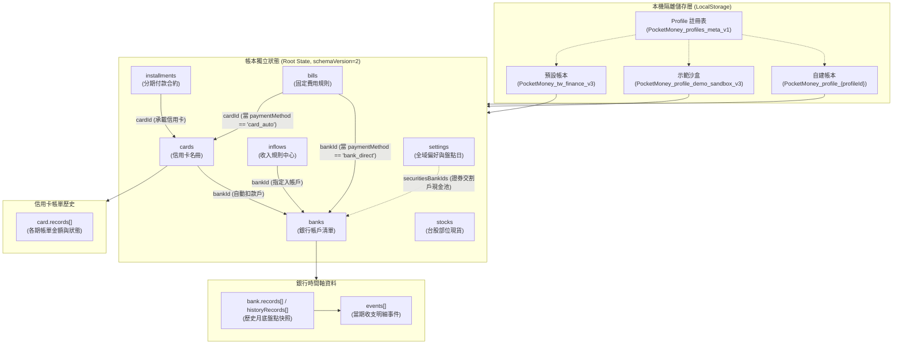

# PocketMoney 資料庫實體關係圖 (ERD.md)

- **專案名稱**：PocketMoney (個人資產與扣款時序防禦系統)
- **Schema 版本**：`schemaVersion: 2` (對應 `STORAGE_KEY: PocketMoney_tw_finance_v3`)
- **唯一真值來源**：主程式 [`pocketmoney.html`](../pocketmoney.html) 與欄位規格書 [`schema/SCHEMA.md`](../schema/SCHEMA.md)
- **架構決策紀錄**：[`DECISIONS.md`](../DECISIONS.md)

---

## 1. 實體關係架構圖 (Entity-Relationship Flowchart)

---

## 2. 三類核心資料屬性差異說明

本系統之實體依財務性質區分為三種截然不同的資料模型與生命週期：

1. **銀行 (Banks) — 存量為主**：
   - 以即時結餘 `balance`（現值）為核心防禦存量。
   - 歷史紀錄保存於 `records`（含月底結餘與歸戶 `events` 事件）或 `historyRecords`（純月底結餘）。
   - **未來推演不存入資料庫**，檢視未來月份時由前端動態滾算期末預估餘額。
2. **信用卡 (Cards) — 流量為主**：
   - 當期以 `statementTotal` 作為當月待扣總額暫存。
   - 歷史紀錄保存於 `records` 各期出帳金額、扣繳狀態（`paid` / `auto` / `failed`）與單筆大額開銷 `bigExpenses`。
   - 未來月份不寫入靜態歷史，而是以常態日常消費基底、當月進行中分期（`installments`）與信用卡代扣帳單（`bills`）**動態推估未來流量**。
3. **投資 (Stocks) — 配置比例為主**：
   - 僅以 `stocks` 保存持有標的與現值（股數、均價、市價），**無歷史快照**亦無未來推演。
   - 投資現金池並非獨立實體，而是由 `settings.securitiesBankIds` 關聯之交割銀行帳戶 `balance` 現值加總而成，共同計算資產配置比例與持股水位。

---

## 3. 欄位規格與詳細計算導引

本圖僅呈現頂層實體關聯與外鍵約束架構。關於各實體的完整 TypeScript 介面、所有屬性欄位清單、生命週期行為及 ADR-016 時間軸計算公式，請嚴格參閱唯一真值規格文件：

👉 **[詳細欄位結構與計算公式規格書 (`pocketmoney/schema/SCHEMA.md`)](../schema/SCHEMA.md)**
