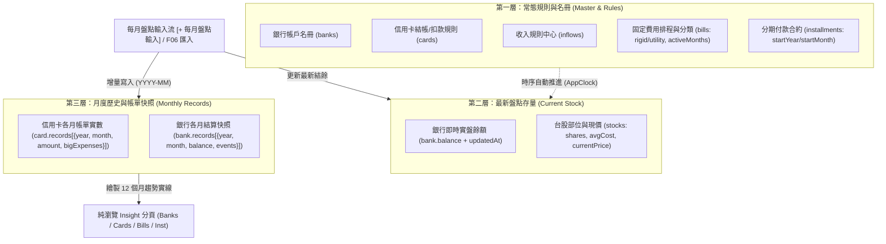
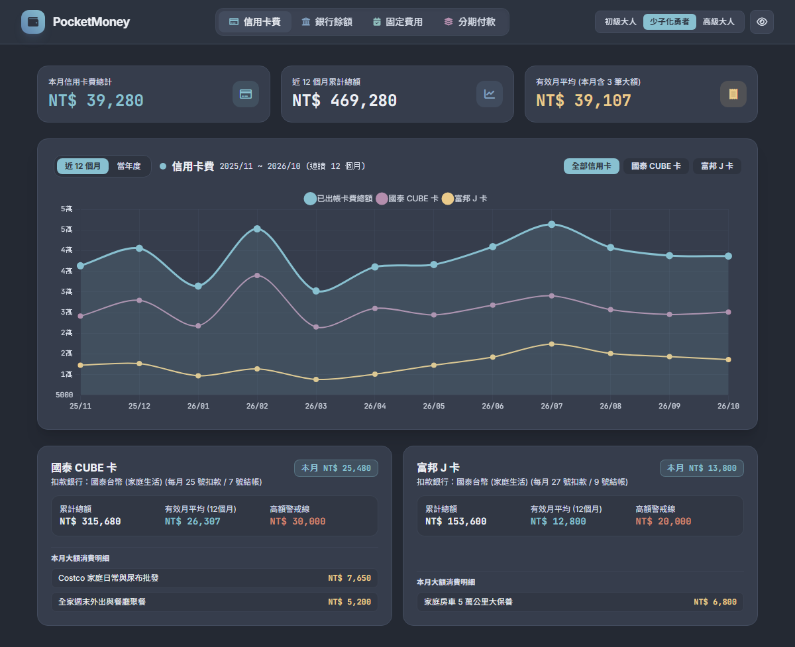
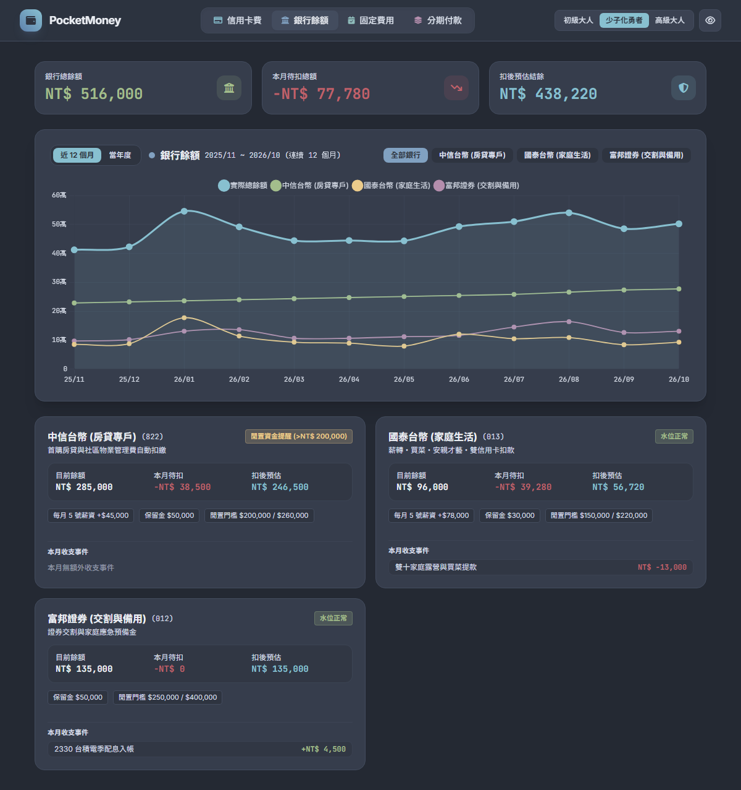
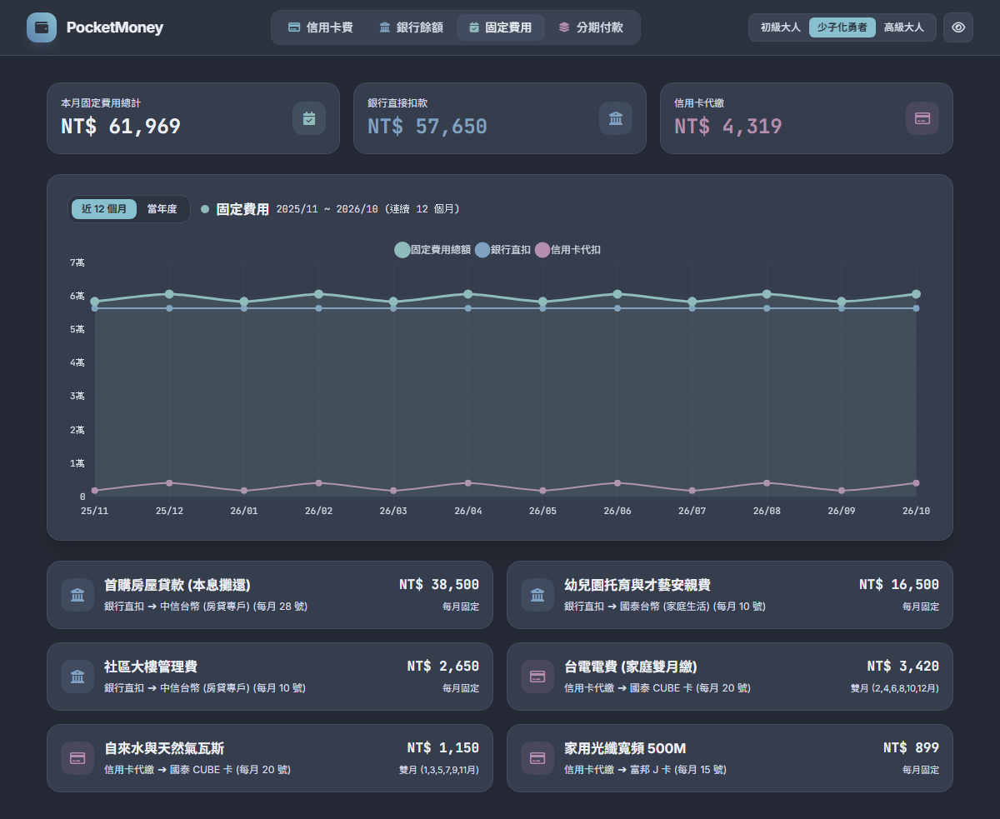
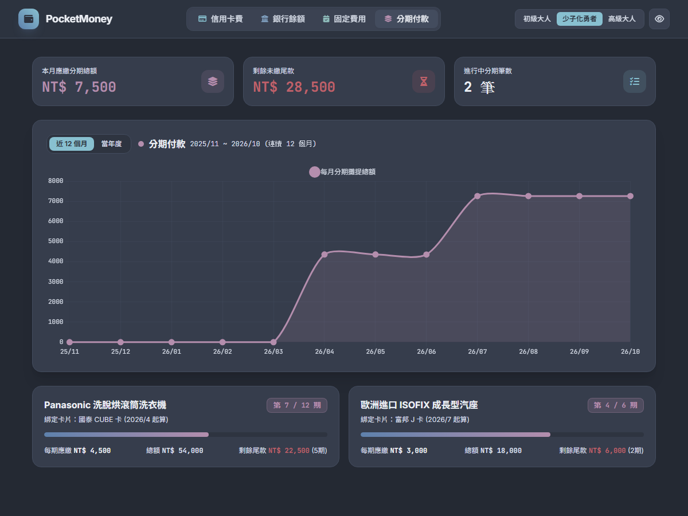
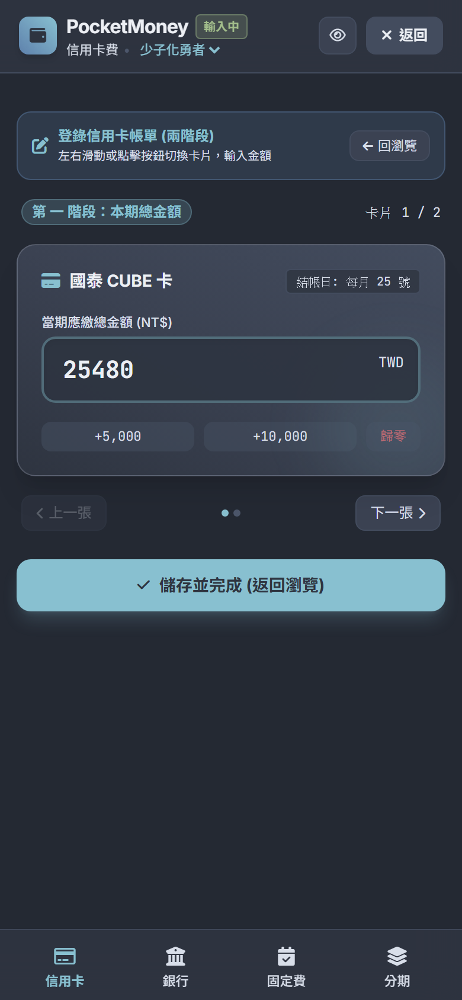
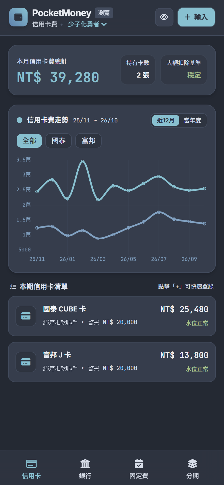
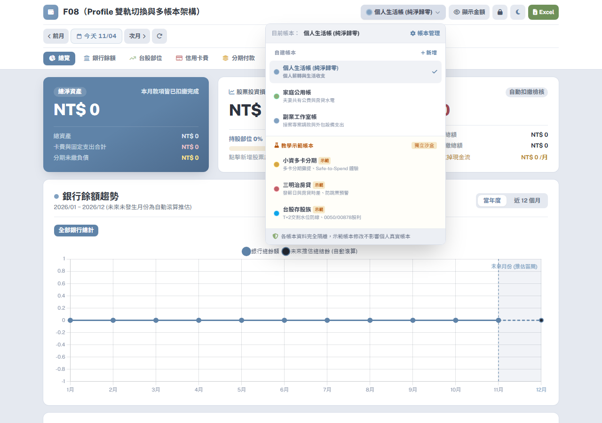
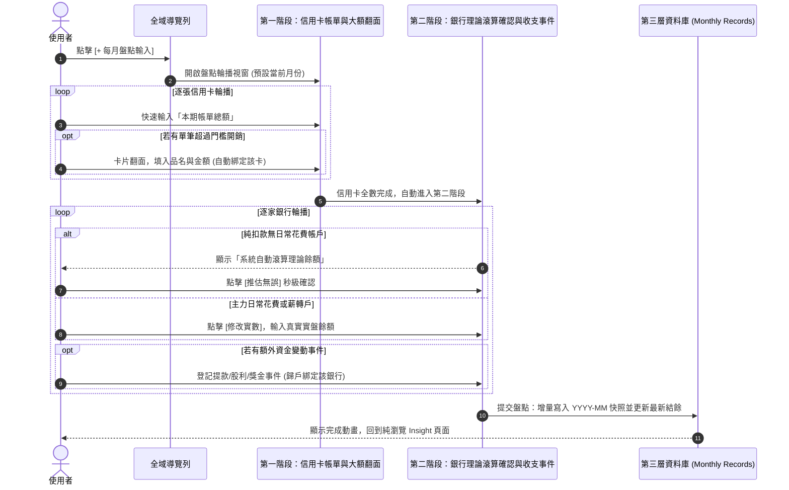

# PocketMoney 前台分頁功能與資料庫映射規格書 (PAGE_DATA_SPEC.md)

> **文件性質**：L1 產品規格與資料庫映射真值來源（Single Source of Truth）。  
> **制定目的**：本規格書旨在讓 Manager、產品團隊與前後端工程師能夠逐頁逐欄審視「前台每個頁面所呈現的業務資訊內容」與「底層資料庫結構 (`SCHEMA.md` / `ERD.md`) 的資料流對照與計算公式」，正式確立 **ADR-017（全分頁純瀏覽 Insight × 專用輸入流分離 × 三層資料庫生命週期通則）**，並嚴格封堵 20 項產品邏輯打架與 AI Slop 違規，作為專案開發與驗收的唯一權威基準藍圖。  
> **規範依據**：嚴格遵循 [`DECISIONS.md`](file:///c:/Dev/wiskinglin.github.io/pocketmoney/DECISIONS.md)（ADR-017）、[`specs/UXD.md`](file:///c:/Dev/wiskinglin.github.io/pocketmoney/specs/UXD.md)（零 AI Slop 介面鐵律與設計規範）、[`specs/UI_VOCABULARY.md`](file:///c:/Dev/wiskinglin.github.io/pocketmoney/specs/UI_VOCABULARY.md)（標準文案辭典）、[`schema/SCHEMA.md`](file:///c:/Dev/wiskinglin.github.io/pocketmoney/schema/SCHEMA.md) 與 [`ERD.md`](file:///c:/Dev/wiskinglin.github.io/pocketmoney/ERD.md)。

---

## 目錄

- [0. 核心架構與資料生命週期通則 (Core Architecture & Data Lifecycle Rules — ADR-017)](#0-核心架構與資料生命週期通則-core-architecture--data-lifecycle-rules--adr-017)
  - [0.1 三層資料庫結構（防範數據破碎）](#01-三層資料庫結構防範數據破碎)
  - [0.2 三大使用情境推進閉環](#02-三大使用情境推進閉環)
  - [0.3 瀏覽（100% 純 Insight）與輸入（專用流程）徹底分離原則](#03-瀏覽100-純-insight與輸入專用流程徹底分離原則)
- [1. 全域頂部導覽列與帳本總控 (Global Header & Profile Switcher)](#1-全域頂部導覽列與帳本總控-global-header--profile-switcher)
- [2. 分頁一：總覽 (`#tab-dashboard`)](#2-分頁一總覽-tab-dashboard)
- [3. 分頁二：銀行餘額 (`#tab-banks`)](#3-分頁二銀行餘額-tab-banks)
- [4. 分頁三：台股部位 (`#tab-stocks`)](#4-分頁三台股部位-tab-stocks)
- [5. 分頁四：信用卡費 (`#tab-cards`)](#5-分頁四信用卡費-tab-cards)
- [6. 分頁五：分期付款 (`#tab-installments`)](#6-分頁五分期付款-tab-installments)
- [7. 分頁六：固定費用 (`#tab-bills`)](#7-分頁六固定費用-tab-bills)
- [專章：每月盤點專用輸入流 (Monthly Input Carousel Mode)](#專章每月盤點專用輸入流-monthly-input-carousel-mode)
- [8. 分頁七：收支規則 (`#tab-rules`)](#8-分頁七收支規則-tab-rules)
- [9. 分頁八：設定 (`#tab-settings`)](#9-分頁八設定-tab-settings)
- [10. 總結：資料庫結構 (`SCHEMA`) 與前台整合檢核矩陣](#10-總結資料庫結構-schema-與前台整合檢核矩陣)
- [11. 20 項產品邏輯打架與 AI Slop 清零決議（#01 ~ #20）改造對照檢核表](#11-20-項產品邏輯打架與-ai-slop-清零決議01--20-改造對照檢核表)

---

## 0. 核心架構與資料生命週期通則 (Core Architecture & Data Lifecycle Rules — ADR-017)

### 0.1 三層資料庫結構（防範數據破碎）
為徹底解決舊架構下跨月編輯誤改即時存量、多頭修改帳單金額、以及缺乏歷史真實快照等問題，PocketMoney 資料庫嚴格劃分為三層生命週期：

1. **第一層：常態規則與名冊 (Master & Rules — 跨月自動延續)**：
   - 設定一次後跨月自動延續，不隨月份切換而增刪，包含：
     - `banks` 帳戶名冊：銀行代號、名稱、最低保留水位 (`minReserve`)、閒置警戒水位 (`cashDragWarn / cashDragAlert`)。
     - `cards` 排程規則：卡片名稱、每月結帳日 (`closingDay`)、自動扣款日 (`dueDay`)、綁定扣繳銀行 (`bankId`)、高額開銷警示線 (`highSpendWarn`)。
     - `inflows` 收入規則：主動薪資、固定獎金、被動收入之入帳日、預估金額、指定入帳銀行、生效月份 (`activeMonths`) 與假日順延調整。
     - `bills` 固定費用規則：扣繳管道 (`paymentMethod: 'bank_direct' | 'card_auto'`)、關聯實體 (`bankId / cardId`)、每月扣款日 (`dueDay`)、常態金額 (`amount`)、支出性質分類 (`category: 'rigid' | 'utility'`)、以及明確生效月份 (`activeMonths`，如雙月偶數月 `[2, 4, 6, 8, 10, 12]` 或雙月奇數月 `[1, 3, 5, 7, 9, 11]`)。
     - `installments` 分期合約：分期名稱、承載卡片 (`cardId`)、總金額、總期數、起始年月 (`startYear, startMonth`)。期數進度完全由檢視月份動態推算。
2. **第二層：最新盤點存量 (Current Stock — 即時水位快照)**：
   - 代表現實世界「此刻」的真實資產與存量，包含：
     - `bank.balance`：銀行活存最新實盤結餘，附帶最後確認時間戳記 (`bank.updatedAt: 'YYYY-MM-DD'`)。
     - `stocks`：台股現貨與 ETF 部位（代號、名稱、持有股數 `shares`、成本均價 `avgCost`、參考市價 `currentPrice`）。
3. **第三層：月度歷史與帳單快照 (Monthly Records — 增量歸檔，嚴禁假造)**：
   - 按 `YYYY-MM` 增量歸檔之月度結算快照，作為 12 個月趨勢圖與歷史回溯之權威真值：
     - `card.records[]`：陣列結構 `[{ year, month, amount, bigExpenses: [{ id, title, amount }] }]`。
     - `bank.records[]`：陣列結構 `[{ year, month, balance, events: [{ id, type, title, amount }] }]`。
   - **核心禁令（清零假數據 Fallback）**：
     - 嚴禁覆蓋歷史月份數據；
     - **嚴禁在無歷史快照時使用假公式（如 `balance * (1 - monthDiff * 0.015)` 每月遞減 1.5%）捏造歷史存款**；
     - **嚴禁在推估未來時寫死假薪資（如 `58000`）或假刷卡費（如 `8000`）**。有紀錄即採真實紀錄，無紀錄即忠實呈現未出帳或 `0`。

---

### 0.2 三大使用情境推進閉環

#### 情境 1：從零開始（Cold Start 乾淨開箱）
1. 使用者初次使用或建立全新帳本時，資料庫為純淨初始狀態。
2. 系統引導使用者：
   - 建立第 1 家主要往來銀行（設定名稱、目前餘額、保留金）；
   - 在「收支規則」分頁設定每月固定薪資入帳日與金額；
   - 登錄日常使用之信用卡（設定結帳日、扣款日、扣款銀行）與固定開銷（如房租、電信費）。
3. 此時無任何歷史月份快照，所有 12 個月趨勢圖之座標軸鎖定 `min: 0, suggestedMax: 10000` 防呆區間，不出現負數或小數，呈現清爽之初始狀態。

#### 情境 2：月度擴充與持續推進（從 10 月邁入 11 月）
1. **系統時鐘自動推進**：當真實世界進入 11 月，系統時鐘 (`AppClock`) 推進至 11 月：
   - 第一層常態規則（薪資、固定開銷、信用卡扣繳排程）自動在 11 月生效；
   - 分期付款根據 `startYear/startMonth` 自動將期數推進至最新期數（無須點擊任何手動前進按鈕）。
2. **專用輸入流增量寫入**：
   - 當使用者收到 11 月信用卡對帳單或月底盤點資產時，點擊全域頂部 **`[+ 每月盤點輸入]`** 按鈕（或使用 F06 對帳單分析器匯入 JSON）：
     - **階段一**：輪播輸入 11 月各卡帳單總額，並翻面登記本期大額消費；
     - **階段二**：檢視系統自動滾算之銀行理論餘額，一鍵確認 `[推估無誤]` 或輸入真實實盤餘額，並登記當月收支事件。
   - 提交後，系統將 11 月實數增量追加寫入第三層 `card.records` 與 `bank.records`，並更新第二層存量 `bank.balance`。
3. **歷史封存與連續趨勢展開**：10 月的歷史數據永久封存於快照中，12 個月趨勢圖新增 11 月實績節點，折線圖連續平滑延展，歷史真實不變。

#### 情境 3：多 Profile 雙軌切換與沙盒重置
1. **使用者自建帳本**（個人生活、家庭共有、工作室等）：獨立持久化儲存於 `localStorage["PocketMoney_profile_{profileId}"]`，資料永不遺失。
2. **教學示範沙盒**（小資多卡分期、三明治房貸、台股存股族）：
   - 切換至示範帳本時，頂部自動展開「沙盒保護橫幅」；
   - 示範帳本之所有增刪改操作均在隔離沙盒中運作；
   - 使用者隨時可點擊「重置示範資料」，一鍵將示範數據還原為系統官方標準預設值，保障正式資料不受污染。

---

### 0.3 瀏覽（100% 純 Insight）與輸入（專用流程）徹底分離原則

1. **職責界線徹底劃分**：
   - **純瀏覽 Insight 分頁**：嚴格禁止原地 `<input>` 編輯框、禁止「執行扣款入帳/一鍵平帳/已繳真扣款/賣出平倉結算」等具破壞性之按鈕。所有卡片與圖表均為唯讀派生之洞察視圖。
   - **專用每月盤點輸入流 (Monthly Input Carousel)**：每月例行盤點之唯一互動流程，集中處理信用卡總額輸入、大額費用翻面綁定、銀行餘額理論滾算確認與收支事件歸戶。
   - **常態規則中心**：專注維護第一層規則模板，剝離當期交易狀態與帳單金額。
2. **設計標竿歷史截圖引用**：
   - 瀏覽視圖標竿：
     -   
       *圖 0.1：信用卡費 12 個月趨勢折線圖與各卡統計卡片標竿（純瀏覽 Insight）*
     -   
       *圖 0.2：銀行餘額 12 個月趨勢圖（實際實線 vs 理論虛線）與雙向風控水位卡標竿*
     -   
       *圖 0.3：固定費用 12 個月三線趨勢圖（呈現雙月水電階梯波峰）標竿*
     -   
       *圖 0.4：分期付款 12 個月攤提退坡折線圖（一眼看清現金流解放）標竿*
   - 輸入流視圖標竿：
     -   
       *圖 0.5：行動端兩階段卡片輪播專用輸入流標竿（專注高效輸入，翻面綁定大額費用）*
     -   
       *圖 0.6：行動端純瀏覽 Insight 卡片與趨勢視圖標竿*

---

## 1. 全域頂部導覽列與帳本總控 (Global Header & Profile Switcher)

### ① 頁面定位與功能描述
全域頂部導覽列常駐於應用程式最頂端，是使用者掌控身分帳本與快速啟動月度輸入的總控中樞。  
其核心職責包含：
1. **品牌與身分管理**：展示產品名稱、金額隱私遮罩快速切換。
2. **多帳本與示範沙盒雙軌切換 (F08 Multi-Profile Switcher)**：支援「使用者自建帳本」與「教學示範帳本」秒級切換，示範模式下啟用沙盒保護橫幅與一鍵重置。
3. **專用輸入流啟動入口**：右上角常駐高對比按鈕 **`[+ 每月盤點輸入]`**，點擊立即開啟專用兩階段輪播輸入流程。
4. **八大核心模組導航列**：提供總覽、銀行餘額、台股部位、信用卡費、分期付款、固定費用、收支規則、設定之快速跳轉。
5. **重大架構收斂（落實 #08、#20 決議）**：
   - **單月時間控制器 (`< 前月 | YYYY/MM | 次月 >`) 徹底移出全域 Header，直接移入「總覽」分頁內部**！避免在銀行、台股、設定等無單月切換意義的分頁產生概念衝突與視角污染。
   - 徹底移除「載入半年展示」等測試按鈕與「當月防禦/過去存量/未來流量」等內部架構黑話徽章。

### ② 視覺畫面截圖引用
  
*圖 1.1：F08 多帳本雙軌切換下拉選單（清晰分組「自建帳本」與「教學示範帳本」，支援免登出秒級切換）*

  
*圖 1.2：F08 帳本管理彈窗（支援新增帳本、變更主題色、重命名、刪除與示範帳本獨立重置）*

### ③ 頁面資訊區塊與互動清單
- **品牌大標題 (`#pageHeaderTitle`)**：標註產品主標題 `PocketMoney`。
- **帳本切換器 (`#profileSwitcherBtn`, `#profileDropdownMenu`)**：
  - 顯示當前帳本主題色點 (`#currentProfileColorDot`)、名稱 (`#currentProfileName`)、示範標籤 (`#currentProfileBadge`)。
  - 下拉選單點擊即可切換帳本；點擊「管理所有帳本」開啟帳本管理彈窗 (`#profileManageModal`)。
- **示範沙盒防護橫幅 (`#demoSandboxBanner`)**：當前帳本為示範情境時展開，提供「重置示範資料」與「切回我的帳本」操作。
- **專用輸入啟動按鈕 (`#btnOpenMonthlyInput`)**：文字標註 **`+ 每月盤點輸入`**，點擊呼叫每月盤點輪播輸入流 Modal。
- **隱私切換鈕 (`#privacyToggleBtn`)**：點擊切換金額遮罩（`NT$ ••••••`）。
- **八大模組分頁導航列 (`nav button[data-tab]`)**：
  - `總覽` (`dashboard`)
  - `銀行餘額` (`banks`)：含低於保留金紅燈警示徽章 (`#navBadgeBanks`)
  - `台股部位` (`stocks`)
  - `信用卡費` (`cards`)：含未繳帳單提醒徽章 (`#navBadgeCards`)
  - `分期付款` (`installments`)
  - `固定費用` (`bills`)
  - `收支規則` (`rules`)
  - `設定` (`settings`)

### ④ 前台 UI 元素 ↔ 資料庫結構 (`state.*`) 與計算公式映射表

| UI 元素 / ID | 顯示內容 | 資料來源欄位 / 公式 | 讀寫模式 |
| :--- | :--- | :--- | :--- |
| `#currentProfileName` | 當前帳本名稱 | `localStorage["PocketMoney_profiles_meta"].profiles.find(p => p.id === currentProfileId).name` | 唯讀讀取 |
| `#currentProfileColorDot` | 帳本主題色圓點 | `profile.colorTheme`（如 `indigo`, `emerald`, `amber`, `rose`, `purple`, `sky`） | 唯讀渲染 |
| `#currentProfileBadge` | `示範` 膠囊徽章 | `profile.isDemo === true` 則顯示，否則隱藏 | 條件渲染 |
| `#btnOpenMonthlyInput` | `+ 每月盤點輸入` | 點擊觸發 `openMonthlyInputCarousel()` | 互動按鈕 |
| `#privacyToggleBtn` | 金額遮罩狀態 | `state.settings.privacyMode: boolean` | 點擊切換並持久化寫入 |
| `#navBadgeBanks` | 銀行分頁驚嘆號紅標 | 計算公式：若任一銀行 $\text{ProjectedBalance}(B_i) < \text{minReserve}$ 則顯示 `!` | 動態計算派生 |
| `#navBadgeCards` | 信用卡分頁驚嘆號紅標 | 計算公式：若存在當期未結清信用卡 ($\sum \text{unpaidCards} > 0$) 則顯示 `!` | 動態計算派生 |

---

## 2. 分頁一：總覽 (`#tab-dashboard`)

### ① 頁面定位與功能描述
總覽頁面是全應用程式**唯一具備單月時間切換器（`< 前月 | YYYY/MM | 次月 >`）的微觀決策視圖**。  
其核心職責為回答：「**本月扣掉所有固定負擔與帳單後，究竟還剩多少現金餘裕（會不會入不敷出）？**」、「**這個月現金流的高低起伏與扣款關鍵日為何？**」。  
此頁面為 100% 純瀏覽視圖，嚴禁放置修改餘額、手動真扣款或一鍵平帳等破壞性按鈕。

### ② 核心規範改造落實（#01 ~ #06 決議）
1. **單月時間控制器專屬化**：日期控制器配置於總覽頂部，日期按鈕文字**永遠只顯示乾淨年月**（如 `2026/11` 或 `2026年 11月`），徹底拔除 `月底結算`、`整月推演` 等內部 AI Slop 標籤（#03、#05）。
2. **左卡標題固定為 `總淨資產`**：無論切換至歷史月份、當前月份或未來推估月份，卡片主標題固定為 `總淨資產`（拔除 `歷史淨資產 (結算)`、`期末預估淨資產` 等變形名稱），右上角徽章依月份性質呈現（當月：距扣款倒數；過去：歷史已結算；未來：整月推估淨值）。
3. **圖表標題精簡為 `現金流趨勢`**：主標題命名為 `現金流趨勢`（拔除生硬的「該月」），並徹底移除 `2026/11 關鍵日現金水位消長 (1號 → 10號 → 20號 → 月底)` 贅字說明副標題（#06）。
4. **4 大錨點小卡動態事件標籤**：1號、10號、20號、月底 4 張小卡右上角，依據該區間實際發生的主要收支事件動態生成標籤（如 `房租直扣`、`主要卡費`、`薪資入帳` 或 `淨變動 +$12,000`），**嚴禁寫死個人習慣標籤如 `固扣結算/卡費結算/發薪結算`**（#01）。
5. **歷史月份自動隱藏「扣款安全檢核」**：切換至歷史月份時，「扣款安全檢核」區塊強制隱藏（歷史已結清，無待扣檢核需求，杜絕印滿 `歷史已結清/月底結算實數/歷史存量快照` 等 Slop 標籤，#04）。
6. **拔除所有手動平帳與扣款按鈕**：徹底移除 `⚡ 一鍵平帳結算`、各銀行卡片底部的 `修改餘額` 與 `執行扣款入帳` 按鈕（#02）。

### ③ 頁面資訊區塊與互動清單
1. **單月時間控制器工具列**：
   - `前月` 按鈕 (`#dashboardPrevMonthBtn`)、`檢視年月` 乾淨按鈕 (`#dashboardViewDateBtn`)、`回到今天` 按鈕 (`#dashboardTodayBtn`)、`次月` 按鈕 (`#dashboardNextMonthBtn`)。
2. **頂部 3 大決策 KPI 卡 (`#overviewKpiContainer`)**：
   - **左卡：總淨資產 (`#kpiNetWorth`)**：主數據純數字大字。下方三項拆解：總資產 (`#kpiTotalAssets`)、未扣款項 (`#kpiTotalUnpaid`)、分期剩餘總負債 (`#kpiInstallmentRemaining`)。
   - **中卡：股票投資 (`#kpiStockMarketVal`)**：總市值、未實現損益 (`#kpiStockPnL`)、持股 vs 現金比重條 (`#kpiStockRatioBar`)。
   - **右卡：現金流餘裕 (`#kpiMonthMarginHero`)**：
     - 主數據：本月淨現金流餘裕（正數綠字如 `NT$ +18,500`，透支紅字如 `NT$ -4,200`）。
     - 右上徽章：收支體質評估（如「健康餘裕 (32%)」、「負擔偏高 (75%)」或「⚠️ 入不敷出」）。
     - 下方三層支出拆解：① 剛性固定負擔 (`#kpiRigidBurdenSub`)、② 浮動生活帳單 (`#kpiVariableBillsSub`)、③ 當期變動消費 (`#kpiDiscretionarySub`)。
3. **核心圖表：現金流趨勢圖 (`#monthlyCashflowCanvas`)**：
   - X 軸固定為 1號、10號、20號、月底 四大關鍵節點。
   - 4 大錨點小卡動態標示各區間收支事件與淨水位變化。
4. **扣款安全檢核清單 (`#autoDebitAuditCard`, `#bankCheckupGrid`)**：
   - 僅於當前月份與未來月份顯示，歷史月份強制隱藏。純瀏覽呈現各行預估扣款後結餘與保留金缺口。
5. **本月大額消費清單 (`#dashboardBigExpensesList`)**：列出當月 > $5,000 大額消費，歷史月份僅讀取該月歷史紀錄，無資料乾淨顯示「本月無大額消費」。
6. **進行中分期付款摘要 (`#dashboardInstallmentSummary`)**：列出前 3 大分期項目之期數進度條與每月負擔。

### ④ 前台 UI 元素 ↔ 資料庫結構 (`state.*`) 與計算公式映射表

| UI 元素 / ID | 顯示內容 | 資料來源欄位 / 公式 | 讀寫模式 |
| :--- | :--- | :--- | :--- |
| `#kpiNetWorth` | 總淨資產金額 | $\text{NetWorth} = \text{TotalBankBalance} + \text{StockMarketValue} - \text{TotalUnpaidLiabilities} - \text{InstallmentRemainingTotal}$ | 唯讀計算 |
| `#kpiTotalAssets` | 總資產細項 | $\text{TotalAssets} = \text{TotalBankBalance} + \text{StockMarketValue}$ | 唯讀計算 |
| `#kpiTotalUnpaid` | 未扣款項總計 | 當月/未來：$\sum \text{unpaidCards} + \sum \text{unpaidBills (bank\_direct)}$；歷史月份：$0$ | 唯讀計算 |
| `#kpiInstallmentRemaining` | 分期未還總本金 | $\sum_{i \in \text{installments}} \max(0, i.\text{totalPeriods} - \text{calcPaidPeriods}(i, \text{vDate})) \times i.\text{monthlyAmount}$ | 唯讀計算 |
| `#kpiMonthMarginHero` | 本月現金流餘裕 | $\text{MonthlyMargin} = \text{InflowTotal} - (\text{RigidBurden} + \text{VariableBills} + \text{DiscretionaryCard})$ | 唯讀計算 |
| `#monthlyCashflowCanvas` | 現金流趨勢圖 | 依 1號、10號、20號、月底動態演算水位繪製 | 唯讀渲染 (Chart.js) |
| `#bankCheckupGrid` | 扣款安全檢核 | 當月/未來：比對各行扣款後結餘 vs `minReserve`；歷史月份：`display: none` | 條件唯讀渲染 |

---

## 3. 分頁二：銀行餘額 (`#tab-banks`)

### ① 頁面定位與功能描述
銀行餘額分頁為 **100% 純瀏覽的 12 個月資產存量與調度 Insight 中心**。  
此頁面不配置單月 `< 前月 / 次月 >` 時間切換器，而是透過「**頂部 3 大 KPI ＋ 中間 12 個月雙模式折線圖 ＋ 底部雙向風控水位卡與收支事件**」三層結構，提供跨越全年的存款消長洞察。

### ② 核心規範改造落實（#07、#08、#12 決議）
1. **100% 純瀏覽，拔除所有原地編輯與破壞性按鈕**：
   - 徹底移除銀行卡片中的原地 `<input type="number">` 餘額修改框。
   - 徹底移除「薪資入帳」手動灌水按鈕（薪資統一由 `inflows` 規則於時序推估中處理，真實入帳由每月盤點更新餘額，#12）。
2. **中間 12 個月趨勢圖（實際實線 vs 理論虛線）**：
   - 支援 `[近 12 個月]`（滾動 12 個月連續實績）與 `[當年度]`（1~12 月，未發生月份以虛線推估）雙模式。
   - 點選單一銀行時，同時繪製 **`實際餘額`（實線）** 與 **`系統自動滾算理論餘額`（黃色虛線）**，兩線偏離處即代表額外收支變動（獎金、大筆提款等）。
3. **雙向風控水位卡**：
   - 防跳票下限：低於保留金 `< minReserve` 觸發紅燈。
   - 防閒置資金上限（Cash Drag）：高於 `cashDragWarn` 亮黃燈，高於 `cashDragAlert` 亮橘燈提醒調度。
4. **徹底清零假數據 Fallback**：拔除歷史月份捏造公式 `balance * (1 - monthDiff * 0.015)`，拔除未設定時寫死之 `58000` 薪資假數據（#07）。

### ③ 頁面資訊區塊與互動清單
1. **頂部 3 大存量 KPI 卡**：
   - **`銀行總餘額` (`#bankTotalBalanceKPI`)**：全數銀行最新實盤確認存量加總。
   - **`本月預估流入` (`#bankInflowsTotalKPI`)**：當月依 `inflows` 規則排程之預估收入總計。
   - **`扣後預估結餘` (`#bankAfterTotalBalanceKPI`)**：`銀行總餘額 - 當月待扣總額`。
2. **中間 12 個月跨月趨勢圖 (`#bankOverviewTrendCard`, `#overviewTrendCanvas`)**：
   - 雙模式切換：`[近 12 個月]` (`#btnChartModeRolling`) / `[當年度]` (`#btnChartModeYtd`)。
   - 帳戶篩選膠囊：`[全部銀行]` 或各銀行獨立走勢。
3. **底部各銀行雙向風控水位卡與收支事件 (`#bankAccountsList`)**：
   - 標頭與水位狀態徽章（紅燈 `< minReserve`、綠燈正常、黃燈 `> cashDragWarn`、橘燈 `> cashDragAlert`）。
   - 存量與待扣三欄數據：目前餘額、本月待扣、扣後預估。
   - 帳戶規則標籤：每月入帳規則、保留金、閒置門檻。
   - 本月收支事件清單：展示歸戶之提款、股利、獎金等事件明細。

### ④ 前台 UI 元素 ↔ 資料庫結構 (`state.*`) 與計算公式映射表

| UI 元素 / ID | 顯示內容 | 資料來源欄位 / 公式 | 讀寫模式 |
| :--- | :--- | :--- | :--- |
| `#bankTotalBalanceKPI` | 銀行總存款 | $\sum_{b \in \text{banks}} b.\text{balance}$ | 唯讀計算 |
| `#bankInflowsTotalKPI` | 本月預估流入 | $\sum_{inf \in \text{inflows}, M \in inf.\text{activeMonths}} inf.\text{amount}$ | 唯讀計算 |
| `#bankAfterTotalBalanceKPI` | 扣後預估結餘 | $\text{BankTotalBalance} - \text{TotalUnpaidLiabilities}$ | 唯讀計算 |
| `#overviewTrendCanvas` | 12 個月走勢圖 | 歷史：讀取 `bank.records[]` 實數；未來：依現有餘額加上預估淨現金流滾算 | 唯讀渲染 (Chart.js) |
| 水位狀態徽章 | 雙向風控狀態 | 比對扣後預估 vs `minReserve`, `cashDragWarn`, `cashDragAlert` | 唯讀判定 |
| 當期收支事件列表 | 歸戶收支事件 | 讀取當期 `bank.records[].events`（正流入綠字、負流出紅字） | 唯讀渲染 |

---

## 4. 分頁三：台股部位 (`#tab-stocks`)

### ① 頁面定位與功能描述
台股部位分頁為 **100% 純瀏覽的資產配置與損益 Insight 視圖**。  
其核心使命為監控「**股票持股比重 vs. 證券交割現金池安全比例**」以及「**整體投資未實現損益**」，防範資金過度投入股市而面臨流動性危機。

### ② 核心規範改造落實（#16 決議）
1. **徹底拔除偽券商下單平倉引擎**：
   - 徹底移除「賣出平倉結算」功能（PocketMoney 是個人現金流防禦儀表板，不是證券下單平倉軟體；使用者在券商賣股後，交割款自然會在 T+2 日入帳網銀，使用者對帳時更新銀行餘額即可；系統自作主張平倉只會造成損益扭曲與多重記帳）。
2. **拔除內部交易黑話**：
   - 移除「波段持倉達標」、「波段持股・佔資金池 43.0%」、「波段損益」等特定操盤黑話，改為中性標準名詞「持股水位正常」、「持股占比」、「未實現損益」。
3. **拔除卡片內原地輸入框**：
   - 移除卡片內原地修改股數、均價與市價輸入框。標的建檔與市價更新收斂至專用彈窗。

### ③ 頁面資訊區塊與互動清單
1. **頂部 3 大投資 KPI 卡**：
   - **`股票總市值` (`#stockHoldingsValue`)**：目前所有持股之市值加總，附註買進總成本 (`#stockHoldingsCost`)。
   - **`總未實現損益` (`#stockTotalPnL`)**：當前總未實現損益金額與報酬率（正數綠字、負數紅字）。
   - **`資產配置水位` (`#stockPoolTotal`)**：
     - 主數據：股票市值 ＋ 證券交割戶現金之總投資池金額。
     - 水位比重條 (`#stockTabBar`)：股票占比 % (`#stockTabHoldRatio`) vs 現金占比 % (`#stockTabCashRatio`)。
     - 右上徽章：持股過高警戒標記（持股比率超標時亮起提醒）。
2. **交割銀行與目標持股比例設定列**：
   - 連結證券交割銀行按鈕（勾選哪些銀行結餘計入交割現金池）。
   - 目標持股上限拉桿（預設 70%）。
3. **持股部位清單 (`#stocksListContainer`)**：
   - 呈現股票代號、名稱、持股數、買進均價、當前市價、市值、未實現損益 (金額與 %)、股息貢獻。

### ④ 前台 UI 元素 ↔ 資料庫結構 (`state.*`) 與計算公式映射表

| UI 元素 / ID | 顯示內容 | 資料來源欄位 / 公式 | 讀寫模式 |
| :--- | :--- | :--- | :--- |
| `#stockHoldingsValue` | 股票總市值 | $\sum_{s \in \text{stocks}} (s.\text{shares} \times s.\text{currentPrice})$ | 唯讀計算 |
| `#stockTotalPnL` | 總未實現損益 | $\text{MarketValue} - \sum_{s \in \text{stocks}} (s.\text{shares} \times s.\text{avgCost})$ | 唯讀計算 |
| `#stockPoolTotal` | 總投資池金額 | $\text{StockMarketValue} + \sum_{b \in \text{securitiesBanks}} b.\text{balance}$ | 唯讀計算 |
| `#stockTabHoldRatio` | 持股比例 % | $\text{round}((\text{StockMarketValue} / \text{StockTotalPool}) \times 100)\%$ | 唯讀計算 |

---

## 5. 分頁四：信用卡費 (`#tab-cards`)

### ① 頁面定位與功能描述
信用卡費分頁為 **100% 純瀏覽的 12 個月刷卡消費與帳單 Insight 視圖**。  
此頁面不配置單月 `< 前月 / 次月 >` 時間切換器，而是透過「**頂部 3 大 KPI ＋ 中間 12 個月疊加趨勢圖 ＋ 底部各卡統計與大額清單**」三層結構，提供使用者精確掌握年度消費水準、日常常態刷卡基準與單卡高額警示。

### ② 核心規範改造落實（#07、#13、#14 決議）
1. **拔除換月重置與手動標記扣款（真扣款）按鈕**：
   - 徹底移除「換月重置」按鈕（時序由 `AppClock` 自動推進，新月份自動生效，無須手動重置，#13）。
   - 徹底移除「✓ 標記已扣款」真扣款按鈕（扣款狀態依到期日 `dueDay` 自動判定，嚴禁手動點擊扣減 `bank.balance` 導致雙重扣款，#13）。
2. **中間 12 個月各卡疊加趨勢圖**：
   - 左上角支援 `[近 12 個月]` 與 `[當年度]` 雙模式切換。
   - 右上角提供 `[全部信用卡]` 與單卡膠囊篩選：
     - 全部信用卡：加粗面積圖展示全卡總額，並疊加各卡折線，一眼看出哪個月是哪張卡拉高開銷。
     - 單卡篩選：僅聚焦該卡 12 個月帳單趨勢。
3. **指標標準化：有效月平均與常態基準**：
   - 頂部 KPI「有效月平均」：排除未持卡月份 (`amount === null`) 後之真實月均刷卡額，並對比扣除大額後之「日常常態刷卡基準」。
4. **徹底清零假數據 Fallback**：拔除推估未來卡費時寫死之 `8000` 假數字，無紀錄即為 `0`（#07）。

### ③ 頁面資訊區塊與互動清單
1. **頂部 3 大卡費 KPI 卡**：
   - **`本月信用卡費總計` (`#cardsUnpaidTotalKPI`)**：當月所有信用卡帳單總和。
   - **`12 個月累計總額` (`#cardsAnnualTotalKPI`)**：近 12 個月或當年度刷卡累計總支出。
   - **`有效月平均` (`#cardsEffectiveMonthlyAvgKPI`)**：排除未持卡月份之真實月均刷卡金額，附註本月大額筆數。
2. **中間 12 個月各卡疊加趨勢圖 (`#cardsTrendCanvasWrap`, `#cardsTrendCanvas`)**：
   - 雙模式按鈕：`[近 12 個月]` / `[當年度]`。
   - 卡片篩選膠囊：`[全部信用卡]` / 各卡名稱。
3. **底部各卡統計與當月大額消費清單 (`#creditCardsList`)**：
   - 每張卡片獨立卡面，展示：
     - 標頭：卡片名稱、綁定扣款銀行、結帳日 (`closingDay`)、扣款日 (`dueDay`)、當期帳單金額徽章。
     - 三格統計列：`累計總額`、`有效月平均 (N個月)`、`高額警戒線 (highSpendWarn)`。
     - 當月大額消費明細：列出掛載於該卡當月 `bigExpenses` 之項目品名與金額。

### ④ 前台 UI 元素 ↔ 資料庫結構 (`state.*`) 與計算公式映射表

| UI 元素 / ID | 顯示內容 | 資料來源欄位 / 公式 | 讀寫模式 |
| :--- | :--- | :--- | :--- |
| `#cardsUnpaidTotalKPI` | 本月卡費總計 | 讀取當月各卡 `statementTotal` 或 `card.records` 總額 | 唯讀計算 |
| `#cardsAnnualTotalKPI` | 12 個月累計總額 | $\sum_{m \in 12\text{M}} \text{card.records}[m].\text{amount}$ | 唯讀計算 |
| `#cardsEffectiveMonthlyAvgKPI` | 有效月平均 | $\frac{\text{累計總額}}{\text{有效持卡出帳月數}}$（排除未開卡或無資料月份） | 唯讀計算 |
| `#cardsTrendCanvas` | 12 個月疊加趨勢圖 | 依據 `card.records[]` 歷史實數與未來推估繪製疊加面積圖 | 唯讀渲染 (Chart.js) |
| 各卡卡面高額警戒線 | 高額開銷預警 | 比對當期帳單金額 vs `card.highSpendWarn`，超標亮起提醒 | 唯讀判定 |

---

## 6. 分頁五：分期付款 (`#tab-installments`)

### ① 頁面定位與功能描述
分期付款分頁為 **100% 純瀏覽的 12 個月分期負債與退坡 Insight 視圖**。  
其核心使命為讓使用者清晰掌握「**未來每個月分期攤提退坡走向**」，直觀洞察「**哪一個月份分期結束後，每月固定負擔將大幅減輕、現金流獲得解放**」。

### ② 核心規範改造落實（#15、#19 決議）
1. **拔除手動批次前進按鈕與假 Toast**：
   - 徹底移除「⏩ 批次前進一期」與卡片內「+1 期」按鈕（分期合約已統一具備 `startYear/startMonth`，期數隨時間完全自動推算，手動按鈕無效且彈 Toast 欺騙使用者，#15）。
2. **拔除 AI Slop 贅字與情緒化文案**：
   - 徹底移除卡片內「每期吃掉現金流 NT$ XXXX /月」等情緒化俚語，改為客觀專業名詞「每月攤提 NT$ XXXX /月」（#19）。
   - 徹底移除「依月份自動推進」等把內部技術機制印在畫面上的 Slop 徽章（#19）。
3. **中間 12 個月分期攤提退坡折線圖**：
   - 橫軸為 12 個月，繪製「每月分期攤提總額」退坡折線，清楚呈現負擔逐月遞減之階梯曲線。

### ③ 頁面資訊區塊與互動清單
1. **頂部 3 大分期 KPI 卡**：
   - **`本月應繳分期總額` (`#instMonthlyTotal`)**：當前月份所有進行中分期之攤提金額總和。
   - **`剩餘未繳尾款` (`#instRemainingTotal`)**：扣除已繳期數後，未來所有待清償本金總額。
   - **`進行中分期筆數` (`#instActiveCount`)**：尚未全數繳清之進行中分期筆數。
2. **中間 12 個月分期攤提退坡折線圖 (`#installmentTrendCanvasWrap`, `#installmentTrendCanvas`)**：
   - 直觀展示未來 12 個月份的月攤提金額退坡階梯。
3. **底部進行中分期明細卡片 (`#installmentsListContainer`)**：
   - 每個項目展示：分期名稱、承載信用卡、起算年月、進度條與期數標記（如 `第 7 / 24 期`）、每月攤提金額（首期尾差標註）、剩餘尾款。

### ④ 前台 UI 元素 ↔ 資料庫結構 (`state.*`) 與計算公式映射表

| UI 元素 / ID | 顯示內容 | 資料來源欄位 / 公式 | 讀寫模式 |
| :--- | :--- | :--- | :--- |
| `#instMonthlyTotal` | 本月應繳分期總額 | $\sum_{i \in \text{activeInst}} (\text{isFirstPeriod}(i) ? i.\text{firstPeriodAmount} : i.\text{monthlyAmount})$ | 唯讀計算 |
| `#instRemainingTotal` | 剩餘未繳尾款 | $\sum_{i \in \text{installments}} \max(0, i.\text{totalPeriods} - \text{calcPaidPeriods}(i)) \times i.\text{monthlyAmount}$ | 唯讀計算 |
| `#instActiveCount` | 進行中分期筆數 | 計算尚未繳清的分期項目總數 | 唯讀計算 |
| `#installmentTrendCanvas` | 12 個月退坡折線圖 | 依各分期契約起迄月份演算未來 12 個月每月總攤提金額 | 唯讀渲染 (Chart.js) |
| 動態期數推算 | 當前期數進度條 | $\Delta \text{Months} = (\text{Year} - \text{startYear}) \times 12 + (\text{Month} - \text{startMonth}) + 1$ | 動態推算派生 |

---

## 7. 分頁六：固定費用 (`#tab-bills`)

### ① 頁面定位與功能描述
固定費用分頁為 **100% 純瀏覽的 12 個月固定開銷與扣繳路徑 Insight 視圖**。  
其核心使命為展示「**每月固定義務支出**」、「**雙月水電波峰波谷走向**」以及「**銀行直扣 vs 信用卡代繳扣款路徑分流**」。

### ② 核心規範改造落實（#09、#10、#11 決議）
1. **拔除點擊「已繳」真扣銀行存款**：
   - 徹底移除在固定費用卡片上點擊「已繳」直接執行 `bank.balance -= bill.amount` 的破壞性行為（固定費用由銀行自動排程扣繳，系統依到期日判定扣除，嚴禁手動改寫存款存量，#09）。
2. **原生支援雙月帳單奇/偶數月規則，徹底拔除「雙月費用一鍵開關」**：
   - 結構化支援明確扣款月份（如雙月偶數月 `[2, 4, 6, 8, 10, 12]` 或雙月奇數月 `[1, 3, 5, 7, 9, 11]`），系統自動依檢視月份判定是否生效。
   - 徹底拔除「👁️ 雙月費用一鍵開關」這個怪異的手動補丁按鈕（#10）。
3. **明確區分剛性固定負擔 vs 浮動生活帳單**：
   - 廢除中文字串正則表達式硬猜名稱（#11）。
   - 結構中具備明確屬性 `bill.category: 'rigid' | 'utility'`（剛性固定負擔 vs 浮動生活帳單），為總覽現金流餘裕提供精準運算依據。
4. **中間 12 個月三線趨勢折線圖**：
   - 同時繪製「固定費用總額」、「銀行直扣」、「信用卡代扣」三條 12 個月走勢線，清晰展現雙月電費、自來水費在單雙月份造成的階梯起伏波峰。

### ③ 頁面資訊區塊與互動清單
1. **頂部 3 大固定費用 KPI 卡**：
   - **`本月固定費用總計` (`#billsTotalKPI`)**：當月全數生效之固定費用加總。
   - **`銀行直接扣款` (`#billsBankDirectKPI`)**：由銀行帳戶直接扣除之金額（計入銀行待扣義務）。
   - **`信用卡代繳分流` (`#billsCardAutoKPI`)**：由信用卡代扣之金額（併入信用卡帳單，**嚴禁在銀行端雙重扣除**）。
2. **中間 12 個月三線趨勢折線圖 (`#billsTrendCanvasWrap`, `#billsTrendCanvas`)**：
   - 同步呈現固定費用總額、銀行直扣與信用卡代扣三條走勢線。
3. **底部固定費用明細卡片清單 (`#recurringBillsList`)**：
   - 呈現費用名稱、扣款管道標籤（藍色「銀行直扣 ➔ 銀行名」或紫色「信用卡代繳 ➔ 卡名」）、每月扣款日、金額、分類標籤（`剛性固定` / `浮動生活`）、生效週期標籤（`每月` / `雙月偶數月` / `雙月奇數月`）。

### ④ 前台 UI 元素 ↔ 資料庫結構 (`state.*`) 與計算公式映射表

| UI 元素 / ID | 顯示內容 | 資料來源欄位 / 公式 | 讀寫模式 |
| :--- | :--- | :--- | :--- |
| `#billsTotalKPI` | 本月固定費用總計 | $\sum_{b \in \text{bills}, M \in b.\text{activeMonths}} b.\text{amount}$ | 唯讀計算 |
| `#billsBankDirectKPI` | 銀行直接扣款總額 | $\sum_{b \in \text{bills}, b.\text{paymentMethod} == \text{'bank\_direct'} \land M \in b.\text{activeMonths}} b.\text{amount}$ | 唯讀計算 |
| `#billsCardAutoKPI` | 信用卡代繳分流總額 | $\sum_{b \in \text{bills}, b.\text{paymentMethod} == \text{'card\_auto'} \land M \in b.\text{activeMonths}} b.\text{amount}$ | 唯讀計算 |
| `#billsTrendCanvas` | 12 個月三線趨勢圖 | 依據各費用生效月份 (`activeMonths`) 演算全年度 12 個月總額、直扣與代繳三線 | 唯讀渲染 (Chart.js) |
| 分類與生效標籤 | 剛性/浮動、奇偶月 | 讀取 `bill.category` 與 `bill.activeMonths` | 唯讀渲染 |

---

## 專章：每月盤點專用輸入流 (Monthly Input Carousel Mode)

### ① 流程定位與啟動方式
每月盤點專用輸入流是系統中**唯一負責月度增量資料寫入的專用卡片輪播流程**。  
- **啟動方式**：由全域頂部導覽列右上角的 **`[+ 每月盤點輸入]`** 按鈕點擊啟動，呈現全螢幕沉浸式聚焦卡片輪播（Carousel）。
- **設計哲學**：找回早期 `mockup_input.html` 的精髓——**節奏不中斷的兩階段輸入體驗**。

### ② 兩階段輸入流作業規範

#### 階段一：信用卡帳單總額與大額消費翻面綁定 (Cards & Big Expenses)
1. **第一輪快速打完總額**：卡片逐張輪播，使用者專注將收到之電子帳單總額（`statementTotal`）快速輸入，節奏流暢不中斷。
2. **大額消費翻面綁定**：卡片提供「翻面」互動，若該卡當期有單筆重大開銷（如機票、筆電），在卡片背面輸入品名與金額，直接自動綁定至該卡。

#### 階段二：銀行理論滾算餘額一鍵確認與收支事件歸戶 (Bank Balances & Events)
1. **智慧推算理論餘額 (Auto-Rollover)**：
   - 系統根據：$\text{上月結算餘額} + \text{本月薪資流入} - \text{直扣固定費用} - \text{上月信用卡扣款}$，自動算出每家銀行的今日理論餘額。
2. **純扣款戶秒級過關**：針對只扣水電或房貸的純扣款銀行，使用者無需登入網銀，直接點擊 **`[推估無誤]`** 即可秒級通過。
3. **主力戶快速修正實數**：僅對有日常提款花費的主力帳戶點擊 `[修改實數]` 輸入真實餘額。
4. **收支事件歸戶**：當發生提款、股利、利息、轉帳、獎金等特殊變動時，於此階段填入說明與金額，直接歸戶綁定該銀行。

#### 增量歸檔與封存
- 盤點完成後，系統將數據打包增量寫入該月份之 `card.records` 與 `bank.records`，並更新第二層存量 `bank.balance`。歷史月份永久封存，絕不回溯污染。

---

## 8. 分頁七：收支規則 (`#tab-rules`)

### ① 頁面定位與功能描述
收支規則分頁是系統的 **純常態規則模板與資產主檔管理中心**。  
其核心使命為管理「**超越特定月份的常態性規則模板**」（發薪日、扣租日、信用卡結帳/扣款排程）。

### ② 核心規範改造落實（#12、#17 決議）
1. **回歸純規則模板，徹底剝離當期交易輸入**：
   - 徹底移除收入表格中的「○ 標記入帳 / ✓ 已入帳」按鈕（入帳屬於時序推估與實盤盤點，規則頁只管規則模板，#17）。
   - 徹底移除信用卡表格中的「本期帳單總額」原地輸入框與「+大額」按鈕（帳單輸入收斂至每月盤點輸入流，#17）。
   - 徹底移除固定費用表格中的「當期金額」原地輸入框（#17）。
2. **薪資入口唯一收斂至 `inflows`**：
   - 薪資全面收斂至 `inflows` 陣列（指定名稱、類型、預估金額、入帳銀行、入帳日與生效月份），徹底拔除 `bank.salaryAmount` 雙重設定與正則模糊比對風險（#12）。
3. **頂部 1~31 號時序長條預覽條 (`#rulesTimelineContainer`)**：
   - 展開全月 1 到 31 號刻度軸，動態標註發薪入帳日（綠點）、直扣扣款日（藍點）、信用卡扣款日（紫點）與今日游標，讓使用者一眼洞悉「先發薪還是先扣款」。

### ③ 頁面資訊區塊與互動清單
- **收支時序預覽條 (`#rulesTimelineContainer`)**：1~31 號水平刻度軸，展示常態收支排程。
- **收入規則中心 (`#rulesInflowsContainer`)**：管理薪資、副業、獎金與股利之常態規則。
- **信用卡排程規則 (`#rulesCardsContainer`)**：管理各卡結帳日、扣款日、扣繳銀行與高額警戒線。
- **固定費用排程規則 (`#rulesBillsContainer`)**：管理各固定費用之扣款日、扣繳管道、分類 (`rigid/utility`) 與雙月奇偶生效月。

---

## 9. 分頁八：設定 (`#tab-settings`)

### ① 頁面定位與功能描述
設定分頁是系統的 **資料備份匯出入、本地安全鎖定與全域隱私管理中心**。

### ② 核心規範改造落實（#19、#20 決議）
1. **拔除 AI Slop 文案與工程碎碎念**：
   - 徹底移除「此應用程式由JS撰寫，資料與功能可下載成單一網頁...」等工程師炫耀碎碎念（#19）。
   - 徹底移除底部違規版本標籤（如 `PocketMoney 2026 Nov 3rd v0.2.0`），遵守零 Slop 鐵律（#19）。
2. **收斂全域工具列冗餘**：
   - 全域 Header 之 Excel 匯出與鎖定按鈕統一收斂至設定分頁，避免入口重複（#20）。

### ③ 頁面資訊區塊與互動清單
- **資料備份與匯出**：匯出完整 JSON 資料庫、匯入 JSON 資料庫（相容 F06）、匯出 Excel 報表 (CSV)、下載單檔離線版 HTML。
- **安全與隱私鎖定**：設定 / 變更 4 位數本地 PIN 碼鎖。
- **完全清空重設 (Danger Zone)**：二階段確認清除資料庫並歸零。

---

## 10. 總結：資料庫結構 (`SCHEMA`) 與前台整合檢核矩陣

本矩陣依據 ADR-017 三層資料庫結構全面升級，明確定義各實體之所屬層級、讀寫分工與改造規範：

| 實體名稱 (Entity) | 所屬層級 | 主要讀取分頁 | 主要寫入 / 管理流程 | 核心商業邏輯與防禦機制 | 改造規範 (ADR-017) |
| :--- | :--- | :--- | :--- | :--- | :--- |
| **`PROFILE`** | 系統層 | 全域 Header 沙盒橫幅 | 帳本管理彈窗 (`#profileManageModal`) | 多帳本秒級切換 示範沙盒防污染與一鍵重置 | 整合 F08 雙軌切換架構。 |
| **`BANK_MASTER`** | 第一層 (Rules) | 銀行餘額、 收支規則 | 收支規則、 帳戶設定彈窗 | 帳戶名冊、最低保留金 (`minReserve`)、 閒置警戒門檻 (`cashDragWarn / Alert`) | 移除 `bank.salaryAmount`，統一收斂至 `inflows`。 |
| **`INFLOW`** | 第一層 (Rules) | 總覽 (餘裕)、 銀行餘額 (流入) | 收支規則分頁 | 收入規則中心、入帳日順延機制、 預估現金流加總 | 薪資與收入唯一真實來源，剝離標記入帳按鈕。 |
| **`CARD_RULE`** | 第一層 (Rules) | 信用卡費、 收支規則 | 收支規則分頁 | 結帳日 (`closingDay`)、扣款日 (`dueDay`)、 扣款銀行綁定、高額警戒線 | 剝離當期帳單金額修改，收斂至輸入流。 |
| **`BILL_RULE`** | 第一層 (Rules) | 固定費用、 收支規則 | 收支規則分頁 | 扣款管道 (`bank_direct` vs `card_auto`)、 剛性/浮動分類、雙月奇偶 `activeMonths` | 廢除正則猜測，新增明確欄位 `category` 與 `activeMonths`。 |
| **`INSTALLMENT`** | 第一層 (Rules) | 分期付款、 信用卡費 (拆解) | 分期建立彈窗 | 起始年月動態推算期數、 除不盡尾差併入首期 (SCHEMA §3.2) | 拔除批次前進一期按鈕，期數隨時序全自動推進。 |
| **`BANK_STOCK`** | 第二層 (Stock) | 總覽、 銀行餘額 | 每月盤點輸入流 (`[推估無誤]` / 實盤) | 銀行活存最新實盤結餘 (`balance`)、 更新時間戳記 (`updatedAt`) | 拔除原地 `<input>` 與點擊「已繳」真扣款。 |
| **`STOCK_POS`** | 第二層 (Stock) | 總覽、 台股部位 | 台股持股彈窗 | 持股總市值、未實現損益、 股票 vs 交割現金池配置比重 | 拔除偽券商賣出平倉下單功能。 |
| **`CARD_RECORD`** | 第三層 (Records) | 總覽、 信用卡費 | 每月盤點輸入流 (兩階段輪播) | 各月真實帳單快照 (`amount`)、 當月大額消費明細 (`bigExpenses[]`) | 按 `YYYY-MM` 增量寫入，嚴禁無快照時使用假公式 Fallback。 |
| **`BANK_RECORD`** | 第三層 (Records) | 總覽、 銀行餘額 | 每月盤點輸入流 (收支事件歸戶) | 各月結算快照 (`balance`)、 當月歸戶收支事件 (`events[]`) | 繪製 12 個月走勢圖實線來源，嚴禁覆蓋歷史。 |

---

## 11. 20 項產品邏輯打架與 AI Slop 清零決議（#01 ~ #20）改造對照檢核表

本表完整彙整 Manager 於討論筆記與檢驗報告中拍板之 **20 項清零決議**，作為程式碼重構與驗收的唯一對照清單：

| 編號 | 原始問題與矛盾 | 決議定案之目標規格 (ADR-017) | 影響分頁 / 模組 | 驗收防線 |
| :--- | :--- | :--- | :--- | :--- |
| **[#01]** | 現金流趨勢圖 4 錨點小卡右上角寫死 `固扣結算/卡費結算/發薪結算` 個人習慣 | 改為動態依據該區間實際發生之主要收支事件或淨變動生成標籤，不寫死特定業務習慣 | 總覽頁 (`dashboard`) | 支援不同發薪日使用者 |
| **[#02]** | 總覽頁殘留 `⚡ 一鍵平帳結算`、`修改餘額` 與 `執行扣款入帳` 按鈕 | 總覽定位為 100% 純瀏覽微觀決策視圖，徹底拔除所有平帳與真扣款按鈕 | 總覽頁 (`dashboard`) | 總覽頁零破壞性按鈕 |
| **[#03]** | 歷史月份日期按鈕被塞入 `📅 2026/08 月底結算`，左卡出現 `歷史淨資產 (結算)` | 日期按鈕永遠只顯示乾淨年月（如 `2026/08`）；左卡標題固定為 `總淨資產`，拔除內部狀態 Slop | 總覽頁 (`dashboard`) | `lint_ui.py` 攔截 |
| **[#04]** | 歷史月份「扣款安全檢核」區塊多餘顯示且寫滿 `歷史已結清/歷史存量快照` Slop | 切換至歷史月份時強制完全隱藏「扣款安全檢核」區塊 | 總覽頁 (`dashboard`) | 歷史月份區塊隱藏 |
| **[#05]** | 未來月份日期按鈕出現 `整月推演`，左卡右上出現 `整月流量推演視圖` Slop | 日期按鈕保持乾淨年月；拔除所有推演視圖內部黑話標籤 | 總覽頁 (`dashboard`) | `lint_ui.py` 攔截 |
| **[#06]** | 圖表標題寫 `該月現金流趨勢`，底下塞生硬說明副標題 | 主標題精簡為 `現金流趨勢`，徹底移除說明式長副標題 | 總覽頁 (`dashboard`) | 零 Slop 規範 |
| **[#07]** | 歷史餘額假公式 `balance * (1 - 0.015)`、未來假薪資 `58000`、假卡費 `8000` | 徹底拔除所有假造 Fallback，無歷史紀錄即呈現無資料或 0 | 總覽、銀行、信用卡 | 代碼無假公式 |
| **[#08]** | 全域頂部挂單月時間切換器，與 12 個月趨勢圖分頁產生嚴重邏輯打架 | 單月時間切換器移出全域 Header，專屬於「總覽」分頁內部；其他分頁採 12 個月 Insight | 全域 Header、各分頁 | 全域 Header 空間瘦身 |
| **[#09]** | 固定費用點擊「已繳」直接真扣 `bank.balance`，跨月狀態錯亂 | 移除卡片點擊「已繳」扣存款之行為，狀態由到期日自動判定，存量由盤點更新 | 固定費用 (`bills`) | 杜絕存款被直接扣除 |
| **[#10]** | 雙月帳單無奇偶月規則，靠奇葩按鈕「雙月費用一鍵開關」補丁掩飾缺陷 | 結構化定義雙月 `activeMonths`，時序自動判定生效；徹底拔除「雙月費用一鍵開關」按鈕 | 固定費用 (`bills`) | 拔除怪異按鈕 |
| **[#11]** | 剛性固定負擔 vs 浮動生活費靠正則表達式硬猜名稱 | 資料庫新增明確欄位 `bill.category: 'rigid' \| 'utility'`，Modal 支援分類勾選 | 固定費用、總覽 | 廢除正則猜測 |
| **[#12]** | 薪資設定雙重入口 (`bank.salaryAmount` vs `inflows`)，靠脆弱正則比對 | 移除 `bank.salaryAmount`，收入統一由 `inflows` 規則中心管理 | 銀行餘額、收支規則 | 單一資料來源 |
| **[#13]** | 信用卡殘留手動「換月重置」與「✓ 標記已扣款」真扣款按鈕 | 拔除「換月重置」按鈕（時序自動推進）；拔除標記真扣款按鈕（避免雙重扣款） | 信用卡費 (`cards`) | 拔除手動真扣款 |
| **[#14]** | 信用卡本期帳單在 4 個地方都能編輯，大額消費無歷史快照 | 帳單輸入收斂至每月盤點輸入流；大額消費按年月快照歸檔，杜絕冒充歷史 | 信用卡、總覽、規則 | 輸入單一收斂 |
| **[#15]** | 分期付款「依月份自動推進」與手動「批次前進一期 / +1期」按鈕並存且彈假 Toast | 統一採起算年月動態推算期數，徹底拔除手動前進按鈕與假 Toast | 分期付款 (`installments`) | 拔除手動前進按鈕 |
| **[#16]** | 台股部位混入偽券商賣出平倉下單功能，按賣出直接刪股票並灌水銀行 | 徹底拔除「賣出平倉結算」功能，台股回歸資產配置純瀏覽 Insight | 台股部位 (`stocks`) | 拔除偽券商功能 |
| **[#17]** | 收支規則分頁名為規則，實為當月交易狀態與帳單重複輸入頁 | 規則頁回歸純常態排程模板，剝離「標記入帳」與「本期帳單金額」原地修改框 | 收支規則 (`rules`) | 純規則中心 |
| **[#18]** | 各分頁在歷史與未來模式下毫無防呆，原地編輯直接改壞當前真實資料 | 6 大分頁全面轉為 100% 純瀏覽 Insight，編輯輸入全面收斂至專用輸入流與規則中心 | 全部 6 大瀏覽分頁 | 徹底消除誤改風險 |
| **[#19]** | 各分頁充斥 `(Inflow)`、`每期吃掉現金流`、`此應用程式由JS撰寫`、版本標籤等 Slop | 地毯式文案淨化，移除所有括號英文、俚語口吻、工程炫耀與版本標籤 | 全部分頁與設定 | `lint_ui.py` 零違規 |
| **[#20]** | 頂部 Header 常駐 Excel 匯出、鎖定與 Demo 按鈕，手機版嚴重破版 | Excel 與鎖定收斂至設定頁；Demo 移入示範沙盒；頂部空間瘦身並新增 `[+ 每月盤點輸入]` | 全域 Header | 手機端清爽排版 |

---

> **規格書總結與後續施工檢核**：
> 本規格書為 PocketMoney 最高階架構定案版。後續所有程式碼實作與修改（`pocketmoney.html` 與原型 `F15`）必須嚴格依照本規格執行。交付前強制執行 `python pocketmoney/lint_ui.py`，確保 100% 零 AI Slop 違規！
