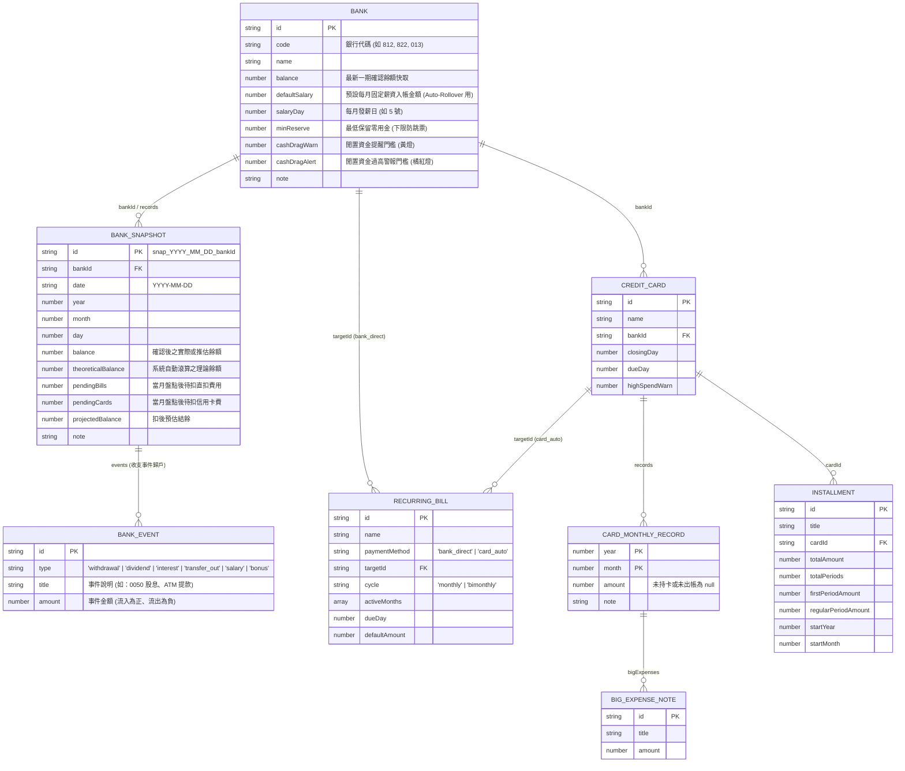

# PocketMoney 使用者體驗與介面設計規格書 (User Experience & UI Design, UXD)

## Revision (版本修訂紀錄)

| 版本 | 日期 | 修訂摘要 |
| :--- | :--- | :--- |
| **Rev 0.1** | 2026-10-29 | 初版建立：整合早期探索提案，制定「零 AI Slop」介面鐵律，定案「信用卡帳單輪播輸入」、「大額費用二階段翻面綁定」與「銀行餘額理論推算＋收支事件歸戶」流程。 |
| **Rev 0.2** | 2026-11-02 | 完成瀏覽視圖規格 ([`mockup_view.html`](file:///c:/Dev/wiskinglin.github.io/_dev/PocketMoney/mockup_view.html)) 與三組模擬資料庫 ([`database/dummy_db_*.json`](file:///c:/Dev/wiskinglin.github.io/_dev/PocketMoney/database/))：定案四大分頁「頂部 3 KPI ＋ 12 個月雙模式折線圖 ＋ 底部明細卡片」架構，並制定「近 12 個月 vs. 當年度（未發生月份防誤解視覺區隔）」設計規範。 |
| **Rev 0.3** | 2026-11-02 | 增補市售手機螢幕解析度規格（邏輯視窗 CSS Pixels vs. 物理像素）、主流裝置對照矩陣，制定行動端安全最小寬度（360px ~ 375px）、RWD 排版斷點與單手拇指操作熱區（Thumb Zone）設計規範。 |

---

## 第零章：文件與 UI 實作鐵律（Zero-Slop UI & Documentation Rules）

為防止文件中的架構解釋或開發備註滲透至最終產品介面，所有 AI Agent 與開發者在撰寫規格、製作 Mockup 或實作 HTML 時，必須嚴格遵守以下規範：

### 0.1 強制區分 `【設計邏輯】` 與 `【UI 實際文字】`
- **`【設計邏輯 (Design Logic)】`**：僅供開發者理解業務規則、計算公式與狀態條件，**嚴禁渲染至 HTML DOM 中**。
- **`【UI 實際文字 (Exact UI Copy)】`**：明確列於規格書「B. 介面文字清單」內的字串。**只有被定義為 `UI 實際文字` 的字串才允許出現在畫面上**。

### 0.2 三條「零 AI Slop」介面鐵律
1. **禁用版本與開發標籤**：
   - 畫面上禁止出現 `✨ NEW v4`、`PC 版 UI Mockup`、`PoC`、`Beta`、`v4 新介面` 等開發過程標籤。
2. **禁用架構術語作為介面標題**：
   - 禁止在畫面上使用 `跨日快照矩陣`、`信用卡年度帳單矩陣 (5~10號收單...)`、`存量斷言`、`雙軌分流` 等內部設計詞彙。
   - 真實產品標題僅使用簡潔名詞：**`銀行餘額`**、**`信用卡費`**、**`固定費用`**、**`分期付款`**、**`台股部位`**。
3. **禁止整排教學式副標題**：
   - 禁止在頁面或表格上方印出操作說明書（例如：`點擊任一金額可直接原地修改；滑鼠移過右上角...`）。
   - 介面互動應透過游標狀態（`cursor: pointer` / `text`）、Hover 高亮、Focus 邊框與直覺按鈕傳達，不依賴文字解釋。

---

## 第一章：真實使用情境與純動作流程 (User Action Flows)

### 1.1 每月財務週期事件表

系統針對以「月」為週期的個人資金盤點與扣繳檢核設計，每月的實際金融事件時序如下：

| 時間區間 | 事件類型 | 實際發生內容 | 資金扣款路徑 |
| :--- | :--- | :--- | :--- |
| **每月 5 號 ～ 10 號** | 信用卡出帳 | 各家銀行陸續寄發信用卡帳單，10 號前收齊當月應繳總額。 | 將於 20～30 號從各卡綁定的同名銀行帳戶自動扣款。 |
| **每月 10 號** | 房租扣款 | 固定於 10 號當日由指定銀行帳戶自動轉帳。 | 銀行帳戶直接扣款 (`bank_direct`)。 |
| **每月 10 號 ～ 19 號** | 餘額盤點與資金調度 | 盤點各銀行帳戶餘額，檢核是否足以支付 20～30 號卡費與 28 號車貸；若有不足則跨行轉帳補足，若有過多閒置資金則評估轉投資。 | 跨銀行帳戶轉帳。 |
| **每月 20 號 ～ 30 號** | 信用卡自動扣繳 | 各家信用卡依扣款日（20～30 號）從綁定銀行帳戶扣款。 | 銀行帳戶自動扣繳。 |
| **帳單截止日前 (如 21 號)** | 公用事業費代繳 | 水電、瓦斯、網路費透過信用卡刷卡代繳。 | 併入信用卡下期（次月 5 號）帳單，不直接扣減當月銀行餘額 (`card_auto`)。 |
| **每月 28 號** | 車貸扣款 | 固定於 28 號當日由指定銀行帳戶自動扣款。 | 銀行帳戶直接扣款 (`bank_direct`)。 |

---

### 1.2 核心使用者動作流程 (Action Flows)

> **一致性原則**：本節記錄已定案之「輸入視圖 (`mockup_input.html`)」與「瀏覽視圖 (`mockup_view.html`)」動作流程，並與第三章 UI 規格完全同步。

#### 流程一：每月收齊信用卡帳單並輸入（輸入與瀏覽分離）
| 步驟 | 觸發時機 (Trigger) | 使用者動作 (User Action) | 系統計算邏輯 (System Logic) | 畫面變化 (UI State Change) |
| :--- | :--- | :--- | :--- | :--- |
| **1. 第一階段：輪播輸入每月卡費總額** | 每月 5～10 號收到帳單，進入「卡片輪播輸入模式」 | 針對畫面中央聚焦顯示之「本月尚未輸入」信用卡，輸入當月帳單總額並按 `Enter` | 將金額寫入該卡當月紀錄 `records[{year, month, amount}]`，並將該卡標記為本月已輸入，篩選下一張未輸入卡片 | 當前信用卡面滑入歸檔，自動滑出下一張尚未輸入的信用卡面（不中斷輸入總額節奏） |
| **2. 第二階段：逐張翻面確認並綁定大額費用** | 第一階段全數卡片總額輸入完畢後，自動進入第二階段 | 針對翻面聚焦之卡片（系統優先排列本月金額較高之卡片），輸入大額消費項目名稱與金額（或略過無大額之卡片） | 將大額明細直接寫入該卡當月之 `bigExpenses` 陣列完成綁定（僅作結構拆解註解，不重複累加帳單總額） | 卡片翻轉至背面大額輸入區，確認後滑入歸檔並切換至下一張待確認卡片，全部確認完畢後播放完成動畫 |

#### 流程二：瀏覽信用卡費與大額明細（`信用卡費` 瀏覽視圖）
| 步驟 | 觸發時機 (Trigger) | 使用者動作 (User Action) | 系統計算邏輯 (System Logic) | 畫面變化 (UI State Change) |
| :--- | :--- | :--- | :--- | :--- |
| **1. 檢視全卡帳單 KPI 與 12 個月折線圖** | 點擊頂部導覽列 `信用卡費` | 瀏覽頂部 3 張 KPI 卡（本月總計、12 個月累計、有效月平均）與中間 12 個月折線圖 | 依當前時間軸模式（預設 `近 12 個月` 或 `當年度`）彙整各卡 `records`，排除 `amount === null` 計算有效月平均 | 渲染頂部 3 張 KPI 卡、中央全卡總額與各卡分線折線圖、底部各卡大額明細卡片 |
| **2. 切換時間區間或篩選單一信用卡** | 點擊圖表左上角 `[近 12 個月]` / `[當年度]` 或右上角信用卡膠囊標籤 | 切換連續 12 個月或當年度 1～12 月視角；或點擊特定信用卡膠囊（如 `國泰 CUBE 卡`） | 若切為 `當年度`，已發生月份畫實線，未出帳月份設為 `null` 並以有效月均畫虛線延伸；若點選單卡則僅篩選該卡折線與下方明細卡 | 折線圖動態重繪（`當年度` 模式下未發生月份顯示淡色背景區隔與虛線空心點），下方明細區同步過濾 |

#### 流程三：盤點銀行餘額與歸戶收支事件（輸入與瀏覽分離）
| 步驟 | 觸發時機 (Trigger) | 使用者動作 (User Action) | 系統計算邏輯 (System Logic) | 畫面變化 (UI State Change) |
| :--- | :--- | :--- | :--- | :--- |
| **0. 月度自動滾算 (Auto-Rollover)** | 每月初或開啟盤點時自動觸發 | 無需手動操作（系統自動預先試算） | 依各銀行上次餘額，自動加計設定之「固定薪資入帳」，並扣除已發生之「上月綁定卡費」與「固定房租/車貸」，算出今日理論餘額 | 各銀行卡片預先帶入系統算出的「今日推估餘額」與計算公式明細 |
| **1. 第一階段：輪播確認 / 輸入銀行餘額** | 點擊「新增銀行盤點」進入銀行輪播模式 | 逐一檢視各家銀行卡面：若為無日常進出的純扣款戶，直接點 `[推估無誤]`（或按 `Enter`）；若有日常領錢/買賣股票，則輸入網銀實際餘額 | 將確認後之餘額寫入該銀行當日快照 `records[{year, month, day, balance}]` 與 `bankSnapshots`，並更新 `bank.balance` | 當前銀行卡面滑入歸檔，自動滑出下一家銀行卡面 |
| **2. 第二階段：銀行收支事件歸戶** | 完成銀行餘額輪播確認後（或餘額與推估值有差額時） | 比照信用卡大額費用模式，逐張或針對有變動的銀行輸入重大收支事件（類型：`提款`、`股利收入`、`利息收入`、`轉帳支出`、`薪資收入`、`獎金收入`）與金額 | 將收支事件寫入該銀行當期快照之 `events` 陣列，直接歸戶綁定至該銀行 | 事件標籤掛載至對應銀行紀錄下，完成盤點動畫 |

#### 流程四：瀏覽銀行餘額與扣款水位檢核（`銀行餘額` 瀏覽視圖）
| 步驟 | 觸發時機 (Trigger) | 使用者動作 (User Action) | 系統計算邏輯 (System Logic) | 畫面變化 (UI State Change) |
| :--- | :--- | :--- | :--- | :--- |
| **1. 檢視全行資金 KPI 與 12 個月水位折線圖** | 點擊頂部導覽列 `銀行餘額`（預設首頁視圖） | 檢視「銀行總餘額」、「本月待扣總額」、「扣後預估結餘」3 大 KPI 與 12 個月存量折線圖 | 讀取 `bankSnapshots` 按月繪製全行總餘額與各行水位折線；下方各銀行卡片比對 `projectedBalance` 與 `minReserve` / `cashDragWarn` / `cashDragAlert` | 頂部顯示總存量與待扣流量，中間顯示 12 個月折線圖，下方每家銀行卡片顯示水位燈號、設定門檻與當月歸戶收支事件 |
| **2. 切換單一銀行檢視「實際餘額 vs. 自動滾算理論餘額」** | 點擊圖表右上角特定銀行膠囊（如 `中信台幣`）或左上角 `[當年度]` | 對比單一銀行的實際餘額實線與系統自動滾算理論餘額虛線 | 取出指定 `bankId` 之 12 個月 `balance` 與 `theoreticalBalance`；於 `當年度` 模式下，未發生月份依 `+defaultSalary -直扣費用 -綁定卡費月均` 自動滾算推估虛線 | 折線圖聚焦顯示該銀行之實際存量線與理論推估虛線，下方僅顯示該銀行之詳細水位卡與收支事件清單 |

#### 流程五：瀏覽固定費用與分期付款（`固定費用` / `分期付款` 瀏覽視圖）
| 步驟 | 觸發時機 (Trigger) | 使用者動作 (User Action) | 系統計算邏輯 (System Logic) | 畫面變化 (UI State Change) |
| :--- | :--- | :--- | :--- | :--- |
| **1. 瀏覽固定費用雙軌分流折線圖** | 點擊頂部導覽列 `固定費用` | 檢視本月固定費用總額、「銀行直接扣款 (`bank_direct`)」與「信用卡代繳 (`card_auto`)」分流 KPI 及 12 個月折線圖 | 依 `activeMonths` 計算各月單雙月帳單落點；`當年度` 模式下未發生月份自動轉為虛線＋空心點代表契約預定扣款 | 圖表清楚呈現單雙月電費/水瓦斯造成的波峰波谷，下方卡片列出每筆費用的扣款管道、綁定對象與扣款日 |
| **2. 瀏覽分期付款月負擔退坡折線圖** | 點擊頂部導覽列 `分期付款` | 檢視本月應繳分期、剩餘未繳尾款、進行中筆數 KPI，以及 12 個月分期攤提現金流折線圖 | 依 `startYear`、`startMonth` 與 `totalPeriods` 自動推算各月有效分期總額，視覺化未來哪一個月分期到期後現金流負擔會下降 | 折線圖呈現未來月份隨分期結清而階梯式下降的趨勢，下方卡片顯示各筆分期進度條、當前期數與剩餘尾款 |

---

### 1.3 v3 升級至 v4 的核心功能差異

| 項目 | v3 現況 | v4 規格調整 |
| :--- | :--- | :--- |
| **輸入與瀏覽分離** | 瀏覽資訊與輸入框混在同一個畫面，視覺與操作互相干擾。 | 將「輸入流程（[`mockup_input.html`](file:///c:/Dev/wiskinglin.github.io/_dev/PocketMoney/mockup_input.html) 卡片輪播輸入）」與「瀏覽分析視圖（[`mockup_view.html`](file:///c:/Dev/wiskinglin.github.io/_dev/PocketMoney/mockup_view.html) 12 個月折線圖＋明細卡）」徹底切開。 |
| **銀行餘額智慧推算與收支事件** | 每次盤點需手動重填所有銀行餘額，且無法記錄餘額增減原因。 | 內建「月度自動滾算（＋薪資－卡費－固定貸款）」，盤點時可一鍵確認推估餘額；並支援將「提款、股利、利息、轉帳、薪資、獎金」等收支事件歸戶至對應銀行。 |
| **時間維度與雙模式 12 個月圖表** | 僅儲存單一當期數值 (`statementTotal` / `balance`)，換月重置會覆蓋舊資料。 | 儲存跨年連續時序紀錄；圖表支援 **`[近 12 個月]`（預設，連續 12 個已發生月）** 與 **`[當年度]`（1～12 月，未發生月份以背景區隔＋虛線空心點防誤解呈現）** 雙模式切換。 |
| **繳費狀態管理** | 需手動點擊「標記已繳 (`paid=true`)」與「新月份重置 (`paid=false`)」。 | 移除手動繳費狀態切換。帳單與固定費用依日期（10 號房租、20~30 號卡費、28 號車貸）自動判定當月待扣金額。 |
| **固定費用扣款路徑** | 所有固定費用皆綁定銀行扣款，導致刷卡代繳的水電費與信用卡帳單重複扣減銀行餘額。 | 區分為 `bank_direct`（房租、車貸，計入銀行待扣）與 `card_auto`（水電、瓦斯、網路，刷卡代繳不重複扣減銀行餘額）。 |
| **銀行水位檢核** | 僅檢核餘額不足（`< 0`）。 | 雙向檢核：下限檢核「低於保留金 (`minReserve`)」，上限檢核「閒置資金提醒 (`cashDragWarn`) / 閒置過高警報 (`cashDragAlert`)」。 |
| **有效月平均計算** | 無歷史月份統計。 | 區分 `0`（有持卡刷 0 元，計入分母）與 `null`（未持卡/未出帳，不計入分母）。 |

---

## 第二章：參考架構與歷史提案取捨紀錄 (Architecture Decisions)

### 2.1 開源財務系統設計借鏡
1. **Beancount（存量斷言 `balance` directive）**：銀行餘額採用「不定期日期存量快照（Date-Point Snapshot）」，不強制記錄每日收支流水。
2. **Actual Budget（支付路由 Payment Routing）**：公用事業費刷信用卡時，負債歸入信用卡帳單，不直接扣減銀行活存。
3. **Firefly III / Maybe（主檔與時序分離）**：銀行與信用卡主檔僅存名稱、綁定關係與風控門檻；金額數據存放於以數值時間 `(year, month, day)` 索引的子陣列與扁平快照表中。

### 2.2 內部探索提案取捨總結
1. **[`PocketMoneyObjects.md`](file:///c:/Dev/wiskinglin.github.io/_dev/PocketMoney/archive/PocketMoneyObjects.md)**：
   - **保留**：信用卡 `closingDay`（結帳日）與 `dueDay`（扣款日）；分期付款首期含餘數 (`firstPeriodAmount`) 與續期金額 (`regularPeriodAmount`)；銀行水位門檻。
   - **捨棄**：逐日 `CashflowEvent` 事件流引擎（改以月度帳單與不定期銀行快照取代）。
2. **[`SUB_DATABASE_STOCK_FLOW_PROPOSAL.md`](file:///c:/Dev/wiskinglin.github.io/_dev/PocketMoney/archive/SUB_DATABASE_STOCK_FLOW_PROPOSAL.md)**：
   - **保留**：銀行餘額為存量（Stock，`YYYY-MM-DD`）、信用卡帳單為流量（Flow，`YYYY-MM`）的粒度分離架構。
   - **捨棄**：歷史紀錄中的 `paid: boolean` 與雙向交易外鍵 `bankLedgerEntryId`。
3. **[`TIMELINE_DATA_PROPOSAL.md`](file:///c:/Dev/wiskinglin.github.io/_dev/PocketMoney/archive/TIMELINE_DATA_PROPOSAL.md)**：
   - **保留**：分期付款記錄 `startYear / startMonth` 以自動推算各月期數與未來月份負擔。
   - **修正**：時間索引改為結構化數值 (`year: number, month: number, day?: number`)，並於頂層提供 `bankSnapshots` 扁平陣列以供前端折線圖直接按月聚合。

---

## 第三章：UI 視圖標準規格 (UI View Specifications)

> **說明**：本章節完整定義「輸入視圖 ([`mockup_input.html`](file:///c:/Dev/wiskinglin.github.io/_dev/PocketMoney/mockup_input.html))」與「瀏覽視圖 ([`mockup_view.html`](file:///c:/Dev/wiskinglin.github.io/_dev/PocketMoney/mockup_view.html))」之介面設計與互動規範。

---

### 3.1 信用卡每月帳單輸入 UI (Credit Card Monthly Input) — 【已定案】

#### 正式採納方案
- **方案 1：【卡片輪播焦點模式 (Cover Flow / Netflix 式)】**
  畫面中央只聚焦放大「本月尚未輸入」的實體信用卡面，打完金額按 `Enter` 卡面自動滑入歸檔並滑出下一張未填卡，全數填完即進入第二階段。

#### 未來備案（完整保留供後續演進參考）
- **備案 2：【待辦收件匣清零模式 (Inbox Zero 待處理佇列)】**
- **備案 3：【單月對帳單面板 (Monthly Focus Sheet)】**
- **備案 4：【PDF 帳單拖曳匯入 + 卡片確認流 (Dropzone & Review Cards)】**

---

### 3.2 大額費用輸入與綁定 UI (Big Expenses Input & Card Binding) — 【已定案】

#### 正式採納方案
- **方案 1：【兩階段輪播：先全數輸完總額 ➔ 第二階段逐張確認大額】**
  第一輪專心把所有卡片的帳單總額快速打完（不中斷節奏）；全數輸完後自動進入第二階段，畫面將剛才輸入的卡片（優先排高金額卡）逐張翻面，讓你填入大額費用並直接綁定該卡。

#### 未來備案（完整保留供後續演進參考）
- **備案 2：【獨立「大額費用」管理清單（比照固定費用模式）】**
- **備案 3：【總額輸完後的「全卡對帳桌面」(Post-Input Card Board)】**

---

### 3.3 信用卡費瀏覽 UI (Credit Card Browse View) — 【已定案：`mockup_view.html`】

當使用者於瀏覽視圖點擊頂部導覽按鈕 **`信用卡費`** 時，畫面採用「**頂部 3 KPI 摘要卡 ＋ 中間 12 個月雙模式趨勢折線圖 ＋ 底部各卡明細卡片**」三層結構：

1. **頂部三大 KPI 金額摘要卡**：
   - **`本月信用卡費總計`**：彙整當月所有信用卡應繳總額。
   - **`近 12 個月累計總額` / `當年度累計總額`**：隨圖表左上角時間區間模式同步切換計算範圍。
   - **`有效月平均`**：排除未持卡月份 (`amount === null`) 後之真實月均刷卡金額，並附註本月包含幾筆大額消費。
2. **中間 12 個月折線圖與單卡篩選膠囊**：
   - 左上角提供 **`[近 12 個月]`** 與 **`[當年度]`** 雙模式切換按鈕（詳見 3.7 節）。
   - 右上角提供 **`[全部信用卡]`** 與各張信用卡名稱之膠囊篩選器：
     - 點選 **`[全部信用卡]`**：主線（加粗帶底色面積）繪製「已出帳卡費總額」，同時疊加各張信用卡的獨立折線，一眼看出哪個月份是哪一張卡拉高了總開銷。
     - 點選**單一信用卡膠囊**：折線圖與下方明細卡片同步過濾，僅聚焦呈現該卡之 12 個月帳單走勢。
3. **底部各信用卡統計與當月大額消費明細卡**：
   - 每張信用卡獨立一張雙欄卡片，顯示：
     - **標頭**：卡片名稱、綁定扣款銀行、每月扣款日 (`dueDay`) 與結帳日 (`closingDay`)、本月帳單金額徽章。
     - **三格統計列**：`累計總額`、`有效月平均 (N個月)`、`高額警戒線 (highSpendWarn)`。
     - **本月大額消費明細**：列出掛載於該卡當月 `bigExpenses` 之項目名稱與金額。

---

### 3.4 銀行餘額輸入與收支事件歸戶 UI (Bank Balances Input & Cashflow Events) — 【已定案】

#### 正式採納方案（組合設計）
1. **基底互動 — 【全數銀行輪播模式（比照信用卡輪播）】**
   比照信用卡輪播模式，將各家銀行卡面逐一翻出進行餘額確認與輸入，完成後進入第二階段歸戶收支事件。
2. **智慧推算機制 A — 【薪資與固定收支「月度自動滾算引擎」(Auto-Rollover)】**
   設定薪轉戶每月固定入帳金額後，系統每月初自動替所有銀行結算「`+ 薪資` `- 上月卡費` `- 固定房租車貸`」，產生全自動的最新基準水位。
3. **智慧推算機制 B — 【系統自動推算「理論餘額」➔ 一鍵確認 / 僅改差額】**
   系統自動算出每家銀行的**今日推估餘額**；無需登入那些純扣款網銀，直接點 `[推估無誤]` 即可過關，只需針對有日常領錢的主力戶輸入真實餘額。

4. **收支事件歸戶 — 【銀行收支事件綁定（比照信用卡大額費用模式）】**
   當發生特定資金變動事件（包含：**`提款`**、**`股利收入`**、**`利息收入`**、**`轉帳支出`**、**`薪資收入`**、**`獎金收入`**）時，於銀行餘額輪播確認後（第二階段）填入事件類別、說明與金額，直接歸戶綁定至該銀行帳戶。

---

### 3.5 銀行餘額瀏覽與水位檢核 UI (Bank Balances Browse View) — 【已定案：`mockup_view.html`】

當使用者點擊頂部導覽按鈕 **`銀行餘額`** 時，畫面呈現全行與個別銀行的存量變化、待扣流量及風控門檻檢核：

1. **頂部三大 KPI 金額摘要卡**：
   - **`銀行總餘額`**：當月全數銀行實際確認存量加總（綠色高亮）。
   - **`本月待扣總額`**：月底前尚未到期的綁定信用卡費 (`pendingCards`) ＋ 銀行直扣固定費用 (`pendingBills`) 總和（紅色負項提示）。
   - **`扣後預估結餘`**：`銀行總餘額 - 本月待扣總額`，反映月底扣繳完畢後的真實安全可用資金。
2. **中間 12 個月銀行餘額折線圖與銀行篩選膠囊**：
   - 右上角提供 **`[全部銀行]`** 與各家銀行名稱之膠囊切換按鈕：
     - 點選 **`[全部銀行]`**：顯示「實際總餘額」主折線，並疊加各家銀行分線（讓使用者同時看見總資產趨勢與各帳戶消長）。
     - 點選**單一銀行膠囊**：同時繪製 **`實際餘額`（實線）** 與 **`系統自動滾算理論餘額`（黃色虛線）**，兩線偏離處即代表該月發生了額外提款、獎金或股息入帳。
3. **底部各銀行水位檢核與收支事件卡片**：
   - 每家銀行卡片包含四個核心資訊區塊：
     - **標頭與水位狀態徽章**：依據 `扣後預估結餘 (projectedBalance)` 對比三個風控設定值，自動顯示四態徽章：
       1. `低於保留金 (NT$ minReserve)`（紅燈 `nord-11`）：提醒需跨行轉帳補錢防跳票。
       2. `水位正常`（綠燈 `nord-14`）：介於 `minReserve` 與 `cashDragWarn` 之間。
       3. `閒置資金提醒 (>NT$ cashDragWarn)`（黃燈 `nord-13`）：活存偏高，可考慮轉投資。
       4. `閒置過高警報 (>NT$ cashDragAlert)`（橘紅燈 `nord-12`）：嚴重 Cash Drag，強烈建議調度配置。
     - **存量與待扣三欄小計**：並排顯示 `目前餘額`、`本月待扣`、`扣後預估`。
     - **帳戶規則參數膠囊**：顯示 `每月 D 號薪資 +$defaultSalary`、`保留金 $minReserve`、`閒置門檻 $cashDragWarn / $cashDragAlert`。
     - **本月收支事件清單**：列出當期歸戶之 `BANK_EVENT` 明細（正向流入為綠字 `+NT$`，負向流出為紅字 `-NT$`）。

---

### 3.6 固定費用與分期付款瀏覽 UI (`固定費用` / `分期付款` Browse Views) — 【已定案：`mockup_view.html`】

1. **`固定費用` 瀏覽視圖**：
   - **頂部三大 KPI**：`本月固定費用總計`、`銀行直接扣款`（計入銀行待扣）、`信用卡代繳`（併入下期卡費，不重複扣減銀行餘額）。
   - **中間 12 個月折線圖**：同時繪製「固定費用總額」、「銀行直扣」、「信用卡代扣」三條 12 個月趨勢線，清楚呈現雙月電費、水瓦斯在單雙月造成的階梯起伏。
   - **底部費用明細卡片**：列出各筆固定費用的名稱、扣款路徑標籤（`銀行直扣 ➔ 銀行名` 或 `信用卡代繳 ➔ 卡名`）、每月扣款日、金額與單雙月生效月份。
2. **`分期付款` 瀏覽視圖**：
   - **頂部三大 KPI**：`本月應繳分期總額`、`剩餘未繳尾款`、`進行中分期筆數`。
   - **中間 12 個月折線圖**：繪製 12 個月的「每月分期攤提總額」折線，直觀呈現未來哪一個月分期結束後每月固定負擔將下降。
   - **底部進度明細卡片**：每筆分期顯示項目名稱、綁定信用卡與起算年月、`第 n / N 期` 徽章、視覺化進度條，以及 `每期應繳`、`總額`、`剩餘尾款 (剩餘期數)`。

---

### 3.7 圖表 12 個月雙模式時間軸與「未發生月份」防誤解設計規範

所有瀏覽分頁（`銀行餘額`、`信用卡費`、`固定費用`、`分期付款`）之折線圖，X 軸一律固定為 **12 個月份刻度**，並在圖表卡片左上方提供兩個模式切換按鈕：

| 模式按鈕 | 座標範圍範例（以基準月 `2026/10` 為例） | 適用情境与設計特性 |
| :--- | :--- | :--- |
| **`[近 12 個月]`（預設）** | `25/11`、`25/12`、`26/01` ～ `26/10` | **連續 12 個已發生月份（Rolling 12 Months）**：12 個節點全數為真實已發生數據，折線完整連續，解決每年 1～3 月時「當年度只有一兩個點、圖表空白無法看趨勢」的痛點。 |
| **`[當年度]`** | `1月` ～ `10月`、`11月 (未發生)`、`12月 (未發生)` | **當年度 1～12 月視角（Year-to-Date + Forecast）**：檢視今年度截至目前（10 月）的累積變化與年底前（11、12 月）的推估走向。 |

#### 針對 `[當年度]` 模式下「未發生月份（如 11 月、12 月）」的四重防誤解規範：
1. **嚴禁將未發生月份填 `0`**：
   - 若將尚未出帳或尚未盤點的 11、12 月數值填為 `0`，折線會在 11 月垂直暴跌至 0，造成使用者誤以為「資產歸零」或「11 月免繳卡費」。因此**未發生月份的「實際數據陣列」必須設為 `null`（實線嚴格停在當前月份 10 月）**。
2. **背景分界虛線與淡色推估區間（Future Zone Shading）**：
   - 在當前月份（`10月`）與下一個未發生月份（`11月`）之間繪製垂直黃色分界虛線，並將 `11月 ~ 12月` 的圖表背景鋪上淡冷灰半透明底色，右上角明確標示 **`未發生月份 (推估區間)`**，X 軸刻度文字亦改為琥珀黃色 `11月 (未發生)`、`12月 (未發生)`。
3. **實線（已發生實績）vs. 虛線＋空心圓點（未發生推估）視覺分離**：
   - **已發生月份（1～10 月）**：一律使用**實線＋實心圓點**。
   - **未發生月份（11～12 月）**：一律切換為**虛線 (`borderDash`) ＋ 空心圓點 (`pointBackgroundColor: '#242933'`)**：
     - 於 `銀行餘額`：依 10 月實際餘額往後自動滾算（`+預設薪資 -直扣固定費用 -綁定卡費有效月均`）繪製推估虛線。
     - 於 `信用卡費`：依各卡「有效月平均」繪製常態推估虛線。
     - 於 `固定費用` 與 `分期付款`：依已知契約扣款月份與剩餘分期期數繪製待扣虛線。
4. **Tooltip 強制標註「尚未發生 / 推估」狀態**：
   - 當滑鼠移至 1～10 月時，Tooltip 標題顯示 `2026年 10月 (已發生)`；移至 11、12 月時，Tooltip 標題強制顯示 **`2026年 11月 — 尚未發生 (推估預覽)`**，且金額後方加上 `(推估)` 後綴。

---

## 第四章：資料模型與計算邏輯 (Data Schema & Computation Rules)

### 4.1 實體關係圖與雙軌快照結構 (ER Diagram)

為同時支援「單一銀行歷史查詢 (`bank.records`)」與「前端跨銀行 12 個月折線圖快速聚合 (`bankSnapshots`)」，v4 資料庫在頂層提供對齊日期的扁平表 `BANK_SNAPSHOT`：

### 4.2 核心計算公式

1. **信用卡累計總額與有效月平均（支援 `rolling12` 與 `ytd` 區間 $S$）**：
   - 區間總計：
     $$PeriodTotal(c, S) = \sum_{r \in c.records, (r.year, r.month) \in S, r.amount \neq null} r.amount$$
   - 有效持卡月數（`amount === 0` 計入分母，`amount === null` 未持卡或未出帳不計入分母）：
     $$ActiveMonths(c, S) = \text{count}(r \in c.records \mid (r.year, r.month) \in S \land r.amount \neq null)$$
   - 有效月平均：
     $$MonthlyAvg(c, S) = \begin{cases} \mathrm{round}\left(\frac{PeriodTotal(c, S)}{ActiveMonths(c, S)}\right) & \text{if } ActiveMonths > 0 \\ 0 & \text{otherwise} \end{cases}$$

2. **銀行待扣總額、扣後預估結餘與四段水位判定**：
   - 設該銀行於當月最新盤點日為 $D_{snap}$：
   - 尚未扣款之銀行直扣固定費用：
     $$PendingBills(B_i) = \sum_{b \in Bills, b.paymentMethod = 'bank\_direct', b.targetId = B_i.id, b.dueDay > D_{snap}} b.defaultAmount$$
   - 尚未扣款之綁定信用卡費：
     $$PendingCards(B_i) = \sum_{c \in Cards, c.bankId = B_i.id, c.dueDay > D_{snap}} c.currentMonthAmount$$
   - 扣後預估結餘：
     $$ProjectedBalance(B_i) = B_i.balance - (PendingBills(B_i) + PendingCards(B_i))$$
   - 水位燈號判定：
     $$Status(B_i) = \begin{cases} \text{LOW\_RESERVE (紅燈)} & \text{if } ProjectedBalance(B_i) < B_i.minReserve \\ \text{CASH\_DRAG\_ALERT (橘紅燈)} & \text{if } ProjectedBalance(B_i) \ge B_i.cashDragAlert \\ \text{CASH\_DRAG\_WARN (黃燈)} & \text{if } ProjectedBalance(B_i) \ge B_i.cashDragWarn \\ \text{NORMAL (綠燈)} & \text{otherwise} \end{cases}$$

3. **未發生月份（$m > M_{\text{current}}$）之銀行餘額自動滾算推估公式**：
   - 在 `[當年度]` 模式下，針對尚未發生的月份 $m \in \{11, 12\}$，以當前月份確認餘額 $B_i.\text{balance}$ 為起點逐月遞推：
     $$\widehat{Balance}(B_i, m) = \widehat{Balance}(B_i, m-1) + B_i.defaultSalary - \sum_{\substack{b \in Bills \\ b.targetId = B_i.id \\ m \in b.activeMonths}} b.defaultAmount - \sum_{\substack{c \in Cards \\ c.bankId = B_i.id}} MonthlyAvg(c)$$

4. **分期付款目標年月期數自動推算**：
   - 對於目標年月 $(Y, M)$：
     $$PeriodIndex(Y, M) = (Y - startYear) \times 12 + (M - startMonth) + 1$$
   - 若 $1 \le PeriodIndex \le totalPeriods$，則該分期於 $(Y, M)$ 生效（第 1 期金額為 `firstPeriodAmount`，第 2 期起為 `regularPeriodAmount`）。

---

### 4.3 模擬資料庫檔案清單 (`pocketmoney/database/`)

為供前端開發與測試驗證，`pocketmoney/database/` 目錄下內建三組涵蓋完整 12 個月（`2025-11` ～ `2026-10`）歷史時序之標準 JSON 資料庫：

1. **[`scenario_1_junior_installments.json`](../database/scenario_1_junior_installments.json)**：**初級大人**（`<30` 歲小資族，1 銀行＋1 信用卡＋套房房租與 iPhone 分期＋0050 定期定額）。
2. **[`scenario_2_sandwich_mortgage.json`](../database/scenario_2_sandwich_mortgage.json)**：**少子化勇者**（`30-40` 歲家庭用戶，3 銀行專戶＋2 家庭卡＋房貸托育雙月水電＋權值股與高股息配置）。
3. **[`scenario_3_stock_investor.json`](../database/scenario_3_stock_investor.json)**：**高級大人**（`40+` 歲高資產族群，5 大多幣專戶＋3 頂級卡＋豪宅置產與千萬級股債配置）。

---

## 第五章：行動端（Mobile）螢幕解析度與 RWD 響應式設計標準 (Mobile Viewport & Responsive Standards)

為確保 PocketMoney 於各品牌行動裝置上均具備高度易讀性與流暢的單手操作體驗，前端開發與 Mockup 實作必須嚴格遵守本章之視窗解析度與響應式切版標準。

### 5.1 關鍵觀念：物理硬體解析度 vs. 前端邏輯視窗（CSS Viewport）

在行動端切版與 UI/UX 設計中，必須嚴格區分兩種解析度觀念：
- **物理硬體像素（Physical Pixels）**：手機硬體規格表所標示的物理發光點總數（如 1080×2400、1179×2556），主要影響螢幕顯示細緻度（PPI）。**前端 CSS 切版與排版佈局切勿直接使用物理像素**。
- **邏輯視窗像素（Logical CSS Viewport Pixels）**：瀏覽器用於 CSS 排版與 Media Query 判斷的基準單位。由物理像素除以設備像素比（Device Pixel Ratio, DPR, 如 @2x, @3x）換算而來。**所有斷點、容器寬度、字級與間距均以邏輯像素為唯一依據**。

---

### 5.2 市售主流手機螢幕解析度與邏輯視窗對照矩陣

依據當前全球與台灣市場主流銷售機種，整理前端切版必須涵蓋的解析度分佈：

| 裝置級別 | 代表機種 | 螢幕尺寸 | 物理解析度 (Physical) | 設備像素比 (DPR) | **前端 CSS 邏輯寬高 (Viewport)** | 切版定位與設計指導原則 |
| :--- | :--- | :---: | :---: | :---: | :---: | :--- |
| **小屏緊湊型** | iPhone SE (2/3代), iPhone 8 | 4.7 吋 | 750 × 1334 | @2x | **`375 × 667`** | **嚴苛極限底線**：字級縮放邊界，極易發生 Tab 擠壓，必須確保無橫向破版。 |
| **Android 小屏入門** | 三星 A 系列、舊款 Android | 5.5 ~ 6.1 吋 | 720 × 1600 (HD+) | @2.0x | **`360 × 800`** | **Android 最小安全寬度**：全站 CSS 佈局不得在寬度 $\le 360\text{px}$ 時產生非預期橫向滾動條。 |
| **主流標準旗艦 (市場最大宗)** | **iPhone 13 / 14 / 15 / 16** Galaxy S23 / S24 | 6.1 ~ 6.2 吋 | 1170 × 2532 1179 × 2556 1080 × 2340 | @3x | **`390 × 844` `393 × 852`** | **核心設計稿基準（Design Baseline）**：Figma 畫布與首要測試標準，涵蓋逾 60% 訪客。 |
| **主流 Android 旗艦** | Google Pixel 7 / 8 / 9 小米 14 / 15、OPPO Reno | 6.3 ~ 6.7 吋 | 1080 × 2400 (FHD+) 1220 × 2712 (1.5K) | @2.6x ~ @3x | **`412 × 915`** | **Android 現代標準視窗**：多數現代 Android 手機的標準排版寬度。 |
| **大屏旗艦 (Pro Max / Plus)** | iPhone 15 / 16 Pro Max Galaxy S24 Ultra | 6.7 ~ 6.9 吋 | 1290 × 2796 1440 × 3120 (QHD+) | @3x ~ @3.5x | **`430 × 932` `440 × 956`** | **大屏視野**：需注意文字行寬（Line-length），避免在大螢幕上單行過長導致閱讀疲勞。 |

---

### 5.3 PocketMoney 行動端切版三大規範

#### 1. 視窗安全邊界（Safety Width Boundaries）
- **絕對最小寬度（Hard Minimum Width）**：以 **`360px`** 為基準。在寬度 360px 視窗下，頁面內容必須保證自適應且不可出現水平破版或橫向滾動軸。
- **標準測試視窗（Standard Testing Viewport）**：開發與驗證時優先使用 **`375px`**（iPhone SE/Mini 邊界）與 **`390px / 393px`**（主流 iPhone 基準）。

#### 2. 單手操作拇指熱區（Thumb Zone & Bottom Navigation）
- **底部導覽（Bottom Bar）優先**：
  - 由於 6 吋以上手機普及，螢幕頂部為「單手難以觸及區（Hard-to-reach zone）」。
  - 核心頻繁動作（四大主分頁切換：信用卡費、銀行餘額、固定費用、分期付款）在行動端應移至螢幕下方常駐底部導覽列（高度 56px~64px，固定於 `bottom: 0`）。
  - 若保留頂部 Tab，則必須採用 **橫向滑動列（Scrollable Tabs）**，設定 `overflow-x: auto; flex-wrap: nowrap;`，嚴禁在小於 430px 時強制等寬換行壓扁文字。
- **觸控目標尺寸（Touch Target Size）**：
  - 所有具備點擊功能的按鈕、Tab、切換膠囊，點擊感應面積不得小於 **`44 × 44 px`**（符合 WCAG 2.1 AAA 規範），按鈕間保留至少 **`8px`** 安全間距，防止手指誤觸相鄰項目。

#### 3. 虛擬鍵盤適配與輸入體驗（Keyboard Optimization）
- **數值鍵盤直接喚起**：
  - 金額輸入框（信用卡帳單金額、銀行餘額、大額費用）嚴格標註 `type="text" inputmode="decimal"` 或 `type="tel"`，確保行動端直接彈出純數字九宮格鍵盤。
  - 隱藏 `<input type="number">` 原生上下調節箭頭（Stepper Spinners），避免佔用螢幕寬度。
- **浮動按鈕邊界隔離**：
  - 卡片切換輔助箭頭嚴禁懸浮覆蓋在卡片內部輸入框上；卡片應優先支援左右手勢滑動（Swipe Gesture）。

---

## 第六章：雙軌輸入流程規格 (Wizard Flow vs. One-Page Matrix)

為解決「新手初次進來面對空表單茫然」與「資深用戶頻繁記帳嫌繁瑣」的雙重矛盾，系統提供雙軌輸入流程：

### 6.1 新手逐步導覽 (Wizard Flow — 3 分鐘快速建立)
引導首次使用的訪客在 3 分鐘內完成基礎個人數據配置：
1. **步驟 1：帳戶初始化**：
   - 選擇或輸入常用活存銀行（如台新 Richart、國泰世華）。
   - 填寫當前真實餘額與最低保留安全水位（預設 20,000 元）。
2. **步驟 2：薪資與固定收入**：
   - 填寫每月實領月薪、固定發薪日（如每月 5 號或 25 號）。
   - 設定假日順延機制（提前週五發放或延後週一發放）。
3. **步驟 3：固定支出清單**：
   - 勾選或填寫房租、水電費、電信費、軟體訂閱。
   - 指定各費用扣款日與扣款方式（銀行直扣 vs 信用卡代繳）。
4. **步驟 4：信用卡與分期設定**：
   - 建立常用信用卡，輸入結帳日與約定扣款日。
   - 輸入最近一期帳單金額與現存未繳完之分期（總額、已繳期數、總期數）。
5. **步驟 5：證券交割與投資設定（可選）**：
   - 指定台股專用交割帳戶，並輸入主要持股或待交割款。

### 6.2 進階使用者快速矩陣 (One-Page Financial Ledger)
提供單頁集中式試算表介面，適用於熟練用戶每月定期調帳：
* **區塊 A：銀行帳戶矩陣**：支援快速鍵連續新增行，包含帳戶名稱、用途標籤、目前餘額、安全預備水位、薪資入帳標記。
* **區塊 B：信用卡與當前帳單狀態**：已出帳應繳、未出帳大額消費、展開式子表格直接編輯未結束分期清單。
* **區塊 C：固定收支週期表**：收支名稱、金額、頻率、下次扣款日、關聯管道。
* **區塊 D：投資庫存與在途交割款**：標的代號、股數、均價成本、T+1/T+2 待交割淨額。
* **一鍵衝突檢核 (Dry Run & Conflict Detection)**：
  - 點擊「儲存與試算」時，系統於背景進行模擬：
  - 自動檢核卡費扣款當日帳戶是否破底。
  - 自動計算 T+2 買進扣款與交割帳戶現額之差額。
  - 若發現潛在違約，彈出警告標記衝突點，經用戶確認後正式生效。

---

## 第七章：四大決策視角與異常處置閉環 (Decision Views & Resolution Loop)

### 7.1 視角 1：首頁－全域現金健康總覽 (Executive Summary)
* **頂部三大 KPI 卡**：
  * **總流動現金**：全帳戶即時可用餘額總和。
  * **本月真實 Safe-to-Spend**：當前到下個發薪日前，真正無後顧之憂的可支出額度。
  * **最低防禦水位指標**：近 30 天內最低水位預估日、預估最低金額與安全線缺口。
* **近 7 天資金動態待辦串流 (Next 7 Days Action Stream)**：
  * 按日期時間軸排列即將發生的事件（例如：「明日扣房租 $22,000」、「後天信用卡扣款 $15,800」）。
  * 標示扣款安全度：餘額充裕標記綠色打勾；不足則標記紅色警示並顯示缺額。

### 7.2 視角 2：時間軸日曆視圖 (Cashflow Calendar & Projection View)
* **未來 90 天現金走勢折線圖**：
  * X 軸為日期，Y 軸為總資金水位（支援單一銀行視角切換）。
  * 橫向固定一條灰色虛線為「安全水位臨界值」。低於安全水位處曲線自動轉為橘色；若餘額小於 0 則轉為紅色高亮。
* **互動日曆矩陣**：
  * 色彩標籤顯示每日金流事件：綠色（薪資/股息流入）、灰色（固定支出）、橘色（信用卡扣款）、藍色（T+2 證券交割）。
  * 點擊任一日期，抽屜展開當日明細與當日結餘。

### 7.3 視角 3：信用卡與分期負擔雷達 (Debt & Installment Radar)
* **資產與負債明確獨立**：嚴禁將存款與卡費負債混合相消。
* **未來 12 個月分期負擔直方圖**：堆疊柱狀圖顯示各月必須支付的分期總額，直觀展示哪個月分期結束（如第 4 個月後手機款結清）。
* **提前結清試算**：模擬若本期一次清償某筆分期，對未來 3 個月 Safe-to-Spend 的具體提升效果。

### 7.4 視角 4：證券交割與資產部位看板 (Portfolio & Settlement Radar)
* **T+2 交割安全水位儀與倒數**：
  * 即時比對交割帳戶餘額 vs T+1/T+2 待扣款。
  * 若餘額不足，觸發「交割保衛倒數」，提示在營業日 10:00 前自活存調撥之缺額。
* **除權息日曆**：標記確認之除權息日程，自動推估扣除二代健保補充費與匯費後之實收股利。

### 7.5 異常處置閉環 (Resolution Loop)
當系統偵測到任一未來日期出現透支（餘額小於 0）或低於安全防禦線時，主動彈出解法推薦面板：
* **解法 A：調撥資金排程**：系統計算自其他有充裕餘額之銀行轉出之最佳金額，支援一鍵加入備忘或日曆提醒。
* **解法 B：分期方案調整**：建議將即將產生之單筆大額刷卡改為分期，模擬拉長還款時間後的曲線變化。
* **解法 C：賣股因應**：試算若出脫部分持股，在 T+2 能否及時補足現金缺口。

---

## 第八章：Profile 切換器元件規格 (Demo Showcase & Multi-Profile Switcher)

### 8.1 頂部導航 Profile 切換選單
* **位置**：頂部 Navbar 右側（顯示目前帳本名稱與色標膠囊，例如 `[個人生活帳 ▼]`）。
* **互動機制**：
  * 點擊展開下拉選單，包含：
    * `切換帳本清單`：列出已建立之帳本（個人日常、家庭公費、工作室），右側顯示最後更新時間。
    * `示範情境區 (Demo Mode)`：【示範】小資多卡分期、【示範】家庭三明治開銷。
    * `＋ 新增帳本` 按鈕。
  * 切換時無須重新整理頁面，內部透過重新設定 `state` 與執行 `renderAll()` 進行即時切換。

### 8.2 教學示範模式標記與沙盒重置
* **示範專屬橫幅**：當處於示範 Profile 時，頁面頂部常駐淡藍色提示條：
  `💡 目前為【示範教學帳本】，資料僅供操作預覽，不影響您的真實資料。 [重置資料] [切換回我的帳本]`。
* **沙盒隔離**：示範模式下的新增/修改僅保存在臨時快取，點擊「重置資料」立即還原初始展示狀態。
