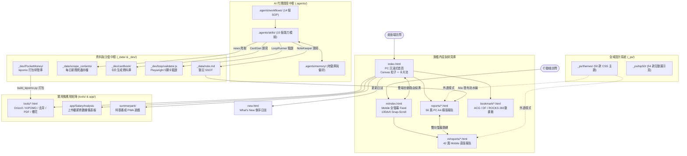

# KLIO 智能觀測站與前瞻技術展示平台 (wiskinglin.github.io)
# 全站目錄與工程資產完整盤點稽核報告

---

## 報告摘要與全貌總覽

- **專案名稱**：KLIO (Think Smart, Looks Amazing !)
- **託管平台**：GitHub Pages (`https://wiskinglin.github.io`)
- **核心定位**：個人前瞻技術智庫、AI Agentic 工作流落地實驗室、瀏覽器原生運算（Browser-Native / Local-First）實踐平台與個人數位花園。
- **盤點涵蓋範圍**：專案根目錄下全部 20 個功能資料夾及根目錄核心檔案、設定檔與版本控制歷程。
- **盤點方式**：透過 20 個獨立 Subagent 進行各目錄深度檢索、代碼解析、資產測量與跨目錄引用追蹤，並經獨立稽核 Agent 進行一致性審查。

### 全站資源規模統計

| 統計維度 | 統計數值 | 備註說明 |
| :--- | :--- | :--- |
| **頂層目錄數** | 20 個 | 包含公開頁面、內部研發沙盒、資料庫與代理系統 |
| **總檔案數量** | 約 980+ 個 | 實體總計 987 個檔案，涵蓋 HTML、CSS、JS、MD、Python、圖資等 |
| **主要前端技術** | 純原生 HTML5 / ES6 Modules / Tailwind CSS | 零構建打包（Zero-build）、隨處可跑（Buildless） |
| **旗艦深度報告** | 56 篇 (PC 橫版) + 42 篇 (Mobile 直版) | 跨 7 大主題領域，橫跨 4 個排版設計世代 |
| **微應用與小工具** | 11 個正式工具 + 54 個實驗性 App 原型 | 涵蓋 OrionX 硬體檢測、KIPOMO 現金流、WebGPU AI 等 |
| **核心設計系統** | 50 款 UX/UI 風格主題 (`_ps/themes/`) | 實現內容與排版完全解耦之 Design Tokens 體系 |
| **AI 代理中樞** | 15 個 Skills + 14 個 Workflows | 實現內容生成、多階段品質門檻（Gate）與自動部署 |

---

## 全站核心架構與資訊流向圖

---

## 各資料夾深度盤點詳細剖析

### 1. `.agents/` — AI 代理調度中心 (Agent Operating System)
- **統計資訊**：37 個目錄、120 個檔案。
- **模組架構**：
  1. `skills/`（15 個技能）：
     - `Brand`：品牌一致性萃取與 `/v1/` 隔離優化。
     - `CardGen` / `CardInspector`：卡片主圖 Prompt 生成與 G1~G5 五道品質檢驗。
     - `ContentEditor`：深度報告文字總編輯，執行 3000~5000 字審查與 14pt 字級調整。
     - `LoopRunner`：自動化品管迴圈，調用 Playwright 執行 5 項客觀關卡檢驗。
     - `news`：全球重點媒體頭條自動爬蟲與統整日報產出。
     - `NoteKeeper`：隨手筆記整理，按 ISO 週次置頂（Prepend）寫入 `_data/note.md`。
     - `reports`：深度報告自動發布，選定 50 UX 風格並同步注入 PC/Mobile 雙端首頁。
     - `UIArchitect`：依 EPDCA 流程執行專業介面診斷與系統化美學重構。
     - `SkillGenerator` / `SkillOptimizer`：Skill 腳手架建立與自我演化優化引擎。
     - `docx` / `pdf` / `pptx` / `xlsx`：專門處理 Office 檔案之專家工具庫（含 XML 解包校驗、LibreOffice 背景重算與 Poppler 縮圖生成）。
  2. `workflows/`（14 個標準工作流）：包含旗艦自動化 Pipeline `/klio`（筆記 $\to$ 報告發布 $\to$ 品管驗證 $\to$ 部署）、`/deploy`、`/note`、`/card`、`/news` 等。
  3. `memory/`：記錄團隊踩坑經驗與避雷手冊（`lessons_learned.md`）與全域偏好（`preferences.json`）。
  4. `sessions/`：支援跨 Agent 狀態交接之動態會話保存機制。
- **專案角色與依賴**：全站內容自動化生產、品管檢驗與部署之指揮大腦；發布流程中會在部署前將內部私密數據（`_data`）從 `main` 生產分支完全隔離。

---

### 2. `app/` — 獨立專題應用模組 (`SalaryAnalysis`)
- **統計資訊**：4 個子目錄、9 個檔案（總容量約 458 KB）。
- **核心內容**：完整自包含的上市櫃企業薪資數據分析系統。
  - `data/salary_median_7years_sorted.csv`：涵蓋數百家上市櫃公司民國 108~114 年跨 7 年完整薪資中位數與平均薪資。
  - `tools/process_scale_data.py`：Python 數據處理腳本（`pandas`, `scipy.stats`），按員工人數劃分 5 大規模級距並計算常態分佈理論曲線與統計分箱。
  - `dashboard/`：深色玻璃擬態儀表板（`index.html` 組織規模分佈直方圖、`trend.html` 個股趨勢圖與三大排行榜、`data.js` 前端靜態數據庫）。
- **專案角色與依賴**：完全解耦之資料科學展示專題，前端僅依賴 CDN Chart.js，離線即可秒級啟動。

---

### 3. `assets/` — 焦點報告首頁展示資產
- **統計資訊**：1 個子目錄、1 個圖檔（`assets/images/techorange_ai_agents.jpg`，1.21 MB）。
- **核心內容與用途**：
  - 由 `/klio` 自動發布科技新聞報告（NVIDIA 收購 Hugging Face 傳聞）時建立。
  - 被桌面版首頁 `index.html`（第 311 行）與行動版首頁 `m/index.html`（第 160 行）作為置頂最新焦點報告卡片（Editorial Card）的滿版視覺背景圖。
- **專案角色與依賴**：雙端首頁卡片強依賴之視覺資源。

---

### 4. `bookmark/` — 三大主題沉浸式書籤導航庫
- **統計資訊**：0 個子目錄、3 個 HTML 檔案（約 200 KB、3,858 行，收錄 283 筆精選書籤）。
- **核心內容與功能**：
  - `animeComicsGame.html` (ACG Universe)：收錄全球 101 個頂尖動漫、遊戲與漫畫出版社，採用 12 欄日漫分鏡網格排版與速度線特效。
  - `designFirst.html` (Design First.)：收錄全球 106 個頂級數位設計工作室與創意開發者作品集，採瑞士極簡藝廊風格與游標追光。
  - `tech_rocks.html` (Tech ROCKS!!!)：收錄 76 個科技旗艦硬體與 AI 武器庫，模擬 Cyberpunk 太空站 HUD 控制台與終端機開機檢測序列。
- **專案角色與依賴**：全站三大主要內容支柱之一，首頁導覽列以 `DF`、`ACG`、`ROCKS` 捷徑強引導；純原生自包含 SPA，支援三色主題切換與 LocalStorage 偏好記憶。

---

### 5. `bug/` — 歷史真機除錯存證資產
- **統計資訊**：0 個子目錄、7 個 JPG 圖片（約 544 KB）。
- **核心內容**：2026 年 6 月 9 日排查 `tools/calculator.html`（多功能計算機）於 Android 裝置真機測試時的排版缺陷截圖（包含軟鍵盤彈起遮擋換算清單、歷史面板擠壓首屏按鈕）。
- **專案角色與依賴**：全站無代碼引用。在當日 Commit `a03cc97` 修正 CSS Flexbox 順序後已解決該問題，屬於歷史調試存證，可安全保留或清理。

---

### 6. `icons/` — 全站核心品牌與 PWA 圖標庫
- **統計資訊**：0 個子目錄、6 個 PNG 檔案（約 780 KB，32-bit ARGB 透明底）。
- **核心內容**：
  - `KLIO.png`：網站看板娘虛擬形象母檔插畫（彩虹短髮電路紋賽博龐克少女）。
  - `favicon-16x16.png` / `favicon-32x32.png`：標準瀏覽器分頁圖標。
  - `apple-touch-icon.png` (180x180)：iOS「加入主畫面」圖標。
  - `android-chrome-192x192.png` / `512x512.png`：PWA 啟動與主畫面圖標。
- **專案角色與依賴**：由 `index.html`、`m/index.html`、`site.webmanifest` 直接引用，並與 `tools/icons/` 保持 1:1 雜湊鏡像。

---

### 7. `image/` — 深度報告與全站公開靜態圖庫
- **統計資訊**：1 個子目錄（`image/202608`）、45 個圖檔（磁碟佔用約 37.58 MB）。
- **核心內容分類**：
  1. 首頁資訊流卡片背景圖（6 張，如 `fable5_cybersecurity.png`, `loop_engineering_bg.png`）。
  2. 深度專題報告內頁插圖（6 張，如發電廠算力圖、賽博龐克動漫設定圖、數位主權圖）。
  3. AI 圖像生成提示詞指南圖庫（31 張，`prompt_1_1` 至 `prompt_5_3_c`，完整對應日系海報、拼貼、九宮格、展演與字體排版）。
  4. 候選未引用備份圖（2 張，榮耀手機與 ARRI 攝影機素材）。
- **專案角色與依賴**：全站公開發布層的主要靜態圖床，所有報告與首頁均以相對路徑安全引用。

---

### 8. `m/` — 行動端直式閱讀子系統 (Mobile Subsystem)
- **統計資訊**：1 個子目錄（`m/reports/`）、43 個 HTML 檔案（約 895 KB）。
- **核心內容與架構**：
  - `m/index.html`：專為智慧型手機設計的全螢幕直立滑動資訊流（Snap-Scroll Feed，100dvh），收錄 42 張卡片，具備滾動進度點、Web Share API 原生分享。
  - `m/reports/*.html`（42 篇）：直式單欄閱讀版面（最大寬度 640px，字級 16px，行高 1.75），配有頂部滾動進度條與 TL;DR 摘要盒。
- **專案角色與依賴**：與根目錄 `reports/` 構成嚴密的「PC / Mobile 雙軌發布系統」，兩端均內建雙向 User-Agent 與螢幕寬度自動路由跳轉。

---

### 9. `mobile/` — 過渡期歷史遺留目錄
- **統計資訊**：0 個子目錄、1 個 HTML 檔案（`20260327_Ateam_v2.html`，約 91 KB）。
- **核心內容**：早期架構重構（2026/03）前遺留的舊版行動報告，內部仍保留橫向 A4 宣告。
- **專案角色與依賴**：過渡期遺留孤立檔案（Legacy Orphan），現行全站正式行動端架構已完全由 `m/` 接管，全站無入口卡片鏈入。

---

### 10. `pocketmoney/` — 歷史執行殘留目錄
- **統計資訊**：1 個空目錄（`__pycache__`）、0 個檔案（0 Bytes）。
- **核心內容**：先前執行自動化驗證腳本時殘留的 Python 直譯快取外殼。
- **專案角色與依賴**：無依賴；真正的 PocketMoney 核心落座於線上正式版 `tools/kipomo.html` 與工程研發庫 `_dev/PocketMoney/`。

---

### 11. `reports/` — 旗艦產業深度研究報告庫
- **統計資訊**：0 個子目錄、56 個 HTML 檔案（約 1.95 MB）。
- **核心內容分佈**：
  - 涵蓋 7 大領域：AI 與代理技術 (39.3%)、商業模式與個案 (17.9%)、硬體半導體 (16.1%)、金融與總經 (8.9%)、職場心理 (7.1%)、汽車與消費 (5.4%)、Web UX (5.4%)。
  - 經歷 4 個設計世代：純 Tailwind 長文章 $\to$ A4 橫式簡報型（含列印 PDF 與即時編輯按鈕）$\to$ `_ps/themes` 設計系統標準化 $\to$ 現代混合自適應架構。
- **專案角色與依賴**：全站最核心的原創智庫資產，直接驅動首頁 59 處卡片展示，並與 `m/reports/` 保持雙向跳轉。

---

### 12. `summerpark/` — 柯基養成公園 PWA 放置遊戲
- **統計資訊**：5 個頂層目錄（全樹共 10 個子目錄結構）、52 個檔案（包含 39 個遊戲核心執行檔與 `summerpark_docs` 內 13 個規格/AI 設計參考原圖檔，總佔用約 22.04 MB）。
- **核心內容與技術架構**：
  - 免安裝、跨平台、卡通活頁風 PWA 遊戲，包含日常照護、放置散步探索、紙娃娃換裝、扭蛋盲盒、真實日夜天氣與每日任務。
  - 純原生 ES Modules 零建置工具架構，單向資料流（Store $\to$ Services $\to$ UI Render）。
  - Web Audio API 純代碼合成即時音效，零音檔依賴；Service Worker 提供 Cache-First 離線體驗；提供 Cloudflare Workers + D1 邊緣雲端存檔方案。
- **專案角色與依賴**：完全高內聚、零耦合的獨立子應用，為全站卓越前端工程能力的代表作。

---

### 13. `tools/` — 實用微應用矩陣與 OrionX 診斷平台
- **統計資訊**：6 個子目錄、53 個檔案（15 個 HTML、12 個 WebManifest、22 個圖示、2 份規範/文檔、1 份測試腳本與 1 份 PDF）。
- **12 大核心工具陣容**：
  1. `calculator.html` (CALCUKLIO)：擬態計算機與單位/匯率換算。
  2. `color.html` (KLIO COLOR)：調色盤與動態 UI 預覽。
  3. `ebook.html`：行為經濟學電子書閱讀器（三主題切換）。
  4. `finte.html` (Finte / PocketMoney Shortcut)：財務模組捷徑導引頁。
  5. `fly.html` (Sky Fly)：極速 Canvas 街機遊戲（Gamepad API + Web Audio）。
  6. `kipomo.html` (PocketMoney)：現金流時序盤點與 30 號扣款防斷鏈系統。
  7. `pdf.html`：本地端隱私 PDF 編輯、手寫簽名與塗鴉工具。
  8. `photo.html`：兩吋標準證件照相機與水平輔助線規。
  9. `rmbg.html`：WebGPU 本地端 AI 秒速去背神器（Transformers.js + RMBG-1.4）。
  10. `Sakura.html`：WebRTC P2P 櫻花私密聊天室（Base64 URL Hash 零伺服器信令）。
  11. `screentest.html`：全螢幕壞點與色彩檢測儀。
  12. `orionx/OrionX.html`：全方位系統與硬體測試診斷平台（含 PRD 規格、POC 原型與 Playwright 自動化測試）。
- **專案角色與依賴**：全站最精華的實用工具中心，具備 Client-Side 本地優先、隱私安全、PWA 獨立視窗與前沿 Web API 應用四大特質。

---

### 14. `ui/` — 經典 UI 卡片排版參考圖庫
- **統計資訊**：0 個子目錄、4 個 PNG 圖檔（約 4.33 MB）。
- **核心內容**：
  - `kobo.png`：直式書籍卡片輪播排版原型 (1:1.4)。
  - `pinterest.png`：瀑布流 (Masonry) 與懸停操作佈局。
  - `spotify.png`：深色模式 1:1 正方形媒體網格。
  - `youtube.png`：16:9 寬螢幕影音資訊流網格。
- **專案角色與依賴**：卡片生成系統（CardGen）與資訊流早期研發時採集的四大經典 UI 標竿，全站代碼未直接鏈結。

---

### 15. `_cases/` — 前端技術調研與離線案例快照
- **統計資訊**：1 個子目錄、59 個檔案（約 4.46 MB）。
- **核心內容**：完整離線封存之 Anime.js v4 官方網站互動展示頁面（含核心樣式、展示腳本、SVG 圖示與贊助者頭像）。
- **專案角色與依賴**：作為 Web 動畫、捲動驅動與物理互動的內部研究對照庫，已被 `.gitignore` 排除後續提交，對外程式依賴為零。

---

### 16. `_data/` — 知識庫與 Agent 資料中樞 (SSOT)
- **統計資訊**：18 個目錄、100 個檔案（Markdown 佔 86%）。
- **核心數據模組**：
  1. `note.md`：個人隨手筆記與閱讀摘錄唯一真實來源（SSOT），採 ISO 週次 Prepend 分段。
  2. `source_website/` 與 `scrape_contents/`：每日 5 大國際媒體爬蟲目標與全文儲存庫存（25 篇/日 + 綜合日報）。
  3. `web_collect/`：25 個主題的結構化書籤清單（醫療法規、IPC、AI 工具、供應鏈等）。
  4. `analysis/`：全站架構分析、50 風格審查策略與 SSOT 總綱。
  5. `bak_settings/`：備份之 Agent 技能與 50 種風格標準化 JSON 資料集。
- **專案角色與依賴**：全站 AI Agent 運作之資料中樞；在 `deploy.md` 流程中設定了**嚴格的 Git 分支隔離機制**，合併至 `main` 時自動剔除 `_data/`，保障隱私與生產庫存純淨。

---

### 17. `_dev/` — 內部研發沙盒與孵化基地
- **統計資訊**：51 個子目錄、308 個檔案（磁碟佔用約 133.53 MB）。
- **核心模組剖析**：
  1. `cardbook/`：CardGen / CardInspector 核心倉，含卡片資料庫 `CBD.md`、6 套卡牌模板、裁切腳本與圖像庫。
  2. `editor/`：iTW 編輯器多世代演進實驗室（v1 至 v5，以及含 Edge-TTS 的 queen 語音編輯器）。
  3. `PocketMoney/`：kipomo 的研發總部，含架構規範、Playwright 測試腳本與一鍵建置發布工具 `build_kipomo.py`。
  4. `ideas/app/`：54 款獨立 HTML 應用與遊戲原型（塔防、競速、量化沙盒、TTS 實驗室）。
  5. `threejs/`：9 款 Three.js 3D 視覺化模擬（太陽系、第一人稱美術館、電動車馬達）。
  6. `loop/`：LoopRunner 品管核心 `validator.js`（Playwright 5 項客觀關卡自動驗證）。
  7. `twfood/`：台灣特色小吃清單與 17 幅高解析插畫。
- **專案角色與依賴**：全專案規模最大之實驗創新基地，既支撐多個 Agent Skills 運作，又作為正式線上產品的孵化源頭。

---

### 18. `_klio_docs/` — 產品願景與瀏覽器原生 AI 白皮書
- **統計資訊**：0 個子目錄、8 個檔案（7 篇 Markdown + 1 個 SPA 閱讀器，約 92.5 KB）。
- **核心文件模組**：
  1. `Klio_01_Product_Vision.md` / `Klio_02_BrowserNativeAI.md`：KLIO 產品願景白皮書，揭櫫「瀏覽器原生 AI」與「Local-First」架構哲學（WebGPU、WASM、4-bit 量化、IndexedDB 持久化）。
  2. `ITW_01~03` 系列：iTaiwan (.itw) 獨立 Web 資料格式與單檔自包含渲染引擎規格書。
  3. `bookmark_redesign_proposal.md`：三大主題書籤重構企劃案。
  4. `reader.html`：純靜態自包含電子書閱讀器 SPA（Tailwind CDN + marked.js，三主題切換與字級調整）。
- **專案角色與依賴**：KLIO 平台的產品哲學與架構設計思想中樞（SSOT），對應導引了全站多項應用的工程實作。

---

### 19. `_ps/` — 核心設計系統與 UX/UI 50 大風格庫
- **統計資訊**：2 個子目錄（`themes/`, `top50/`）、109 個檔案（約 772.7 KB）。
- **核心系統組成**：
  1. `themes/`：全域基礎骨架（`_base.css`、`_base-responsive.css`）、動態主題切換引擎（`theme-switcher.js`）以及 **50 款獨立 Design Tokens CSS 樣式表**（涵蓋便當盒 Bento、瑞士風格、適應性暗黑、Y2K、新粗野主義等）。
  2. `theme-switcher-demo.html`：全域 50 款風格即時切換預覽與排版驗證台。
  3. `top50/`：沉浸式圖鑑主頁（Canvas 粒子動態連線）與 54 款單頁互動展示原型。
- **專案角色與依賴**：全站深度報告的底層設計系統，實現了「同一份 HTML 語意結構，自由套用 50 種截然不同的視覺風格」之完全解耦設計。

---

### 20. 根目錄散落檔案與核心設定
- **檔案清單**：
  1. `index.html` (129 KB)：桌面版核心首頁入口（Canvas 粒子引擎、Glassmorphism 導航、時間軸 Editorial 卡片流、智慧行動端路由跳轉）。
  2. `new.html` (162 KB)：平台更新日誌（Agentic Web 風格、倒序時間軸、語意化標籤體系）。
  3. `site.webmanifest`：PWA 清單設定，定義 KLIO 全螢幕應用行為與圖示。
  4. `playwright.config.js`：Playwright 自動化測試配置檔（針對 `tools/orionx/tests` 進行端對端測試，支援虛擬鏡頭與麥克風）。
  5. `.nojekyll`：指示 GitHub Pages 繞過 Jekyll 引擎，允許公開存取 `_` 前綴目錄（如 `_dev`, `_klio_docs`, `_ps`）。
  6. `.gitignore`：過濾 `node_modules`、機密開發與案例目錄。
  7. `README.md`：倉儲基本介紹。
  8. `dev_files.txt`：77 個內部開發原型索引清單。
  9. `test_ocr_page2.txt`：OrionX 硬體檢測 Web API 需求草稿。
  10. `IMPLEMENTATION_PLAN.md`：開發與盤點實作進度計畫檔（任務完畢後依規範清理）。
- **專案角色與依賴**：掌握全站流量總分流、自動化測試品質標準與靜態託管基礎設定。

---

## 專案亮點、技術架構特徵與維護建議

### 一、五大前瞻技術亮點
1. **瀏覽器原生計算與隱私優先 (Browser-Native & Local-First)**：
   無論是去背工具（WebGPU + RMBG-1.4）、P2P 通訊（WebRTC）、PDF 編輯或個人記帳（LocalStorage），全站工具皆堅定落實「純客戶端運算、數據不出本機」的最高隱私標準。
2. **零建置與純原生微前端 (Zero-Dependency & Buildless)**：
   全站無繁雜的打包流程（Webpack/Vite）與龐大依賴（`node_modules` 零污染），採用純 HTML5、ES6 Modules、原生 CSS 變數與極致優化的 CDN 函式庫，實現隨處可開、極速載入。
3. **內容與排版的完全解耦 (Content-Design Decoupling)**：
   透過 `_ps/themes/` 建立的 50 款 Design Tokens，報告只需遵循標準語意結構，即可一鍵換裝變身為截然不同的設計風格。
4. **雙軌出版體系 (Twin-Track Publishing System)**：
   建立「PC 橫向 A4 簡報/列印視圖」與「Mobile 全螢幕 Snap-Scroll Feed / 單欄直式閱讀」的嚴謹雙軌並行機制，提供無縫自適應跳轉。
5. **高度自動化的 AI Agent OS**：
   以 `.agents` 為中樞，將知識收集（`/note`）、內容產出（`/klio`）、客觀驗證（`LoopRunner`）、文字品管（`ContentEditor`）與部署（`/deploy`）串成無縫自動化流水線。

---

### 二、專案維護與整潔度優化建議
1. **清理無依賴之歷史過渡目錄**：
   - `pocketmoney/`：目前僅存 `__pycache__` 空目錄，可安全移除。
   - `mobile/`：僅存 1 篇過渡期舊版報告，現行架構已完全由 `m/` 接管，可評估安全封存或移除。
   - `bug/`：7 張 2026/06 的真機測試截圖已完成任務，全站無引用，可移出主要倉儲。
2. **靜態資產路徑與格式標準化**：
   - 圖片統一性：目前圖片分散於 `image/`、`assets/images/` 與 `ui/`。建議未來可將焦點報告圖資統一收納於 `image/YYYYMM/`。
   - 副檔名校驗：`image/` 根目錄下 40 張檔案實際為 JPEG 但標記為 `.png`，建議在後續批次壓縮時一併正規化為 WebP/AVIF。
3. **補齊根目錄 `favicon.ico`**：
   - 目前全站使用 PNG 圖標，建議由 `icons/favicon-32x32.png` 轉製標準 `favicon.ico` 放於根目錄，滿足舊型爬蟲與直接請求需求。

